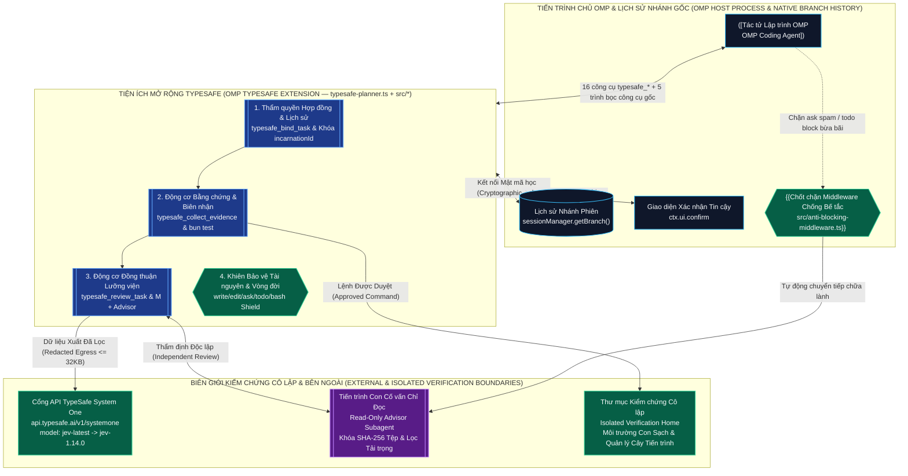

# Tiện ích Mở rộng Kiểm chứng & Lập kế hoạch TypeSafe cho OMP (`OMP TypeSafe Planner Extension — omp_extension`)

Hệ thống kiểm soát chất lượng (`Quality Control`), bảo mật (`Security`), xác thực bằng chứng theo giai đoạn (**Xác thực Nhiệm vụ theo Giai đoạn — Staged Task Verification**) và đồng thuận lưỡng viện (**Đồng thuận Lưỡng viện — Bicameral Consensus: Biểu điểm Nguyên khối `M` + Cố vấn Độc lập Chỉ Đọc `Advisor`**) dành cho tác tử lập trình [oh-my-pi (omp)](https://github.com/can1357/oh-my-pi) (`coding agents`), vận hành trên nền tảng **TypeSafe System One (`jev-latest`)**.

---

## 🏗️ Kiến trúc Tổng quan (System Architecture Overview)



---

## 🌟 Tính năng Cốt lõi (Key Capabilities)

1. **Xác thực Theo Giai đoạn & Không Chặn Preflight (`Staged Verification Workflow`)**:
   - Tách biệt hoàn toàn giai đoạn chuẩn bị bằng chứng/kiểm duyệt (`typesafe_bind_task` $\rightarrow$ `typesafe_collect_evidence` $\rightarrow$ `typesafe_review_task` $\rightarrow$ `typesafe_prepare_advisor`) khỏi lệnh `todo(op="done")` gốc.
   - Preflight của `todo done` chạy trong $<5\text{ms}$ (0 HTTP, 0 lệnh test, 0 subagent), chỉ xác nhận trạng thái `APPROVED_PENDING_COMMIT` khớp với mục tiêu và lịch sử nhánh thực tế.
2. **Đồng thuận Lưỡng viện (`Bicameral Consensus: M + Read-Only Advisor`)**:
   - Kết hợp đánh giá xác suất `noul`/`choice`/`score` của **TypeSafe System One (`M` rubric)** với biên nhận thẩm định độc lập từ **Advisor chỉ đọc (`AdvisorReceipt`)**.
   - Lưu đệm kết quả `M` hợp lệ: không gửi lại HTTP trùng lặp khi ghép thêm biên nhận Advisor hoặc khi Agent gọi lại trên cùng bằng chứng cũ.
3. **Bảo vệ Toàn vẹn Mã nguồn, Chống Gian lận Test & Cô lập `.claude`**:
   - **Gate 1 (`<150ms`, 0 token)**: Kiểm tra mã thoát test (`exitCode === 0`), phát hiện xóa assertion (`expect`/`assert`), khóa sửa đổi trái phép các file hạ tầng và ngăn chạm vào `~/.claude`.
   - **Lọc dữ liệu xuất (`typesafe-redact.cjs`)**: Tự động xóa khóa bí mật (`sk-ant-*`, Bearer, mật khẩu) nhưng vẫn bảo toàn các số nguyên đếm token (`TELEMETRY_COUNT_KEYS`: `input_tokens`, `output_tokens`, `total_tokens`).
4. **Triển khai Giao dịch & Vận hành Độc lập OMP (`tools/`)**:
   - Đồng bộ có khóa (`.omp-sync-target.lock`), nhật ký giao dịch (`.sync-journal.json`), kiểm thử cô lập và hoàn nguyên tự động trên 2 gốc (`target` và `global_omp_agents`). Tách rời hoàn toàn khỏi `.claude`.
   - Hỗ trợ cơ chế loại trừ dự án linh hoạt (`excludeProjects` trong `~/.omp/agent/typesafe.json`): dự án bị loại trừ chạy OMP gốc thuần túy, không bị chặn bởi cổng kiểm duyệt.
5. **Vòng lặp Tự trị Tam giác & Chốt chặn Middleware (`Autonomous Triad & Anti-Blocking Middleware`)**:
   - Chốt chặn `src/anti-blocking-middleware.ts` cấm tác tử spam câu hỏi `ask` về lỗi lập trình/kiểm thử đối với người dùng và cấm tự ý gọi `todo(op="block")` khi gặp lỗi có thể tự sửa.
   - Tự động triệu hồi Cố vấn Độc lập (`src/proactive-advisor-dispatch.ts`) với `decision="stuck"` để phân tích nguyên nhân gốc rễ và đề xuất kế hoạch tái cấu trúc tự động.
6. **Thẩm phán Nguyên tử Đánh giá Vi hạt (`Atomic TypeSafe Jev Judge`)**:
   - Chia nhỏ bài toán kiểm chứng thành các vị từ vi hạt độc lập qua `src/atomic-judge.ts`, `src/atomic-decision-policy.ts` và `src/atomic-parent.ts`, loại bỏ hiện tượng sai lệch cộng dồn và hỗ trợ chính sách đánh giá thế giới đóng/mở.
7. **Quản trị Kế hoạch & Sổ cái Trung tâm Chuẩn ClaudeKit (`ck:project-manager`)**:
   - Bộ công cụ `tools/ck-project-manager.cjs` đảm bảo tính kế thừa bất biến qua các phiên làm việc, tự động đối soát ngược (Sync-Back Guard), phân biệt stubs và tiêu chí chức năng, duy trì sổ cái trạng thái plan (id lấy từ tên thư mục `plans/<id>/plan.md`) tại `plans/plan-ledger.json` và `plans/README.md`.
---

## ⚡ Bắt đầu Nhanh & Vận hành One-Click (Quick Start)

### 1. Cài đặt & Chạy Kiểm thử
```bash
bun install
bun test
```

### 2. Vận hành & Kiểm chứng One-Click
Bạn có thể nhấp đúp trực tiếp các file `.bat` trong thư mục `tools/` hoặc chạy lệnh tương ứng:

| Tác vụ | File Nhấp Đúp (One-Click) | Lệnh Terminal (`bun` / `node`) |
|---|---|---|
| **Kiểm tra cài đặt 2 gốc & trạng thái ngoại tuyến** | `tools\verify-omp-global.bat` | `bun run verify:global` |
| **Kiểm tra cài đặt + Gọi thử Live JEV (tùy chọn)** | `tools\verify-omp-global.bat --live` | `bun run verify:live` |
| **Tự động Kiểm tra $\rightarrow$ Đồng bộ giao dịch 2 gốc** | `tools\oneclick-omp.bat` | `bun run oneclick` |
| **Kiểm tra thử kế hoạch đồng bộ (Dry-Run)** | — | `bun run sync:dry-run` |

---

## 📚 Bản đồ Tài liệu Toàn diện (`docs/`)

Toàn bộ tài liệu kiến trúc, mô hình hóa, đặc tả mã nguồn, luồng dữ liệu và hướng dẫn vận hành được tổ chức chuẩn hóa trong `docs/`:

| Nhóm Tài liệu | File Tài liệu | Nội dung Chính |
|---|---|---|
| **1. Tổng quan & Yêu cầu** | [`docs/project-overview-pdr.md`](docs/project-overview-pdr.md) | Tầm nhìn sản phẩm, phân loại bài toán, ma trận yêu cầu chức năng (FR) & phi chức năng (NFR), KPI. |
| | [`docs/solution-explanation.md`](docs/solution-explanation.md) | Giải thích chuyên sâu lý do thiết kế, so sánh kiến trúc và cách giải quyết 7 bài toán cốt lõi. |
| | [`docs/project-roadmap.md`](docs/project-roadmap.md) | Lộ trình phát triển qua các giai đoạn P0–P6, Red-Team Hardening và định hướng `H/atomic`. |
| **2. Kiến trúc & Thiết kế** | [`docs/system-architecture.md`](docs/system-architecture.md) | Kiến trúc tổng thể 8 tầng, ma trận can thiệp 16 công cụ, sơ đồ luồng ngang-dọc và xử lý sự cố. |
| | [`docs/SAD.md`](docs/SAD.md) | Tài liệu Kiến trúc Hệ thống (System Architecture Document) theo chuẩn C4 và biên giới bảo mật. |
| | [`docs/SDD.md`](docs/SDD.md) | Tài liệu Thiết kế Chi tiết (Software Design Document): giao diện, cấu trúc journal, giới hạn byte. |
| | [`docs/design-guidelines.md`](docs/design-guidelines.md) | Nguyên lý thiết kế: Fail-Closed, Tighten-Only Lattice, Bicameral Consensus, Advisor Isolation. |
| | [`docs/model-specification.md`](docs/model-specification.md) | Đặc tả mô hình `jev-latest` (`jev-1.14.0`), câu hỏi `noul`/`choice`/`score`, chính sách `M` vs `H`. |
| **3. Mô hình Mã nguồn & Luồng** | [`docs/codebase-summary.md`](docs/codebase-summary.md) | Bản đồ toàn bộ 100 file trong `src/`, 26 file trong `tools/`, 82 file trong `tests/`. |
| | [`docs/source-code-modeling.md`](docs/source-code-modeling.md) | Mô hình C4 (Level 1–4), sơ đồ lớp/thực thể, đồ thị phụ thuộc và 6 máy trạng thái hữu hạn (FSM). |
| | [`docs/source-code-specification.md`](docs/source-code-specification.md) | Đặc tả chi tiết từng module, hàm xuất (exports), tham số và bất biến an toàn. |
| | [`docs/source-code-logic-flow.md`](docs/source-code-logic-flow.md) | Sơ đồ tuần tự (Sequence Diagrams) và giải thuật chi tiết từ trên xuống dưới cho 7 luồng thực thi. |
| | [`docs/data-flow-and-states.md`](docs/data-flow-and-states.md) | Luồng biến đổi dữ liệu ngang-dọc, thác ngân sách byte (8MB $\rightarrow$ 32KB $\rightarrow$ 4940B) và chuyển trạng thái. |
| | [`docs/code-standards.md`](docs/code-standards.md) | Quy chuẩn mã nguồn TypeScript/CommonJS, Golden Invariant, quy tắc kiểm thử và đặt tên file. |
| **4. Triển khai, Kiểm chứng & Vận hành** | [`docs/verification-and-healthcheck-guide.md`](docs/verification-and-healthcheck-guide.md) | Ranh giới bằng chứng (Evidence Boundaries): đồng bộ trên đĩa, HTTP extension, native judge và mã được nạp. |
| | [`docs/deployment-guide.md`](docs/deployment-guide.md) | Hướng dẫn triển khai giao dịch (`sync-baseline.cjs`), cơ chế khóa/sao lưu/rollback và One-Click. |
| | [`docs/operations-and-user-guide.md`](docs/operations-and-user-guide.md) | Cẩm nang hướng dẫn sử dụng chi tiết từng công cụ, biến môi trường và quy trình làm việc. |
| | [`docs/install-global-and-other-machine.md`](docs/install-global-and-other-machine.md) | Lệnh cài native judge toàn cục, khởi chạy judge-first và cài extension sang máy khác (global installation). |
| | [`docs/native-judge-guide.md`](docs/native-judge-guide.md) | Cài lại judge bản địa (native judge), chính sách ưu tiên phán đoán (judge-first), bằng chứng smoke và giới hạn khác với extension. |
| | [`docs/research/omp-judge-sources.md`](docs/research/omp-judge-sources.md) | Nguồn nghiên cứu chính thức (official sources), kết quả quan sát và giới hạn phiên bản. |
| | [`docs/autonomous-evidence-unblocking-guide.md`](docs/autonomous-evidence-unblocking-guide.md) | Cẩm nang tự động gỡ bỏ todo dựa trên chuỗi bằng chứng kiểm thử thực nghiệm (exitCode 0, AST clean, Advisor). |
| | [`docs/typesafe-operations.md`](docs/typesafe-operations.md) | Sổ tay vận hành khẩn cấp, phục hồi task bị từ chối, EGC screening và bảo toàn telemetry. |
| | [`docs/decisions/README.md`](docs/decisions/README.md) | Danh mục các Bản ghi Quyết định Kiến trúc (ADR-2026-10-05 đến ADR-20261102). |

---

## 📄 Giấy phép (License)

MIT
