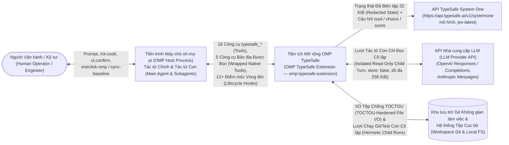
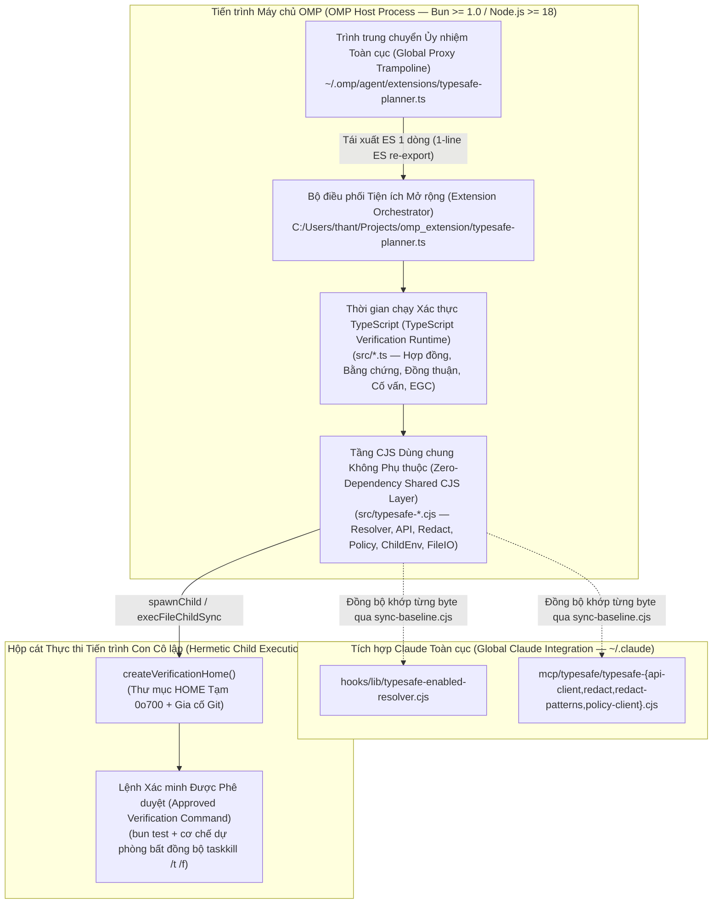
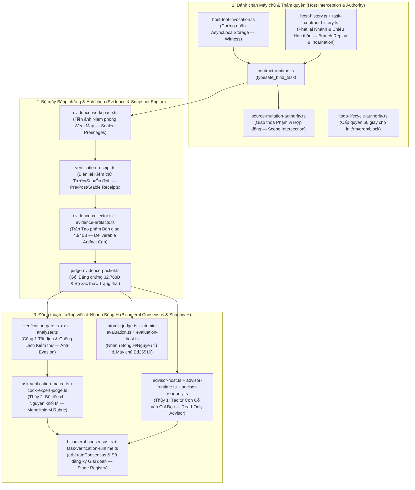
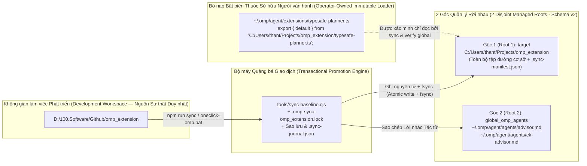

# Tài liệu Kiến trúc Hệ thống (System Architecture Document — SAD) — Tiện ích Mở rộng OMP TypeSafe (OMP TypeSafe Extension)

## 1. Tóm tắt Điều hành & Tầm nhìn Kiến trúc (Executive Summary & Architectural Vision)

**Tiện ích Mở rộng OMP TypeSafe (OMP TypeSafe Extension)** (`omp-typesafe-extension` v1.0.0) là một môi trường thực thi quản trị vòng đời, bảo mật và xác thực theo cơ chế Đóng băng An toàn khi Lỗi (Fail-Closed) dành cho các tác tử lập trình tự hành (Autonomous Coding Agents) trên nền tảng [oh-my-pi (`omp` v18.12.3)](https://github.com/can1357/oh-my-pi). Được vận hành bởi **TypeSafe System One** (`jev-latest`, phân giải thành `jev-1.14.0`) cùng với **Cố vấn Độc lập Chỉ Đọc Bản địa (Independent Read-Only Native Advisor)** (`advisor` / `ck:advisor`), tiện ích mở rộng này chuyển hóa các lời gọi công cụ của mô hình vốn không đáng tin cậy (Untrusted Model Tool Invocations) thành các quy trình kỹ thuật được ràng buộc bằng mật mã và dựa trên bằng chứng thực nghiệm (Cryptographically Bound, Evidence-Backed Engineering Workflows).

### Quy mô Tổng quan (Scale at a Glance)
- **Điểm nhập Gốc (Root Entrypoint)**: `typesafe-planner.ts` (`2,317` dòng mã — LOC)
- **Các Mô-đun Thời gian chạy Cốt lõi (`src/` — Core Runtime Modules)**: `100` mô-đun (`15,028` LOC bao gồm các tệp TypeScript, CommonJS và tệp khai báo kiểu — Declaration Files)
- **Công cụ Vận hành & Đánh giá (`tools/` — Operational & Evaluation Tools)**: `26` công cụ (Đồng bộ hóa giao dịch — Transactional Sync, Trình xác minh toàn cục 6 tầng — 6-Layer Global Verifier, Quảng bá một chạm — One-Click Promotion, Kiểm thử khói SDK — SDK Smoke Test, và Bộ kiểm chuẩn cặp `M`/`H` gồm 17 mô-đun — 17-Module Paired `M`/`H` Benchmark Suite)
- **Kịch bản Bảo trì (`scripts/` — Maintenance Scripts)**: `6` kịch bản tiện ích và di trú lịch sử (Utility/Migration Scripts)
- **Bộ Kiểm thử Xác minh (`tests/` — Verification Suite)**: `82` bộ kiểm thử tất định (`15,898` LOC, `918+` khẳng định kiểm thử đạt — Passing Assertions)

---

## 2. Các Góc nhìn Kiến trúc C4 (C4 Architectural Views)

### 2.1 C4 Cấp độ 1 — Sơ đồ Ngữ cảnh Hệ thống (C4 Level 1 — System Context Diagram)

### 2.2 C4 Cấp độ 2 — Sơ đồ Vùng chứa (C4 Level 2 — Container Diagram)

### 2.3 C4 Cấp độ 3 — Sơ đồ Thành phần (C4 Level 3 — Component Diagram)

---

## 3. Các Trụ cột Kiến trúc Cốt lõi (Core Architectural Pillars)

### 3.1 Trụ cột 1: Xác thực theo Giai đoạn & Tiền kiểm Bản địa Không HTTP (Staged Verification & Zero-HTTP Native Preflight)
Các điểm móc tác tử truyền thống (Traditional Agent Hooks) thường thực thi các bộ kiểm thử và lời gọi LLM ngay bên trong điểm móc của công cụ `todo`, gây ra hiện tượng treo công cụ nhiều giây (Multi-Second Tool Stalls), điều kiện tranh chấp (Race Conditions) và trạng thái dở dang không thể khôi phục. `omp_extension` thực thi một **đường ống ngoại hóa gồm 4 giai đoạn (4-Stage Externalized Pipeline)**:
1. **`typesafe_bind_task`**: Đóng băng chính xác mã định danh hóa thân `incarnationId = canonicalDigest({ creation, target })` từ `sessionManager.getBranch()`, ràng buộc yêu cầu gốc của người dùng (`role:user`) cùng các tiêu chí giai đoạn trong tệp Markdown, đồng thời chụp lại đường cơ sở `WorkspaceSnapshot` trước nhiệm vụ (Pre-Task Baseline).
2. **`typesafe_collect_evidence`**: Chạy các lệnh xác minh được phê duyệt (`collectVerificationReceipt`), tính toán độ lệch điểm cuối gắn với nhiệm vụ (`taskSnapshotDiff` sử dụng các tiền ảnh được lưu giữ nhằm loại trừ các tệp bẩn đã tồn tại từ trước), đóng gói các tạo phẩm gắn với nhiệm vụ trong giới hạn `DELIVERABLE_ARTIFACT_MAX_BYTES = 4,940` byte, và niêm phong một gói `JudgeEvidencePacket` ($\le 32,768$ byte).
3. **`typesafe_review_task`**: Thực thi các kiểm tra tất định tại Cổng 1 (Gate 1 Deterministic Checks) và bộ tiêu chí nguyên khối `M` tại Cổng 2 (Gate 2 Monolithic `M` Rubric), sau đó kết hợp với biên lai cố vấn đã lắng đọng (`AdvisorReceipt`) để dàn dựng một giai đoạn xác thực trong bộ nhớ theo danh tính đối tượng `NativeTaskVerificationStage` (`APPROVED_PENDING_COMMIT`).
4. **Tiền kiểm & Lắng đọng `todo(op="done")` Bản địa (Native `todo(op="done")` Preflight & Settlement)**: Lớp bọc `todo` bản địa thực thi trong $<5\text{ms}$ với **không lời gọi HTTP, không lệnh shell và không suy luận tiến trình con (Zero HTTP, Zero Shell, Zero Child Reasoning)**. Việc chốt trạng thái cuối cùng (`reconcileNativeCommits`) chỉ diễn ra sau khi dòng kết quả `toolResult` của công cụ `todo` bản địa bên ngoài đã được ghi nhận bền vững trong `readHostBranch(ctx)`.

### 3.2 Trụ cột 2: Đồng thuận Lưỡng viện (Bicameral Consensus — Bộ tiêu chí Nguyên khối `M` + Cố vấn Chỉ Đọc)
Việc hoàn thành nhiệm vụ đòi hỏi sự đồng thuận giữa hai thùy nhận thức độc lập về mặt kiến trúc (Architecturally Independent Cognitive Lobes):
- **Thùy 2 (`M` — TypeSafe System One `jev-latest`)**: Đánh giá gói bằng chứng toàn nhiệm vụ duy nhất `JudgeEvidencePacket` qua các chiều `deliverables_verdict`, `meets_criteria` (`noul`), `architectural_drift`, `scope_mode` và mức độ thỏa mãn từng tiêu chí (`criterion_0..N`).
- **Thùy 1 (`Advisor` — Tác tử Con Bản địa Chỉ Đọc)**: Kiểm tra ngữ cảnh đánh giá công khai đã biên tập bảo mật và các tệp trong không gian làm việc được cấp phép thông qua các lệnh `read`/`grep`/`glob` có bảo vệ khớp mã băm SHA chính xác (Exact-SHA Guarded Reads), tạo ra bản đánh giá JSON nghiêm ngặt `AdvisorAssessment`.
- **Bộ nhớ đệm Đơn luồng & Phân xử Đóng băng An toàn khi Lỗi (Single-Flight Caching & Fail-Closed Arbitration — `arbitrateConsensus`)**: Khi `M` phê duyệt trước, `typesafe_review_task` trả về `REVIEW_REQUIRED`. Sau khi tác tử cha thực thi công cụ `task` bản địa đã được chuẩn bị bởi `typesafe_prepare_advisor`, lời gọi `typesafe_review_task` lần thứ hai sẽ tái sử dụng kết quả `M` đã lưu đệm (miễn là `progressDigest` không đổi) và kết hợp với biên lai `AdvisorReceipt` đã lắng đọng. Bất kỳ sự bất đồng nào giữa hai thùy (`proceed` so với `REJECT` hoặc `block` so với `APPROVE`) đều không bao giờ ghi đè lên đánh giá của nhau mà lập tức leo thang lên `HUMAN_REQUIRED`.

### 3.3 Trụ cột 3: Thẩm quyền Lịch sử Bản địa bằng Mật mã (Cryptographic Native History Authority)
Các tham số do mô hình cung cấp được coi là những đề xuất không đáng tin cậy (Untrusted Proposals). Mọi bước chuyển trạng thái đều được suy dẫn trực tiếp từ `ctx.sessionManager.getBranch()`:
- **Chứng nhân Thực thi (Execution Witnesses — `src/host-tool-invocation.ts`)**: Mọi công cụ được đăng ký đều chạy bên trong một khung `AsyncLocalStorage` nhằm ghi nối thêm một mục tùy chỉnh mang số ngẫu nhiên định danh một lần (`omp.typesafe.tool-execution.v1`), được kết nối (Join) với các thông điệp `toolCall` và `toolResult` đã lắng đọng của SDK thông qua `validateProjectToolInvocationJoin`.
- **Nguồn gốc Hóa thân (Incarnation Provenance — `src/task-contract-native.ts`)**: Theo dõi chính xác các bước chuyển con trỏ `todo` của Oh-My-Pi v18.12.3 (`init`, `append`, `done`, `drop`, `rm`, `start`, `block`, `unblock`). Bất kỳ thao tác chỉnh sửa thủ công nào (`user_todo_edit`) hoặc `toolResult` không khớp đều lập tức chuyển cờ `nativeStateReliable = false`.
- **Giao thoa Phạm vi Hợp đồng (Contract Scope Intersection — `src/source-mutation-authority.ts`)**: Khi có nhiều hợp đồng đang hoạt động cùng lúc, `currentSourceMutationGrant` lấy phép giao (Intersection) của cả `operations` lẫn `paths` trên toàn bộ các hợp đồng áp dụng để quyền thao tác của Hợp đồng A không bao giờ có thể áp dụng lên đường dẫn của Hợp đồng B.

### 3.4 Trụ cột 4: Cô lập Nghiêm ngặt Tác tử Con Cố vấn (Strict Advisor Subagent Isolation)
Hệ thống con Cố vấn (`src/advisor-*.ts`) thực thi cơ chế chạy chỉ đọc cô lập hoàn toàn (Hermetic Read-Only Execution):
- **Không Ngữ cảnh Môi trường Xung quanh (No Ambient Context)**: Các điểm móc `context` và `before_provider_request` thay thế toàn bộ lịch sử hội thoại bằng `publicAdvisorMessages(request)` (`[{ role: "user", content: request.publicPrompt }]`) và chiếu tải trọng qua `projectAdvisorPayload` (chỉ cho phép danh sách ghim cứng `advisorProviderApis`, ép buộc `store = false`, loại bỏ mô tả công cụ và giới hạn ngữ cảnh ở mức `262,144` byte).
- **Đọc Bảo vệ bằng SHA Chính xác (Exact-SHA Guarded Reads)**: `executeAdvisorRead` chỉ cho phép `{ read, grep, glob, yield }`, bắt buộc đường dẫn tương đối tường minh kèm bộ chọn dòng `:start-end` trên công cụ `read`, giới hạn `grep` ở chuỗi con nguyên bản (Literal Substrings), và xác minh mã băm SHA-256 hiện tại trên đĩa của mọi tệp được truy cập phải khớp với `request.scope.files` (nếu lệch sẽ phát lỗi `advisor_evaluated_file_changed` và hủy hiệu lực bản đánh giá).
- **Ngân sách & Xả Luồng (Budget & Stream Drain)**: `createAdvisorNativeBudget` thực thi trần ngân sách của `SemanticReviewScheduler` và xả sạch các luồng bản địa bị quá thời gian hoặc gặp lỗi trong vòng `250ms` (`advisor_native_drain_timeout`).

### 3.5 Trụ cột 5: Triển khai Giao dịch & Bằng chứng Nguồn gốc Thời gian chạy (Transactional Deployment & Runtime-Origin Proof)
Công cụ `tools/sync-baseline.cjs` triển khai các thay đổi trên 2 gốc quản lý rời nhau (`target`, `global_omp_agents`) theo Bản kê Schema v2 (độc lập hoàn toàn khỏi `.claude`) trong khi vẫn giữ `~/.omp/agent/extensions/typesafe-planner.ts` làm một **Trình trung chuyển Ủy nhiệm Bất biến 1 dòng (Immutable 1-Line Proxy Trampoline)**:
- Chiếm khóa độc quyền (`.omp-sync-<target>.lock`) và **xác minh lại mã băm kế hoạch triển khai sau khi khóa** (`deployment plan changed after lock`) nhằm đóng kín các cửa sổ tranh chấp (Race Windows).
- Dàn dựng các tệp, ghi bản sao lưu tiền ảnh (Preimage Backups) và tệp nhật ký `.sync-journal.json` (`IN_PROGRESS` $\rightarrow$ `DEPLOYED_VERIFIED`), chạy `bun test` bên trong `createVerificationHome()`, và thực thi hoàn tác theo thứ tự ngược (`RECOVERED`) nếu có bất kỳ lỗi nào.

### 3.6 Trụ cột 6: Môi trường Tiến trình Con Cô lập & I/O Tệp Chống TOCTOU (Hermetic Child Environment & TOCTOU-Hardened File I/O)
- **Danh sách Trắng Môi trường Tiến trình Con (Child Environment Allowlisting — `src/typesafe-child-env.cjs`)**: Giới hạn các tiến trình con trong 7 mục đích tường minh (`evidence-git`, `verification`, `egc-setup`, `deployment-acl`, `deployment-verify`, `deployment-sync`, `pointer-editor`), loại bỏ mọi biến môi trường chứa bí mật, chặn bất kỳ biến môi trường được phép nào (như `PATH` hoặc `TEMP`) có chứa chuỗi con giá trị bí mật (`UNSAFE_ALLOWED_VALUE`), và vô hiệu hóa các điểm móc/thông tin xác thực Git (`GIT_CONFIG_NOSYSTEM=1`, `core.hooksPath=NUL|/dev/null`).
- **Trình đọc Tệp Gia cố Chống TOCTOU (TOCTOU-Hardened File Reader — `src/typesafe-evidence-file.cjs`)**: Xác minh chuỗi thư mục cha bằng lệnh gọi `realpathSync.native` đơn lẻ (`inspectDirectoryChain`) và kiểm tra các thuộc tính BigInt `dev/ino/mode/nlink===1n` trước khi mở, ngay trên bộ mô tả tệp đã mở (`O_RDONLY | O_NOFOLLOW`), và sau khi đọc, đồng thời chặn vô điều kiện bất kỳ phân đoạn đường dẫn nào chứa `.claude` (`UNSAFE_PATH`).

---

## 4. Phân rã Đầy đủ 100 Mô-đun `src/` + `tools/` + `scripts/` (Complete Module Breakdown)

### 4.1 Thời gian chạy CJS Không Phụ thuộc Dùng chung & Khai báo Kiểu (`src/` — 9 tệp)

| # | Đường dẫn Tệp (File Path) | Các Xuất khẩu / Ký hiệu Chính (Key Exports / Symbols) | Trách nhiệm (Responsibility) |
|---|---|---|---|
| 1 | `src/typesafe-enabled-resolver.cjs` | `resolveTypeSafeEnabled`, `findGitRoot`, `readGlobalConfig`, `isValidExcludeList` | Bộ phân giải đăng ký tham gia (Opt-in Resolver) đồng bộ theo cơ chế đóng băng an toàn khi lỗi, chỉ đọc `~/.omp/agent/typesafe.json` + `TYPESAFE_API_KEY`. |
| 2 | `src/typesafe-api-client.cjs` | `judgeTypeSafe`, `prepareRequest`, `redactEvidenceState`, `sanitizeAnswers`, `RETRY_POLICY` | Trình khách HTTP System One (`jev-latest`), bộ bảo vệ thân gói 32 KiB, phép chiếu thông điệp công khai, thử lại lỗi 429/529 & thời gian hồi 45 giây. |
| 3 | `src/typesafe-redact.cjs` | `preparePayload`, `redactPayload`, `TELEMETRY_COUNT_KEYS` | Biên tập che giấu bí mật nhận biết cấu trúc (Shape-Aware Secret Redaction), bảo vệ khóa khứ hồi, bảo toàn bộ đếm token viễn trắc, cắt ngắn kiểu điền nước (Water-Filling Truncator). |
| 4 | `src/typesafe-redact-patterns.cjs` | `redactString`, `detectSecret`, `capBytes`, `sensitiveKeyKind`, `sensitiveCamelKeyKind` | Biểu thức chính quy tuyến tính cho token/PEM/JWT/KV, bộ quét entropy Shannon, bộ làm sạch thư mục người dùng, bộ giới hạn byte UTF-8. |
| 5 | `src/typesafe-policy-client.cjs` | `resolveTrustedToolPolicy`, `checkPolicy`, `judgeWithPolicy`, `createSemanticReviewScheduler` | Ảnh chụp chính sách niêm phong bằng `WeakSet` cho 14 mục đích, bộ xác thực lưới chỉ thắt chặt (Tighten-Only Lattice), bộ lập lịch đánh giá 128 gói. |
| 6 | `src/typesafe-child-env.cjs` | `buildChildEnvironment`, `spawnChild`, `spawnChildSync`, `createVerificationHome` | Bộ tạo môi trường tiến trình con theo danh sách trắng mục đích, chặn chuỗi con giá trị bí mật, gia cố Git, thư mục xác minh tạm quyền `0o700`. |
| 7 | `src/typesafe-child-env.d.cts` | Khai báo kiểu TypeScript (TypeScript Declarations) | Định nghĩa kiểu tĩnh cho mô-đun `typesafe-child-env.cjs`. |
| 8 | `src/typesafe-evidence-file.cjs` | `readWorkspaceFile`, `listWorkspaceFiles`, `writeRecoveryReport`, `WorkspaceFileError` | Trình đọc tệp, trình duyệt cây thư mục chống TOCTOU bằng BigInt `inode/nlink/realpath` và trình ghi báo cáo khôi phục quyền `0o600`. |
| 9 | `src/typesafe-evidence-file.d.cts` | Khai báo kiểu TypeScript (TypeScript Declarations) | Định nghĩa kiểu tĩnh cho mô-đun `typesafe-evidence-file.cjs`. |

### 4.2 Thẩm quyền Lịch sử Bản địa, Hợp đồng Nhiệm vụ & Phạm vi Đột biến (`src/` — 19 tệp)

| # | Đường dẫn Tệp (File Path) | Các Xuất khẩu / Ký hiệu Chính (Key Exports / Symbols) | Trách nhiệm (Responsibility) |
|---|---|---|---|
| 10 | `src/host-history.ts` | `readHostBranch`, `validateProjectToolInvocationJoin`, `validateSourceSpan`, `projectHostHistory` | Trình đọc nhánh trực tiếp (`<=100,000` mục), bộ xác thực phép nối lời gọi/kết quả công cụ, và bộ xác minh khoảng dòng nguồn (`SourceSpan`). |
| 11 | `src/host-tool-invocation.ts` | `createHostToolInvocationRuntime`, `HOST_TOOL_INVOCATION_ENTRY` | Chứng nhân thực thi dựa trên `AsyncLocalStorage` ghi nối mục `omp.typesafe.tool-execution.v1`. |
| 12 | `src/contract-runtime.ts` | `createContractRuntime` | Triển khai `typesafe_bind_task`, kết nối lịch sử nhánh, đầu vào `/ck:cook` và xác nhận giao diện người dùng để đúc kết `TaskContract`. |
| 13 | `src/task-contract.ts` | `createTaskContract`, `reviseTaskContract`, `taskIncarnationId`, `contractRevisionDigest` | Nhà máy khởi tạo `TaskContract` bất biến cốt lõi và các hàm tính toán mã băm (Digest Calculators). |
| 14 | `src/task-contract-source.ts` | `canonicalDigest`, `contractDigest`, `parseContractCriteria`, `freezeContractValue` | Băm chuẩn hóa SHA-256 (Canonical Hashing), bộ phân tích tiêu chí Markdown và đóng băng sâu đệ quy (Recursive Deep-Freeze). |
| 15 | `src/task-contract-history.ts` | `projectContractHistory`, `createContractHistoryRecord`, `CONTRACT_HISTORY_CUSTOM_TYPE` | Phát lại các mục nhánh (`omp.typesafe.contract.v1`) để chiếu các giai đoạn, hóa thân, hợp đồng và khoản nợ. |
| 16 | `src/task-contract-native.ts` | `captureNativeCall`, `applyNativeResult` | Ghép cặp các lời gọi `todo` của trợ lý với `toolResult` đã lắng đọng và theo dõi các hóa thân `creationKnown`. |
| 17 | `src/task-contract-input.ts` | `normalizeNativeTodoInput`, `nativeTodoInputDigest`, `readNativeTodoOperation` | Chuẩn hóa các đối số `todo` trên đường truyền và tính toán mã băm đầu vào chuẩn tắc. |
| 18 | `src/task-contract-transition.ts` | `validateNativeTodoTransition`, `normalizeNativeTodoPointer`, `parseNativeTodoPhases` | Mô phỏng chính xác quy tắc thăng cấp con trỏ và chuyển trạng thái `todo` của Oh-My-Pi v18.12.3. |
| 19 | `src/task-contract-integrity.ts` | `assertContractIntegrity` | Bộ xác thực cấu trúc biên cho các bất biến của `TaskContract` và `SourceSpan`. |
| 20 | `src/task-contract-review.ts` | `validateReviewBinding` | Xác thực `ReviewBinding` trên các mục đích `task_review`, `parent_review`, `consultation` và `shadow`. |
| 21 | `src/task-contract-cook-input.ts` | `captureCookInput`, `readCookInputObservations` | Thu nhận các quan sát đầu vào người dùng `/ck:cook --auto` và chụp nhanh tệp kế hoạch/giai đoạn trước khi bung kỹ năng. |
| 22 | `src/task-contract-runtime-journal.ts` | `readContractRuntimeJournal` | Đọc và xác thực các mục nhật ký `omp.typesafe.contract.source.v1` và `omp.typesafe.contract.confirmation.v1`. |
| 23 | `src/task-contract-runtime-provenance.ts` | `activeContractBindingCall`, `originalHostTaskRequest`, `currentNativeContractTarget` | Phân giải các đề xuất `typesafe_bind_task` đang hoạt động và câu lệnh `role:user` xác thực đứng trước đó. |
| 24 | `src/task-contract-runtime-sources.ts` | `resolveParentSource`, `trustedNativeTaskKind`, `approvedContractScope` | Phân giải các tệp kế hoạch/giai đoạn trong không gian làm việc, phân loại `taskKind` và tính toán `allowedMutationScope`. |
| 25 | `src/task-contract-runtime-types.ts` | `CONTRACT_SOURCE_CUSTOM_TYPE`, `CONTRACT_CONFIRMATION_CUSTOM_TYPE` | Định nghĩa kiểu và hằng số mục tùy chỉnh cho thời gian chạy hợp đồng. |
| 26 | `src/source-mutation-authority.ts` | `currentSourceMutationGrant`, `sourceMutationAllowed` | Lấy phần giao của `operations` và `paths` giữa các hợp đồng đang hoạt động để cấp phép đột biến tệp. |
| 27 | `src/file-mutation-targets.ts` | `extractFileMutationTargets` | Trích xuất đường dẫn tệp đích và lược đồ URI từ đối số của các công cụ `write`, `edit` và vá lỗi. |
| 28 | `src/plan-closure.ts` | `assertScopedPlanClosure`, `parsePlanCliCheck`, `PlanClosurePrerequisiteError` | Chặn việc đánh dấu hoàn tất `plan.md`/`phase-*.md` qua `write`/`edit`/`bash` cho đến khi các nhiệm vụ ràng buộc đã được xác thực. |

### 4.3 Bằng chứng Gắn với Nhiệm vụ, Ảnh chụp & Biên lai Xác minh (`src/` — 8 tệp)

| # | Đường dẫn Tệp (File Path) | Các Xuất khẩu / Ký hiệu Chính (Key Exports / Symbols) | Trách nhiệm (Responsibility) |
|---|---|---|---|
| 29 | `src/task-evidence-runtime.ts` | `createTaskEvidenceRuntime` | Thời gian chạy phiên cho `typesafe_collect_evidence`, chụp đường cơ sở, kiểm tra độ mới và `typesafe_retrieve_evidence`. |
| 30 | `src/evidence-workspace.ts` | `captureWorkspaceSnapshot`, `taskSnapshotDiff`, `SNAPSHOT_LIMITS` | Chụp ảnh không gian làm việc Git/phi-Git đã niêm phong, lưu giữ tiền ảnh trong `WeakMap` (trần 32 MiB) và tính độ lệch điểm cuối. |
| 31 | `src/evidence-collector.ts` | `collectTaskEvidence`, `executeTestCommand`, `DELIVERABLE_ARTIFACT_MAX_BYTES` (`4940`) | Chạy các lệnh xác minh (với `taskkill /t /f` bất đồng bộ trên Windows + bộ hẹn giờ dự phòng 5 giây) và thu thập mã nguồn theo phạm vi. |
| 32 | `src/evidence-artifacts.ts` | `collectTaskArtifacts`, `taskArtifactAssociation`, `referencedWorkspacePaths` | Phát hiện, chấm điểm và đóng gói các tạo phẩm nhiệm vụ trong ngân sách 4.940 byte. |
| 33 | `src/evidence-selection.ts` | `retrieveEvidenceSource`, `selectCriterionEvidence` | Trích xuất các khoảng dòng đánh số từ 1 tăng dần nghiêm ngặt từ mã nguồn ảnh chụp đã lưu đệm. |
| 34 | `src/evidence-privacy.ts` | `isPrivateEvidencePath` | Chặn các đường dẫn riêng tư/chứa thông tin xác thực trước khi trộn hoặc tuần tự hóa bằng chứng. |
| 35 | `src/verification-receipt.ts` | `collectVerificationReceipt`, `validateVerificationReceipt`, `issueAuthorizedMutationReceipt` | Thực thi các lệnh kiểm thử được phê duyệt giữa các ảnh chụp trước/sau/ổn định và cấp biên lai niêm phong bằng `WeakMap`. |
| 36 | `src/judge-evidence-packet.ts` | `buildJudgeEvidencePacket`, `buildJudgeEvidencePacketSet`, `createEvidenceStateValidator` | Lắp ráp các gói `JudgeEvidencePacket` giới hạn 32.768 byte và xác thực tính đồng nhất của trạng thái HTTP đã chuẩn bị. |

### 4.4 Xác thực theo Giai đoạn, Đồng thuận Lưỡng viện & Các Bộ Đánh giá (`src/` — 25 tệp)

| # | Đường dẫn Tệp (File Path) | Các Xuất khẩu / Ký hiệu Chính (Key Exports / Symbols) | Trách nhiệm (Responsibility) |
|---|---|---|---|
| 37 | `src/task-verification-runtime.ts` | `createTaskVerificationRuntime` | Điều phối `typesafe_review_task`, chốt chặn thử lại cùng bằng chứng, kết hợp Cố vấn và tiền kiểm/chốt `done` bản địa. |
| 38 | `src/task-verification-macro.ts` | `evaluateMonolithicTask` | Thực thi độ bao phủ gói nhiệm vụ hoàn chỉnh duy nhất và gọi `runPhaseMacroCheck`. |
| 39 | `src/task-verification-native.ts` | `createNativeStageRegistry` | Sổ đăng ký dàn dựng theo danh tính đối tượng cho chu trình `APPROVED_PENDING_COMMIT` $\rightarrow$ `observe` $\rightarrow$ `commit`. |
| 40 | `src/task-verification-state.ts` | `taskReviewSnapshot`, `taskRecoveryProgress`, `stateProgressDigest` | Tính toán mã băm tiến độ ở cấp độ tiêu chí được sử dụng bởi các chốt chặn chống thử lại. |
| 41 | `src/task-verification-history.ts` | `createVerificationHistory`, `VERIFICATION_FACTS_ENTRY` | Lưu trữ bền vững và truy vấn các mục nhánh `omp.typesafe.task-verification-facts.v1`. |
| 42 | `src/task-verification-historical.ts` | `createHistoricalDebtResolver` | Triển khai `typesafe_resolve_historical_debt` với `ctx.ui.confirm` cho các hóa thân đã đóng. |
| 43 | `src/task-verification-debt.ts` | `historicalDebtCatalogue` | Tổng hợp các bản ghi `semantic_rejection`, `contract_debt` và `unclassified_native_failure`. |
| 44 | `src/task-verification-debt-types.ts` | `HistoricalDebtCatalogue`, `HistoricalDebtResolutionFact` | Định nghĩa kiểu cho danh mục nợ lịch sử và dữ kiện giải quyết nợ. |
| 45 | `src/task-verification-advisor.ts` | `createTaskAdvisorServices` | Cầu nối giữa `TaskVerificationRuntime` và `AdvisorHostServices` qua các chế độ đánh giá và tham vấn. |
| 46 | `src/task-verification-invocation.ts` | `verificationInvocationSource` | Phân giải các chứng nhân `HostToolInvocation` đang hoạt động hoặc đã lưu trữ cho các lượt đánh giá. |
| 47 | `src/task-verification-plan.ts` | `planPhaseReviewDigest`, `usablePlanPhaseReview` | Tính toán và xác thực mã băm cho các lượt đánh giá giai đoạn kế hoạch ở chế độ tham vấn. |
| 48 | `src/task-verification-types.ts` | `TaskVerificationRuntime`, `NativeTaskVerificationStage`, `TaskReviewOutcome` | Các giao diện cốt lõi cho thời gian chạy và kết quả xác thực nhiệm vụ. |
| 49 | `src/todo-lifecycle-authority.ts` | `createTodoLifecycleAuthority`, `LIFECYCLE_RECOVERY_ENTRY` | Triển khai `typesafe_prepare_todo_mutation` (`omp.typesafe.lifecycle-recovery.v1`) và quyền hạn có thời hạn 60 giây. |
| 50 | `src/task-recovery.ts` | `createTaskRecoveryPolicy`, `recoveryProgressDigest`, `createRejectionDebt` | Tổng hợp các kế hoạch khôi phục `RecoveryPlan` theo thứ tự phụ thuộc (`diagnose` $\rightarrow$ `execute` $\rightarrow$ `verify` $\rightarrow$ `review` $\rightarrow$ `reevaluate`). |
| 51 | `src/bicameral-consensus.ts` | `arbitrateConsensus`, `evaluateBicameralDoneConsensus`, `evaluateAdvisorIntent` | Bộ máy đồng thuận lưỡng viện kết hợp `AdvisorReceipt` và `JevResult`. |
| 52 | `src/verification-gate.ts` | `checkDeterministicPreconditions`, `verifyTaskCompletion` | Các kiểm tra tất định Cổng 1 và cổng xác thực độc lập Cổng 2. |
| 53 | `src/cook-expert-judge.ts` | `runTaskMicroCheck`, `runPhaseMacroCheck`, `evaluateScopeArbiter`, `evaluateDriftGuard`, `evaluateRiskSecurityTriage` | Bộ chạy kiểm tra vĩ mô, xác minh hủy bỏ nhiệm vụ và Bộ Đánh giá Chuyên gia Ba Vai trò (Tri-Role Expert Evaluators). |
| 54 | `src/plan-evaluator.ts` | `evaluatePlanDraft` | Bộ đánh giá kế hoạch về mặt cấu trúc và ngữ nghĩa (`purpose: "plan"`, giới hạn 32 KiB, `algorithm_depth >= 2`). |
| 55 | `src/debate-evaluator.ts` | `runMultiPersonaDebate` | Bộ đánh giá tranh luận 5 nhân cách tiền triển khai (`architect`, `security`, `performance`, `ux`, `devils_advocate`). |
| 56 | `src/semantic-judge-client.ts` | `createSemanticJudgeClient` | Bộ chuyển đổi TypeScript bọc `typesafe-policy-client.cjs` và `typesafe-api-client.cjs`. |
| 57 | `src/semantic-approval-policy.ts` | `createSemanticApprovalPolicy`, `passesSemanticApproval` | Chính sách ngưỡng phê duyệt niêm phong bằng `WeakSet` (`TYPESAFE_AUTO_APPROVAL_THRESHOLD`). |
| 58 | `src/semantic-failure.ts` | `semanticFailureDisposition` | Ánh xạ các mã lỗi truyền tải/xác thực sang `EVIDENCE_REQUIRED` hoặc `UNAVAILABLE`. |
| 59 | `src/ast-analyzer.ts` | `analyzeDiffForTestEvasion` | Phát hiện hành vi xóa khẳng định kiểm thử, bỏ qua bài kiểm thử, chú thích vô hiệu hóa spec và biểu thức hằng đúng trong bản diff. |
| 60 | `src/remediation-generator.ts` | `generateRemediationBlock`, `synthesizePlanDelta` | Tạo các khối XML `<remediation>` và `<plan_reconciliation>`. |
| 61 | `src/xml-enclosure.ts` | `sanitizeXmlText`, `encloseUntrusted` | Làm sạch các chuỗi tiêm lệnh (Prompt Injection) và thoát các thẻ đóng XML trong văn bản không tin cậy. |

### 4.5 Hệ thống con Cố vấn Bản địa Chỉ Đọc (`src/` — 19 tệp)

| # | Đường dẫn Tệp (File Path) | Các Xuất khẩu / Ký hiệu Chính (Key Exports / Symbols) | Trách nhiệm (Responsibility) |
|---|---|---|---|
| 62 | `src/advisor-protocol.ts` | `createAdvisorRequest`, `makeAdvisorReceipt`, `validateAdvisorReceipt`, `advisorOutputSchema`, `foldAdvisorHistory` | Định nghĩa `AdvisorRequest`, `AdvisorAssessment`, `AdvisorReceipt` và các bất biến khả dụng của `parentIntegration`. |
| 63 | `src/advisor-runtime.ts` | `createAdvisorRuntime` | Máy trạng thái cốt lõi cho việc chuẩn bị Cố vấn, cấp phát tác tử con, trung gian lệnh đọc và tạo biên lai. |
| 64 | `src/advisor-host.ts` | `registerAdvisorHost`, `supportsAdvisorHost` | Đăng ký `typesafe_prepare_advisor` và `typesafe_advisor`, đồng thời bọc `task`, `read`, `grep`, `glob`, `todo`. |
| 65 | `src/advisor-host-types.ts` | `AdvisorHostAPI`, `AdvisorHostServices`, `AdvisorHostRegistration` | Các giao diện cho tích hợp máy chủ Cố vấn và các dịch vụ `todo` bản địa. |
| 66 | `src/advisor-host-dispatch.ts` | `prepareHostReview`, `prepareHostShadowReview`, `executeHostTask` | Quản lý các thẻ đánh giá tạm thời (Provisional Review Tokens), ràng buộc tham số `task` bản địa và điều phối theo ngân sách. |
| 67 | `src/advisor-host-hooks.ts` | `installAdvisorHostHooks` | Cài đặt các điểm móc khởi tạo tiến trình con, bắt đầu tác tử, ngữ cảnh, tải trọng nhà cung cấp và trung gian công cụ. |
| 68 | `src/advisor-host-state.ts` | `getHostScope`, `routeChild`, `rotateHostScope`, `ADVISOR_HOST_ENTRY` | Quản lý `HostScope`, `ChildRoute`, `advisorDispatchFrame` và các mục `typesafe:advisor:host:v1`. |
| 69 | `src/advisor-host-history.ts` | `hasSettledAdvisorHistory` | Xác minh rằng một `AdvisorReceipt` được hậu thuẫn bởi một `toolResult` đã lắng đọng không xung đột trong lịch sử nhánh. |
| 70 | `src/advisor-host-settlement.ts` | `collectAdvisorHostSettlement`, `ownsAdvisorHostSettlement` | Thu thập và xác thực bằng `WeakMap` các dòng `task` bản địa đã lắng đọng cho các trình tiêu thụ bóng/máy chủ. |
| 71 | `src/advisor-native-budget.ts` | `createAdvisorNativeBudget` | Thực thi kiểm soát thu nhận của `SemanticReviewScheduler`, thời hạn hoàn thành và xả luồng 250ms khi quá hạn/lỗi. |
| 72 | `src/advisor-native-observation.ts` | `captureAdvisorNativeObservation`, `decodeAdvisorNativeObservation` | Thu nhận mức sử dụng token, chi phí, thời lượng và siêu dữ liệu mô hình của tiến trình con do SDK báo cáo. |
| 73 | `src/advisor-native-prompt.ts` | `nativeAdvisorPrompt`, `ADVISOR_NATIVE_CONTEXT`, `ADVISOR_SOLUTION_SPACE` | Định dạng các nhiệm vụ JSON một dòng thành lời nhắc tác tử con ghim cứng cho phiên bản v18.12.3. |
| 74 | `src/advisor-native-schema.ts` | `advisorNativeTaskCapabilities`, `advisorNativeParameters`, `validAdvisorNativeControls` | Kiểm tra hình dạng lược đồ `task` bản địa kiểu `batch` so với `flat` và xác thực các tham số điều khiển chỉ đọc. |
| 75 | `src/advisor-native-todo.ts` | `executeAdvisorNativeTodo` | Bọc quá trình thực thi `todo` bản địa bằng bước tiền kiểm `beforeExecute` và quan sát `afterExecute`. |
| 76 | `src/advisor-public-context.ts` | `prepareAdvisorPublicContext`, `prepareAdvisorConsultationContext` | Biên tập bảo mật và giới hạn kích thước lời nhắc đánh giá/tham vấn công khai (mặc định `262,144` byte). |
| 77 | `src/advisor-read-session.ts` | `createAdvisorReadSession` | Theo dõi việc cấp phép, thực thi và kết quả `toolResult` đã công bố cho từng lệnh gọi `read`/`grep`/`glob`. |
| 78 | `src/advisor-readonly.ts` | `authorizeAdvisorRead`, `executeAdvisorRead`, `defaultAdvisorReadLimits` | Thực thi các lệnh `read`/`grep`/`glob` có bảo vệ trên các tệp được cấp phép khớp SHA chính xác (trần `16,384` B mỗi lệnh). |
| 79 | `src/advisor-guards.ts` | `advisorProviderApis`, `projectAdvisorPayload`, `guardAdvisorTool`, `publicAdvisorMessages` | Chiếu các tải trọng nhà cung cấp đã làm sạch (`store: false`) và chặn các công cụ tiến trình con trái phép. |
| 80 | `src/advisor-mutation-delegation.ts` | `createNativeMutationDelegation` | Lan truyền quyền `NativeMutationScopeGrant` qua các lần khởi tạo tác tử con không phải Cố vấn theo phả hệ phiên. |

### 4.6 Đánh giá Nhánh Bóng `H/Atomic`, EGC & Các Tiện ích Cốt lõi (`src/` — 20 tệp)

| # | Đường dẫn Tệp (File Path) | Các Xuất khẩu / Ký hiệu Chính (Key Exports / Symbols) | Trách nhiệm (Responsibility) |
|---|---|---|---|
| 81 | `src/advisor-shadow.ts` | `validateShadowAdvisorReview`, `shadowAdvisorDispatchId` | Xác thực các ràng buộc Cố vấn nhánh bóng chỉ đọc và mã băm khuôn mẫu. |
| 82 | `src/atomic-checks.ts` | `runAtomicDeterministicChecks` | Đánh giá các kiểm tra tất định (`exit_status`, `digest`, `exact`) cho các lượt đánh giá nguyên tử `H`. |
| 83 | `src/atomic-decision-policy.ts` | `resolveAtomicDecisionPolicy`, `decideAtomicNoul` | Đánh giá các vị từ `noul` theo các chế độ `support_only`, `counterevidence_only` và `closed_world_boolean`. |
| 84 | `src/atomic-preparation.ts` | `prepareAtomicInput` | Xây dựng các `PredicateSpec` con và `DeterministicCheck` từ một tập `JudgeEvidencePacketSet`. |
| 85 | `src/atomic-parent.ts` | `createAtomicParentPredicates` | Tổng hợp các vị từ tích hợp cha phụ thuộc vào các vị từ tiêu chí con. |
| 86 | `src/atomic-judge.ts` | `createAtomicJudge`, `validateAtomicReceipt` | Sắp xếp topo và gom lô các vị từ nguyên tử qua `SemanticReviewScheduler` để đúc kết `AtomicReviewReceipt`. |
| 87 | `src/atomic-evaluation.ts` | `createPairedReviewDriver` | Chạy các nhánh bóng ghép cặp `M` đối chiếu với `H` cùng các biên lai Cố vấn bản địa không thể tái sử dụng. |
| 88 | `src/evaluation-host.ts` | `createEvaluationHost` | Triển khai `typesafe_eval_host` (`identity`, `authorize`, `prepare`, `collect`) với chữ ký biên lai Ed25519. |
| 89 | `src/evaluation-host-types.ts` | `EvaluationHost`, `EvaluationHostOptions`, `EvaluationHostFacts` | Các giao diện cho các thao tác máy chủ đánh giá nội phiên. |
| 90 | `src/evaluation-host-corpus.ts` | `loadOwnedEvaluationRun`, `loadOwnedEvaluationCase` | Nạp và xác thực các lượt chạy kiểm chuẩn đã đóng băng và các yêu cầu nhánh bản địa đang chờ xử lý. |
| 91 | `src/evaluation-host-observation.ts` | `observedNativeProof`, `failedNativeObservation` | Trích xuất bằng chứng bản địa đã lắng đọng và các quan sát lỗi cho các phong bì kiểm chuẩn. |
| 92 | `src/egc.ts` | `default` (`egc`), `EgcEvidenceRefusal` | Tiện ích mở rộng Hoàn thành Mục tiêu Thực chứng độc lập (Earned Goal Completion — `.omp/egc.json`, cô lập worktree, bộ chạy holdout). |
| 93 | `src/egc-native.ts` | `EgcNativeLedger`, `projectEgcNativeHistory` | Tái cấu trúc các hóa thân todo bản địa và quản lý khoản nợ `EgcDebt` cùng chốt chặn đình trệ theo từng nhiệm vụ. |
| 94 | `src/egc-safety.ts` | `prepareEgcData`, `serializeEgcData`, `boundedEgcJson`, `assertEgcIdentity` | Giới hạn cấu trúc EGC (`<=2000` nút, độ sâu `<=5`, `<=131,072` B) và biên tập che giấu bí mật. |
| 95 | `src/egc-judge.ts` | `createEgcJudge` | Đánh giá các câu hỏi `noul` gồm `stub`, `tamper` và `impl_r1..N` cho các cổng EGC. |
| 96 | `src/payload-safety.ts` | `preparePayloadSafe`, `redactAnthropicSecrets`, `truncatePayloadState` | Cầu nối an toàn tải trọng TypeScript, làm sạch khóa `sk-ant-*` và cắt ngắn bản diff có bảo toàn thông báo lỗi. |
| 97 | `src/auth-manager.ts` | `AuthManager` | Bộ theo dõi lỗi thông tin xác thực sử dụng tiền tố token SHA-256 dài 16 ký tự hệ thập lục phân (`MAX_RETRIES = 1`). |
| 98 | `src/types/verification.ts` | `VerificationOutcome`, `ReviewBinding`, `TaskEvidence`, `DeterministicCheckResult` | Các giao diện TypeScript dùng chung cho các cổng xác thực, ràng buộc và kết quả. |
| 99 | `src/types/security.ts` | `SecurityPosture`, `RedactionOptions` | Các giao diện TypeScript dùng chung cho cấu hình bảo mật và biên tập che giấu bí mật. |
| 100 | `src/errors/TypeSafeError.ts` | `TypeSafeError` | Phân cấp lớp lỗi có kiểu tĩnh cho các ngoại lệ của tiện ích mở rộng. |

### 4.7 Các Công cụ Vận hành, Quảng bá & Đánh giá Ghép cặp (`tools/` — 26 tệp & `scripts/` — 6 tệp)

| Danh mục (Category) | Các Tệp (Files) | Mục đích (Purpose) |
|---|---|---|
| **Trình Xác minh Toàn cục & Một chạm (One-Click & Global Verifier — 4)** | `tools/oneclick-omp.bat`, `tools/oneclick-omp.ps1`, `tools/verify-omp-global.bat`, `tools/verify-omp-global.cjs` | Trình xác minh cài đặt toàn cục 6 tầng siêu tốc (`<3s`) (`verify:global`, `verify:live`) và bộ điều phối đồng bộ có điều kiện thông minh (`oneclick-omp`). |
| **Đồng bộ Đường cơ sở Giao dịch (Transactional Baseline Sync — 4)** | `tools/sync-baseline.cjs`, `tools/promote-omp-global.ps1`, `tools/sync-baseline.bat`, `tools/README.md` | Quảng bá có hướng dẫn và triển khai giao dịch trên `target` và `global_omp_agents` (Schema v2) kèm kiểm tra kế hoạch sau khi khóa và hoàn tác tự động. |
| **Kiểm thử Khói Biên SDK (SDK Boundary Smoke Test — 1)** | `tools/todo-remediation-smoke.ts` | Khởi chạy CLI `omp` thực tế kết nối tới máy chủ OpenAI giả lập theo kịch bản nội bộ bên trong `createVerificationHome()` để xác minh `SDK_NATIVE_SMOKE_PROOF`. |
| **Bộ Kiểm chuẩn Ghép cặp `M`/`H` (Paired `M`/`H` Benchmark Suite — 17)** | `tools/jev-paired-eval.ts`, `jev-paired-eval-lib.ts`, `jev-paired-types.ts`, `jev-paired-inputs.ts`, `jev-paired-files.ts`, `jev-paired-validation.ts`, `jev-paired-runner.ts`, `jev-paired-host-protocol.ts`, `jev-paired-host-client.ts`, `jev-paired-host-journal.ts`, `jev-paired-workspace.ts`, `jev-paired-accounting.ts`, `jev-paired-exposure.ts`, `jev-paired-statistics.ts`, `jev-paired-metrics.ts`, `jev-paired-metric-types.ts`, `jev-paired-ablations.ts` | Đánh giá ghép cặp đã đăng ký trước và đóng băng bằng mật mã giữa nhánh Vĩ mô (`M` — Macro) và nhánh Nguyên tử (`H` — Atomic) (`validate`, `freeze`, `benchmark`, `report`, `decide`) theo quy chuẩn `strict-corpus-dominance-v1`. |
| **Các Kịch bản Tiện ích / Di sản (Legacy / Utility Scripts — 6)** | `scripts/deploy-baseline-to-target.cjs`, `scripts/patch-workspace-planner.cjs`, `scripts/remove-gate3.cjs`, `scripts/safe-update-planner-model.cjs`, `scripts/typesafe-planner-drop-tasks.cjs`, `scripts/update-planner-jev-latest.cjs` | Các tiện ích di trú lịch sử được giữ lại để đảm bảo tính liên tục của bản kê khai đường cơ sở (Baseline Manifest Continuity). |

---

## 5. Ma trận Ranh giới Bảo mật & Tin cậy (Security & Trust Boundaries Matrix)

| Mã Ranh giới (Boundary ID) | Tên Ranh giới (Boundary Name) | Phía Không Tin cậy / Bên ngoài (Untrusted / External Side) | Thực thể Thực thi Tin cậy (Trusted Enforcer) | Cơ chế Thực thi (Enforcement Mechanism) |
|---|---|---|---|---|
| **TB-1** | **Đối số Đường truyền Mô hình so với Lịch sử Nhánh Máy chủ (Model Wire Arguments vs. Host Branch History)** | Đối số công cụ do LLM sinh ra (`task`, `phase`, `originalUserEntryId`) | `src/host-history.ts`, `src/host-tool-invocation.ts` | Kết nối các số ngẫu nhiên `omp.typesafe.tool-execution.v1` trong `AsyncLocalStorage` với các dòng `toolCall` + `toolResult` đã lắng đọng trong `sessionManager.getBranch()`. |
| **TB-2** | **Hệ thống Tệp Không gian làm việc so với Bộ Thu thập Bằng chứng (Workspace Filesystem vs. Evidence Collector)** | Liên kết tượng trưng (Symlinks), điểm nối Windows (Junctions), liên kết cứng (`nlink > 1`), đột biến tệp đồng thời, thư mục `.claude/` | `src/typesafe-evidence-file.cjs` | Duyệt chuỗi thư mục tổ tiên bằng một lệnh `realpathSync.native` duy nhất + cờ `O_NOFOLLOW` + kiểm tra BigInt `dev/ino/mode/nlink===1n` trước/mở/sau + chặn đường dẫn `.claude`. |
| **TB-3** | **Môi trường Tiến trình Cha so với Tiến trình Con (Parent Process Env vs. Child Processes)** | `process.env` xung quanh chứa `*_API_KEY`, `*_TOKEN`, `*_SECRET` hoặc biến `PATH`/`TEMP` bị đầu độc | `src/typesafe-child-env.cjs` | Danh sách trắng nghiêm ngặt theo mục đích (`BASE` + `DEPLOYMENT`), loại bỏ mọi bí mật, từ chối bất kỳ biến được phép nào chứa chuỗi con giá trị bí mật (`UNSAFE_ALLOWED_VALUE`). |
| **TB-4** | **Bằng chứng Không gian làm việc so với Đường ra TypeSafe (Workspace Evidence vs. TypeSafe Egress)** | Bản diff mã nguồn, nhật ký hoặc lời nhắc chứa khóa, chứng chỉ PEM, JWT, bí mật entropy cao hoặc đường dẫn thư mục người dùng | `src/typesafe-redact.cjs`, `src/typesafe-api-client.cjs` | Biên tập nhiều lượt bằng biểu thức chính quy + entropy Shannon, bảo vệ khóa khứ hồi (`payload_rejected_secret_in_key`), ngoại lệ số nguyên cho `TELEMETRY_COUNT_KEYS`, trần cứng 32.768B. |
| **TB-5** | **Phiên Tác tử Chính so với Tác tử Con Cố vấn Chỉ Đọc (Main Agent Session vs. Read-Only Advisor Subagent)** | Lịch sử hội thoại xung quanh, công cụ ghi/bash, lệnh đọc tệp tùy ý, tác tử con lồng nhau | `src/advisor-guards.ts`, `src/advisor-readonly.ts` | Thay thế ngữ cảnh bằng `publicAdvisorMessages`, giới hạn công cụ trong `{ read, grep, glob, yield }`, ép buộc `store: false` và chỉ đọc tệp khớp mã băm SHA chính xác. |
| **TB-6** | **Không gian làm việc Phát triển so với Thời gian chạy OMP Toàn cục (Dev Workspace vs. Global OMP Runtime)** | Chỉnh sửa trực tiếp vào `~/.omp/agent/extensions/typesafe-planner.ts` hoặc sao chép tệp từng phần | `tools/sync-baseline.cjs`, `tools/verify-omp-global.cjs` | Trình trung chuyển ủy nhiệm bất biến 1 dòng + xác minh định danh kế hoạch sau khi khóa + ghi nguyên tử có nhật ký + xác minh `bun test` cô lập + hoàn tác tự động. |

---

## 6. Cấu trúc Triển khai Được Quản lý (Managed Deployment Topology)

