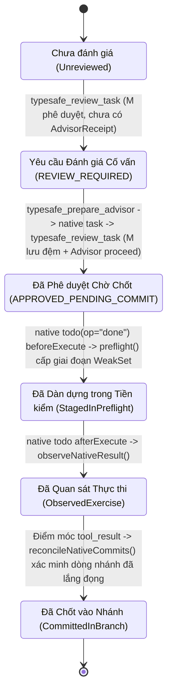

# Tài liệu Thiết kế Phần mềm (Software Design Document — SDD) — Tiện ích Mở rộng OMP TypeSafe (OMP TypeSafe Extension)

## 1. Lược đồ Nhật ký Nhánh Tùy chỉnh & Thẩm quyền Lịch sử Máy chủ (Custom Branch Journal Schemas & Host History Authority)

Toàn bộ trạng thái có thẩm quyền trong `omp-typesafe-extension` đều được lưu trữ bền vững vào và tái chiếu từ nhánh phiên của máy chủ (`ctx.sessionManager.getBranch()`). Dữ liệu JSON được nhập vào hoặc các cờ do mô hình cung cấp không bao giờ có thể vượt qua hàm kiểm tra `isHostOwnedEntry(entryId, customType)`.

### 1.1 Tóm tắt các Lược đồ Mục Nhật ký Nhánh Tùy chỉnh (Summary of Custom Branch Entry Schemas)

| Loại Tùy chỉnh `customType` (Custom Entry) | Hằng số Định nghĩa & Tệp (Defining Constant & File) | Phiên bản Lược đồ (Schema Version) | Các Loại Bản ghi / Biến thể (Record Kinds / Variants) | Mục đích (Purpose) |
|---|---|---|---|---|
| `omp.typesafe.tool-execution.v1` | `HOST_TOOL_INVOCATION_ENTRY` (`src/host-tool-invocation.ts`) | `1` | `HostToolInvocation` | Chứng nhân thực thi dựa trên `AsyncLocalStorage` (Execution Witness) chứng minh việc thực thi công cụ thực sự từ máy chủ. |
| `omp.typesafe.contract.v1` | `CONTRACT_HISTORY_CUSTOM_TYPE` (`src/task-contract-history.ts`) | `1` | `"contract"` \| `"debt"` | Ghi lại các ràng buộc `TaskContract` bất biến, các bản sửa đổi và các nghĩa vụ nợ `ContractDebtReference`. |
| `omp.typesafe.contract.source.v1` | `CONTRACT_SOURCE_CUSTOM_TYPE` (`src/task-contract-runtime-types.ts`) | `1` | `ContractSourceJournalRecord` \| `"cook_input_observation"` | Đóng băng ảnh chụp lời nhắc người dùng `/ck:cook --auto`, các tài liệu kế hoạch/giai đoạn và ngữ cảnh nguồn của hợp đồng. |
| `omp.typesafe.contract.confirmation.v1` | `CONTRACT_CONFIRMATION_CUSTOM_TYPE` (`src/task-contract-runtime-types.ts`) | `1` | `ContractConfirmationJournalRecord` (`decision: "confirmed_source_scope"`) | Ghi lại sự xác nhận tương tác trực tiếp của con người trên máy chủ (`ctx.ui.confirm`) đối với phạm vi hoặc sửa đổi hợp đồng. |
| `omp.typesafe.task-verification-facts.v1` | `TASK_VERIFICATION_FACTS` (`src/task-verification-history.ts`) | `1` | `"review_failure"` \| `"availability"` \| `"availability_consumed"` \| `"recovery_plan"` \| `"native_commit"` \| `"debt_resolved"` \| `"historical_resolution"` | Lưu trữ bền vững các chốt chặn chống thử lại (Anti-Retry Ratchets), quyền khả dụng, kế hoạch khôi phục, các lần chốt `done` bản địa và kết quả giải quyết nợ lịch sử. |
| `omp.typesafe.lifecycle-recovery.v1` *(todo-lifecycle-recovery)* | `LIFECYCLE_RECOVERY_ENTRY` (`src/todo-lifecycle-authority.ts`) | `1` | Bản ghi kiểm toán bàn giao khôi phục vòng đời & cấp quyền đột biến 60 giây | Kiểm toán các bước chuẩn bị vòng đời khác `done` (`block`, `drop`, `rm`, `init`) và mã băm của báo cáo khôi phục. |
| `typesafe:advisor:host:v1` | `ADVISOR_HOST_ENTRY` (`src/advisor-host-state.ts`) | `1` | `"epoch"` \| `"provisional"` \| `"journal"` \| `"native_observation"` | Theo dõi kỷ nguyên (Epochs) của máy chủ Cố vấn, thẻ đánh giá tạm thời, các bản ghi `AdvisorJournalRecord` và hạch toán tiến trình con của SDK. |
| `egc-ledger` | `src/egc.ts` | `1` | `{ baseParts, continuations, tasks: EgcDebt[] }` | Lưu trữ bền vững các khoản nợ nhiệm vụ Hoàn thành Mục tiêu Thực chứng (Earned Goal Completion — EGC) độc lập và số lần tiếp tục phiên. |

---

### 1.2 Định nghĩa TypeScript Chính xác cho các Mục Nhật ký Nhánh (Exact TypeScript Definitions for Branch Journal Entries)

```typescript
// 1. omp.typesafe.tool-execution.v1 (src/host-tool-invocation.ts)
export interface HostToolInvocation {
  schemaVersion: 1;
  nonce: string;
  sessionId: string;
  callId: string;
  toolName: string;
  inputDigest: string;
}

// 2. omp.typesafe.contract.v1 (src/task-contract-history.ts & src/types/verification.ts)
export type ContractHistoryRecord =
  | {
      schemaVersion: 1;
      sessionId: string;
      branchId: string;
      operationId: string;
      sourceEntryId: string;
      kind: "contract";
      contract: TaskContract;
    }
  | {
      schemaVersion: 1;
      sessionId: string;
      branchId: string;
      operationId: string;
      sourceEntryId: string;
      kind: "debt";
      debt: ContractDebtReference;
    };

// 3. omp.typesafe.contract.source.v1 (src/task-contract-runtime-types.ts)
export interface CookInputObservationRecord {
  schemaVersion: 1;
  kind: "cook_input_observation";
  sessionId: string;
  originParentId: string | null;
  nonce: string;
  origin: "interactive" | "rpc";
  prompt: string;
  promptDigest: string;
  sourcePath: string;
  documents: readonly FrozenSourceDocument[];
}

export interface ContractSourceJournalRecord {
  schemaVersion: 1;
  sessionId: string;
  branchId: string;
  toolCallId: string;
  callEntryId: string;
  invocation: HostToolInvocation;
  invocationInput: ContractBindingInvocationInput;
  revision: number;
  previousRevisionId?: string;
  amendment?: HostReference;
  proposal: ContractBindingProposal;
  originalUserRequest: { reference: HostReference; text: string };
  taskSource: FrozenNativeTaskSource;
  parentSource?: FrozenParentSourceContext;
  inputObservation?: CookInputObservationReference;
  taskKind: TaskContract["taskKind"];
  readScope: readonly string[];
  allowedMutationScope: AllowedMutationScope;
  approvedCommandIds: readonly string[];
  policyDigest: string;
  authorization: ContractSourceAuthorization;
}

// 4. omp.typesafe.contract.confirmation.v1 (src/task-contract-runtime-types.ts)
export interface ContractConfirmationJournalRecord {
  schemaVersion: 1;
  sessionId: string;
  branchId: string;
  toolCallId: string;
  callEntryId: string;
  invocation: HostToolInvocation;
  originalUserRequest: HostReference;
  taskDigest: string;
  nativeBinding: NativeTaskSourceBinding;
  parentDigest?: string;
  parentContextDigest: string;
  inputObservation?: CookInputObservationReference;
  previousRevisionId?: string;
  previousParentDigest?: string;
  taskKind: TaskContract["taskKind"];
  execution: boolean;
  allowedMutationScope: AllowedMutationScope;
  approvedCommandIds: readonly string[];
  policyDigest: string;
  decision: "confirmed_source_scope";
}

// 5. omp.typesafe.task-verification-facts.v1 (src/task-verification-history.ts)
export type VerificationFact =
  | {
      schemaVersion: 1;
      kind: "review_failure";
      contextKey: string; // "${sessionId}|${branchId}"
      contract: ContractReference;
      sourceEntryId: string;
      callId: string;
      bindingDigest: string;
      progressDigest: string;
      status: "REJECTED" | "UNAVAILABLE" | "EVIDENCE_REQUIRED";
      criterionIds: readonly string[];
      reasons: readonly string[];
      policyDigest: string;
      component: string;
      resolvedModel?: string;
      semanticDispatch: boolean;
      rawJev?: HistoricalRawJev;
    }
  | {
      schemaVersion: 1;
      kind: "availability";
      contextKey: string;
      sourceEntryId: string;
      callId: string;
      observationId: string;
      purpose: JudgePurpose;
      policyDigest: string;
      resolvedModel?: string;
      bodyDigest: string;
    }
  | {
      schemaVersion: 1;
      kind: "availability_consumed";
      contextKey: string;
      observationId: string;
      failedAttemptId: string;
      retryCallId: string;
      progressDigest: string;
    }
  | {
      schemaVersion: 1;
      kind: "recovery_plan";
      contextKey: string;
      contract: ContractReference;
      sourceEntryId: string;
      callId: string;
      plan: TaskRecoveryPlan;
    }
  | {
      schemaVersion: 1;
      kind: "native_commit";
      contextKey: string;
      contract: ContractReference;
      bindingDigest: string;
      callId: string;
      resultEntryId: string;
    }
  | {
      schemaVersion: 1;
      kind: "debt_resolved";
      contextKey: string;
      contract: ContractReference;
      debtBindingDigest: string;
      bindingDigest: string;
      callId: string;
      resultEntryId: string;
    }
  | HistoricalDebtResolutionFact; // kind: "historical_resolution"
```

---

## 2. Hợp đồng Nhiệm vụ, Hóa thân & Thẩm quyền Đột biến Nguồn (Task Contract, Incarnation & Source Mutation Authority)

### 2.1 `TaskContract` & `SourceSpan` (`src/task-contract.ts`, `src/types/verification.ts`)

```typescript
export interface SourceSpan {
  uri: string;            // e.g. "native-todo://<sessionId>/<entryId>?phaseOrdinal=0&ordinal=1" or workspace path
  fullFileDigest: string; // 64-hex SHA-256
  startLine: number;      // 1-based inclusive
  endLine: number;        // 1-based inclusive (endLine >= startLine)
  text: string;
  digest: string;         // canonicalDigest of span text
}

export interface ContractCriterion {
  id: string;
  text: string;
  kind: "requirement" | "acceptance" | "parent_integration";
  source: SourceSpan;
}

export interface AllowedMutationScope {
  operations: readonly ("read" | "create" | "modify" | "delete")[];
  paths: readonly string[];
}

export interface TaskContract {
  schemaVersion: 1;
  contractId: string;     // canonicalDigest({ incarnationId, originalUserRequest })
  revisionId: string;     // contractRevisionDigest(body)
  previousRevisionId?: string;
  incarnationId: string;  // canonicalDigest({ creation, target })
  target: { phase: string; phaseOrdinal: number; content: string; ordinal: number };
  taskKind: "implementation" | "review" | "research" | "operations";
  originalUserRequest: HostReference;
  approvedSource: {
    kind: "native_task" | "plan_phase";
    uri: string;
    digest: string;
    spans: readonly SourceSpan[];
  };
  criteria: readonly ContractCriterion[];
  parentRequirements: readonly { parentContractId: string; criterionId: string; requirement: string }[];
  allowedMutationScope: AllowedMutationScope;
  approvedCommandIds: readonly string[];
  policyDigest: string;
}
```

### 2.2 Giao thoa Thẩm quyền Đột biến Nguồn (Source Mutation Authority Intersection — `src/source-mutation-authority.ts`)
Khi có nhiều hợp đồng đang hoạt động cùng lúc trên nhánh hiện tại, `currentSourceMutationGrant` tính toán phép giao (Intersection) trên cả `operations` và `paths` để ngăn chặn hành vi leo thang đặc quyền chéo giữa các hợp đồng (Cross-Contract Privilege Escalation):
$$\text{Grant.operations} = \bigcap_{c \in \text{applicable}} c.\text{allowedMutationScope.operations}, \quad \text{Grant.paths} = \bigcap_{c \in \text{applicable}} c.\text{allowedMutationScope.paths}$$

---

## 3. Bộ máy Bằng chứng, `JudgeEvidencePacket` (Trần 32 KiB) & Ngân sách Tạo phẩm (Evidence Engine, `JudgeEvidencePacket` & Artifact Budgets)

### 3.1 Ảnh chụp Không gian làm việc & Lưu giữ Tiền ảnh (Workspace Snapshot & Preimage Retention — `src/evidence-workspace.ts`)
- **`SNAPSHOT_LIMITS` (Giới hạn Ảnh chụp)**:
  - `files`: `4,000` (số tệp tối đa)
  - `fileBytes`: `1,048,576` (`1 MiB` trên mỗi tệp)
  - `retainedBytes`: `8,388,608` (`8 MiB` trên mỗi ảnh chụp)
  - `totalRetainedBytes`: `33,554,432` (`32 MiB` trên toàn bộ các ảnh chụp đang sống, được quản lý thông qua `FinalizationRegistry`)
  - `diffBytes`: `1,048,576` (`1 MiB` kích thước bản diff hợp nhất tối đa)
- **Tính Độ lệch Gắn với Nhiệm vụ (Task-Relative Diffing — `taskSnapshotDiff`)**: Trích xuất các byte tiền ảnh được lưu giữ từ `WeakMap<WorkspaceSnapshot, RetainedSnapshot>` vào một thư mục tạm có quyền `0o700` và thực thi lệnh `git diff --no-index --binary --find-renames --no-ext-diff`, giúp cô lập hoàn toàn các thay đổi của nhiệm vụ khỏi trạng thái cây làm việc đã bẩn từ trước nhiệm vụ.

### 3.2 Trần Tạo phẩm Bàn giao (`DELIVERABLE_ARTIFACT_MAX_BYTES = 4940` — Deliverable Artifact Cap)
Được định nghĩa trong `src/evidence-collector.ts` và được thực thi nghiêm ngặt trong `src/evidence-artifacts.ts` cùng `src/judge-evidence-packet.ts`:
- Các tạo phẩm ứng viên dạng Markdown/JSON/văn bản được xác thực qua `isPrivateEvidencePath`, `pathInScope`, `evidence.snapshot.files` và `isPlanCliStub` (từ chối các khuôn mẫu CLI chưa được chỉnh sửa).
- Các ứng viên được sắp xếp theo thứ tự `(required DESC, relevance DESC, path ASC)` và được đóng gói tham lam (Greedily Packed) cho đến tối đa **`4,940` byte UTF-8**.
- Nếu bất kỳ tạo phẩm bắt buộc (`required`) nào vượt quá ngân sách `4,940` byte, `collectTaskArtifacts` sẽ ghi nhận thiếu sót bắt buộc `insufficient_deliverable_evidence` (đồng thời `buildJudgeEvidencePacket` ghi nhận `MANDATORY_ARTIFACT_BUDGET_EXCEEDED`), thực thi đóng băng an toàn khi lỗi với trạng thái `EVIDENCE_REQUIRED`.

### 3.3 `JudgeEvidencePacket` & `EvidencePacketSetManifest` (`src/judge-evidence-packet.ts`)

```typescript
export interface ArtifactSelectionManifest {
  requiredPaths: readonly string[];
  outOfPacketScope: readonly string[];
  acceptedBytes: number;
  maxBytes: 4940;
}

export interface JudgeEvidencePacket {
  schemaVersion: 1;
  binding: {
    contractId: string;
    revisionId: string;
    incarnationId: string;
    originalRequestDigest: string;
    policyDigest: string;
    target: TaskContract["target"];
  };
  applicability: {
    taskKind: TaskContract["taskKind"];
    allowedMutationScope: TaskContract["allowedMutationScope"];
    sourceMutations: readonly string[];
  };
  originalSource: TaskContract["approvedSource"];
  parentRequirements: TaskContract["parentRequirements"];
  criteria: readonly ContractCriterion[];
  obligations: Array<{
    id: string;
    criterionId: string;
    kind: "deterministic" | "semantic" | "integration";
    evidenceIds: string[];
    requirement: string;
  }>;
  snapshots: { baselineId: string; evaluatedId: string; evaluatedTreeDigest: string };
  source: PacketSourceEvidence[];
  diff: string;
  commitInterval?: TaskEvidenceResult["commitInterval"];
  artifacts: readonly EvidenceArtifact[];
  verification?: TaskEvidenceResult["verificationReceipt"];
  diagnosticObservations?: readonly NonNullable<TaskEvidenceResult["verificationReceipt"]>[];
  authorizedMutations?: TaskEvidenceResult["authorizedMutationReceipts"];
  integrationReceipts?: readonly IntegrationEvidenceReceipt[];
  counterevidence: readonly string[];
  omissions: readonly EvidenceOmission[];
  artifactSelection?: ArtifactSelectionManifest;
  scope?: { kind: "criterion"; selectedCriterionIds: readonly string[]; globalCompletionEligible: false };
  manifest?: CriterionEvidenceManifest;
}
```

- **Trần Cứng Gói Bằng chứng 32.768 Byte (Hard 32,768-Byte Packet Ceiling)**: `buildJudgeEvidencePacket` kiểm tra điều kiện `Buffer.byteLength(JSON.stringify(packet), "utf8") <= 32768`; bất kỳ sự tràn dung lượng nào cũng trả về `{ ok: false, status: "EVIDENCE_REQUIRED", reasons: ["MANDATORY_PACKET_PROOF_EXCEEDS_BUDGET"] }`.
- **Niêm phong Danh tính Truyền tải (Transport Identity Seal — `createEvidenceStateValidator`)**: Tính toán trước `redactEvidenceState(fields, redaction)` và xác minh ngay bên trong `typesafe-api-client.cjs` (`runPreparedValidation`) rằng phần thân HTTP đã tuần tự hóa cuối cùng (`<= 32768` byte) khớp chính xác với `bodyBytes`, `bodyDigest` kỳ vọng và thỏa mãn `isDeepStrictEqual` đối với `body.state`.

---

## 4. Giao thức Cố vấn Chỉ Đọc & Dàn dựng Lưỡng viện (Read-Only Advisor Protocol & Bicameral Staging)

### 4.1 `AdvisorRequest`, `AdvisorAssessment` và `AdvisorReceipt` (`src/advisor-protocol.ts`)

```typescript
export interface ReviewSnapshot {
  contractDigest: string;
  evidenceDigest: string;
  treeDigest: string;
  testDigest: string;
  policyDigest: string;
  parentDigest: string;
  childDigest: string;
  integrationDigest: string;
}

export interface AdvisorScope {
  workspaceRoot: string;
  files: readonly { path: string; sha256: string }[];
  resources: readonly { uri: string; digest: string }[];
  publicContextDigest: string;
  egressPolicyDigest: string;
}

export interface AdvisorRequest {
  schemaVersion: 1;
  requestId: string; // "advisor:<requestDigest>"
  binding: ReviewBinding;
  bindingDigest: string;
  snapshot: ReviewSnapshot;
  scope: AdvisorScope;
  criterionIds: readonly string[];
  parentRequirementIds: readonly string[];
  evidenceRefs: readonly string[];
  integrationEvidenceRefs: readonly string[];
  publicPrompt: string;
  promptDigest: string;
  sessionEpoch: string;
  parentAgentId: string;
  parentToolCallId: string;
  itemIndex: number;
  agent: "advisor" | "ck:advisor";
  requestDigest: string;
}

export interface AdvisorAssessment {
  verdict: "proceed" | "revise" | "block" | "human_required" | "unavailable";
  recommendation: string;
  rankedOptions: readonly { option: string; rationale: string; rank: number }[];
  findings: readonly {
    severity: "critical" | "high" | "medium" | "low" | "info";
    claim: string;
    evidenceRefs: readonly string[];
  }[];
  confidence: number; // [0, 1]
  openQuestions: readonly string[];
  criterionCoverage: readonly {
    criterionId: string;
    status: "covered" | "uncovered" | "contradicted";
    evidenceRefs: readonly string[];
  }[];
  parentIntegration: {
    status: "not_applicable" | "supported" | "contradicted" | "insufficient";
    criterionIds: readonly string[];
    evidenceRefs: readonly string[];
  };
}

export interface AdvisorReceipt {
  schemaVersion: 1;
  receiptId: string; // "advisor-receipt:<canonicalDigest(body)>"
  requestId: string;
  binding: ReviewBinding;
  bindingDigest: string;
  snapshot: ReviewSnapshot;
  assessment: AdvisorAssessment;
  assessmentDigest: string;
  parentRequirementIds: readonly string[];
  provenance: {
    parentToolCallId: string;
    itemIndex: number;
    childId: string;
    sessionEpoch: string;
    terminalDigest: string;
  };
  authority: "none" | "task_bound";
}
```

### 4.2 Các Bất biến Xác thực Nghiêm ngặt trong `validateAssessmentForRequest` (`src/advisor-protocol.ts:114-139`)
1. **Song ánh Tiêu chí Đầy đủ (Complete Criterion Bijection)**: `criterionCoverage.length === request.criterionIds.length`, mọi `criterionId` phải là duy nhất và có mặt trong `request.criterionIds`, đồng thời bất kỳ mục nào có `status === "covered"` đều bắt buộc phải trích dẫn ít nhất một `evidenceRef` hợp lệ (`evidenceRefs.length > 0`).
2. **Thế giới Tham chiếu Đóng (Closed Reference World)**: Mọi `evidenceRef` trong `findings`, `criterionCoverage` và `parentIntegration` đều phải thuộc tập `request.evidenceRefs` (và `parentIntegration.evidenceRefs` khi ở trạng thái `supported` bắt buộc phải thuộc tập `request.integrationEvidenceRefs`).
3. **Bất biến Khả dụng của Tích hợp Cha (Parent Integration Applicability Invariant)**:
   - Khi `request.parentRequirementIds.length === 0` (tích hợp cha không áp dụng): `parentIntegration.status` **bắt buộc** phải bằng `"not_applicable"` và cả hai mảng `criterionIds` lẫn `evidenceRefs` **bắt buộc** phải rỗng (`[]`).
   - Khi `request.parentRequirementIds.length > 0` (tích hợp cha có áp dụng): `parentIntegration.status` **không được phép** bằng `"not_applicable"`, `criterionIds` phải khớp với `request.parentRequirementIds` xét theo tập hợp, và nếu `status === "supported"`, `evidenceRefs` bắt buộc phải khác rỗng.

### 4.3 `NativeTaskVerificationStage` & Chốt theo Danh tính Đối tượng (Object-Identity Commit — `src/task-verification-native.ts`)


---

## 5. Hợp đồng Độc lập Hoàn thành Mục tiêu Thực chứng (Earned Goal Completion — EGC Standalone Contracts — `src/egc.ts`)

### 5.1 `EgcEvidenceRefusal` & Giới hạn Tệp Chưa Theo dõi (Untracked File Bounds)
Khi thu thập các tệp chưa được theo dõi trong không gian làm việc so với nhánh cơ sở `base` (`src/egc.ts:128-145`), mỗi tệp được đọc thông qua `readWorkspaceFile(cwd, path, { maxBytes: 131072 })`. Nếu một tệp vượt quá `131,072` byte hoặc biến mất đồng thời trong lúc đọc, hàm `changes()` sẽ ném ra ngoại lệ:
```typescript
class EgcEvidenceRefusal extends Error {
  constructor(readonly code: "FILE_TOO_LARGE" | "FILE_MISSING" | string, readonly path: string) {
    super(`${code} ${path}`);
  }
}
```
Bên trong hàm `attempt()`, việc bắt được ngoại lệ `EgcEvidenceRefusal` sẽ từ chối hoàn thành nhiệm vụ ngay lập tức (`status = "rejected"`, ghi nhận `evidence unavailable: ${error.code} ${error.path}`) mà không làm sập phiên máy chủ.

### 5.2 Sàng lọc Chế độ Thực thi Gia cố (Hardened Enforce-Mode Screening — `src/egc.ts`)
1. **Chặn Lời gọi Không Hộp cát (Unsandboxed Call Blocking)**: Ở chế độ `enforce`, bất kỳ lời gọi công cụ `todo`, `todo_write` hoặc công cụ ghi tệp nào mang tham số `"unsandboxed": true` trong đối số đều bị chặn ngay lập tức (`{ block: true, reason: "EGC: unsandboxed tool execution is forbidden." }`).
2. **Yêu cầu Xác minh đối với Nhiệm vụ Không Hợp đồng (Uncontracted Task Verification Requirement)**: Khi `contract.uncontracted === "allow"`, một nhiệm vụ không có hợp đồng không thể vượt qua thao tác `done` nếu thiếu các lệnh `verify` khả thi trừ phi `contract.jev.mode === "enforce"` **và** danh sách `requirements` khác rỗng đã được định nghĩa.
3. **Từ chối Đích `done` Mơ hồ (Ambiguous `done` Target Rejection)**: Nếu một lời gọi `todo(op="done")` khớp với nhiều nghĩa vụ đang mở cùng lúc (`targets.length > 1`), EGC sẽ chặn lời gọi đó (`"EGC: ambiguous todo completion target."`) thay vì tự phỏng đoán nghĩa vụ nào cần đánh giá.

---

## 6. Truyền tải CJS, Biên tập Bảo mật & `TELEMETRY_COUNT_KEYS` (CJS Transport, Redaction & `TELEMETRY_COUNT_KEYS`)

### 6.1 Ngoại lệ Bảo toàn `TELEMETRY_COUNT_KEYS` (`TELEMETRY_COUNT_KEYS` Carve-Out — `src/typesafe-redact.cjs:60-104`)
Trong `src/typesafe-redact.cjs`, các khóa đối tượng khớp với điều kiện `sensitiveKeyKind(key) === "token"` sẽ kích hoạt cơ chế biên tập che giấu toàn bộ (Wholesale Redaction) đối với các giá trị chuỗi, số, mảng và đối tượng ngang hàng. Để bảo toàn dữ liệu hạch toán mức sử dụng token của LLM trong bằng chứng và các quan sát Cố vấn mà không làm suy yếu cơ chế che giấu bí mật, hàm `redactDeep` thực thi quy tắc sau:

```javascript
const TELEMETRY_COUNT_KEYS = new Set([
  "input_tokens",
  "output_tokens",
  "total_tokens",
  "prompt_tokens",
  "completion_tokens",
  "cache_creation_input_tokens",
  "cache_read_input_tokens",
]);
const isTelemetryCount = (k, v) =>
  TELEMETRY_COUNT_KEYS.has(k) && Number.isSafeInteger(v) && v >= 0;
```

| Tên Khóa (Key Name) | Kiểu Giá trị & Ví dụ (Value Type & Example) | Kết quả Biên tập (Redaction Outcome) | Lý giải Kỹ thuật (Rationale) |
|---|---|---|---|
| `input_tokens` / `output_tokens` / `total_tokens` | `128` (số nguyên an toàn không âm — Non-Negative Safe Integer) | **Được bảo toàn (`128`)** | Khớp với `TELEMETRY_COUNT_KEYS` và thỏa mãn `Number.isSafeInteger(v) && v >= 0`. |
| `input_tokens` | `-1`, `3.14`, `"128"`, hoặc `{ count: 128 }` | **Bị che giấu (`[REDACTED:kv]` / `[REDACTED:token]`)** | Không thỏa mãn điều kiện kiểm tra số nguyên an toàn không âm. |
| `secret_token` / `auth_token` / `api_token` | `12345` hoặc `"sk-ant-..."` | **Bị che giấu (`[REDACTED:kv]` / `[REDACTED:token]`)** | Không nằm trong `TELEMETRY_COUNT_KEYS`; áp dụng cơ chế che giấu toàn bộ nhánh ngang hàng. |
| Khóa Câu hỏi hoặc Tùy chọn Lựa chọn (Question or Choice Option Key) | `questions["sk-ant-api03-..."]` | **Ném lỗi `payload_rejected_secret_in_key`** | Các khóa khứ hồi (Round-Trip Keys) không được phép biến đổi; yêu cầu đóng băng an toàn trước khi gửi đi. |

### 6.2 Thuật toán Điền nước Tìm kiếm Nhị phân (Binary-Search Water-Filling Algorithm — `preparePayload` trong `src/typesafe-redact.cjs:317-373`)
Khi `maxBytes` là một số hữu hạn (mặc định `32,768` byte cho các lời gọi `preparePayload` tổng quát; được đặt thành `Infinity` trong `prepareRequest` nơi `JudgeEvidencePacket` đã giới hạn kích thước trạng thái từ trước):
1. Thu thập tất cả các nút lá kiểu chuỗi có thể cắt ngắn (`state`, `instructions`, các phần tử mảng `score`, các giá trị từ điển `criteria`).
2. Tìm kiếm nhị phân (Binary Search) mức trần byte $L \in [0, \max_i \text{byteLength}(s_i)]$ dọc theo ranh giới điểm mã UTF-8 (`capBytes(s_i, L)`):
   $$\max L \quad \text{sao cho (subject to)} \quad \text{byteLength}\big(\text{JSON.stringify}(\text{payload}(L))\big) \le 32,768$$
3. Giữ nguyên vẹn từng chữ các trường nhỏ hơn trong khi chỉ cắt tỉa đồng đều những nút lá chuỗi lớn nhất.
