# Hướng dẫn Kiến trúc: Giải pháp Thực thi Tự chủ Dựa trên Bằng chứng & Chống Treo Todo (Autonomous Evidence-Based Execution & Anti-Hang Todo Architecture)

## 1. Phát biểu Vấn đề & Giải phẫu Nguyên nhân Gốc rễ (Problem Statement & Root Cause Anatomy)

Trong các phiên bản trước của `omp_extension`, cơ chế bảo vệ hợp đồng nhiệm vụ (*Task Contract*) và tiền kiểm hoàn thành nhiệm vụ (*Native Todo Preflight*) được thiết kế theo tư duy **Đóng băng An toàn Cực đoan (Extreme Fail-Closed)**:

```mermaid
flowchart TD
    classDef fail fill:#7f1d1d,stroke:#f87171,color:#f8fafc,stroke-width:1.5px
    classDef pass fill:#064e3b,stroke:#34d399,color:#f8fafc,stroke-width:1.5px
    classDef warn fill:#7c2d12,stroke:#fb923c,color:#f8fafc,stroke-width:1.5px
    classDef core fill:#1e3a8a,stroke:#60a5fa,color:#f8fafc,stroke-width:1.5px

    subgraph ProblemFlow["Vòng Lặp Tê Liệt Kiến Trúc Cũ (Legacy Deadlock Loop)"]
        A["1. Agent nhận yêu cầu sửa mã / thực thi"]:::core
        A --> B["2. typesafe_bind_task đòi hỏi Popup UI con người<br/>(requiresUI === true && !ctx.hasUI)"]:::warn
        B -->|Không có UI| C["3. Ném lỗi HUMAN_REQUIRED<br/>Không thể liên kết hợp đồng thực thi"]:::fail
        C --> D["4. typesafe-planner chặn edit/write<br/>(HUMAN_REQUIRED: protected source mutation)"]:::fail
        D --> E["5. todo done bị chặn vĩnh viễn<br/>(EVIDENCE_REQUIRED: task review required)"]:::fail
        E --> F["6. CÔNG VIỆC BỊ TREO HOÀN TOÀN<br/>Không có tiến triển, Todo không thể gỡ"]:::fail
    end

    subgraph SolutionFlow["Kiến Trúc Tự Chủ Mới Dựa Trên Bằng Chứng (New Autonomous Evidence Architecture)"]
        S1["1. Agent Tự chủ Nghiên cứu & Lập kế hoạch<br/>(Autonomous Research & Planning: read/find/scout)"]:::core
        S2["2. Tự do Sửa đổi Mã nguồn Có Bảo vệ<br/>(Protected Workspace Mutation: edit/write)"]:::core
        S3["3. Chạy Kiểm thử Thật & Thu thập Bằng chứng<br/>(Run bun test, exitCode === 0, AST clean)"]:::pass
        S4["4. Rà soát Khách quan từ Cố vấn Độc lập<br/>(Read-Only Advisor Synthesis)"]:::pass
        S5["5. Tự động Phê duyệt Giai đoạn & Gỡ Todo<br/>(Automatic Stage Approval & todo done)"]:::pass
        S1 --> S2 --> S3 --> S4 --> S5
    end
```



### Các Điểm Nghẽn Cụ Thể trong Mã Nguồn Cũ

1. **Điểm nghẽn 1 (`src/contract-runtime.ts:117, 155–158`)**:
   Khi một nhiệm vụ có kế hoạch (`planPath`) hoặc là nhiệm vụ sửa mã nguồn (`kind === "implementation"`), hệ thống gán cờ `requiresUI = true`. Trong môi trường tự chủ (headless, CLI, subagent), `ctx.hasUI` luôn là `false`, khiến hệ thống ném ngoại lệ `HUMAN_REQUIRED: Exact material source/scope requires actual host UI confirmation`, làm đứt gãy hoàn toàn chuỗi cấp quyền.
2. **Điểm nghẽn 2 (`typesafe-planner.ts:1746`)**:
   Lớp bảo vệ đánh chặn công cụ `edit` và `write` kiểm tra `sourceMutationAllowed`. Vì Bước 1 không thể cấp quyền do thiếu UI con người, mọi thao tác sửa mã trong `src/**` và `tools/**` đều bị chặn đứng với mã lỗi `HUMAN_REQUIRED`.
3. **Điểm nghẽn 3 (`src/task-verification-runtime.ts:152`)**:
   Tiền kiểm của `todo(op="done")` đòi hỏi trạng thái `APPROVED_PENDING_COMMIT`. Vì hai bước trên bị treo, `todo(op="done")` liên tục bị từ chối với lỗi `EVIDENCE_REQUIRED: A current task-bound source review and real settled Advisor receipt must exist`.

---

## 2. Giải pháp Đột phá: Chuyển dịch từ "Sự Hiện diện của Con người" sang "Bằng chứng Kiểm chứng Khách quan"

Để tác nhân AI có thể **tự nghiên cứu, tìm giải pháp, suy luận, thực thi và có bằng chứng xác đáng để gỡ bỏ todo khi hoàn thành**, kiến trúc cung cấp 2 giải pháp song hành:

### Giải pháp 1: Cơ chế Giải phóng Tự do Vận hành Tức thì qua `excludeProjects` (Immediate Autonomous Unblocking)

Cơ chế này sử dụng ngay lớp bảo vệ phân tầng có sẵn `handleExcludedMutationGuard` trong `typesafe-planner.ts`:

1. **Cấu hình**:
   Thêm đường dẫn workspace phát triển vào mảng `excludeProjects` trong tệp cấu hình toàn cục `~/.omp/agent/typesafe.json`:
   ```json
   {
     "typesafe": {
       "enabled": true,
       "projects": ["*"],
       "excludeProjects": [
         "D:/100.Software/Github/omp_extension"
       ]
     }
   }
   ```
2. **Nguyên lý Hoạt động của `handleExcludedMutationGuard`**:
   - **Bảo tồn Tuyệt đối Bất biến Vàng (Golden Invariant Preservation)**:
     - Tệp proxy nạp toàn cục `~/.omp/agent/extensions/typesafe-planner.ts` vẫn được bảo vệ nghiêm ngặt: bất kỳ hành vi sửa đổi trực tiếp nào đều bị chặn ngay lập tức.
     - Tệp lưu trữ bản địa `todo.json` bị cấm sửa trực tiếp (bắt buộc thông qua công cụ `todo` chính thức của Core OMP).
     - Thư mục thời gian chạy hoạt động `C:/Users/thant/Projects/omp_extension` bị cấm ghi trực tiếp (bắt buộc thông qua giao dịch đồng bộ `tools/oneclick-omp.bat`).
   - **Giải phóng 100% Quyền Tự chủ cho Tác nhân AI**:
     - Lệnh `todo` native (`init`, `start`, `done`, `drop`, `rm`, `view`) được chuyển tiếp trực tiếp vào nhân Core OMP (`current.invokeTool`), không bị chặn bởi cổng kiểm duyệt Preflight hay đòi hỏi biểu điểm `M`.
     - Tác nhân AI được toàn quyền gọi `edit`, `write` để nghiên cứu, thử nghiệm và sửa đổi mã nguồn trong không gian phát triển.
     - Tác nhân tự chạy `bun test`, thu thập bằng chứng kiểm thử, tự suy luận và gỡ bỏ `todo` khi đã đáp ứng đầy đủ yêu cầu.

---

### Giải pháp 2: Cơ chế Tự chủ Dựa trên Bằng chứng Kiểm chứng (Autonomous Evidence-Based Staging)

Trong các môi trường vẫn muốn kích hoạt luồng đánh giá biểu điểm ngữ nghĩa TypeSafe (`M`) và Cố vấn chỉ đọc (`Advisor`) nhưng **không muốn bị treo khi không có UI con người**:

1. **Tự động Cấp quyền Hợp đồng Tự chủ (Autonomous Provisional Scope Grant)**:
   - Khi phát hiện `!ctx.hasUI` (môi trường không có giao diện hộp thoại xác nhận) nhưng người dùng đã đưa ra yêu cầu thực thi rõ ràng (như cờ `--auto`, lệnh `/ck:cook`, `/ck:fix`, hoặc lời nhắc chỉ thị thực thi):
   - Thay vì ném `HUMAN_REQUIRED`, hệ thống tự động khởi tạo một `ProvisionalExecutionGrant` bị giới hạn nghiêm ngặt trong phạm vi thư mục dự án (`scope.paths: ["src/**", "tests/**", "docs/**"]`).
2. **Thực thi & Thu thập Bằng chứng Khách quan (`typesafe_collect_evidence`)**:
   - Tác nhân AI tự do sửa mã nguồn, sau đó thực thi lệnh kiểm thử thực tế:
     ```bash
     bun test
     ```
   - Lệnh `typesafe_collect_evidence` thu thập:
     - Mã thoát kiểm thử `exitCode === 0`.
     - Toàn bộ kết quả kiểm thử thực tế `testOutput`.
     - Bản diff mã nguồn và băm ảnh chụp không gian làm việc (`preSnapshot` $\rightarrow$ `postSnapshot`).
3. **Bộ Phân tích Chống Trốn tránh AST (`src/ast-analyzer.ts`)**:
   - Tự động quét bản diff để khẳng định tác nhân không gian lận:
     - Không xóa các dòng khẳng định `expect(...)` / `assert(...)`.
     - Không thêm chú thích vô hiệu hóa kiểm thử (`describe.skip`, `it.skip`, `xit`).
     - Không tạo khẳng định hằng đúng giả mạo (`expect(true).toBe(true)`).
4. **Phản biện từ Cố vấn Độc lập Chỉ Đọc (`AdvisorReceipt`)**:
   - Hệ thống tự động khởi chạy tiến trình con Cố vấn chỉ đọc (`Advisor Subagent`) qua công cụ `task`.
   - Cố vấn chỉ đọc độc lập rà soát mã nguồn, không bị ảnh hưởng bởi thiên kiến của tác nhân chính, và phát hành biên nhận `AdvisorReceipt` hợp lệ vào lịch sử nhánh.
5. **Tự động Cấp Quyền Hoàn thành (`APPROVED_PENDING_COMMIT`)**:
   - Khi kết quả kiểm thử đạt 100% + AST diff sạch + Đồng thuận Lưỡng viện chấp thuận:
   - Hệ thống tự động phát hành giai đoạn `APPROVED_PENDING_COMMIT` vào `createNativeStageRegistry`.
   - Lệnh `todo(op="done")` vượt qua bước tiền kiểm $<5\text{ms}$ một cách hoàn toàn tự động, gỡ bỏ mục việc với đầy đủ bằng chứng toán học và thực nghiệm!

---

## 3. Bảng Ma trận So sánh 2 Chế độ Hoạt động

| Tiêu chí So sánh | Chế độ Đóng băng Cũ (Legacy Frozen Mode) | Chế độ Tự chủ Dựa trên Bằng chứng (Autonomous Evidence Mode) |
|---|---|---|
| **Yêu cầu Xác nhận của Con người** | Bắt buộc popup `ui.confirm`; ném `HUMAN_REQUIRED` nếu chạy không có UI $\rightarrow$ **GÂY TREO** | Tự động hóa dựa trên kết quả kiểm thử thực tế và phân tích AST $\rightarrow$ **TỰ CHỦ 100%** |
| **Khả năng Sửa đổi Mã nguồn** | Bị khóa hoàn toàn nếu chưa có xác nhận từ UI con người | Cho phép sửa đổi trong phạm vi dự án; bảo vệ Bất biến Vàng |
| **Điều kiện Gỡ bỏ Todo `done`** | Phải có biên nhận duyệt thủ công kết hợp | Đạt 100% bài kiểm thử (`bun test` exit 0) + AST diff sạch + Cố vấn đồng thuận |
| **Độ trễ và Tính liên tục của Phiên** | Thường xuyên bị dừng chờ người dùng can thiệp | Phiên làm việc chạy liên tục, tự động gỡ todo khi nghiệm thu xong |
| **Bảo vệ Bất biến Vàng** | Có | Có (Cấm ghi đè proxy, cấm sửa `todo.json`, cấm ghi đè target trực tiếp) |

---

## 4. Hướng dẫn Vận hành Dành cho Người dùng

### Cách 1: Bật Chế độ Tự chủ Hoàn toàn Ngay Lập tức (Khuyên dùng khi muốn Agent tự do tối đa)
Mở tệp `C:\Users\thant\.omp\agent\typesafe.json` và cấu hình:
```json
{
  "typesafe": {
    "enabled": true,
    "projects": ["*"],
    "excludeProjects": [
      "D:/100.Software/Github/omp_extension"
    ]
  }
}
```
*Tác dụng*: Toàn bộ rào cản tiền kiểm gây treo todo được gỡ bỏ ngay lập tức; AI Agent được tự do nghiên cứu, lập kế hoạch, sửa mã, chạy test và gỡ bỏ todo khi hoàn thành.

### Cách 2: Vận hành theo Chuỗi Bằng chứng Khách quan (Objective Evidence Chain)
Trong các tác vụ đòi hỏi thẩm định ngữ nghĩa TypeSafe:
1. Agent khởi tạo danh sách việc: `todo({ op: "init", list: [...] })`.
2. Agent liên kết nguồn và kế hoạch: `typesafe_bind_task({ task: "...", planPath: "..." })`.
3. Agent thực hiện thay đổi và kiểm thử: `bun test`.
4. Agent thu thập bằng chứng thực nghiệm: `typesafe_collect_evidence({ task: "...", commandId: "workspace-tests" })`.
5. Agent chạy thẩm định: `typesafe_review_task({ task: "..." })`.
6. Agent hoàn tất: `todo({ op: "done", task: "..." })`.
