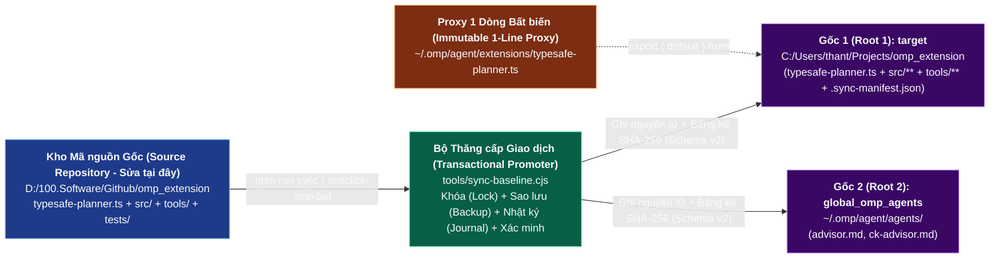
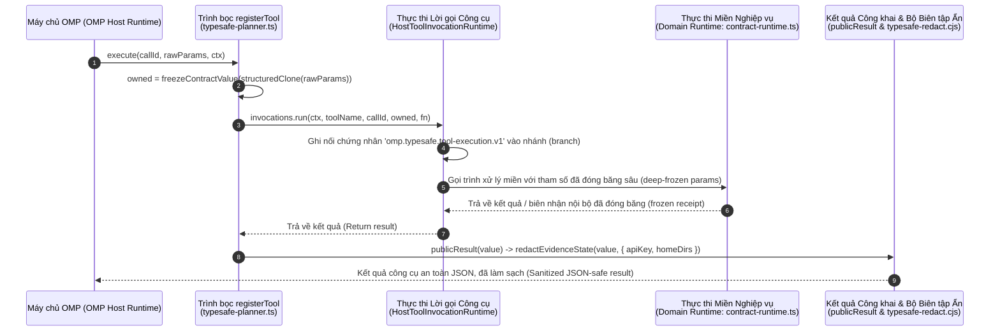

# Tiêu chuẩn Mã nguồn & Kỹ thuật (Code & Engineering Standards) — `omp_extension`

> **Tiêu chuẩn Kỹ thuật & Bảo mật Chính tắc (Canonical Engineering & Security Standard)** cho `omp-typesafe-extension` (`v1.0.0`).  
> Áp dụng cho `typesafe-planner.ts`, toàn bộ `100` mô-đun trong `src/`, `26` công cụ vận hành trong `tools/`, `6` kịch bản trong `scripts/`, `82` bộ kiểm thử trong `tests/`, và toàn bộ hệ thống tài liệu trong `docs/`.

---

## 1. Bất biến Vàng — Triển khai 3 Thư mục Gốc & Cô lập Proxy (The Golden Invariant: 3-Root Deployment & Proxy Isolation)

### 1.1 Trình trung chuyển Ủy nhiệm Toàn cục Bất biến (Immutable Global Proxy Trampoline)
Điểm nhập tiện ích mở rộng Oh-My-Pi toàn cục (global entrypoint) tại `C:/Users/thant/.omp/agent/extensions/typesafe-planner.ts` là một **trình trung chuyển ủy nhiệm mô-đun ES 1 dòng bất biến (immutable 1-line ES module proxy trampoline)**:

```ts
export { default } from "C:/Users/thant/Projects/omp_extension/typesafe-planner.ts";
```

### 1.2 Các Quy tắc Bắt buộc của Bất biến Vàng (Mandatory Rules of the Golden Invariant)
1. **Tuyệt đối Không Chỉnh sửa Trực tiếp Các Đích Thời gian chạy (Never Edit Runtime Targets Directly)**: Các kỹ sư và tác nhân AI TUYỆT ĐỐI KHÔNG ĐƯỢC chỉnh sửa trực tiếp các tệp nằm dưới:
   - `C:/Users/thant/.omp/agent/extensions/typesafe-planner.ts` (Trình nạp Ủy nhiệm - Proxy Loader)
   - `C:/Users/thant/Projects/omp_extension/` (Thư mục gốc đích - `target` root)
   - `C:/Users/thant/.omp/agent/agents/` (Thư mục gốc tác nhân OMP toàn cục - `global_omp_agents` root)
2. **Chỉ Phát triển trong Kho Mã nguồn Gốc (Develop Only in the Source Repository)**: Mọi thay đổi mã nguồn, tái cấu trúc (refactors), tài liệu và kiểm thử BẮT BUỘC phải được soạn thảo duy nhất tại `D:/100.Software/Github/omp_extension`.
3. **Chỉ Thăng cấp Thông qua Đồng bộ Giao dịch (Promote Only via Transactional Sync)**: Việc thăng cấp (promotion) sang 2 thư mục gốc thời gian chạy BẮT BUỘC phải diễn ra duy nhất qua `tools/sync-baseline.cjs` (được gọi thông qua `tools/oneclick-omp.bat` hoặc `tools/promote-omp-global.ps1` theo Bản kê Schema v2).



---

## 2. Kiến trúc Thực thi Hai Tầng — TypeScript & CommonJS Không Phụ thuộc (Dual-Layer Runtime Architecture)

`omp_extension` chủ đích phân tách cơ sở mã nguồn thành hai tầng mô-đun phối hợp chặt chẽ:

1. **93 Mô-đun TypeScript (`typesafe-planner.ts` + `src/*.ts`)**: Được nạp trực tiếp bởi Bun bên trong tiến trình máy chủ Oh-My-Pi (OMP host process) để phục vụ quản trị hợp đồng (contract governance), Đồng thuận Lưỡng viện (Bicameral Consensus), trung gian Cố vấn gốc (native Advisor mediation), phân tích cây cú pháp trừu tượng (AST analysis), và đánh giá bắt cặp `M`/`H` (paired `M`/`H` evaluation).
2. **7 Mô-đun CommonJS Không Phụ thuộc (`src/typesafe-*.cjs` + khai báo kiểu `.d.cts`)**: Nạp độc lập theo đường dẫn tương đối nội bộ tiện ích mở rộng OMP tại `target`, tách rời hoàn toàn khỏi mọi phụ thuộc `.claude`.

### 2.1 Danh mục & Hợp đồng của 7 Mô-đun `.cjs` (Inventory & Contracts of the 7 `.cjs` Modules)

| Mô-đun CJS (`src/`) | Khai báo Kiểu (Type Declaration) | Phạm vi Quản lý (Managed Scope) | Thư viện Tích hợp Node Được phép (Permitted Node Built-ins) | Trách nhiệm Cốt lõi (Core Responsibility) |
|---|---|---|---|---|
| `typesafe-enabled-resolver.cjs` | *(Nạp động trong TS)* | Chỉ `target` | `fs`, `path`, `os` | Bộ giải quyết kích hoạt đồng bộ thuần túy (`resolveTypeSafeEnabled`) đọc `TYPESAFE_API_KEY` và tệp toàn cục `~/.omp/agent/typesafe.json`. |
| `typesafe-api-client.cjs` | *(Nạp động/CJS require)* | Chỉ `target` | `https`, `crypto`, `os`, `path` | Trình khách HTTP không phụ thuộc cho TypeSafe System One (`callTypeSafeJudge`, `prepareJudgeRequest`, thời gian nghỉ & thử lại khi gặp lỗi 429/529). |
| `typesafe-redact.cjs` | *(Xuất lại qua `payload-safety.ts`)* | Chỉ `target` | `crypto`, `os`, `path` | Bộ biên tập ẩn thông tin đệ quy nhận biết cấu trúc (`redactPayload`, `redactEvidenceState`), miễn trừ `TELEMETRY_COUNT_KEYS`, và giới hạn đổ đầy nước 32 KiB. |
| `typesafe-redact-patterns.cjs` | *(Nội bộ cho `typesafe-redact.cjs`)* | Chỉ `target` | `path`, `os` | Các mẫu biểu thức chính quy nhận diện khóa (`TOKEN_PATTERNS`), bộ dò khóa-giá trị phân tách/dính liền/camelCase, bộ quét entropy Shannon, và bộ xóa đường dẫn thư mục người dùng. |
| `typesafe-policy-client.cjs` | *(Được nhập bởi các cổng TS)* | Chỉ `target` | `crypto` | Bộ giải quyết ảnh chụp chính sách công cụ tin cậy, bộ cưỡng chế lưới chỉ thắt chặt (`validateRoutingTightenOnly`), và bộ lập lịch `SemanticReviewScheduler`. |
| `typesafe-child-env.cjs` | `typesafe-child-env.d.cts` | Chỉ `target` | `fs`, `path`, `os`, `child_process` | Bộ tạo môi trường tiến trình con theo danh sách trắng nghiêm ngặt (`buildChildProcessEnv`), bộ chặn rò rỉ giá trị bí mật, gia cố cấu hình git, và `createVerificationHome`. |
| `typesafe-evidence-file.cjs` | `typesafe-evidence-file.d.cts` | Chỉ `target` | `fs`, `path` | Bộ đọc tệp không gian làm việc gia cố chống TOCTOU (`readWorkspaceEvidenceFile`), bộ duyệt cây thư mục (`walkWorkspaceFiles`), và bộ ghi phục hồi nguyên tử. |

### 2.2 Tiêu chuẩn Lập trình CJS Bắt buộc (Mandatory CJS Coding Standards)
- **Không Phụ thuộc Gói npm Bên ngoài (Zero External npm Dependencies)**: Tuyệt đối không gọi `require()` tới các gói bên thứ ba bên trong `src/typesafe-*.cjs`. Chúng phải thực thi được trên Node.js thuần $\ge 18$ mà không cần phân giải `node_modules` trong `~/.claude`.
- **Đồng bộ hóa Nghiêm ngặt `.d.cts` (Strict `.d.cts` Synchronization)**: Bất kỳ thay đổi chữ ký hàm (signature change) nào đối với `src/typesafe-child-env.cjs` hoặc `src/typesafe-evidence-file.cjs` BẮT BUỘC phải cập nhật tệp `.d.cts` tương ứng (`src/typesafe-child-env.d.cts`, `src/typesafe-evidence-file.d.cts`) trong cùng một bản cam kết (commit).
- **Không Tin cậy Cấu hình Cục bộ Dự án (No Project-Local Config Trust)**: `src/typesafe-enabled-resolver.cjs` CHỈ ĐƯỢC PHÉP tin cậy `~/.omp/agent/typesafe.json`. Mô-đun này tuyệt đối không bao giờ đọc cấu hình cục bộ trong kho mã để quyết định việc bật/tắt các cổng bảo mật, nhằm ngăn chặn một kho mã không tin cậy tự vô hiệu hóa TypeSafe.

---

## 3. Tính Bất biến Đầu vào/Đầu ra & Vệ sinh Ranh giới (Input/Output Immutability & Boundary Hygiene)

Mọi ranh giới công cụ (tool boundary) và bước chuyển trạng thái (state transition) trong `omp_extension` đều cưỡng chế tính bất biến mật mã (cryptographic immutability) và làm sạch dữ liệu đầu ra (outbound sanitization).



### 3.1 Đóng băng Sâu Đầu vào (`freezeContractValue` - Deep Input Freezing)
- Tất cả tham số công cụ đi vào `registerTool` (`typesafe-planner.ts:1199-1203`) và tất cả các cấu trúc được khởi tạo gồm `TaskContract`, `WorkspaceSnapshot`, `JudgeEvidencePacket`, và `AdvisorReceipt` BẮT BUỘC phải đi qua `freezeContractValue(structuredClone(value))` (`src/task-contract-source.ts`).
- `freezeContractValue` gọi đệ quy `Object.freeze()` trên toàn bộ đối tượng, mảng và thuộc tính lồng nhau để không một thành phần tiêu thụ hay hook phía sau nào có thể sửa đổi tại chỗ (mutate in place) một biên nhận đã xác thực.

### 3.2 Biên tập Ẩn Đầu ra & Bảo toàn Bộ đếm Viễn trắc (Outbound Redaction & Telemetry Count Preservation)
- Mọi đầu ra công cụ công khai (`publicResult` trong `typesafe-planner.ts:1316-1321`) và mọi gói trạng thái gửi tới System One (`preparePayloadSafe` trong `src/payload-safety.ts`) BẮT BUỘC phải đi qua `redactEvidenceState` / `redactPayload` (`src/typesafe-redact.cjs`).
- **Từ chối Bí mật Nằm trong Tên Khóa (Secret-in-Key Rejection)**: Nếu bản thân tên khóa của đối tượng JSON chứa chuỗi bí mật hoặc khớp với mẫu khóa nhạy cảm trong khi đang giữ giá trị bí mật, tên khóa đó sẽ bị thay thế hoặc làm sạch (`[REDACTED_KEY]`).
- **Miễn trừ Bộ đếm Viễn trắc (Telemetry Count Exemption - Gia cố Giai đoạn 5 / Phase 5 Hardening)**: Tập hợp `TELEMETRY_COUNT_KEYS` trong `src/typesafe-redact.cjs` bảo toàn tường minh các số nguyên không âm an toàn (`Number.isSafeInteger(v) && v >= 0`) cho các trường kế toán token ngay cả khi tên của chúng chứa chuỗi `"token"`:
  - `input_tokens`, `output_tokens`, `total_tokens`
  - `prompt_tokens`, `completion_tokens`, `cached_tokens`
  - `cache_read_input_tokens`, `cache_creation_input_tokens`, `reasoning_tokens`
  - Bất kỳ giá trị không phải số nguyên hoặc số âm nào nằm dưới các khóa này vẫn bị định tuyến qua quy trình biên tập ẩn bí mật đầy đủ.

### 3.3 Băm Chính tắc (`canonicalDigest` - Canonical Digesting)
- Bất cứ khi nào cần tính mã băm định danh của một đối tượng (`incarnationId`, `contractRevisionDigest`, `evidencePacketDigest`, `recoveryProgressDigest`), BẮT BUỘC sử dụng `canonicalDigest(value)` (`src/task-contract-source.ts`). Hàm này chuẩn hóa đệ quy thứ tự khóa JSON (canonicalizes JSON key ordering recursively) trước khi tính mã băm thập lục phân SHA-256. Tuyệt đối không băm trực tiếp `JSON.stringify(obj)` trên các đối tượng chưa chuẩn hóa thứ tự khóa.

---

## 4. Tiêu chuẩn Bảo mật Hệ thống Tệp, Chống Symlink/TOCTOU & Tiến trình Con (Filesystem, Symlink/TOCTOU & Child Process Security Standards)

### 4.1 Đọc Tệp Không gian làm việc (`src/typesafe-evidence-file.cjs` - Workspace File Reading)
Tuyệt đối không sử dụng `fs.readFileSync` thô trên các đường dẫn không gian làm việc khi thu thập bằng chứng, đọc kế hoạch hoặc phục vụ yêu cầu đọc của Cố vấn (Advisor). Luôn luôn sử dụng `readWorkspaceEvidenceFile(workspaceRoot, candidatePath, maxBytes)` (`src/typesafe-evidence-file.cjs`):

1. **Chặn Vượt rào Đường dẫn & Thư mục Riêng tư (Path Traversal & Private Directory Block)**: Từ chối các đường dẫn thoát khỏi `workspaceRoot` hoặc chạm vào `.claude` (`isPrivateEvidencePath` trong `src/evidence-privacy.ts`).
2. **Xác minh Chuỗi Thư mục Đường dẫn Thực Đơn nhất (Single-Realpath Directory Chain Verification - Gia cố Giai đoạn 1)**: Kiểm tra `lstatSync` trên từng phân đoạn thư mục tổ tiên (ancestor directory segment) từ `workspaceRoot` xuống tới tệp đích và phân giải `realpathSync` để chặn hành vi đánh tráo liên kết tượng trưng (symlink swaps), điểm nối thư mục Windows (Windows directory junctions), và thoát điểm gắn kết (mount-point escapes).
3. **Xác thực Bộ mô tả Tệp & Liên kết Cứng (File Descriptor & Hardlink Validation)**: Mở tệp với cờ `O_RDONLY | O_NOFOLLOW` (nơi hệ điều hành hỗ trợ), kiểm tra `fstatSync(fd)`, từ chối các tệp không phải tệp thường (non-regular files), từ chối tệp có liên kết cứng đa điểm (`stat.nlink > 1`), và xác minh `stat.size <= maxBytes` trước khi đọc vào bộ đệm cố định.

### 4.2 Môi trường Tiến trình Con & Kết thúc Cây Tiến trình (Child Process Environment & Process Tree Termination)
Khi khởi tạo các lệnh xác thực (`src/evidence-collector.ts`) hoặc kiểm thử triển khai bản cơ sở (`tools/sync-baseline.cjs`):

1. **Danh sách trắng Môi trường Nghiêm ngặt (`src/typesafe-child-env.cjs` - Strict Environment Allowlist)**:
   - Chỉ xây dựng `env` thông qua hàm `buildChildProcessEnv(baseEnv)`.
   - Chỉ các biến hệ điều hành/chuỗi công cụ nằm trong danh sách trắng tường minh (`PATH`, `SystemRoot`, `COMSPEC`, `TEMP`, `TMP`, `HOME`, `USERPROFILE`, `NODE_OPTIONS` đã lọc, v.v.) mới được sao chép.
   - **Chặn Rò rỉ Giá trị Bí mật Trên Toàn bộ Biến Được phép (Secret-Value Leak Blocking - Gia cố Giai đoạn 4)**: Mọi giá trị biến môi trường được phép đều bị quét đối chiếu với các giá trị thông tin xác thực đã biết (`TYPESAFE_API_KEY`, `ANTHROPIC_API_KEY`, `OPENAI_API_KEY`, v.v.) và các biểu thức chính quy nhận diện token (`src/typesafe-redact-patterns.cjs`). Nếu người dùng hoặc tác nhân sao chép một giá trị bí mật vào biến được phép (ví dụ `PATH` hoặc `CUSTOM_VAR`), giá trị đó sẽ bị tước bỏ hoặc làm sạch trước khi khởi tạo tiến trình con.
   - Tiêm các cờ môi trường git đã gia cố (`GIT_TERMINAL_PROMPT=0`, `GIT_CONFIG_NOSYSTEM=1`, `GIT_ATTR_NOSYSTEM=1`) để các tiến trình con git không thể bị treo ở lời nhắc nhập mật khẩu tương tác hoặc thực thi các git hook toàn cục.
2. **Dọn dẹp Cây Tiến trình Không Chặn (`src/evidence-collector.ts` - Non-Blocking Process Tree Cleanup)**:
   - Khi lệnh hết thời gian chờ (command timeout), các cây tiến trình Windows BẮT BUỘC phải được kết thúc bất đồng bộ thông qua `spawn("taskkill", ["/pid", String(pid), "/t", "/f"], { stdio: "ignore", windowsHide: true })` kết hợp với bộ hẹn giờ dự phòng `SIGKILL` 5 giây—tuyệt đối không dùng `execSync("taskkill ...")` đồng bộ vì sẽ làm đóng băng vòng lặp sự kiện của máy chủ (host event loop).

---

## 5. Phân loại Chính tắc Mã Lỗi, Trạng thái & Từ chối (Canonical Error, Status & Refusal Taxonomy)

Tất cả các mô-đun xác thực, hợp đồng, EGC và Advisor BẮT BUỘC phải trả về các mã trạng thái tất định, có cấu trúc (structured, deterministic status codes) thay vì ném ra các ngoại lệ chưa bắt (unhandled exceptions) vào vòng lặp máy chủ OMP.

### 5.1 Các Trạng thái Rà soát Nhiệm vụ theo Giai đoạn (`src/task-verification-types.ts` - Staged Task Review Statuses)

| Mã Trạng thái (Status Code) | Ý nghĩa (Meaning) | Cho phép `todo(op="done")` Gốc? | Hành động Tiếp theo Bắt buộc của Tác nhân (Required Next Agent Action) |
|---|---|---|---|
| `APPROVED_PENDING_COMMIT` | Cổng 1 (Gate 1), bộ tiêu chí `M` tại Cổng 2 (Gate 2 `M` rubric), và (nếu bắt buộc) biên nhận độc lập `AdvisorReceipt` đã quyết toán đều đạt trên bằng chứng hiện tại. | **CÓ (YES)** (đặt thẻ cam kết vào `createNativeStageRegistry`) | Gọi `todo(op="done")` gốc ngay lập tức trước khi sửa đổi bất kỳ tệp nào trong không gian làm việc. |
| `EVIDENCE_REQUIRED` | Nhiệm vụ chưa được ràng buộc, thiếu ảnh chụp cơ sở, không gian làm việc đã thay đổi sau khi thu thập, hoặc thiếu/cũ biên nhận lệnh xác thực bắt buộc. | **KHÔNG (NO)** | Gọi `typesafe_bind_task` và/hoặc `typesafe_collect_evidence` kèm theo `commandId` xác thực hợp lệ. |
| `REVIEW_REQUIRED` | Đánh giá `M` tại Cổng 2 yêu cầu sự phân xử của Cố vấn độc lập (independent Advisor arbitration), hoặc biên nhận rà soát kế hoạch cha chưa được quyết toán trong lịch sử nhánh. | **KHÔNG (NO)** | Gọi `typesafe_prepare_advisor`, thực thi bộ mô tả `task` gốc trả về, và chạy lại `typesafe_review_task`. |
| `REJECTED` | Cổng 1 tất định thất bại (lệnh kiểm thử trả về mã thoát khác 0, phát hiện trốn tránh kiểm thử AST) hoặc Đồng thuận Lưỡng viện (`M` + `Advisor`) bác bỏ việc hoàn thành tiêu chí. | **KHÔNG (NO)** (ghi nhận nợ `RejectionDebt` và kích hoạt chốt chặn cùng bằng chứng Cổng 0) | Sửa mã nguồn trong không gian làm việc để khắc phục các tiêu chí/kiểm thử được chỉ rõ, thu thập lại bằng chứng và rà soát lại. |
| `UNAVAILABLE` | Không thể kết nối tới API TypeSafe System One (`HTTP 429/529`/hết thời gian chờ mạng) hoặc khóa API bị thiếu/bị thu hồi (`AuthManager`). | **KHÔNG (NO)** (trừ khi ghi nhận quyền xác nhận khả dụng tường minh trên UI của con người) | Báo cáo lỗi khả dụng hoặc xin xác nhận tường minh từ người vận hành máy chủ (`ctx.ui.confirm`). |
| `HUMAN_REQUIRED` | Thu hẹp phạm vi (`drop`/`rm`), chặn (`block`) khi còn nợ từ chối chưa giải quyết, hoặc đối soát nợ lịch sử đòi hỏi quyền cho phép tối cao của con người. | **KHÔNG (NO)** | Gọi `typesafe_prepare_todo_mutation` hoặc `typesafe_resolve_historical_debt` kèm xác nhận tương tác của con người. |

### 5.2 Các Mã Từ chối Cam kết Gắn cổng Bằng chứng (`EGC` Refusal Codes trong `src/egc.ts`)

| Mã / Điều kiện Từ chối (Refusal Code / Condition) | Điều kiện Kích hoạt trong `src/egc.ts` (Trigger Condition) | Hành vi Cưỡng chế (Enforcement Behavior) |
|---|---|---|
| `UNSANDBOXED_TODO_REFUSED` | Bên gọi truyền `"unsandboxed": true` vào `todo` / `todo_write` khi EGC đang ở chế độ cưỡng chế (`enforce` mode). | Từ chối tất định ngay lập tức trước bất kỳ bước chuyển trạng thái nào. |
| `AMBIGUOUS_DONE_TARGETS` | Lệnh gọi `todo(op="done")` gốc phân giải ra `targets.length > 1` (nhắm tới nhiều nhiệm vụ trong một lần gọi hoàn thành duy nhất). | Từ chối ngay lập tức, bắt buộc hoàn thành từng nhiệm vụ đơn lẻ theo từng bản rà soát đã phân giai đoạn. |
| `MISSING_VERIFICATION_COMMAND` | Chính sách là `uncontracted: "allow"` mà không có yêu cầu `jev.mode === "enforce"` và chưa có lệnh xác thực nào được thực thi. | Từ chối hoàn thành cho tới khi ghi nhận được biên nhận lệnh xác thực được phê duyệt. |
| `EgcEvidenceRefusal("FILE_MISSING")` | Tệp bàn giao hoặc tệp bằng chứng được tham chiếu không tồn tại trên đĩa tại thời điểm xác thực. | Trả về từ chối có cấu trúc nêu chính xác đường dẫn tương đối bị thiếu trong không gian làm việc. |
| `EgcEvidenceRefusal("FILE_TOO_LARGE")` | Tệp bằng chứng/bàn giao được tham chiếu vượt quá `DELIVERABLE_ARTIFACT_MAX_BYTES` (`4,940 B`) hoặc giới hạn tệp ảnh chụp (`512 KiB`). | Trả về từ chối có cấu trúc nhằm ngăn chặn hành vi cắt cụt âm thầm hoặc làm cạn kiệt bộ nhớ. |

---

## 6. Tiêu chuẩn Kiểm thử, TDD & Xác minh (Testing, TDD & Verification Standards)

1. **Vị trí & Quy tắc Đặt tên Kiểm thử (Test Location & Naming)**: Tất cả các tệp kiểm thử nằm tại `tests/*.test.ts` và phản chiếu đúng phân hệ được kiểm thử (ví dụ: `tests/task-verification-runtime.test.ts`, `tests/advisor-runtime.test.ts`, `tests/egc-gate.test.ts`, `tests/sync-baseline.test.ts`).
2. **Thực thi Ngoại tuyến Khép kín (Hermetic Offline Execution)**: Các bài kiểm thử đơn vị và tích hợp trong `tests/` BẮT BUỘC phải tất định 100% và chạy ngoại tuyến (offline)—không bao giờ thực hiện lời gọi trực tiếp tới `api.typesafe.ai` trừ khi được gọi tường minh qua `tools/verify-omp-global.cjs` (Kiểm tra trực tiếp Tầng 6 - Layer 6 live check). Phải giả lập (mock) hoặc tiêm các phụ thuộc truyền tải (`callJudge`, `createVerificationHome`).
3. **Thư mục Người dùng Xác minh Cô lập (`createVerificationHome` - Isolated Verification Home)**: Các bài kiểm thử và bước tự kiểm thử của `tools/sync-baseline.cjs` BẮT BUỘC phải sử dụng `createVerificationHome()` (`src/typesafe-child-env.cjs`) để trạng thái `.claude` và `.omp` tạm thời không bao giờ làm bẩn hồ sơ thực `C:/Users/thant` của nhà phát triển.
4. **Tuân thủ Chống Trốn tránh AST (AST Anti-Evasion Compliance)**: Tuyệt đối không xóa các câu lệnh `expect(...)` / `assert(...)` hiện có, không đóng chú thích các câu lệnh khẳng định, và không thêm `.skip` / `xit` để ép bài kiểm thử vượt qua. Hàm `analyzeDiffForTestEvasion` (`src/ast-analyzer.ts`) chủ động gắn cờ các mẫu hành vi này trong quá trình tự kiểm tra Cổng 1 (self-hosted Gate 1 checks).

---

## 7. Quy tắc Tổ chức Thư mục & Mô-đun (`ck:project-organization` - Directory & Module Organization Rules)

```text
D:/100.Software/Github/omp_extension/
├── typesafe-planner.ts          # Điểm nhập chính của tiện ích mở rộng OMP (đăng ký công cụ & hook)
├── src/                         # 100 tệp triển khai mô-đun hóa (modular implementation files)
│   ├── typesafe-*.cjs           # 7 mô-đun CJS không phụ thuộc (+ 2 tệp khai báo kiểu .d.cts)
│   ├── contract-runtime.ts      # Thực thi ràng buộc TaskContract & truy xuất nguồn gốc (provenance)
│   ├── task-contract*.ts        # 12 mô-đun hợp đồng nhiệm vụ, chuyển tiếp todo gốc & nhật ký
│   ├── task-verification*.ts    # 12 mô-đun rà soát theo giai đoạn, vĩ mô M, phân giai đoạn gốc & nợ
│   ├── task-evidence-runtime.ts # Thực thi phiên thu thập & truy xuất bằng chứng
│   ├── evidence-*.ts            # 5 mô-đun ảnh chụp không gian làm việc, tạo tác, chọn lọc & riêng tư
│   ├── judge-evidence-packet.ts # Bộ xây dựng & xác thực gói JudgeEvidencePacket 32 KiB
│   ├── advisor-*.ts             # 19 mô-đun trung gian Cố vấn gốc chỉ đọc độc lập
│   ├── bicameral-consensus.ts   # Bộ phân xử đồng thuận lưỡng viện M + Advisor
│   ├── atomic-*.ts              # 6 mô-đun thẩm phán Nguyên tử H chạy bóng & tổng hợp vị từ
│   ├── evaluation-host*.ts      # 4 mô-đun máy chủ đánh giá bắt cặp nội phiên ký số Ed25519
│   └── egc*.ts                  # 4 mô-đun cây làm việc & sổ cái Cam kết Gắn cổng Bằng chứng (EGC)
├── tools/                       # 26 công cụ CLI vận hành, đồng bộ, xác minh & đánh giá bắt cặp
│   ├── oneclick-omp.bat/.ps1    # Kiểm tra trạng thái thông minh, đồng bộ có điều kiện & xác minh
│   ├── verify-omp-global.cjs    # Trình xác minh cài đặt toàn cục 6 tầng & API trực tiếp (<3 giây)
│   ├── sync-baseline.cjs        # Bộ triển khai bản cơ sở 3 gốc có giao dịch kèm hoàn tác (rollback)
│   └── jev-paired-*.ts          # 15 mô-đun đo kiểm bắt cặp M/H, thống kê & cổng thống trị (dominance gates)
├── scripts/                     # 6 kịch bản tiện ích bảo trì & di trú
├── tests/                       # 82 tệp kiểm thử khép kín (918+ khẳng định kiểm thử)
└── docs/                        # Hệ thống tài liệu Kiến trúc, PDR, Tiêu chuẩn, Thiết kế, Đặc tả & ADR
```

- **Kỷ luật Kích thước Tệp (File Size Discipline)**: Các mô-đun mã nguồn trong `src/` NÊN duy trì quy mô đơn trách nhiệm gọn gàng (thông thường `30–350 LOC`). Các tệp tài liệu trong `docs/` BẮT BUỘC giữ nghiêm ngặt dưới `800 dòng` (mục tiêu `180–750 dòng`).
- **Đặt tên theo Kebab-Case (Kebab-Case Naming)**: Mọi tệp trong `src/`, `tools/`, `scripts/`, `tests/`, và `docs/` (ngoại trừ `README.md` và `ADR-*.md`) BẮT BUỘC sử dụng quy ước đặt tên `kebab-case` kèm tiền tố miền nghiệp vụ (`task-contract-*`, `task-verification-*`, `advisor-*`, `evidence-*`, `atomic-*`, `jev-paired-*`).

---

## 8. Quy chuẩn Ngôn ngữ và Chuẩn hóa Tài liệu Kỹ thuật (Documentation Language & Standardization Rules)

Để đảm bảo tính nhất quán tuyệt đối, khả năng đọc hiểu chuyên sâu cho kỹ sư Việt Nam và độ chính xác ngữ nghĩa khi các tác nhân AI nạp ngữ cảnh (`ck:docs`), toàn bộ các tệp tài liệu trong `docs/` (bao gồm PDR, kiến trúc, tiêu chuẩn mã nguồn, hướng dẫn thiết kế, đặc tả, lộ trình, toàn bộ hồ sơ quyết định kiến trúc `docs/decisions/*.md` và nhật ký kỹ thuật `docs/journals/*.md`) **BẮT BUỘC** tuân thủ các quy tắc chuẩn hóa sau:

1. **Bắt buộc Viết 100% bằng Tiếng Việt Kèm Thuật ngữ Tiếng Anh trong Ngoặc đơn (Mandatory 100% Vietnamese Prose with English Technical Terms in Parentheses)**:
   - Toàn bộ tiêu đề chương mục, đoạn văn diễn giải, bảng biểu, ghi chú kiến trúc và nhãn mô tả trong sơ đồ Mermaid PHẢI được viết bằng tiếng Việt rõ ràng, mạch lạc, chuẩn văn phong kỹ thuật.
   - Ngay sau mỗi thuật ngữ chuyên ngành, khái niệm kiến trúc hoặc tên mẫu thiết kế bằng tiếng Việt, BẮT BUỘC đặt thuật ngữ tiếng Anh gốc tương ứng trong ngoặc đơn `(...)`. Ví dụ chuẩn:
     - *Đồng thuận Lưỡng viện (Bicameral Consensus)*
     - *Xác thực Nhiệm vụ theo Giai đoạn (Staged Task Verification)*
     - *Đóng băng An toàn khi Lỗi (Fail-Closed)*
     - *Lưới Chính sách Chỉ Thắt chặt (Tighten-Only Policy Lattice)*
     - *Bất biến Vàng (Golden Invariant)*
     - *Trình trung chuyển Ủy nhiệm Bất biến (Immutable Proxy Trampoline)*
     - *Chốt chặn Chống Thử lại Cùng Bằng chứng (Same-Evidence Retry Ratchet)*
     - *Cố vấn Độc lập Chỉ Đọc (Independent Read-Only Advisor)*
2. **Bảo toàn Tuyệt đối Định danh Mã nguồn và Công thức Kỹ thuật (Strict Technical Identifier & Formula Fidelity)**:
   - Giữ nguyên không dịch tên tệp, đường dẫn thư mục (`src/*`, `tools/*`, `tests/*`), tên hàm/biến/lớp/công cụ (`typesafe_bind_task`, `TELEMETRY_COUNT_KEYS`, `JudgeEvidencePacket`, `APPROVED_PENDING_COMMIT`), câu lệnh CLI, và các công thức toán học LaTeX ($P(\text{yes}) \in [0, 1]$).
3. **Quy tắc Cú pháp An toàn cho Sơ đồ Mermaid (Mermaid Syntax Safety Rules)**:
   - Khi dịch nhãn nút (node labels) hoặc nhãn cạnh (edge labels) trong sơ đồ Mermaid sang tiếng Việt có chứa dấu ngoặc đơn `(English Term)`, BẮT BUỘC phải bọc toàn bộ chuỗi nhãn trong dấu ngoặc kép `"..."` (ví dụ: `A["Cổng 1 (Gate 1)"] -->|"Đạt (Pass)"| B["Cổng 2 (Gate 2)"]`) để trình phân tích cú pháp Mermaid không hiểu nhầm dấu ngoặc đơn là ký hiệu hình dạng nút.
4. **Giới hạn Dòng Nghiêm ngặt (Strict Line-Count Bounds)**:
   - Mỗi tệp tài liệu trong `docs/` phải duy trì độ dài từ `180` đến `750` dòng (tối đa tuyệt đối dưới `800` dòng theo ngưỡng `maxLoc = 800`).
