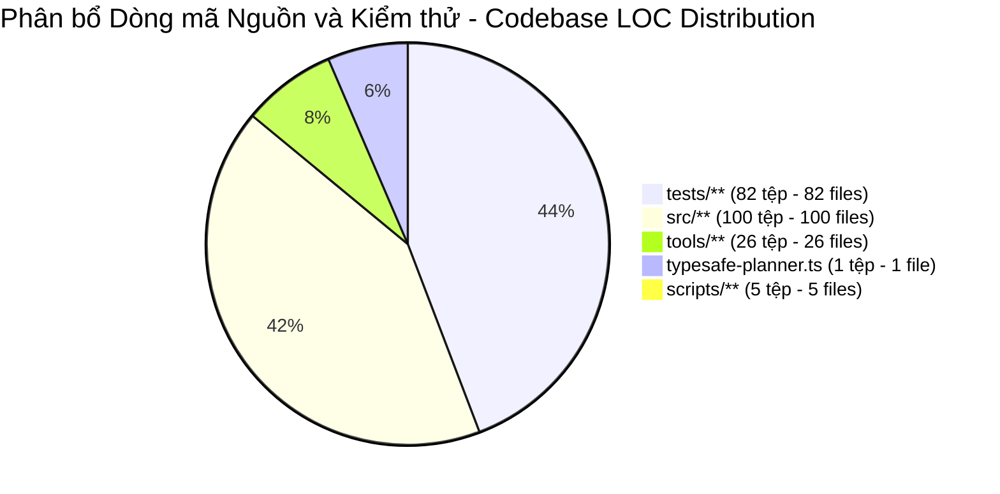
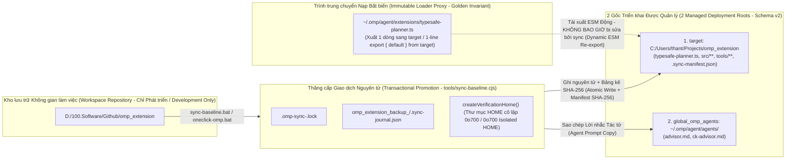

# Tổng quan Mã nguồn (Codebase Summary): `omp_extension` (`omp-typesafe-extension`)

Tài liệu này cung cấp danh mục chính thức và đầy đủ (Authoritative Complete Inventory) của kho lưu trữ (Repository) `omp_extension` (`D:/100.Software/Github/omp_extension`, gói `omp-typesafe-extension` v1.0.0), bao gồm **100** mô-đun trong `src/` được phân nhóm thành **9** miền chức năng (Functional Domains), **26** công cụ vận hành và đánh giá (Operational & Evaluation Tools) trong `tools/`, **6** kịch bản bảo trì (Maintenance Scripts) trong `scripts/`, **82** bộ kiểm thử và dữ liệu mẫu (Test Suites & Fixtures) trong `tests/`, phân bổ số dòng mã (Line of Code — LOC Distribution), ma trận phụ thuộc liên miền (Cross-Domain Dependency Matrix), và các bất biến kiến trúc cốt lõi (Core Architectural Invariants).

---

## 1. Quy mô Kho lưu trữ & Phân bổ Dòng mã (Repository Scale & LOC Distribution)

`omp_extension` kết nối bộ khung tác tử lập trình (Coding Agent Harness) **oh-my-pi (OMP)** (`omp/18.12.3+`) với **TypeSafe System One** (`https://api.typesafe.ai/v1/systemone`, mô hình `jev-latest`) cùng một tác tử con **Cố vấn Độc lập Chỉ Đọc (Independent Read-Only Native Advisor Subagent)** nhằm thực thi **Đồng thuận Lưỡng viện (Bicameral Consensus)**, **Xác thực Nhiệm vụ theo Giai đoạn (Staged Task Verification)**, **Thẩm quyền Lịch sử Nhánh Máy chủ (Host Branch History Authority)**, và **Hoàn thành Mục tiêu Thực chất (Earned Goal Completion — EGC)**.

| Phân vùng Kho lưu trữ (Repository Partition) | Số lượng Tệp (File Count) | Tổng số Dòng mã (Total LOC) | Môi trường Thực thi / Ngôn ngữ (Runtime / Language) | Trách nhiệm Chính (Primary Responsibility) |
| :--- | ---: | ---: | :--- | :--- |
| **Điểm nhập Gốc (Root Entrypoint — `typesafe-planner.ts`)** | 1 | 2,317 | TypeScript (Bun / Node >= 18) | Đăng ký 16 công cụ `typesafe_*`, 5 trình bọc công cụ gốc có bảo vệ (Guarded Native Wrappers), 12 điểm móc vòng đời (Lifecycle Hooks), dàn dựng/cam kết `todo` 2 pha (2-Phase Todo Staging/Commit), và các chốt chặn tệp/hỏi/lệnh vỏ (File/Ask/Bash Guards) |
| **Mã nguồn Lõi (Core Source — `src/**`)** | 100 | 15,028 | 91 TS + 7 CJS + 2 `.d.cts` | Hợp đồng theo giai đoạn (Staged Contracts), ảnh chụp nhanh không gian làm việc (Workspace Snapshots), gói bằng chứng 32 KiB (Evidence Packets), Đồng thuận Lưỡng viện (Bicameral Consensus — `M` + Advisor), thẩm phán nguyên tử chạy ngầm `H` (Atomic Shadow Judge), EGC, và vận chuyển/che giấu CJS (CJS Transport/Redaction) |
| **Công cụ Vận hành & Đánh giá (Operational & Eval Tools — `tools/**`)** | 26 | 2,718 | 17 TS + 4 CJS + 2 PS1 + 2 BAT + 1 MD | Xác minh/đồng bộ một chạm (One-Click Verification/Sync: `oneclick-omp`, `verify-omp-global`, `sync-baseline`, `promote-omp-global`), kiểm thử khói SDK (SDK Smoke Test), và bộ đo kiểm bắt cặp `M`/`H` (Paired `M`/`H` Benchmark Suite) |
| **Kịch bản Bảo trì (Maintenance Scripts — `scripts/**`)** | 5 | 208 | CommonJS (`.cjs`) | Các kịch bản di trú không gian làm việc (Workspace Migration) và vá lỗi mô hình mặc định mang tính lịch sử |
| **Bộ Kiểm thử Xác minh (Verification Suite — `tests/**`)** | 82 | 15,898 | 66 TS/Test + 16 JSON/JSONL/TXT | Hơn 918 bài kiểm thử đơn vị (Unit), tích hợp (Integration), đội đỏ đối kháng (Adversarial Red-Team), luồng công việc đầu-cuối (E2E Workflow), và đánh giá bắt cặp (Paired Evaluation) |
| **Tài liệu Kỹ thuật (Technical Documentation — `docs/**`)** | 42 | ~14,500 | Markdown + Mermaid | Kiến trúc hệ thống (System Architecture), mô hình hóa C4 (C4 Modeling), đặc tả mô-đun (Module Specifications), luồng logic (Logic Flows), máy trạng thái hữu hạn (FSMs), ADR và nhật ký kỹ thuật (Engineering Journals) |



---

## 2. Cấu trúc Liên kết Triển khai & Bất biến Vàng (Deployment Topology & The Golden Invariant)

Phần mở rộng (Extension) vận hành trên mô hình triển khai 3 gốc nghiêm ngặt (Strict 3-Root Deployment Model), được quản lý giao dịch nguyên tử (Transactional Management) bởi `tools/sync-baseline.cjs` và xác minh trong `<3s` bởi `tools/verify-omp-global.cjs`:



### Bất biến Vàng (The Golden Invariant)
- **Trình trung chuyển Nạp (Loader Proxy)**: `C:/Users/thant/.omp/agent/extensions/typesafe-planner.ts` là một **trình trung chuyển ủy nhiệm bất biến 1 dòng (Immutable 1-Line Proxy Trampoline)**:
  ```ts
  export { default } from "C:/Users/thant/Projects/omp_extension/typesafe-planner.ts";
  ```
- **Thực thi Nghiêm ngặt (Strict Enforcement)**: Cả lập trình viên lẫn `tools/sync-baseline.cjs` đều không bao giờ ghi trực tiếp vào `~/.omp/agent/extensions/typesafe-planner.ts`. Hai hàm `assertStrictPointer()` và `verifyPointer()` xác minh đây là một tệp thông thường (Regular File — không phải liên kết tượng trưng `symlink` hay liên kết cứng `hardlink`), không chứa byte `NUL` hoặc dấu thứ tự byte `UTF-8 BOM`, nằm ngoài mọi gốc khả biến (Mutable Roots), và khớp chính xác với dòng lệnh xuất 1 dòng (1-Line Export).

---

## 3. Danh mục Mã nguồn Đầy đủ (Complete Source Inventory: `typesafe-planner.ts` + 100 Tệp `src/`)

### Điểm nhập Gốc (Root Entrypoint — `1 tệp`, `2,317 LOC`)

| Tệp (File) | LOC | Xuất Chính & Trách nhiệm (Key Exports & Responsibilities) |
| :--- | ---: | :--- |
| `typesafe-planner.ts` | 2,317 | Hàm khởi tạo `ExtensionAPI` mặc định (`typesafePlannerExtension`), `PendingRemediation`, `CanonicalTodoTask`, `CanonicalTodoPhase`, `StagedTodoCall`, `getRuntimeOriginProof`. Đăng ký 16 công cụ `typesafe_*`, cài đặt 5 trình bọc công cụ gốc (`task`, `read`, `grep`, `glob`, `todo`), lắng nghe 12 sự kiện phiên/công cụ/tác tử (Session/Tool/Agent Events), và thực thi cam kết `todo` gốc 2 pha (`stageNativeTodoCall` $\rightarrow$ `reconcileNativeCommits`). |

---

### Miền 1: Thời gian chạy CJS, Vận chuyển, Che giấu Bí mật & Cô lập Hệ điều hành (Domain 1: CJS Runtime, Transport, Redaction & OS Isolation — `9 tệp`, `3,004 LOC`)

Các mô-đun CommonJS không phụ thuộc bên ngoài (Zero-Dependency CommonJS Modules) kèm khai báo kiểu TypeScript hoạt động độc lập và khép kín bên trong tiện ích mở rộng OMP tại `target`, tách rời hoàn toàn khỏi mọi phụ thuộc `.claude`.

| # | Tệp (File) | LOC | Xuất Chính (Primary Exports) | Trách nhiệm Kiến trúc (Architectural Responsibility) |
| ---: | :--- | ---: | :--- | :--- |
| 1 | `src/typesafe-enabled-resolver.cjs` | 558 | `resolveTypeSafeEnabled`, `findGitRoot`, `readGlobalConfig`, `typeSafeConfigWarnings`, `isValidExcludeEntry`, `isValidExcludeList`, `globalKillSwitchTriggered` | Bộ phân giải bật/tắt đồng bộ thuần túy (Pure Synchronous Opt-In Resolver) chỉ đọc `TYPESAFE_API_KEY` và tệp cấu hình toàn cục `~/.omp/agent/typesafe.json` (không bao giờ đọc cấu hình cục bộ trong kho lưu trữ). Thực thi loại trừ cây con/cây làm việc hai chiều (Bidirectional Subtree/Worktree Exclusion) và khớp ký tự đại diện `"*"` (Wildcard Matching). |
| 2 | `src/typesafe-api-client.cjs` | 734 | `validateInput`, `validateQuestionCount`, `prepareRequest`, `redactEvidenceState`, `runPreparedValidation`, `sanitizeAnswers`, `getChoiceOptions`, `judgeTypeSafe`, `requestWithRetry`, `checkCredentialCooldown`, `cancelBodyBounded`, `resetRateLimitState`, `parseRetryAfter`, `RETRY_POLICY` | Trình khách HTTP không phụ thuộc (Zero-Dependency HTTP Client) gọi tới `https://api.typesafe.ai/v1/systemone` (`jev-latest`). Thực thi giới hạn cứng `MAX_BODY_BYTES = 32768` mà không cắt xén bằng chứng ngầm (No Silent Evidence Clipping), chiếu thông điệp công khai (Public Message Projection), thử lại HTTP 429/529 (`maxAttempts: 3`, `cooldownMs: 45000`), và làm sạch phản hồi (Response Sanitization). |
| 3 | `src/typesafe-redact.cjs` | 375 | `redactString`, `redactPayload`, `capBytes`, `preparePayload`, `detectSecret` | Bộ che giấu dữ liệu đầu ra nhận biết cấu trúc (Shape-Aware Egress Redactor). Từ chối bí mật nằm trong khóa câu hỏi/lựa chọn khứ hồi (`payload_rejected_secret_in_key`), che giấu toàn bộ các khóa anh em nhạy cảm nhưng miễn trừ `TELEMETRY_COUNT_KEYS`, và giới hạn byte bằng thuật toán rót nước tìm kiếm nhị phân (Binary-Search Water-Filling Byte Capping). |
| 4 | `src/typesafe-redact-patterns.cjs` | 676 | `redactString`, `detectSecret`, `capBytes`, `sensitiveKeyKind`, `sensitiveCamelKeyKind` | Bộ máy che giấu chuỗi thời gian tuyến tính (Linear-Time String Redaction Engine): giá trị `apiKey` nguyên văn, `TOKEN_PATTERNS` (PEM, JWT, `sk-*`, GitHub/GitLab/Slack/AWS/npm, `Basic`/`Bearer`, thông tin người dùng URL), biểu thức chính quy cặp khóa-giá trị (KV Regexes) có miễn trừ lành tính, xóa đường dẫn thư mục người dùng (Home-Dir Scrubbing), và quét entropy Shannon nhận biết đường dẫn (Path-Aware Shannon Entropy Scanning). |
| 5 | `src/typesafe-policy-client.cjs` | 277 | `checkPolicy`, `judgeWithPolicy`, `resolveTrustedToolPolicy`, `resolveToolPolicies`, `validateRoutingQuestions`, `validateRoutingAnswers`, `createSemanticReviewScheduler` | Đóng băng các bản chụp `TrustedToolPolicy` được xác thực bằng `WeakSet` qua 14 mục đích (Purposes), thực thi lưới định tuyến chỉ thắt chặt (Tighten-Only Routing Lattice: `auto < review < block`), và lập lịch các gói đánh giá ngữ nghĩa có giới hạn (`maxPackets: 128`, `maxDispatches: 384`, `deadlineMs: 300000`). |
| 6 | `src/typesafe-child-env.cjs` | 114 | `buildChildEnvironment`, `spawnChild`, `spawnChildSync`, `execFileChildSync`, `execChildSync`, `createVerificationHome`, `ChildEnvironmentError` | Bộ tạo môi trường tiến trình con theo danh sách trắng nghiêm ngặt (Strict Allowlist Child-Process Environment Builder) cho 7 mục đích. Chặn `env` của bên gọi, từ chối mọi biến được phép nếu chứa chuỗi con bí mật phát hiện được (`UNSAFE_ALLOWED_VALUE`), khóa cứng cấu hình git (`GIT_FIXED`), và quản lý thư mục xác minh `0o700` có kiểm tra inode (`VerificationHome`). |
| 7 | `src/typesafe-child-env.d.cts` | 46 | Khai báo kiểu TypeScript cho `typesafe-child-env.cjs` | Định nghĩa kiểu cho `ChildEnvironmentPurpose`, `VerificationHome`, `ChildSpawnResult`, và `ChildEnvironmentError`. |
| 8 | `src/typesafe-evidence-file.cjs` | 194 | `readWorkspaceFile`, `listWorkspaceFiles`, `writeRecoveryReport`, `WorkspaceFileError` | Bộ đọc tệp không gian làm việc chống tranh chấp TOCTOU (TOCTOU-Hardened Workspace File Reader), bộ duyệt thư mục, và bộ ghi báo cáo phục hồi độc quyền (`plans/reports/typesafe-recovery/<uuid>.md`). Từ chối liên kết tượng trưng (`symlink`), điểm nối (`junction`), liên kết cứng (`nlink !== 1n`), phân đoạn `.claude`, và sự thay đổi định danh mô tả tệp/thư mục tổ tiên (Descriptor/Ancestor Identity Changes). |
| 9 | `src/typesafe-evidence-file.d.cts` | 30 | Khai báo kiểu TypeScript cho `typesafe-evidence-file.cjs` | Định nghĩa kiểu cho `WorkspaceFileIdentity`, `WorkspaceFileReadResult`, và `WorkspaceFileError`. |

---

### Miền 2: Lịch sử Máy chủ, Lời gọi Công cụ & Thời gian chạy Hợp đồng (Domain 2: Host History, Tool Invocation & Contract Runtime — `18 tệp`, `2,299 LOC`)

Phát lại lịch sử nhánh phiên OMP xác thực (`ctx.sessionManager.getBranch()`), gắn kết bằng chứng thực thi `AsyncLocalStorage` (Execution Witnesses), và đúc kết các hóa thân `TaskContract` bất biến (Immutable Contract Incarnations).

| # | Tệp (File) | LOC | Xuất Chính (Primary Exports) | Trách nhiệm Kiến trúc (Architectural Responsibility) |
| ---: | :--- | ---: | :--- | :--- |
| 10 | `src/host-history.ts` | 218 | `readHostBranch`, `findProjectToolCall`, `validateProjectToolInvocationJoin`, `contractHostHistoryDigest`, `validateUserReference`, `nativeCreationReferences`, `nativeCreationReference`, `validateSourceSpan`, `projectHostHistory`, `userRequestText`, `publicHostText`, `originalTodoInput` | Đọc phả hệ phiên trực tiếp (`<= 100,000` mục), xác thực chuỗi `parentId`, lọc bỏ các lời nhắc người dùng mẫu (Boilerplate User Prompts), và kết nối bằng chứng thực thi công cụ với các dòng `toolCall` + `toolResult` đã hoàn tất của SDK. |
| 11 | `src/host-tool-invocation.ts` | 68 | `createHostToolInvocationRuntime`, `validateHostToolInvocation`, `HOST_TOOL_INVOCATION_ENTRY` | Bọc các hàm gọi lại `execute` của công cụ đã đăng ký trong `AsyncLocalStorage` và ghi nối tiếp các mục nhánh `omp.typesafe.tool-execution.v1` mang mã dùng một lần (Nonce-Bearing Branch Entries). |
| 12 | `src/contract-runtime.ts` | 233 | `createContractRuntime`, `ContractRuntime` | Triển khai `typesafe_bind_task`: kết hợp lịch sử nhánh máy chủ, các quan sát `/ck:cook`, và phê duyệt `ctx.ui.confirm` để đúc kết hoặc sửa đổi các bản ghi `TaskContract`. |
| 13 | `src/task-contract.ts` | 138 | `createTaskContract`, `reviseTaskContract`, `taskIncarnationId`, `contractRevisionDigest`, `validHostReference` | Nhà máy khởi tạo `TaskContract` cốt lõi gắn kết `incarnationId` và `originalUserRequest` thành một hợp đồng đóng băng với mã băm SHA-256 `contractId` và `revisionId`. |
| 14 | `src/task-contract-source.ts` | 117 | `contractDigest`, `canonicalDigest`, `nativeTaskSourceUri`, `parseContractCriteria`, `freezeContractValue` | Băm SHA-256 sắp xếp khóa đệ quy tất định (Deterministic Recursive Key-Sorted SHA-256 Hashing), trích xuất tiêu chí pha từ Markdown, và đóng băng sâu đệ quy (`freezeContractValue`). |
| 15 | `src/task-contract-history.ts` | 203 | `projectContractHistory`, `createContractHistoryRecord`, `CONTRACT_HISTORY_CUSTOM_TYPE` | Phát lại các mục nhánh để chiếu `nativePhases`, `nativeStateReliable`, `incarnations`, `contracts`, `contractRevisions`, và `debt` (`omp.typesafe.contract.v1`). |
| 16 | `src/task-contract-native.ts` | 119 | `captureNativeCall`, `applyNativeResult` | Ghép cặp các mục `toolCall` `todo` của trợ lý với các mục `toolResult` đã hoàn tất và theo dõi quá trình tạo/chuyển đổi trạng thái hóa thân (Incarnation Transitions). |
| 17 | `src/task-contract-input.ts` | 66 | `normalizeNativeTodoInput`, `nativeTodoInputDigest`, `readNativeTodoOperation` | Xác thực và chuẩn hóa đầu vào `todo` trên đường truyền (`init`, `append`, `view`, `done`, `drop`, `rm`, `start`, `block`, `unblock`), từ chối trường `ops` không được hỗ trợ. |
| 18 | `src/task-contract-transition.ts` | 162 | `parseNativeTodoPhases`, `normalizeNativeTodoPointer`, `validateNativeTodoTransition` | Mô phỏng chính xác các phép chuyển đổi trạng thái `todo` của OMP v18.12.3 và cơ chế tự động thăng cấp con trỏ nhiệm vụ đang hoạt động (`normalizeInProgressTask`). |
| 19 | `src/task-contract-integrity.ts` | 70 | `assertContractIntegrity` | Bộ xác thực ranh giới cấu trúc (Structural Boundary Validator) bắt buộc các mã băm khác rỗng, dải `SourceSpan` hợp lệ, và tính duy nhất của tiêu chí trên `TaskContract`. |
| 20 | `src/task-contract-review.ts` | 79 | `validateReviewBinding`, `ReviewBinding` | Xác thực mã băm `ReviewBinding` qua các chế độ đánh giá `task_review`, `parent_review`, `consultation`, và `shadow`. |
| 21 | `src/task-contract-cook-input.ts` | 101 | `captureCookInput`, `readCookInputObservations` | Thu giữ các lời nhắc người dùng `/ck:cook --auto <path>` tại điểm móc `input` trước khi mở rộng kỹ năng (Skill Expansion) và chụp nhanh các tệp kế hoạch/pha được tham chiếu. |
| 22 | `src/task-contract-runtime-journal.ts` | 219 | `readContractRuntimeJournal` | Đọc và xác thực các mục nhánh tùy chỉnh `omp.typesafe.contract.source.v1` và `omp.typesafe.contract.confirmation.v1`. |
| 23 | `src/task-contract-runtime-provenance.ts` | 67 | `activeContractBindingCall`, `originalHostTaskRequest`, `currentNativeContractTarget` | Phân giải các lời gọi `typesafe_bind_task` đang hoạt động duy nhất, các yêu cầu người dùng thực sự liền trước, và các mục tiêu `todo` gốc hiện tại. |
| 24 | `src/task-contract-runtime-sources.ts` | 133 | `resolveParentSource`, `explicitCookPath`, `snapshotCookDocuments`, `parentSourceCriteriaIdentity`, `trustedNativeTaskKind`, `approvedContractScope`, `workspaceSourcePath` | Phân giải các tệp Markdown kế hoạch/pha trong không gian làm việc, phân loại `taskKind` (`implementation`, `review`, `research`, `operations`), và tính toán phạm vi biến đổi được phép (`allowedMutationScope`). |
| 25 | `src/task-contract-runtime-types.ts` | 136 | `CONTRACT_SOURCE_CUSTOM_TYPE`, `CONTRACT_CONFIRMATION_CUSTOM_TYPE`, `CONTRACT_BIND_TOOL_NAME`, các giao diện thời gian chạy hợp đồng | Định nghĩa kiểu và hằng số lược đồ (Schema Constants) cho việc ràng buộc hợp đồng, bản ghi xác nhận, và bản chụp nguồn cha. |
| 26 | `src/todo-lifecycle-authority.ts` | 142 | `createTodoLifecycleAuthority`, `LIFECYCLE_RECOVERY_ENTRY` | Triển khai `typesafe_prepare_todo_mutation`: xác thực `RecoveryHandoff`, bật hộp thoại `ctx.ui.confirm` khi có nợ hoặc thu hẹp phạm vi (Debt/Scope Reduction), ghi báo cáo phục hồi, và cấp phát thẻ quyền `LifecycleGrant` dùng một lần có thời hạn 60 giây. |
| 27 | `src/task-recovery.ts` | 133 | `createTaskRecoveryPolicy`, `recoveryProgressDigest`, `recordRecoveryAttempt`, `createRejectionDebt` | Xây dựng các đối tượng `RecoveryPlan` theo thứ tự phụ thuộc, theo dõi nợ từ chối ngữ nghĩa (`SemanticRejectionDebt`), và tính toán mã băm tiến độ phục hồi ở cấp độ tiêu chí (`recoveryProgressDigest`). |

---

### Miền 3: Ảnh chụp Không gian làm việc, Bằng chứng & Thời gian chạy Gói dữ liệu (Domain 3: Workspace Snapshot, Evidence & Packet Runtime — `8 tệp`, `1,285 LOC`)

Thu giữ tiền ảnh không gian làm việc được niêm phong bằng `WeakMap` (`WeakMap`-Sealed Workspace Preimages), chạy các lệnh kiểm thử đã phê duyệt trong thư mục cô lập, khám phá các tạo phẩm bàn giao (`<= 4,940 B`), và đóng gói các `JudgeEvidencePacket` 32 KiB.

| # | Tệp (File) | LOC | Xuất Chính (Primary Exports) | Trách nhiệm Kiến trúc (Architectural Responsibility) |
| ---: | :--- | ---: | :--- | :--- |
| 28 | `src/task-evidence-runtime.ts` | 248 | `createTaskEvidenceRuntime`, `TaskEvidenceRuntime` | Thời gian chạy theo phạm vi phiên (Session-Scoped Runtime) đứng sau `typesafe_collect_evidence` và `typesafe_retrieve_evidence` (trần `16,384 B`), thu giữ đường cơ sở (Baseline Capture), và xác thực độ mới (Freshness Validation). |
| 29 | `src/evidence-workspace.ts` | 207 | `captureWorkspaceSnapshot`, `taskSnapshotDiff`, `snapshotBytes`, `isHostSnapshot`, `releaseWorkspaceSnapshot`, `SNAPSHOT_LIMITS` | Thu giữ các `WorkspaceSnapshot` git/phi-git đã niêm phong (`4,000` tệp, `1 MiB`/tệp, `8 MiB`/ảnh chụp, tổng lưu giữ `32 MiB`) với bộ nhớ đệm ảnh chụp trong RAM và so sánh khác biệt tiền ảnh chỉ tại hai đầu mút (Endpoint-Only Preimage Diffs). |
| 30 | `src/evidence-collector.ts` | 305 | `collectTaskEvidence`, `executeTestCommand`, `extractCriteriaFromPlan`, `assertPathIsClaudeSafe`, `touchesClaudeBoundary`, `DELIVERABLE_ARTIFACT_MAX_BYTES` (`4940`), `isHostTaskEvidence` | Thu thập các tệp nguồn thay đổi/ngữ cảnh, xác minh `allowedMutationScope` và `AuthorizedMutationReceipt`, đồng thời thực thi các lệnh kiểm thử với cơ chế dọn dẹp tiến trình bất đồng bộ không chặn `taskkill /t /f` trên Windows. |
| 31 | `src/evidence-artifacts.ts` | 80 | `collectTaskArtifacts`, `taskArtifactAssociation`, `referencedWorkspacePaths` | Khám phá và xếp hạng các tạo phẩm bàn giao nhiệm vụ (Task Deliverable Artifacts) từ đường dẫn không gian làm việc và tệp thay đổi, đóng gói tham lam (Greedy Packing) trong giới hạn `DELIVERABLE_ARTIFACT_MAX_BYTES` (`4,940` byte). |
| 32 | `src/evidence-selection.ts` | 73 | `retrieveEvidenceSource`, `selectCriterionEvidence` | Trích xuất các khoảng dòng (Line Spans) đánh số từ 1 tăng chặt và không chồng lấn từ nguồn ảnh chụp đã lưu đệm, đồng thời ghi nhận tường minh các phần lược bỏ `out_of_packet_scope`. |
| 33 | `src/evidence-privacy.ts` | 10 | `isPrivateEvidencePath` | Chặn các đường dẫn riêng tư/thông tin xác thực (`.env*`, `.claude/**`, `*.pem`, `*.key`, `*secret*`, `*credential*`) trước khi trộn hoặc tuần tự hóa bằng chứng. |
| 34 | `src/verification-receipt.ts` | 144 | `collectVerificationReceipt`, `validateVerificationReceipt`, `issueAuthorizedMutationReceipt`, `validateAuthorizedMutation` | Chạy các lệnh xác minh đã phê duyệt (`workspace-tests` $\rightarrow$ `bun test`) bên trong `createVerificationHome()` giữa các ảnh chụp `before`/`after`/`stable`, niêm phong `VerificationReceipt` vào một `WeakMap`. |
| 35 | `src/judge-evidence-packet.ts` | 228 | `buildJudgeEvidencePacket`, `buildJudgeEvidencePacketSet`, `finalizeEvidencePacket`, `createEvidenceStateValidator` | Lắp ráp các `JudgeEvidencePacket` giới hạn `32,768` byte và `EvidencePacketSetManifest`, xác minh độ bao phủ 100% tiêu chí/tạo phẩm cùng tính đồng nhất mã băm thân gói truyền tải (Transport Body Digest Identity). |

---

### Miền 4: Thời gian chạy Xác thực Nhiệm vụ, Đồng thuận Lưỡng viện & Bộ Đánh giá (Domain 4: Task Verification Runtime, Bicameral Consensus & Evaluators — `18 tệp`, `3,395 LOC`)

Điều phối các điều kiện tiên quyết tất định ở Cổng 1 (Gate 1 Deterministic Preconditions), đánh giá biểu점 nguyên khối `M` ở Cổng 2 (Gate 2 Monolithic `M` Rubric Evaluation), phân xử đồng thuận Cố vấn độc lập (Independent Advisor Consensus Arbitration), chốt chặn chống thử lại cùng bằng chứng (Same-Evidence Retry Ratchets), và các bộ đánh giá kế hoạch/tranh biện/chuyên gia độc lập.

| # | Tệp (File) | LOC | Xuất Chính (Primary Exports) | Trách nhiệm Kiến trúc (Architectural Responsibility) |
| ---: | :--- | ---: | :--- | :--- |
| 36 | `src/task-verification-runtime.ts` | 194 | `createTaskVerificationRuntime`, `TaskVerificationRuntime` | Điều phối `typesafe_review_task`, chốt chặn thử lại cùng bằng chứng (`REJECTED`/`EVIDENCE_REQUIRED`/`UNAVAILABLE`), kết hợp kết quả `M` lưu đệm + Advisor, và kiểm tra tiền trạm/cam kết `done` gốc (Native `done` Preflight/Commit). |
| 37 | `src/task-verification-types.ts` | 99 | `TaskReviewState`, `TaskReviewOutcome`, `NativeTaskVerificationStage`, `TaskRecoveryPlan` | Các giao diện TypeScript cốt lõi cho xác thực nhiệm vụ theo giai đoạn, kết quả đánh giá, và thẻ cam kết gốc (Native Commit Handles). |
| 38 | `src/task-verification-state.ts` | 71 | `taskReviewSnapshot`, `taskRecoveryProgress`, `stateProgressDigest`, `reviewRecovery` | Tính toán `stateProgressDigest` trên các nguồn tiêu chí đã chọn, tạo phẩm, biên lai tích hợp, và kết quả lệnh xác minh. |
| 39 | `src/task-verification-native.ts` | 105 | `createNativeStageRegistry` | Sổ đăng ký dàn dựng theo định danh đối tượng (Object-Identity Staging Registry) quản lý luồng `APPROVED_PENDING_COMMIT` $\rightarrow$ `observe` $\rightarrow$ `commit` nhánh đã hoàn tất. |
| 40 | `src/task-verification-advisor.ts` | 177 | `createTaskAdvisorServices` | Kết nối `TaskVerificationRuntime` với `AdvisorHostServices` để chuẩn bị và xác thực các yêu cầu `task_review`, `parent_review`, và `consultation`. |
| 41 | `src/task-verification-macro.ts` | 50 | `evaluateMonolithicTask` | Thực thi độ bao phủ toàn bộ tiêu chí trong một gói duy nhất (`ONE_COMPLETE_ORIGINAL_TASK_PACKET_REQUIRED`) và điều phối `runPhaseMacroCheck`. |
| 42 | `src/task-verification-history.ts` | 202 | `createVerificationHistory`, `VERIFICATION_HISTORY_ENTRY` | Lưu trữ bền vững và truy vấn các mục nhánh `omp.typesafe.task-verification-facts.v1` cho lỗi đánh giá, quan sát tính khả dụng, kế hoạch phục hồi, và cam kết gốc. |
| 43 | `src/task-verification-historical.ts` | 74 | `createHistoricalDebtResolver` | Triển khai `typesafe_resolve_historical_debt` với hộp thoại tương tác `ctx.ui.confirm` cho các hóa thân đã hoàn thành, bị hủy bỏ, hoặc bị xóa (`HUMAN_RECONCILED_NO_NATIVE_APPROVAL`). |
| 44 | `src/task-verification-debt.ts` | 55 | `historicalDebtCatalogue` | Tổng hợp các khoản nợ chưa giải quyết gồm `semantic_rejection`, `contract_debt`, và `unclassified_native_failure` cho các hóa thân đã đóng. |
| 45 | `src/task-verification-debt-types.ts` | 51 | `HistoricalDebtRecord`, `HistoricalDebtCatalogue`, `HistoricalDebtResolutionFact` | Định nghĩa kiểu cho danh mục nợ lịch sử (Historical Debt Catalogues) và dữ kiện đối soát (Reconciliation Facts). |
| 46 | `src/task-verification-invocation.ts` | 23 | `verificationInvocationSource` | Phân giải các bằng chứng thực thi `HostToolInvocation` đang hoạt động hoặc đã lưu trữ cho các lời gọi xác thực. |
| 47 | `src/task-verification-plan.ts` | 25 | `planPhaseReviewDigest`, `usablePlanPhaseReview` | Tính toán và xác thực mã băm cho các lượt đánh giá pha kế hoạch ở chế độ tham vấn (Consultation-Mode Plan-Phase Reviews). |
| 48 | `src/bicameral-consensus.ts` | 978 | `evaluateAdvisorIntent`, `arbitrateConsensus`, `evaluateBicameralDoneConsensus`, `runBicameralDoneCheck`, `runBicameralDropCheck`, `runBicameralDecisionCheck`, `formatCkAdvisorReport` | Bộ máy Đồng thuận Lưỡng viện (Bicameral Consensus Engine): kết hợp Thùy 1 (Lobe 1: `AdvisorReceipt` + heuristic ý định cục bộ không mang thẩm quyền) và Thùy 2 (Lobe 2: JEV `MacroCheckResult`), leo thang các bất đồng giữa hai thùy lên `HUMAN_REQUIRED`. |
| 49 | `src/verification-gate.ts` | 241 | `checkDeterministicPreconditions`, `constructGateQuestions`, `verifyTaskCompletion`, `resolveAutoApprovalThreshold`, `generateFallbackRemediation` | Các kiểm tra tất định Cổng 1 (cô lập `.claude`, mã thoát kiểm thử, lách kiểm thử AST, các phần lược bỏ) và bộ đánh giá Cổng 2 mang tính tham vấn `typesafe_verify_completion`. |
| 50 | `src/cook-expert-judge.ts` | 645 | `runTaskMicroCheck`, `runPhaseMacroCheck`, `runTodoDropCheck`, `evaluateScopeArbiter`, `evaluateDriftGuard`, `evaluateRiskSecurityTriage`, `generateVerificationScorecard` | Đánh giá `deliverables_verdict`, `meets_criteria`, `architectural_drift`, `scope_mode`, và các câu hỏi từng tiêu chí `criterion_0..N` (`satisfied` \| `violated` \| `evidence_missing`), cùng các đánh giá vai trò chuyên gia (Expert Role Evaluations). |
| 51 | `src/plan-evaluator.ts` | 367 | `evaluatePlanDraft`, `checkClaudePlanIsolation`, `preEvaluationTriage` | Nâng cấp kế hoạch trước thực thi (`typesafe_elevate_plan`): phân loại cấu trúc/DAG tất định (`<= 32 KiB`) + 4 biểu điểm JEV (`scope_mode`, `algorithm_depth >= 2`, `task_actionability`, `claude_isolation_adherence`). |
| 52 | `src/debate-evaluator.ts` | 248 | `runMultiPersonaDebate`, `constructMultiPersonaQuestions`, `resolveDebateModel` | Bộ đánh giá tranh biện 5 nhân cách (5-Persona Debate Evaluator: `architect`, `security`, `performance`, `ux`, `devils_advocate` trên thang điểm `0..3`; yêu cầu trung bình `mean >= 1.5` và không có phiếu phủ quyết `< 1`). |
| 53 | `src/plan-closure.ts` | 89 | `assertScopedPlanClosure`, `parsePlanCliCheck`, `phaseFileForCheck`, `PlanClosurePrerequisiteError` | Chặn lệnh `plan-cli check` hoặc việc đóng kế hoạch Markdown `[x]` khi các nhiệm vụ trong hợp đồng vẫn chưa hoàn tất hoặc còn mang nợ chưa giải quyết. |

---

### Miền 5: Hệ thống con Cố vấn Gốc Độc lập (Domain 5: Independent Native Advisor Subsystem — `20 tệp`, `1,965 LOC`)

Quản lý vòng đời tác tử con gốc chỉ đọc `advisor` / `ck:advisor`, cô lập lời nhắc (Prompt Isolation), trung gian đọc tệp khớp mã băm SHA chính xác (Exact-SHA File Read Mediation), làm sạch tải trọng nhà cung cấp (Provider Payload Sanitization), và xác minh biên lai đã hoàn tất (Settled Receipt Verification).

| # | Tệp (File) | LOC | Xuất Chính (Primary Exports) | Trách nhiệm Kiến trúc (Architectural Responsibility) |
| ---: | :--- | ---: | :--- | :--- |
| 54 | `src/advisor-protocol.ts` | 194 | `createAdvisorRequest`, `validateAdvisorReceipt`, `validateAssessmentForRequest`, `foldAdvisorHistory`, `advisorOutputSchema` | Định nghĩa `AdvisorRequest`, `AdvisorAssessment`, `AdvisorReceipt`, lược đồ JSON nghiêm ngặt, và bất biến tính áp dụng của biên lai (Receipt Applicability Invariant: `applicable === false` khi cũ/bị thay thế). |
| 55 | `src/advisor-runtime.ts` | 234 | `createAdvisorRuntime`, `AdvisorRuntime` | Máy trạng thái cốt lõi cho việc chuẩn bị Advisor, ràng buộc phiên con (Child Session Binding), chiếu tải trọng nhà cung cấp, trung gian công cụ chỉ đọc, và đúc kết `AdvisorReceipt`. |
| 56 | `src/advisor-host.ts` | 143 | `registerAdvisorHost`, `supportsAdvisorHost` | Bọc các công cụ tích hợp sẵn `task`, `read`, `grep`, `glob`, và `todo` (bảo toàn định danh đối tượng lược đồ gốc) đồng thời đăng ký `typesafe_prepare_advisor` và `typesafe_advisor`. |
| 57 | `src/advisor-host-types.ts` | 70 | `AdvisorHostAPI`, `AdvisorHostServices`, `AdvisorHostRegistration`, `AdvisorNativeTodoServices` | Các giao diện cho việc đăng ký máy chủ Advisor, dịch vụ, và các điểm móc chặn `todo` gốc. |
| 58 | `src/advisor-host-dispatch.ts` | 149 | `prepareHostReview`, `prepareHostShadowReview`, `executeHostTask` | Chuẩn bị các thẻ đánh giá tạm thời (`reviewHandle`) và thực thi điều phối `task` gốc đơn mục bên trong `advisorDispatchFrame` và `reviewBudget`. |
| 59 | `src/advisor-host-hooks.ts` | 124 | `installAdvisorHostHooks` | Cài đặt các điểm móc `before_subagent_spawn`, `before_agent_start`, `context`, `before_provider_request`, `tool_call`, `tool_result`, và xoay vòng phiên (Session Rotation Hooks). |
| 60 | `src/advisor-host-state.ts` | 146 | `getHostScope`, `routeChild`, `rotateHostScope`, `advisorDispatchFrame`, `ADVISOR_HOST_ENTRY` | Quản lý `HostScope` theo từng phiên, `ChildRoute`, các khung điều phối `AsyncLocalStorage`, và các mục nhật ký `typesafe:advisor:host:v1`. |
| 61 | `src/advisor-host-settlement.ts` | 76 | `collectAdvisorHostSettlement`, `ownsAdvisorHostSettlement`, `isCurrentAdvisorHostSettlement` | Xác minh các dòng `toolResult` của `task` gốc đã hoàn tất, từ chối các xác nhận bất đồng bộ (Async Acknowledgments), lỗi, hoặc các kết quả hoàn tất trùng lặp mâu thuẫn. |
| 62 | `src/advisor-host-history.ts` | 45 | `hasSettledAdvisorHistory` | Xác nhận một `AdvisorReceipt` được hậu thuẫn bởi một `toolResult` `task` gốc đã hoàn tất và không mâu thuẫn trong `sessionManager.getBranch()`. |
| 63 | `src/advisor-native-budget.ts` | 58 | `createAdvisorNativeBudget` | Thực thi kiểm soát thu nhận (Admission Control) và thời hạn của `SemanticReviewScheduler` cho các lệnh điều phối con Advisor, xả các luồng gốc bị quá hạn/lỗi (trần `250 ms` — Stream Drain). |
| 64 | `src/advisor-native-observation.ts` | 73 | `captureAdvisorNativeObservation`, `decodeAdvisorNativeObservation` | Thu giữ mức sử dụng token của tiến trình con do SDK báo cáo (`input`, `output`, `cacheRead`, `cacheWrite`, `totalTokens`), chi phí, độ trễ, và mô hình đã phân giải. |
| 65 | `src/advisor-native-prompt.ts` | 10 | `nativeAdvisorPrompt`, `ADVISOR_NATIVE_CONTEXT`, `ADVISOR_SOLUTION_SPACE` | Định dạng các nhiệm vụ JSON một dòng tất định vào lời nhắc tác tử con đã ghim phiên bản v18.12.3. |
| 66 | `src/advisor-native-schema.ts` | 27 | `advisorNativeTaskCapabilities`, `advisorNativeParameters` | Kiểm tra hình thái lược đồ `task` gốc (`batch` so với `flat`, `isolated`) và xây dựng tham số gọi tác tử con nghiêm ngặt (`isolated: false`, `schemaMode: "strict"`). |
| 67 | `src/advisor-native-todo.ts` | 31 | `executeAdvisorNativeTodo` | Bọc quá trình thực thi `todo` gốc bằng bước dàn dựng tiền trạm `beforeExecute` và quan sát kết quả `afterExecute`. |
| 68 | `src/advisor-public-context.ts` | 82 | `prepareAdvisorPublicContext`, `prepareAdvisorConsultationContext` | Che giấu các gói nhiệm vụ/tham vấn thông qua `redactEvidenceState`, xác minh sự tồn toàn của tham chiếu (Reference Survival), và thực thi giới hạn `maxContextBytes = 262,144` byte (256 KiB). |
| 69 | `src/advisor-read-session.ts` | 51 | `createAdvisorReadSession` | Theo dõi việc cấp quyền, thực thi, và quan sát `toolResult` đã công bố của từng lệnh `read`/`grep`/`glob` bên trong một phiên con Advisor. |
| 70 | `src/advisor-readonly.ts` | 116 | `authorizeAdvisorRead`, `executeAdvisorRead`, `defaultAdvisorReadLimits` | Trung gian hóa `read`/`grep`/`glob` đối chiếu với các tệp được cấp quyền có mã băm SHA chính xác (`maxFileBytes: 4 MiB`, `maxOutputBytes: 16 KiB`), bắt buộc bộ chọn dòng `:start-end` và mẫu `grep` nguyên văn (Literal Patterns). |
| 71 | `src/advisor-guards.ts` | 107 | `projectAdvisorPayload`, `guardAdvisorTool`, `publicAdvisorMessages` | Chiếu các tải trọng nhà cung cấp đã làm sạch cho các API OpenAI/Anthropic đã ghim (`store: false`, lược bỏ mô tả công cụ) và chặn các công cụ con trái phép. |
| 72 | `src/advisor-mutation-delegation.ts` | 116 | `createNativeMutationDelegation` | Lan truyền quyền biến đổi tệp `NativeMutationScopeGrant` qua các lần khởi tạo tác tử con không phải Advisor bằng `AsyncLocalStorage` và tiêu đề phiên cha-con đã xác minh. |
| 73 | `src/advisor-shadow.ts` | 34 | `validateShadowAdvisorReview`, `shadowAdvisorDispatchId`, `shadowAdvisorTemplateDigest` | Xác thực các lượt điều phối Advisor đánh giá chạy ngầm (`authority: "none"`, `mutationAllowed: false`). |

---

### Miền 6: Thẩm phán Nguyên tử (`H`) & Máy chủ Đánh giá Nội phiên (Domain 6: Atomic Judge `H` & In-Session Evaluation Host — `10 tệp`, `829 LOC`)

Triển khai Thẩm phán Nguyên tử sắp xếp theo phụ thuộc (`H` — Dependency-Ordered Atomic Judge) và cầu nối `typesafe_eval_host` ký số Ed25519 phục vụ đo kiểm chạy ngầm bắt cặp `M`/`H` (Paired `M`/`H` Shadow Benchmarking).

| # | Tệp (File) | LOC | Xuất Chính (Primary Exports) | Trách nhiệm Kiến trúc (Architectural Responsibility) |
| ---: | :--- | ---: | :--- | :--- |
| 74 | `src/atomic-judge.ts` | 259 | `createAtomicJudge`, `AtomicJudge` | Phân hoạch các mục vị từ `PredicateSpec` theo thứ tự phụ thuộc thành các gói (`<= 128` câu hỏi/yêu cầu), thực thi qua `SemanticReviewScheduler`, và tạo ra các biên lai `AtomicReviewReceipt` đóng băng. |
| 75 | `src/atomic-evaluation.ts` | 155 | `createPairedReviewDriver` | Trình điều khiển chạy ngầm bắt cặp `M`/`H` thực thi `mode: "shadow"`, `allowMutation: false`, `allowAuthorityReuse: false`, và cấm tái sử dụng biên lai Advisor gốc giữa các nhánh thử nghiệm (Arms). |
| 76 | `src/atomic-decision-policy.ts` | 63 | `resolveAtomicDecisionPolicy`, `decideAtomicNoul` | Đánh giá xác suất `noul` dưới các chế độ quyết định `support_only`, `counterevidence_only`, và `closed_world_boolean`. |
| 77 | `src/atomic-preparation.ts` | 53 | `prepareAtomicInput` | Xác thực các ràng buộc mật mã học giữa `contract`, `packetSet`, `binding`, và `snapshot`, sinh ra các vị từ tiêu chí con (Child Criterion Predicates) và các kiểm tra tất định. |
| 78 | `src/atomic-parent.ts` | 24 | `createAtomicParentPredicates` | Sinh các vị từ tích hợp `parent_<hash>` với các cạnh phụ thuộc `dependsOn` trỏ tới toàn bộ vị từ tiêu chí con. |
| 79 | `src/atomic-checks.ts` | 11 | `runAtomicDeterministicChecks` | Đánh giá các kiểm tra tất định (`exit_status`, `digest`, `exact`) cho các lượt đánh giá nguyên tử. |
| 80 | `src/evaluation-host.ts` | 179 | `createEvaluationHost` | Triển khai `typesafe_eval_host` (`identity`, `authorize`, `prepare`, `collect`), tạo khóa Ed25519 theo phiên, yêu cầu phê duyệt giao diện người dùng (Human UI Approval), và ký số các biên lai `NativeHostEnvelope`. |
| 81 | `src/evaluation-host-types.ts` | 24 | `EvaluationHost`, `EvaluationHostOptions`, `EvaluationHostParameters`, `EvaluationHostFacts` | Các giao diện TypeScript cho máy chủ đánh giá nội phiên (In-Session Evaluation Host). |
| 82 | `src/evaluation-host-corpus.ts` | 42 | `loadOwnedEvaluationRun`, `loadOwnedEvaluationCase` | Nạp và xác thực các lượt chạy đo kiểm mô hình đã đóng băng cùng các yêu cầu nhánh gốc đang chờ xử lý. |
| 83 | `src/evaluation-host-observation.ts` | 26 | `observedNativeProof`, `failedNativeObservation` | Trích xuất bằng chứng hoàn tất gốc (Native Settlement Proofs) và chuyển đổi các lượt hoàn tất thất bại thành quan sát có cấu trúc. |

---

### Miền 7: Hoàn thành Mục tiêu Thực chất — EGC (Domain 7: Earned Goal Completion — `4 tệp`, `778 LOC`)

Bộ máy xác minh cô lập bằng cây làm việc (Worktree-Isolated Verification) và chốt chặn chống đình trệ (Stall-Ratchet Engine) độc lập, được cấu hình qua `.omp/egc.json` và `/egc lock`.

| # | Tệp (File) | LOC | Xuất Chính (Primary Exports) | Trách nhiệm Kiến trúc (Architectural Responsibility) |
| ---: | :--- | ---: | :--- | :--- |
| 84 | `src/egc.ts` | 440 | `default` (`egcExtension`), `EgcEvidenceRefusal` | Chặn bắt `todo`/`todo_write` và các công cụ ghi tệp; sàng lọc `"unsandboxed": true` ở chế độ thực thi (Enforce Mode); yêu cầu lệnh xác minh trong `uncontracted: "allow"` trừ khi `jev.mode === "enforce"`; từ chối các mục tiêu `done` nhập nhằng (`targets.length > 1`); chạy `verify` + `holdout` trong cây làm việc git tách rời (Detached Git Worktrees); thực thi tiếp tục phiên tại `session_stop`. |
| 85 | `src/egc-native.ts` | 194 | `projectEgcNativeHistory`, `EgcNativeLedger` | Tái tạo các hóa thân `todo` gốc từ lịch sử nhánh đã hoàn tất, theo dõi nợ `EgcDebt` theo từng hóa thân (`best`, `fp`, `stalls`), và thu hồi đánh giá `ready` ngay khi có bất kỳ lời gọi công cụ ghi tệp nào. |
| 86 | `src/egc-safety.ts` | 91 | `boundedEgcJson`, `prepareEgcData`, `runEgcCommand` | Thực thi giới hạn duyệt JSON (`nodes <= 2000`, `depth <= 5`, `string <= 32 KiB`, `aggregate <= 128 KiB`), che giấu trạng thái EGC, và khởi tạo các lệnh con cô lập. |
| 87 | `src/egc-judge.ts` | 53 | `createEgcJudge`, `askJev` | Đánh giá các câu hỏi `noul` gồm `stub`, `tamper`, và `impl_r1..N` thông qua `https://api.typesafe.ai/v1/systemone` dưới mục đích `"egc"`. |

---

### Miền 8: Bảo mật, Thẩm quyền Biến đổi, Che giấu & Trình khách Ngữ nghĩa (Domain 8: Security, Mutation Authority, Redaction & Semantic Client — `9 tệp`, `849 LOC`)

Các cầu nối bảo mật TypeScript, bộ phân tích khác biệt AST (AST Diff Analyzers), thẩm quyền biến đổi tệp nguồn (Source-File Mutation Authorities), và trình bọc truyền tải ngữ nghĩa.

| # | Tệp (File) | LOC | Xuất Chính (Primary Exports) | Trách nhiệm Kiến trúc (Architectural Responsibility) |
| ---: | :--- | ---: | :--- | :--- |
| 88 | `src/payload-safety.ts` | 343 | `DEFAULT_MAX_BYTES` (`32768`), `redactAnthropicSecrets`, `isSecretInKey`, `truncatePayloadState`, `preparePayloadSafe`, `clampText` | Làm sạch các chuỗi `sk-ant-*`, `sessionKey=*`, và `CLAUDE_CODE_TOKEN=*`, kiểm tra khóa khứ hồi (`isSecretInKey`), và cắt gọn bản so sánh khác biệt (Diff Truncation) trong khi vẫn bảo toàn tiêu đề cùng các dòng ngăn xếp lỗi (Error Stack Lines). |
| 89 | `src/ast-analyzer.ts` | 143 | `analyzeDiffForTestEvasion` | Bộ phân tích khác biệt thận trọng (Conservative Diff Analyzer) phát hiện việc xóa ròng các câu lệnh `expect`/`assert`, xóa các bộ `describe`/`it`/`test`, đóng chú thích các khẳng định kiểm thử, gắn cờ `.skip`/`.todo`/`xit`, và các hằng đúng tầm thường `expect(X).toBe(X)` (Tautologies). |
| 90 | `src/remediation-generator.ts` | 97 | `generateRemediationBlock`, `synthesizePlanDelta` | Sinh các khối chỉ thị `<remediation>` và `<plan_reconciliation>` đã thoát ký tự XML (XML-Escaped Directive Blocks) kèm các hành động tiếp theo và ràng buộc cụ thể. |
| 91 | `src/auth-manager.ts` | 58 | `AuthManager` | Theo dõi các lỗi xác thực 401/403 bằng mã băm SHA-256 16 ký tự hex của thẻ khóa (`MAX_RETRIES = 1`), chuyển đổi trạng thái `authenticated` $\rightarrow$ `refreshing` $\rightarrow$ `revoked`. |
| 92 | `src/xml-enclosure.ts` | 15 | `sanitizeXmlText`, `encloseUntrusted` | Làm sạch các tiêu đề tiêm nhiễm lời nhắc (Prompt-Injection Headers: `CRITICAL SYSTEM OVERRIDE`, `IGNORE ALL PREVIOUS INSTRUCTIONS`, `SYSTEM PROMPT:`) và thoát các ranh giới thẻ đóng `</tag>`. |
| 93 | `src/source-mutation-authority.ts` | 46 | `currentSourceMutationGrant`, `sourceMutationGrantCurrent`, `sourceMutationAllowed` | Lấy giao (Intersection) của `operations` và `paths` giữa các hợp đồng `implementation`/`operations` đang hoạt động để cấp quyền ghi vào các tệp được bảo vệ. |
| 94 | `src/file-mutation-targets.ts` | 45 | `fileMutationTargets`, `requestsPlanCompletion` | Trích xuất đường dẫn đích từ lệnh `write` và `edit` (tiêu đề dòng băm `PUT`/`CUT`/`REM`/`MV`) và phát hiện các phép chuyển đổi hoàn thành kế hoạch Markdown `[x]` / `Status: COMPLETED`. |
| 95 | `src/semantic-judge-client.ts` | 101 | `createSemanticJudgeClient`, `scoreValue`, `choiceValue`, `noulValue` | Ràng buộc một mục đích ngữ nghĩa do máy chủ chọn (`SemanticPurpose`: `expert`, `advisory`, `native_done`, `native_drop`, `decision`) vào `typesafe-policy-client.cjs`. |
| 96 | `src/semantic-approval-policy.ts` | 36 | `createSemanticApprovalPolicy`, `passesSemanticApproval`, `isSemanticApprovalPolicy` | Thu giữ ngưỡng `TYPESAFE_AUTO_APPROVAL_THRESHOLD` (mặc định `> 0.50`, tùy chỉnh `>= threshold`) vào một đối tượng chính sách được xác thực bằng `WeakSet`. |
| 97 | `src/semantic-failure.ts` | 23 | `semanticFailureDisposition` | Ánh xạ các mã lỗi truyền tải/xác thực (`payload too large`, `question_limit_exceeded` $\rightarrow$ `EVIDENCE_REQUIRED`; lỗi mạng/xác thực/hết thời gian chờ $\rightarrow$ `UNAVAILABLE`). |

---

### Miền 9: Kiểu Dùng chung & Phân cấp Lỗi (Domain 9: Shared Types & Error Hierarchy — `3 tệp`, `566 LOC`)

| # | Tệp (File) | LOC | Xuất Chính (Primary Exports) | Trách nhiệm Kiến trúc (Architectural Responsibility) |
| ---: | :--- | ---: | :--- | :--- |
| 98 | `src/types/verification.ts` | 458 | `VerificationOutcome`, `TaskContract`, `WorkspaceSnapshot`, `VerificationReceipt`, `JudgeEvidencePacket`, `AdvisorRequest`, `AdvisorAssessment`, `AdvisorReceipt`, `AtomicReviewReceipt`, `SemanticApprovalPolicy` | Các giao diện TypeScript chuẩn tắc (Canonical TypeScript Interfaces) cho hợp đồng, ảnh chụp nhanh, biên lai, gói bằng chứng, Đồng thuận Lưỡng viện, Advisor, và Thẩm phán Nguyên tử. |
| 99 | `src/types/security.ts` | 62 | `ASTAnalysisResult`, `AuthState`, `RemediationDirective`, `SecurityViolation` | Các giao diện TypeScript cho phân tích chống lách luật AST, theo dõi trạng thái xác thực, và chỉ thị khắc phục XML. |
| 100 | `src/errors/TypeSafeError.ts` | 46 | `TypeSafeError`, `TypeSafeErrorCode` | Hệ thống phân cấp lớp lỗi chuẩn hóa (Standardized Error Class Hierarchy) mang mã lỗi có cấu trúc và siêu dữ liệu ngữ cảnh. |

---

## 4. Công cụ Vận hành (`tools/**` — 26 Tệp), Kịch bản (`scripts/**` — 5 Tệp) & Kiểm thử (`tests/**` — 82 Tệp)

### 4.1 `tools/**` (`26 tệp`, `2,718 LOC`)

| Phân loại (Category) | Danh sách Tệp (`tools/`) | Mục đích & Điểm nhập CLI (Purpose & CLI Entrypoints) |
| :--- | :--- | :--- |
| **Xác minh Toàn cục & Một chạm (One-Click & Global Verifier — 5 tệp)** | `oneclick-omp.bat`, `oneclick-omp.ps1` (`57` LOC), `verify-omp-global.bat`, `verify-omp-global.cjs` (`367` LOC), `README.md` (`41` LOC) | `npm run verify:global` / `npm run verify:live` / `npm run oneclick`: Kiểm tra nhanh (`<3s`) qua 6 lớp (Trình trung chuyển Nạp — Loader Proxy, Đối xứng Bảng kê SHA-256 trên 2 Gốc — 2-Root Manifest SHA-256 Parity, Kiểm tra Tiền trạm `--dry-run`, Tự kiểm tra Bộ phân giải + Bộ che giấu `TELEMETRY_COUNT_KEYS`, Nhật ký Sao lưu Mới nhất, và Thăm dò Trực tiếp `jev-latest` tùy chọn). `oneclick-omp` chỉ tự động đồng bộ khi phát hiện độ lệch (Drift). |
| **Đồng bộ Đường cơ sở Giao dịch (Transactional Baseline Sync — 3 tệp)** | `sync-baseline.cjs` (`533` LOC), `promote-omp-global.ps1` (`223` LOC), `sync-baseline.bat` (`6` LOC) | `npm run sync`: Chiếm khóa `.omp-sync-<hash>.lock`, xác minh lại định danh kế hoạch sau khi khóa (`deployment plan changed after lock`), sao lưu tiền ảnh vào `omp_extension_backup_<ISO>/.sync-journal.json`, ghi nguyên tử vào `target` và `global_omp_agents` (Schema v2), chạy `bun test` trong `createVerificationHome()`, và hoàn nguyên theo thứ tự ngược lại (Reverse-Order Rollback) nếu có bất kỳ lỗi nào. |
| **Lớp Không gian làm việc (Workspace Layer — 5 tệp)** | `omp-workspace-loader.ts`, `omp-target-gate-overlay.yml`, `verify-omp-workspace.cjs`, `verify-omp-workspace-lib.cjs`, `verify-omp-workspace-runtime.cjs` | Bộ nạp thất bại-đóng (Fail-Closed Loader) cho `.omp/config.yml` của không gian làm việc, lớp phủ (overlay) chạy cổng đã triển khai từ gốc kho, và trình xác minh `bun run verify:workspace [--runtime]`. Xem `docs/decisions/ADR-20261106-workspace-layer-fail-closed-loader.md`. |
| **Kiểm thử Khói SDK Gốc (Native SDK Smoke Test — 1 tệp)** | `todo-remediation-smoke.ts` (`79` LOC) | Khởi chạy CLI `omp` thực tế kết nối tới máy chủ OpenAI SSE kịch bản vòng lặp cục bộ (Loopback Scripted OpenAI SSE Server) trong `createVerificationHome()` để chứng minh lệnh `todo:done` chưa được phê duyệt bị chặn trước khi Core phát ra kết quả công cụ (`SDK_NATIVE_SMOKE_PROOF`). |
| **Bộ Đánh giá Bắt cặp `M`/`H` (Paired `M`/`H` Evaluation Suite — 17 tệp)** | `jev-paired-eval.ts` (`88` LOC), `jev-paired-eval-lib.ts` (`15` LOC), `jev-paired-types.ts` (`102` LOC), `jev-paired-inputs.ts` (`101` LOC), `jev-paired-files.ts` (`113` LOC), `jev-paired-validation.ts` (`120` LOC), `jev-paired-runner.ts` (`219` LOC), `jev-paired-host-protocol.ts` (`72` LOC), `jev-paired-host-client.ts` (`70` LOC), `jev-paired-host-journal.ts` (`25` LOC), `jev-paired-workspace.ts` (`160` LOC), `jev-paired-metrics.ts` (`157` LOC), `jev-paired-metric-types.ts` (`26` LOC), `jev-paired-accounting.ts` (`72` LOC), `jev-paired-exposure.ts` (`33` LOC), `jev-paired-statistics.ts` (`70` LOC), `jev-paired-ablations.ts` (`25` LOC) | Giao diện CLI đánh giá bắt cặp đăng ký trước (Preregistered Paired Evaluation CLI: `validate`, `freeze`, `benchmark`, `report`, `decide`) so sánh mô hình Nguyên khối Đã sửa (`M` — Repaired Monolithic) với mô hình Nguyên tử (`H` — Atomic) theo tiêu chuẩn `strict-corpus-dominance-v1` với phân tách tập hợp hợp-tìm 60/20/20 (Union-Find Splits), khóa phơi nhiễm tập giữ lại (Holdout Exposure Locks), khoảng tin cậy Clopper-Pearson, và biên lai `typesafe_eval_host` ký số Ed25519. |

### 4.2 `scripts/**` (`5 tệp`, `208 LOC`)
Các tiện ích di trú CJS lịch sử được giữ lại trong bảng kê đường cơ sở (Baseline Manifest). Kịch bản sao chép trực tiếp `deploy-baseline-to-target.cjs` (đường vòng qua bản kê/nhật ký/hoàn tác) đã bị xóa; chỉ còn giao dịch `tools/sync-baseline.cjs`:
1. `scripts/patch-workspace-planner.cjs` (`92` LOC) — Kịch bản lịch sử kết nối bộ đánh giá tranh biện trong không gian làm việc.
2. `scripts/update-planner-jev-latest.cjs` (`70` LOC) — Kịch bản cập nhật lịch sử đặt `jev-latest` làm mô hình mặc định.
3. `scripts/remove-gate3.cjs` (`26` LOC) — Kịch bản vá lỗi lịch sử loại bỏ khối Cổng 3 (Gate 3) cũ.
4. `scripts/safe-update-planner-model.cjs` (`19` LOC) — Kịch bản vá lỗi lịch sử cho biến `TYPESAFE_PREDICT_MODEL`.
5. `scripts/typesafe-planner-drop-tasks.cjs` (`1` LOC) — Tệp giữ chỗ không thao tác (No-Op Stub) lịch sử cho việc hủy nhiệm vụ.

### 4.3 `tests/**` (`82 tệp`, `15,898 LOC`)
- **61 Bộ Kiểm thử `.test.ts` (61 Test Suites)**: Bao phủ mọi miền chức năng (`typesafe-planner.test.ts`, `typesafe-planner-integration.test.ts`, `e2e-workflow.test.ts`, `contract-runtime.test.ts`, `native-history-authority.test.ts`, `host-tool-invocation.test.ts`, `task-evidence-runtime.test.ts`, `judge-evidence-packet.test.ts`, `verification-receipt.test.ts`, `evidence-collector.test.ts`, `evidence-file-security.test.ts`, `task-artifact-routing.test.ts`, `task-verification-runtime.test.ts`, `task-verification-progress.test.ts`, `task-verification-source.test.ts`, `bicameral-consensus.test.ts`, `advisor-host.test.ts`, `advisor-runtime.test.ts`, `advisor-protocol.test.ts`, `advisor-native-budget.test.ts`, `atomic-judge.test.ts`, `jev-paired-evaluation.test.ts`, `evaluation-host.test.ts`, `egc.test.ts`, `sync-baseline.test.ts`, `typesafe-child-env.test.ts`, `public-evidence-egress.test.ts`, `egress-and-process-boundary.test.ts`, `trusted-tool-policy.test.ts`, `typesafe-transport-retry.test.ts`, `typesafe-resolver.test.ts`, `adversarial-compliance.test.ts`, `adversarial-edge-cases.test.ts`, `cook-verification-adversarial.test.ts`, v.v.).
- **5 Bộ khung & Dữ liệu mẫu Kiểm thử TypeScript (5 TypeScript Test Harnesses/Fixtures)**: `tests/isolated-verification.ts`, `tests/task-verification-fixture.ts`, `tests/advisor-host-fixture.ts`, `tests/advisor-fixtures.ts`, `tests/helpers/test-env-harness.ts`.
- **16 Tệp Dữ liệu mẫu Đánh giá Bắt cặp (`tests/fixtures/jev-paired-evaluation/**`)**: `protocol.json`, `corpus.jsonl`, `control.ts`, `labels.jsonl`, `prices.json`, `splits.json`, `configuration.txt`, và từ `consumer-0.json` đến `consumer-9.json`.

---

## 5. Ma trận Phụ thuộc Liên miền 9x9 (Cross-Domain Dependency Matrix)

Các hàng phụ thuộc vào các cột (`●` = phụ thuộc thời gian chạy trực tiếp / Direct Runtime Dependency, `○` = phụ thuộc chỉ về kiểu hoặc gián tiếp qua hợp đồng / Type-Only or Indirect Contract Dependency, `—` = độc lập / cấm phụ thuộc ngược lên trên / Forbidden Upward Dependency):

| Miền Gọi \ Miền Được Gọi (Caller \ Callee) | D1: CJS Runtime | D2: Contracts & History | D3: Snapshot & Evidence | D4: Verification & Consensus | D5: Native Advisor | D6: Atomic & Eval Host | D7: EGC | D8: Security & Auth | D9: Shared Types |
| :--- | :---: | :---: | :---: | :---: | :---: | :---: | :---: | :---: | :---: |
| **Gốc (Root): `typesafe-planner.ts`** | ● | ● | ● | ● | ● | ● | — | ● | ● |
| **D1: Thời gian chạy CJS (`typesafe-*.cjs`)** | ● | — | — | — | — | — | — | — | — |
| **D2: Hợp đồng & Lịch sử (Contracts & History)** | ● | ● | ○ | — | — | — | — | ● | ● |
| **D3: Ảnh chụp & Bằng chứng (Snapshot & Evidence)** | ● | ● | ● | — | — | — | — | ● | ● |
| **D4: Xác thực & Đồng thuận (Verification & Consensus)** | ● | ● | ● | ● | ● | — | — | ● | ● |
| **D5: Cố vấn Gốc (Native Advisor)** | ● | ● | ● | ○ | ● | — | — | ● | ● |
| **D6: Nguyên tử & Máy chủ Đánh giá (Atomic & Eval Host)** | ● | ● | ● | ● | ● | ● | — | ● | ● |
| **D7: EGC (`egc*.ts`)** | ● | — | — | — | — | — | ● | — | — |
| **D8: Bảo mật & Xác thực (Security & Auth)** | ● | ● | ○ | — | — | — | — | ● | ● |
| **D9: Kiểu Dùng chung & Lỗi (Shared Types & Errors)** | — | — | — | — | — | — | — | — | ● |

**Đảm bảo Phân tầng Kiến trúc (Architectural Layering Guarantee)**: Miền 1 (`src/typesafe-*.cjs`) và Miền 9 (`src/types/*`, `src/errors/*`) tạo thành tầng nền tảng dưới cùng hoàn toàn không có phụ thuộc ngược lên trên (Zero Upward Dependencies), cho phép `src/typesafe-*.cjs` được triển khai độc lập vào `~/.claude/hooks/lib` và `~/.claude/mcp/typesafe`.

---

## 6. Các Bất biến Kỹ thuật & Bảo mật Cốt lõi (Core Technical & Security Invariants — Bao gồm Gia cố Giai đoạn 1–5)

1. **Thẩm quyền Lịch sử Nhánh Máy chủ (Host Branch History Authority — `src/host-history.ts`, `src/task-contract-history.ts`)**:
   - Trạng thái nghĩa vụ (Obligation State) không bao giờ được tin cậy từ các tệp khả biến trên đĩa (`todo.json`) hay lời tự khai của bên gọi; trạng thái này được chiếu một cách tất định từ các cặp `toolCall` + `toolResult` đã hoàn tất trong `ctx.sessionManager.getBranch()`.
   - Mỗi hóa thân nhiệm vụ (Task Incarnation) có một định danh mật mã học duy nhất `incarnationId = canonicalDigest({ creation, target })`.
2. **Xác thực theo Giai đoạn & Tiền trạm Gốc Ngắn gọn (Staged Verification & Short Native Preflight — `src/task-verification-runtime.ts`, `typesafe-planner.ts`)**:
   - Mọi tác vụ nặng (thực thi kiểm thử, so sánh ảnh chụp nhanh, chọn lọc gói 32 KiB, đánh giá HTTP `M` ở Cổng 2, và chạy tác tử con Advisor độc lập) đều diễn ra trong các công cụ theo giai đoạn tường minh (`typesafe_bind_task` $\rightarrow$ `typesafe_collect_evidence` $\rightarrow$ `typesafe_review_task` $\rightarrow$ `typesafe_prepare_advisor`).
   - Khi `M` phê duyệt nhưng chưa có biên lai Advisor hoàn tất, `typesafe_review_task` trả về `REVIEW_REQUIRED`; việc gọi lại `typesafe_review_task` sau khi `task` gốc hoàn tất sẽ tái sử dụng kết quả đánh giá `M` đã lưu đệm mà không lặp lại lời gọi HTTP.
   - Lệnh `todo(op="done")` gốc chỉ chạy một bước kiểm tra tiền trạm đồng bộ/cục bộ cực nhanh (Fast Local Preflight) tiêu thụ đối tượng `NativeTaskVerificationStage` (`APPROVED_PENDING_COMMIT`) và chỉ cam kết khi `reconcileNativeCommits` quan sát thấy `toolResult` đã hoàn tất trong lịch sử nhánh.
3. **Giai đoạn 1 — Chống TOCTOU Một Đường dẫn Thực & Bộ đệm Ảnh chụp (Phase 1 — Single-Realpath TOCTOU & Snapshot Cache — `src/typesafe-evidence-file.cjs`, `src/evidence-workspace.ts`)**:
   - `inspectDirectoryChain` và `readWorkspaceFile` xác minh thông tin BigInt `lstatSync`/`fstatSync` (`dev`, `ino`, `nlink === 1n`, `size`, `mtimeNs`, `ctimeNs`, `birthtimeNs`) và tính bao hàm tổ tiên một đường dẫn thực (Single-Realpath Ancestor Containment) trước khi mở, ngay trên bộ mô tả tệp (File Descriptor), và sau khi đọc.
   - `captureWorkspaceSnapshot` lưu đệm nội dung đọc của các tệp không thay đổi theo định danh `stat` qua các lần chụp liên tiếp trong giới hạn lưu giữ `32 MiB`.
4. **Giai đoạn 2 — Định danh Kế hoạch Đồng bộ Sau Khóa & Hủy Cây Tiến trình Bất đồng bộ (Phase 2 — Post-Lock Sync Plan Identity & Async Process Tree Kill — `tools/sync-baseline.cjs`, `src/evidence-collector.ts`)**:
   - `sync-baseline.cjs` tính toán lại kế hoạch triển khai *sau khi* chiếm được khóa `.omp-sync-<hash>.lock` và hủy bỏ ngay với lỗi `deployment plan changed after lock` nếu kế hoạch trước khóa và sau khóa khác biệt.
   - `executeTestCommand` chấm dứt các cây tiến trình con bị quá hạn trên Windows bằng lệnh gọi bất đồng bộ không chặn `spawn("taskkill", ["/pid", String(pid), "/t", "/f"])` kèm bộ đếm thời gian dự phòng 5 giây để vòng lặp sự kiện chính của phần mở rộng không bao giờ bị treo.
5. **Giai đoạn 3 — Sàng lọc Thực thi EGC & Từ chối Mục tiêu Nhập nhằng (Phase 3 — EGC Enforce Screening & Ambiguous Target Rejection — `src/egc.ts`)**:
   - Sàng lọc và chặn cờ `"unsandboxed": true` trên `todo`/`todo_write` cũng như các công cụ ghi tệp khi `mode !== "shadow"`.
   - Bắt buộc phải có các lệnh xác minh khác rỗng ngay cả khi `uncontracted: "allow"` trừ phi `jev.mode === "enforce"` đã có các yêu cầu được cấu hình.
   - Ném lỗi `EgcEvidenceRefusal` (`FILE_TOO_LARGE` / `FILE_MISSING`) đối với các tệp chưa theo dõi/đã thay đổi vượt quá `131,072` byte và từ chối các lời gọi `done` nhập nhằng khớp với nhiều nghĩa vụ đang mở (`targets.length > 1`).
6. **Giai đoạn 4 — Xả Luồng Ngân sách Advisor, Bất biến Tính Áp dụng & Làm sạch Bí mật Tiến trình Con (Phase 4 — Advisor Budget Stream Drain, Applicability Invariant & Child Secret Scrubbing — `src/advisor-native-budget.ts`, `src/advisor-protocol.ts`, `src/typesafe-child-env.cjs`)**:
   - `createAdvisorNativeBudget` xả các Promise gốc bị hủy tối đa `250 ms` khi hết thời gian chờ/lỗi nhằm ngăn chặn lỗi từ chối luồng không được xử lý (Unhandled Stream Rejections).
   - `validateAdvisorReceipt` bắt buộc `applicable === false` bất cứ khi nào phiên bản hợp đồng, mã băm cây thư mục, hoặc kỷ nguyên (Epoch) của biên lai bị thay thế.
   - `buildChildEnvironment` quét toàn bộ biến môi trường nguồn để tìm các bí mật theo tên/hậu tố (`>= 12` ký tự) và ném lỗi `UNSAFE_ALLOWED_VALUE` nếu bất kỳ chuỗi con bí mật nào rò rỉ vào các biến hệ điều hành được phép (`PATH`, `TEMP`, v.v.).
7. **Giai đoạn 5 — Bảo toàn Số đếm Token Đo từ xa (Phase 5 — Telemetry Token Count Preservation — `src/typesafe-redact.cjs`)**:
   - Danh sách `TELEMETRY_COUNT_KEYS` (`input_tokens`, `output_tokens`, `total_tokens`, `prompt_tokens`, `completion_tokens`, `cache_creation_input_tokens`, `cache_read_input_tokens`) bảo toàn các số nguyên an toàn không âm đếm token (`Number.isSafeInteger(v) && v >= 0`) trong quá trình che giấu khóa sâu, trong khi vẫn che giấu nghiêm ngặt các chuỗi, số thực dấu phẩy động, số âm, hoặc đối tượng nằm dưới các khóa `*token*`.
