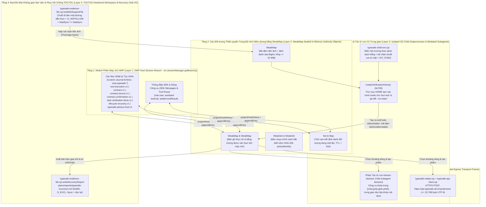
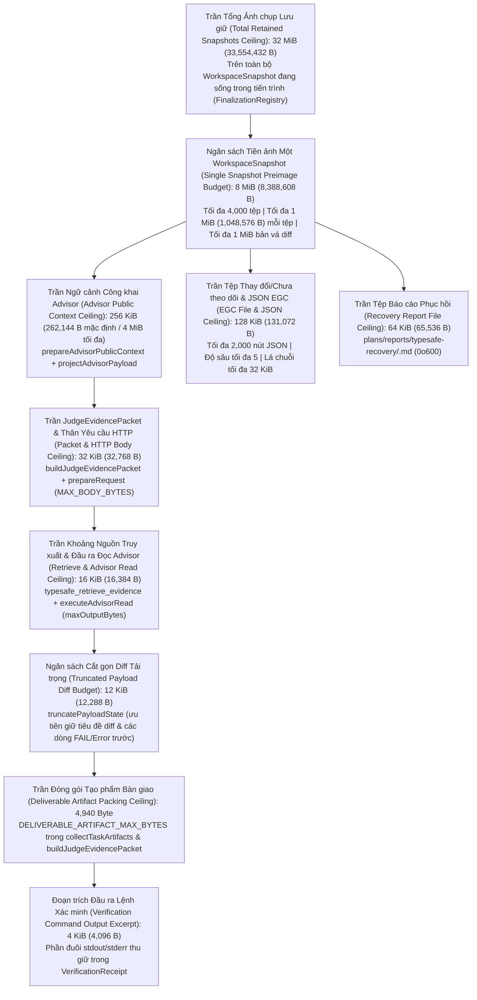
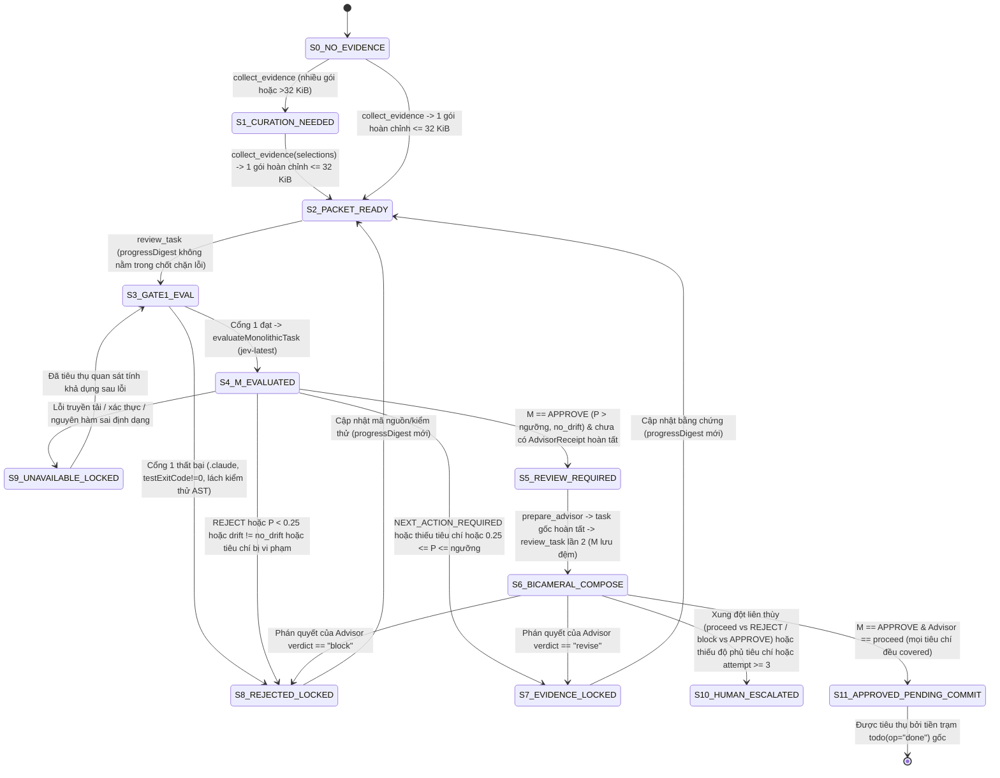

# Phần mở rộng TypeSafe cho oh-my-pi (omp): Đặc tả Luồng Dữ liệu & Chuyển đổi Trạng thái (Data Flow & State Transition Specification)

Tài liệu này đặc tả **Luồng Dữ liệu Ngang (Horizontal Data Flow)** đầu-cuối (xuyên suốt vòng đời của một nhiệm vụ người dùng), **Luồng Dữ liệu Dọc (Vertical Data Flow)** (từ bộ lưu trữ phiên của máy chủ xuống tới tiền ảnh hệ điều hành, khung truyền tải HTTP đã che giấu, và các tạo phẩm trên đĩa), **Thác Ngân sách Byte & Tài nguyên 18 Tầng (18-Tier Byte Budget & Resource Waterfall)**, cùng **5 Máy Trạng thái Hữu hạn Hình thức (Formal Finite State Machines — FSMs)** kèm ma trận chuyển đổi trạng thái và các bất biến toán học.

---

## 1. Luồng Dữ liệu Ngang & Dọc Đầu-Cuối (End-to-End Horizontal & Vertical Data Flows)

### 1.1 Sơ đồ Luồng Dữ liệu Ngang (Lời nhắc $\rightarrow$ Lịch sử Nhánh $\rightarrow$ Ảnh chụp $\rightarrow$ Gói Bằng chứng $\rightarrow$ Bộ Che giấu $\rightarrow$ Đồng thuận $\rightarrow$ Cam kết)

```mermaid
flowchart LR
    subgraph Stage1["1. Lời nhắc Người dùng & Lịch sử Nhánh (User Prompt & Branch History)"]
        UP["Lời nhắc Người dùng / /ck:cook\n(Mục role:user)"]
        NT["Lệnh todo(op='init'|'append') gốc\n(toolCall + toolResult đã hoàn tất)"]
        INC["NativeIncarnationReference\nincarnationId = sha256(creation, target)"]
    end

    subgraph Stage2["2. Hợp đồng & Ảnh chụp Cơ sở (Contract & Baseline Snapshot)"]
        TC["TaskContract (schemaVersion: 1)\ncontractId, revisionId, criteria[], allowedMutationScope"]
        BS["WorkspaceSnapshot Cơ sở\nTiền ảnh niêm phong bằng WeakMap (<= 8 MiB)"]
    end

    subgraph Stage3["3. Biên lai Xác minh & Gói Bằng chứng (Verification Receipt & Evidence Packet)"]
        VR["VerificationReceipt\n('bun test' trong createVerificationHome 0o700)"]
        TE["TaskEvidenceResult\nchangedFiles, taskSnapshotDiff, artifacts (<= 4,940 B)"]
        JEP["JudgeEvidencePacket\nĐộ bao phủ 100% tiêu chí (<= 32,768 B)"]
    end

    subgraph Stage4["4. Che giấu Đầu ra & Đánh giá Hai Thùy (Egress Redaction & Dual-Lobe Evaluation)"]
        RED["redactEvidenceState + preparePayload\n(TOKEN_PATTERNS, TELEMETRY_COUNT_KEYS)"]
        L2["Thùy 2 (Lobe 2): TypeSafe System One (jev-latest)\nBiểu điểm M Nguyên khối / Thẩm phán Nguyên tử H Chạy ngầm"]
        L1["Thùy 1 (Lobe 1): Tác tử con Advisor Gốc\nprepareAdvisorPublicContext (<= 256 KiB) -> AdvisorReceipt"]
    end

    subgraph Stage5["5. Đồng thuận Lưỡng viện & Cam kết Gốc 2 Pha (Bicameral Consensus & 2-Phase Native Commit)"]
        CON["arbitrateConsensus\nAPPROVED_PENDING_COMMIT (consensus:<sha256>)"]
        STG["NativeTaskVerificationStage\nĐược tiêu thụ bởi stageNativeTodoCall"]
        COM["reconcileNativeCommits\ntoolResult đã hoàn tất -> native_commit + debt_resolved"]
    end

    UP & NT --> INC
    INC -->|"typesafe_bind_task"| TC
    TC -->|"captureBaseline"| BS
    BS -->|"typesafe_collect_evidence"| VR & TE
    VR & TE -->|"buildJudgeEvidencePacketSet"| JEP
    JEP -->|"createEvidenceStateValidator"| RED
    RED -->|"HTTP POST <= 32 KiB"| L2
    JEP -->|"typesafe_prepare_advisor + task"| L1
    L1 & L2 -->|"typesafe_review_task (Lượt 2 / Pass 2)"| CON
    CON -->|"Tiền trạm todo(op='done')"| STG
    STG -->|"tool_result đã hoàn tất trong nhánh"| COM
```

---

### 1.2 Sơ đồ Luồng Dữ liệu Dọc (Các Tầng Lưu trữ, Bộ nhớ, Tiến trình Con, Đường truyền & Đĩa)

---

## 2. Đặc tả Thác Ngân sách Byte & Tài nguyên (Byte Budget & Resource Waterfall Specification)

Mọi giai đoạn từ liệt kê tệp trên đĩa của không gian làm việc xuống tới tuần tự hóa HTTP gửi đi và đầu ra công cụ của tác tử con đều thực thi một trần byte đóng băng an toàn khi lỗi và tất định (Deterministic, Fail-Closed Byte Ceiling). Khi một bằng chứng bắt buộc vượt quá ngân sách, thời gian chạy kiên quyết từ chối cắt xén bằng chứng ngầm (Never Silently Clips Evidence) và thay vào đó trả về `EVIDENCE_REQUIRED` hoặc `CURATION_REQUIRED`.

### Ghi chú: Ngân sách Ảnh Thị giác & Quy tắc Chỉ Siết chặt (Visual Evidence Budget & Tighten-Only Rule)

- **Ngân sách ảnh dùng chung ngân sách nguồn 1 MiB**: ảnh `.png`/`.jpg` đổi trong cây git đi qua `collectTaskEvidence` như mọi tệp nguồn nhị phân (base64 trong `sourceEvidence`). Tệp > 1 MiB cho `SOURCE_CHANGED_OR_UNSAFE`; vượt trần tích lũy cho `FULL_SOURCE_BYTE_LIMIT`; thiếu tệp bắt buộc thì kết quả là `EVIDENCE_REQUIRED` (fail-closed, đúng chủ đích). Không có ngân sách ảnh riêng.
- **Ảnh không nằm trong gói bằng chứng**: `JudgeEvidencePacket` chỉ giữ siêu dữ liệu `visualAssets` (`key`, `format`, `bytes`, `sha256`), nên gói vẫn ≤ 32,768 B ở ảnh 100 KB và ~900 KB. Ảnh chỉ được chọn khi không nằm ở đường dẫn riêng tư (`isPrivateEvidencePath`) và nằm trong phạm vi đọc đã duyệt. Đường ảnh cần `selections` (curation) không chứa chính tệp ảnh; không có `selections`, nguồn nhị phân vào gói và bị chặn bằng `BINARY_PUBLIC_REPRESENTATION_REQUIRED`.
- **Thân HTTP**: trần 32 KiB áp cho phần văn bản (`state` + `questions`); `assets` đi kèm ngoài trần đó (mỗi ảnh ≤ 4 MiB, tổng ≤ 8 MiB ở client; System One cho phép tới 16 MiB/ảnh, cạnh 280-1568 px, tổng 78,400-2,458,624 px). Ảnh ngoài dải kích thước bị nhà cung cấp trả `400` và là không phê duyệt; vì vậy host tự đọc kích thước từ byte (IHDR của PNG, SOF của JPEG) khi dựng gói và lần nữa tại `verifyVisualAssetsForSend`, ảnh ngoài dải hoặc không đọc được kích thước cho `EVIDENCE_REQUIRED` với `VISUAL_EVIDENCE_DIMENSIONS_OUT_OF_RANGE` / `VISUAL_EVIDENCE_DIMENSIONS_UNREADABLE` (kèm kích thước quan sát được) và không gửi ảnh. Header `TypeSafe-Danger-Zone-Images: true` được gắn khi thân có `assets`.
- **Tham chiếu tài sản**: System One trả `400` nếu một asset không được nhắc đến dưới dạng văn bản. Khoá wire là hằng cố định `ui_visual_evidence` (`VISUAL_WIRE_ASSET_KEY`; ngắn, entropy thấp nên bộ che giấu `[REDACTED:high-entropy]` không bao giờ thay thế nó, khác với khoá dẫn xuất từ hash trước đây) và xuất hiện trong khoá `assets` cùng văn bản câu hỏi `visual_supports_ui_criteria`; ở `state` nó chỉ là trường `key` của siêu dữ liệu `visualAssets`. Danh tính ảnh được ràng buộc bằng sha256 trong siêu dữ liệu đó và chốt chặn trước khi gửi, không bằng tên khoá. Mỗi yêu cầu chỉ mang một ảnh.
- **Chốt chặn trước khi gửi**: `verifyVisualAssetsForSend` tính lại sha256/bytes/format từng ảnh và so với `visualAssets` của gói; lệch thì không gọi client, kết quả `EVIDENCE_REQUIRED` (`visual_asset_integrity_mismatch`). Base64 chỉ nằm trong bộ nhớ (`packetSet.assetPayload`), không vào entry phiên, báo cáo phục hồi hay manifest.
- **Quy tắc chỉ siết chặt (tighten-only)**: khi có ảnh, M hỏi đúng một câu `noul` về việc ảnh có ủng hộ tiêu chí UI hay không. Trả lời âm, thiếu hoặc sai định dạng chỉ thêm lý do chặn phê duyệt (âm: `REJECTED`; thiếu/sai: `EVIDENCE_REQUIRED`); trả lời dương không bao giờ cứu một câu hỏi khác đang thất bại. Câu hỏi này tính vào giới hạn `maxQuestionsPerRequest`.
- **Cổng thử lại**: `taskRecoveryProgress` gộp siêu dữ liệu `visualAssets` vào digest tiến trình, nên ảnh đổi byte được xem là bằng chứng mới.

### Bảng Thác Ngân sách & Tài nguyên Đầy đủ 18 Tầng (18-Tier Complete Resource & Budget Waterfall Table)

| Tầng (Tier) | Tài nguyên / Ranh giới (Resource / Boundary) | Giới hạn Chính xác (Exact Limit) | Mô-đun & Hằng số Thực thi (Enforcement Module & Constant) | Hành vi Khi Tràn / Vi phạm (Overflow / Violation Behavior) |
| ---: | :--- | ---: | :--- | :--- |
| 1 | **Số Mục Lịch sử Nhánh Máy chủ (Host Branch History Entries)** | `100,000` mục | `src/host-history.ts:readHostBranch` | Đóng băng an toàn khi lỗi (`branch_entry_limit_exceeded`). |
| 2 | **Tổng Bộ nhớ Ảnh chụp Lưu giữ (Total Retained Snapshot Memory)** | `33,554,432` B (`32 MiB`) | `src/evidence-workspace.ts:SNAPSHOT_LIMITS.totalRetainedBytes` | Thu hồi các ảnh chụp không còn tham chiếu hoặc ném lỗi `SNAPSHOT_TOTAL_MEMORY_LIMIT`. |
| 3 | **Tiền ảnh Một `WorkspaceSnapshot` (Single `WorkspaceSnapshot` Preimages)** | `8,388,608` B (`8 MiB`) / `4,000` tệp | `src/evidence-workspace.ts:SNAPSHOT_LIMITS.retainedBytes` / `files` | Từ chối chụp ảnh không gian làm việc (`SNAPSHOT_BYTE_LIMIT` / `SNAPSHOT_FILE_LIMIT`). |
| 4 | **Trần Một Tệp Chỉ Đọc của Advisor (Advisor Read-Only Single File Cap)** | `4,194,304` B (`4 MiB`) | `src/advisor-readonly.ts:defaultAdvisorReadLimits.maxFileBytes` | Chặn lệnh `read`/`grep` của tiến trình con trên tệp quá khổ (`advisor_file_too_large`). |
| 5 | **Một Tệp Nguồn / Tổng Bằng chứng Nguồn (Single Source File / Total Source Evidence)** | `1,048,576` B (`1 MiB`) | `src/evidence-workspace.ts` & `src/evidence-collector.ts` | Ghi nhận phần lược bỏ bắt buộc `FULL_SOURCE_BYTE_LIMIT` $\rightarrow$ yêu cầu chọn lọc khoảng dòng (Line-Span Curation). |
| 6 | **Bản vá Khác biệt Ảnh chụp Hai Đầu mút (Endpoint Snapshot Diff Patch)** | `1,048,576` B (`1 MiB`) | `src/evidence-workspace.ts:SNAPSHOT_LIMITS.diffBytes` | Từ chối hiện thực hóa bản so sánh khác biệt (`SNAPSHOT_DIFF_LIMIT`). |
| 7 | **Lời nhắc & Ngữ cảnh Công khai Advisor (Advisor Public Prompt & Context)** | `262,144` B (`256 KiB`) | `src/advisor-public-context.ts` & `src/advisor-guards.ts` | Trả về `EVIDENCE_REQUIRED` (`advisor_context_budget_exceeded`). |
| 8 | **Trần Tệp & Tổng JSON EGC (EGC File & Aggregate JSON Cap)** | `131,072` B (`128 KiB`) | `src/egc.ts` & `src/egc-safety.ts:boundedEgcJson` | Ném lỗi `EgcEvidenceRefusal("FILE_TOO_LARGE")` hoặc từ chối `.omp/egc.json`. |
| 9 | **Tệp Markdown Bàn giao Phục hồi (Recovery Handoff Markdown File)** | `65,536` B (`64 KiB`) | `src/typesafe-evidence-file.cjs:writeRecoveryReport` | Từ chối ghi báo cáo (`REPORT_TOO_LARGE`). |
| 10 | **`JudgeEvidencePacket` & Thân HTTP POST (`JudgeEvidencePacket` & HTTP POST Body)** | `32,768` B (`32 KiB`) | `src/judge-evidence-packet.ts` & `src/typesafe-api-client.cjs:MAX_BODY_BYTES` | Đóng băng an toàn với lỗi `MANDATORY_PACKET_PROOF_EXCEEDS_BUDGET` hoặc `payload too large` (không bao giờ cắt xén bằng chứng ngầm). |
| 11 | **Nội dung Markdown Bản thảo Kế hoạch (Plan Draft Markdown Content)** | `32,768` B (`32 KiB`) | `src/plan-evaluator.ts:preEvaluationTriage` | Từ chối bản thảo kế hoạch (`insufficient`, vượt ngân sách byte). |
| 12 | **Trần Giá trị Biến Môi trường Con (Child Env Variable Value Cap)** | `32,768` B (`32 KiB`) | `src/typesafe-child-env.cjs:MAX_VALUE_BYTES` | Ném lỗi `ChildEnvironmentError("UNSAFE_ALLOWED_VALUE")`. |
| 13 | **Đầu ra `typesafe_retrieve_evidence` & Đọc Advisor (`typesafe_retrieve_evidence` & Advisor Read Output)** | `16,384` B (`16 KiB`) | `typesafe-planner.ts` & `src/advisor-readonly.ts:maxOutputBytes` | Trả về `EVIDENCE_REQUIRED` (`source_retrieval_output_exceeds_budget`) mà không cắt xén. |
| 14 | **Cửa sổ Cắt gọn Diff Thẩm phán Trực tiếp (Direct Judge Diff Truncation Window)** | `12,288` B (`12 KiB`) | `src/payload-safety.ts:truncatePayloadState` | Ưu tiên giữ các tiêu đề `diff --git`/`---`/`+++` và các dòng `FAIL`/`Error:` trước các dòng thân. |
| 15 | **Tạo phẩm Bàn giao trong Gói Bằng chứng (Deliverable Artifacts in Evidence Packet)** | `4,940` B | `src/evidence-collector.ts:DELIVERABLE_ARTIFACT_MAX_BYTES` | Đóng gói tham lam các tạo phẩm bắt buộc/liên quan tối đa `4,940` B; nếu tràn sẽ ghi nhận `insufficient_deliverable_evidence` / `MANDATORY_ARTIFACT_BUDGET_EXCEEDED`. |
| 16 | **Trần Tạo phẩm Bàn giao `cook-expert-judge` Độc lập (Standalone `cook-expert-judge` Deliverable Cap)** | `18,000` B | `src/cook-expert-judge.ts:runPhaseMacroCheck` | Từ chối với trạng thái `EVIDENCE_REQUIRED` (`insufficient_deliverable_evidence`) nếu vượt ngưỡng. |
| 17 | **Giới hạn Bộ lập lịch Đánh giá Ngữ nghĩa (Semantic Review Scheduler Limits)** | `128` câu hỏi / `128` gói / `384` lượt điều phối / `300,000 ms` | `src/typesafe-policy-client.cjs:REVIEW_LIMITS` | Từ chối với lỗi `question_limit_exceeded`, `packet_limit_exceeded`, hoặc `review_deadline_exceeded`. |
| 18 | **Thời gian sống Dàn dựng Todo Gốc & Quyền Vòng đời (Native Todo Stage & Lifecycle Grant TTL)** | `60,000 ms` (tiền trạm `22,000 ms`) | `typesafe-planner.ts:TODO_STAGE_TTL_MS` & `src/todo-lifecycle-authority.ts` | Dọn bỏ các lời gọi dàn dựng đã hết hạn và các thẻ quyền vòng đời dùng một lần. |

---

## 3. Các Máy Trạng thái Hữu hạn Hình thức — 5 Đặc tả FSM Cốt lõi (Formal Finite State Machines)

### 3.1 FSM 1: Vòng đời Hóa thân Nhiệm vụ (`TaskIncarnationFSM`)

Được định nghĩa xuyên suốt `src/task-contract-native.ts`, `src/task-contract-history.ts`, `src/contract-runtime.ts`, và `src/todo-lifecycle-authority.ts`.

$$
\mathcal{M}_{\text{incarnation}} = (S_{\text{inc}}, \Sigma_{\text{inc}}, \delta_{\text{inc}}, s_0 = \text{NONE}, F_{\text{inc}} = \{\text{COMPLETED}, \text{HUMAN\_RECONCILED}\})
$$

| Trạng thái Hiện tại $s \in S_{\text{inc}}$ | Sự kiện Đầu vào $\sigma \in \Sigma_{\text{inc}}$ | Vị từ Chắn $G(s, \sigma)$ (Guard Predicate) | Trạng thái Kế tiếp $s' = \delta_{\text{inc}}(s, \sigma)$ | Tác dụng phụ Nhánh Bền vững (Durable Branch Side Effect) |
| :--- | :--- | :--- | :--- | :--- |
| `NONE` | `todo(op="init" \| "append")` | `toolResult` không lỗi đã hoàn tất trong nhánh; số thứ tự khởi tạo không nhập nhằng | `OPEN_UNCONTRACTED` | Đúc `incarnationId = canonicalDigest({ creation, target })` với `creationKnown: true`. |
| `OPEN_UNCONTRACTED` | `typesafe_bind_task` | Mục tiêu `creationKnown` duy nhất $\land$ `role:user` thực sự liền trước $\land$ `captureBaseline` thành công | `OPEN_BOUND` | Ghi nối tiếp `omp.typesafe.contract.source.v1`, `confirmation.v1` tùy chọn, và `omp.typesafe.contract.v1`. |
| `OPEN_BOUND` | `typesafe_bind_task` | Cùng `originalUserRequest` $\land$ cập nhật `planPath`/tiêu chí $\land$ `ctx.ui.confirm === true` | `OPEN_BOUND` (`revisionId` mới) | Ghi nối tiếp `contract_revision` vào `omp.typesafe.contract.v1`; chụp lại đường cơ sở nếu chưa bị chạm tới. |
| `OPEN_BOUND` | `typesafe_review_task` thất bại | Kết quả $\in \{\text{REJECTED}, \text{EVIDENCE\_REQUIRED}\}$ hoặc `todo` gốc thất bại | `OPEN_DEBT` | Ghi nối tiếp `review_failure` vào `omp.typesafe.task-verification-facts.v1`; gắn nợ vào `incarnationId`. |
| `OPEN_DEBT` | `typesafe_collect_evidence` | Bằng chứng mã nguồn, kiểm thử, hoặc hợp đồng liên quan đã thay đổi ($\Delta \text{progressDigest} \neq 0$) | `OPEN_BOUND` | Bản ghi `TaskEvidenceRecord` mới mở khóa chốt chặn thử lại của `typesafe_review_task`. |
| `OPEN_BOUND` | `todo(op="done")` | Đã tiêu thụ `NativeTaskVerificationStage` (`APPROVED_PENDING_COMMIT`) $\land$ `toolResult` hoàn tất | `COMPLETED` | Ghi nối tiếp các dữ kiện `native_commit` và `debt_resolved` vào `omp.typesafe.task-verification-facts.v1`. |
| `OPEN_BOUND` / `OPEN_DEBT` | `todo(op="block")` | Tiêu thụ `LifecycleGrant` 60 giây từ `typesafe_prepare_todo_mutation` + `RecoveryHandoff` | `BLOCKED` | Xuất tệp `plans/reports/typesafe-recovery/<uuid>.md` + `omp.typesafe.lifecycle-recovery.v1`. |
| `BLOCKED` | `todo(op="unblock")` | `toolResult` của lệnh `todo(op="unblock")` gốc đã hoàn tất | `OPEN_BOUND` / `OPEN_DEBT` | Khôi phục nhiệm vụ về hàng đợi chờ/đang chạy trong khi vẫn giữ nguyên mọi khoản nợ trước đó. |
| `OPEN_BOUND` | `todo(op="drop" \| "rm" \| "init")` | Tiêu thụ `LifecycleGrant` 60 giây (`ui.confirm` hoặc `allowVerifiedDrop` khi `hasDebt === false`) | `CLOSED_CLEAN` | Nhiệm vụ được đánh dấu `abandoned` hoặc bị xóa với không khoản nợ tồn đọng. |
| `OPEN_DEBT` | `todo(op="drop" \| "rm" \| "init")` | Tiêu thụ `LifecycleGrant` 60 giây với `ctx.ui.confirm === true` trong khi `hasDebt === true` | `HISTORICAL_DEBT` | Hóa thân bị đóng, nhưng khoản nợ chưa giải quyết vẫn nằm trong `historicalDebtCatalogue`. |
| `HISTORICAL_DEBT` | `typesafe_resolve_historical_debt` | `incarnation.status` $\in \{\text{completed}, \text{abandoned}, \text{removed}\}$ $\land$ `ctx.ui.confirm === true` | `HUMAN_RECONCILED` | Ghi nối tiếp `historical_resolution` (`human_accept_historical_obligation_no_native_approval`). |

---

### 3.2 FSM 2: Đánh giá theo Giai đoạn & Đồng thuận Lưỡng viện (`StagedReviewFSM`)

Được định nghĩa xuyên suốt `src/task-verification-runtime.ts`, `src/task-verification-macro.ts`, và `src/bicameral-consensus.ts`.

#### Các Bất biến Đồng thuận Toán học (`arbitrateConsensus` — Mathematical Consensus Invariants)
1. **Bất biến Hiệu chuẩn Ngưỡng (Threshold Calibration Invariant)**: Gọi $P = \text{meets\_criteria} \in [0, 1]$ và $\tau = \text{TYPESAFE\_AUTO\_APPROVAL\_THRESHOLD}$ (mặc định $0.50$). Điều kiện phê duyệt yêu cầu:
   $$
   \text{passesThreshold}(P, \tau) = \begin{cases} P > 0.50 & \text{if } \tau = 0.50 \text{ (default)} \\ P \ge \tau & \text{if } \tau \text{ is explicitly configured} \end{cases}
   $$
2. **Sàn Bằng chứng so với Từ chối Cứng (Evidence Floor vs. Hard Rejection)**: Khi `deliverables_verdict === "APPROVE"` nhưng $\neg \text{passesThreshold}(P, \tau)$:
   - Nếu $0.25 \le P \le \tau$, kết quả là `EVIDENCE_REQUIRED`.
   - Nếu $P < 0.25$, kết quả là `REJECTED`.
3. **Quyền Phủ quyết Liên Thùy Không thể Ghi đè (Non-Overridable Cross-Lobe Veto)**: Không thùy nào có thể ghi đè lên thùy kia. Nếu $(\text{Advisor} = \texttt{proceed} \land \text{JEV} = \texttt{REJECT})$ hoặc $(\text{Advisor} = \texttt{block} \land \text{JEV} = \texttt{APPROVE})$, hàm `arbitrateConsensus` chuyển đổi một cách tất định sang trạng thái `HUMAN_REQUIRED`.

---

### 3.3 FSM 3: Điều phối Advisor Gốc & Trung gian Tiến trình Con Chỉ Đọc (`AdvisorDispatchFSM`)

Được định nghĩa xuyên suốt `src/advisor-host-dispatch.ts`, `src/advisor-host-hooks.ts`, `src/advisor-runtime.ts`, `src/advisor-readonly.ts`, và `src/advisor-host-settlement.ts`.

| Trạng thái (State) | Điều kiện Nhập (Entry Condition) | Thao tác Tiến trình Con Được phép (Permitted Child Operations) | Điều kiện Vô hiệu hóa / Thoát (Invalidation / Exit Condition) |
| :--- | :--- | :--- | :--- |
| `PROVISIONAL` | `typesafe_prepare_advisor` hoặc `typesafe_advisor` xác thực hợp đồng đã ràng buộc & ngữ cảnh công khai (`<= 256 KiB`), đúc mã UUID `reviewHandle`, và ghi `typesafe:advisor:host:v1` (`kind: "provisional"`). | Không có (tiến trình con chưa được khởi tạo). | Bị thay thế nếu một bản nháp mới được chuẩn bị hoặc `rotateHostScope()` tăng `epoch`. |
| `DISPATCHING` | Tác tử cha gọi `task` gốc được bọc với 1 mục khớp `provisional.token`; `executeHostTask` đi vào `advisorDispatchFrame` và `reviewBudget.run()`. | `before_subagent_spawn` cấp quyền cho một tiến trình con duy nhất (`frame.spawnAuthorized = true`). | Thất bại nếu `tasks.length !== 1`, cố tình khởi tạo tác tử con lồng nhau, hoặc `SemanticReviewScheduler` từ chối thu nhận. |
| `CHILD_READONLY` | `before_agent_start` xác minh tiêu đề phiên cha-con và lời nhắc; giới hạn công cụ trong `{ read, grep, glob, yield }`; `before_provider_request` chạy `projectAdvisorPayload` (`store: false`). | `executeAdvisorRead`: `read` (kèm `:start-end`), `grep` nguyên văn, `glob` trên `request.scope.files` (tệp `<= 4 MiB`, đầu ra `<= 16 KiB`) + lệnh kết thúc `yield`. | Bị vô hiệu hóa ngay lập tức (`advisor_evaluated_file_changed`) nếu mã SHA-256 trên đĩa của bất kỳ tệp nào được đọc lệch khỏi `request.scope.files[path].sha256`, hoặc khi hết hạn `300,000 ms` (xả luồng `250 ms`). |
| `YIELDED_UNSETTLED` | Tiến trình con gọi `yield` khớp với `advisorOutputSchema` và `validateAssessmentForRequest` (mọi `evidenceRefs` đã xác minh); `AdvisorReceipt` được đúc trong nhật ký. | Không có (lượt của tiến trình con đã hoàn tất). | Đang chờ dòng `toolResult` của `task` gốc bên ngoài hoàn tất trong lịch sử nhánh của tác tử cha. |
| `SETTLED_APPLICABLE` | `hasSettledAdvisorHistory` và `collectAdvisorHostSettlement` xác nhận một dòng `toolResult` không lỗi duy nhất đã hoàn tất trong `sessionManager.getBranch()` khớp với `contractRevisionId` và `evaluatedTreeDigest`. | Biên lai có thể được kết hợp trong `typesafe_review_task` (`authority: "task_bound"`) hoặc trả về bởi `typesafe_advisor` (`authority: "none"`). | Chuyển sang `STALE_INAPPLICABLE` (`receipt.applicable = false`, Giai đoạn 4) nếu phiên bản hợp đồng, `treeDigest` không gian làm việc, hoặc `epoch` của máy chủ thay đổi. |

---

### 3.4 FSM 4: Quản lý Xác thực & Thời gian hồi Truyền tải (`AuthCooldownFSM`)

Được định nghĩa trong `src/typesafe-api-client.cjs` (`requestWithRetry`, `checkCredentialCooldown`, `RETRY_POLICY`) và `src/auth-manager.ts` (`AuthManager`).

| Trạng thái (State) | Khóa Được Theo dõi (Tracked Key) | Tác nhân Chuyển đổi (Transition Trigger) | Hành vi Yêu cầu Gửi đi (Outbound Request Behavior) | Đường dẫn Phục hồi (Recovery Path) |
| :--- | :--- | :--- | :--- | :--- |
| `HEALTHY` | SHA-256 đầy đủ (`typesafe-api-client.cjs`) & SHA-256 16 ký tự hex (`AuthManager`) | Trạng thái ban đầu hoặc nhận HTTP `200 OK` (`recordSuccess`) | Gửi yêu cầu bình thường (`timeoutMs: 10000`, `totalBudgetMs: 15000`). | — |
| `RETRYING_BACKOFF` | Bộ đếm lần thử theo từng yêu cầu (`1..3`) | HTTP `429` hoặc `529` với `attempt < 3` và `remainingBudget >= 1000 ms` | Xả thân phản hồi (`cancelBodyBounded`), nghỉ theo `Retry-After` (`<= 5000 ms + 250 ms` nhiễu) hoặc lùi lũy thừa (`500 ms` $\rightarrow$ `4000 ms`), rồi thử lại. | HTTP `200 OK` đưa về `HEALTHY`. |
| `COOLDOWN_45S` | `rateLimitState` theo từng mã băm SHA-256 của thông tin xác thực | Đã cạn kiệt cả 3 lần thử hoặc ngân sách `15,000 ms` khi gặp HTTP `429`/`529` | Thất bại nhanh với mã `rate_limited_cooldown` (`0` lời gọi mạng) chừng nào `now < cooldownUntilMs` (`45,000 ms`). | Tự động xóa sau `45,000 ms` hoặc khi gọi `resetRateLimitState()`. |
| `REFRESHING_401` | `AuthManager` (`failureCount === 1`, `MAX_RETRIES = 1`) | Lỗi HTTP `401` hoặc `403` đầu tiên trong `AuthManager.recordFailure` | Cho phép 1 lần làm mới/thử lại (`canAttempt() === true`). | `recordSuccess()` đặt lại về `HEALTHY`. |
| `AUTH_REVOKED` | `authFailed = true` (`typesafe-api-client.cjs`) / `status = "revoked"` (`AuthManager`) | HTTP `401`/`403` trong `typesafe-api-client.cjs` hoặc lần lỗi thứ 2 trong `AuthManager` | Cầu dao ngắt cứng (Hard Circuit-Breaker): chặn toàn bộ lời gọi tiếp theo đối với mã băm thông tin xác thực đó (`auth_failed_cached`). | Cung cấp `TYPESAFE_API_KEY` mới đã xoay vòng (mã băm SHA-256 mới) hoặc gọi `reset()`. |

---

### 3.5 FSM 5: Đồng bộ Đường cơ sở Giao dịch (`SyncTransactionFSM`)

Được định nghĩa trong `tools/sync-baseline.cjs` (`1–533`) và được xác minh bởi `tools/verify-omp-global.cjs` (`1–367`).

| Trạng thái (State) | Trạng thái Nhật ký (`.sync-journal.json`) | Bất biến Được Kiểm tra Trước Khi Chuyển đổi (Invariant Checked Before Transition) | Hành động Khi Lỗi / Hoàn nguyên (Failure / Rollback Action) |
| :--- | :--- | :--- | :--- |
| `1. PREFLIGHT` | Không có (chưa biến đổi đĩa) | Cả 7 tệp `src/typesafe-*.cjs` đều tồn tại; `~/.omp/agent/extensions/typesafe-planner.ts` khớp với trình trung chuyển 1 dòng (`assertStrictPointer`); các gốc (`workspace`, `target`, `backup`, `global_omp_agents`) tách biệt nhau và không chứa `symlink`/`hardlink`. | Thoát ngay lập tức với mã `1` (không chạm vào bất kỳ tệp nào). |
| `2. LOCKED_VERIFIED` | Đã tạo khóa `.omp-sync-<hash>.lock` (`wx`) | **Kiểm tra Kế hoạch Sau Khóa Giai đoạn 2 (Phase 2 Post-Lock Plan Check)**: Tính toán lại kế hoạch triển khai sau khi chiếm khóa và xác minh sự bằng nhau tuyệt đối với kế hoạch trước khi khóa (`deployment plan changed after lock`). | Xóa tệp khóa và thoát với mã `1`. |
| `3. BACKED_UP` | `IN_PROGRESS` | Tạo thư mục `omp_extension_backup_<ISO>`, sao chép tiền ảnh của mọi tệp bị sửa/dọn bỏ trên cả 2 gốc được quản lý, và gọi `fsync` lên `.sync-journal.json`. | Nếu sao lưu thất bại trước khi ghi vào đích, đánh dấu `BACKUP_INCOMPLETE`, xóa khóa, và thoát với mã `1`. |
| `4. APPLIED` | `IN_PROGRESS` | Ghi các tệp đã dàn dựng qua `.tmp` + `fsync` + `rename` nguyên tử vào `target` và `global_omp_agents` (Schema v2); dọn bỏ tệp cũ trong `target`; ghi `target/.sync-manifest.json`. | Bất kỳ lỗi nào hoặc cờ `OMP_FAULT_INJECT` đều kích hoạt hoàn nguyên theo thứ tự ngược từ tiền ảnh sao lưu. |
| `5. VERIFYING` | `IN_PROGRESS` | Khởi chạy `bun test` bên trong `createVerificationHome()` (thư mục `HOME` cô lập `0o700` với `buildChildEnvironment("deployment-verify")`). | Mã thoát kiểm thử khác `0` kích hoạt hoàn nguyên theo thứ tự ngược trên cả 2 gốc và `.sync-manifest.json`. |
| `6A. COMMITTED` | `DEPLOYED_VERIFIED` | `bun test` đạt (`exitCode === 0`); nhật ký được cập nhật thành `DEPLOYED_VERIFIED`; nhả khóa. | Trạng thái kết thúc thành công (mã thoát `0`). |
| `6B. RECOVERED` | `RECOVERED` / `RECOVERY_INCOMPLETE` | Quá trình khôi phục theo thứ tự ngược cho mọi tệp đã sửa/tạo/dọn bỏ và `.sync-manifest.json` đã hoàn tất và được xác minh bằng SHA-256. | Nếu khôi phục sạch: cập nhật nhật ký thành `RECOVERED`, nhả khóa, thoát `1`. Nếu lỗi khôi phục: đánh dấu `RECOVERY_INCOMPLETE`, **giữ lại khóa**, thoát `2`. |
