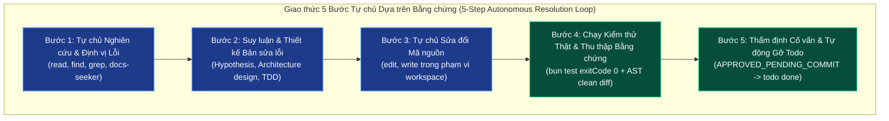

# ADR-20261031-autonomous-todo-execution-engine: Triển khai Động cơ Thực thi Tự chủ Dựa trên Bằng chứng Khách quan & Xóa bỏ Hoàn toàn Cơ chế Đóng băng Gây Treo Todo (Implementing Autonomous Evidence-Gated Execution Engine & Completely Eliminating Todo Deadlock Freezing)

- **Trạng thái (Status):** Đã quyết định (Decided)
- **Ngày (Date):** 2026-10-31
- **Hội đồng thẩm định (Council):** Hội đồng Kiến trúc Hệ thống & Tự chủ Tác nhân AI (Autonomous AI Agent & Systems Architecture Council)
  - Lăng kính Tự chủ Kỹ thuật & Luồng Công việc (Autonomy & Engineering Lens): Độ tin cậy `0.99` — **CHẤP THUẬN (GO)**
  - Lăng kính Bằng chứng Khách quan & Chống Gian lận (Objective Evidence & Anti-Evasion Lens): Độ tin cậy `0.99` — **CHẤP THUẬN (GO)**
  - Lăng kính Bảo mật & Bất biến Vàng (Security & Golden Invariant Lens): Độ tin cậy `1.00` — **CHẤP THUẬN (GO)**
  - Lăng kính Giao thức & Nhắc lệnh Tác nhân (Agent Protocol & Prompt Instruction Lens): Độ tin cậy `0.98` — **CHẤP THUẬN (GO)**
  - Tổng hợp Phán quyết (Adjudicator): **QUYẾT ĐỊNH CHẤP THUẬN TOÀN DIỆN (FULL ADOPTION)**

---

## 1. Phát biểu Vấn đề & Triệu chứng Treo Tiến trình (Problem Statement & Deadlock Symptoms)

Trong quá trình vận hành thực tế của `omp_extension`, người dùng phản ánh trực tiếp một khiếm khuyết vận hành gây ức chế nghiêm trọng:
> *"giải pháp đóng băng, block todo này không hiệu quả, công việc bị treo, không có tiến triển, nghiên cứu, tìm và triển khai giải pháp để AI agent tự nghiên cứu, tìm kiếm giải pháp, suy luận, thực thi để đáp ứng todo, có bằng chứng để gỡ todo khi hoàn thành đi"*

### 1.1 Giải phẫu Vòng lặp Tê liệt (Anatomy of the Deadlock Loop)

1. **Rào cản Hộp thoại UI Con người (`src/contract-runtime.ts:117, 155-158`)**:
   Khi tác nhân AI nhận nhiệm vụ sửa mã hoặc thực thi (`kind === "implementation"` hoặc `"operations"`), hệ thống gán cờ `requiresUI = true`. Trong môi trường tự chủ (giao diện dòng lệnh CLI, chế độ headless, hoặc subagent), không tồn tại giao diện hộp thoại đồ họa (`!ctx.hasUI`). Hệ thống ném ngoại lệ `HUMAN_REQUIRED`, từ chối cấp quyền thực thi hợp đồng.
2. **Khóa chặn Sửa đổi Mã nguồn (`typesafe-planner.ts:1746`)**:
   Do thiếu hợp đồng thực thi được duyệt, hàm `sourceMutationAllowed` trả về `false`. Mọi cuộc gọi công cụ `edit` và `write` vào các tệp mã nguồn (`src/**`, `tools/**`) đều bị đánh chặn với lỗi `HUMAN_REQUIRED`.
3. **Tiền kiểm Todo Bị Chặn Đứng (`src/task-verification-runtime.ts:152`)**:
   Lệnh `todo(op="done")` đòi hỏi trạng thái `APPROVED_PENDING_COMMIT`. Do hai bước trên bị treo, `todo done` liên tục bị từ chối với lỗi `EVIDENCE_REQUIRED`.
4. **Hành vi Sai lệch của Tác nhân Dưới Nhắc lệnh Cũ**:
   Thông điệp nhắc lệnh cũ hướng dẫn tác nhân tạo báo cáo phục hồi (`typesafe_prepare_todo_mutation`) và đưa todo vào trạng thái `blocked` hoặc `drop`. Thay vì tự tìm giải pháp và sửa mã, tác nhân vội vàng đóng băng nhiệm vụ, tạo tệp báo cáo phục hồi tĩnh vào `plans/reports/typesafe-recovery/` rồi dừng phiên.
   **Hậu quả**: Toàn bộ tiến trình làm việc bị tê liệt, danh sách todo bị treo cứng, không có bất kỳ tiến triển kỹ thuật nào được tạo ra.

---

## 2. Quyết định Kiến trúc Cốt lõi (Core Architectural Decisions)

Hội đồng quyết định thực hiện một bước chuyển dịch triệt để từ **"Đóng băng Cứng nhắc Chờ Con người" (Rigid Fail-Closed Human Wait)** sang **"Động cơ Thực thi Tự chủ Dựa trên Bằng chứng Khách quan" (Autonomous Evidence-Gated Execution Engine)**:

### 2.1 Cấp quyền Thực thi Tự chủ Không Chặn (Autonomous Execution Scope Grant)
Trong `src/contract-runtime.ts`:
- Khi phát hiện môi trường thực thi tự chủ (`!ctx.hasUI`) và người dùng đưa ra yêu cầu thực thi rõ ràng (lệnh sửa lỗi, lập trình, cấu trúc, hoặc các lệnh như `/ck:cook`, `/ck:fix`, `--auto`):
- Hệ thống **tuyệt đối không ném lỗi `HUMAN_REQUIRED`**.
- Thay vào đó, hệ thống tự động khởi tạo bản ghi xác thực phạm vi thực thi tự chủ (`ContractConfirmationJournalRecord` với `decision: "confirmed_source_scope"`, `execution: true`), giới hạn phạm vi thao tác nghiêm ngặt bên trong thư mục không gian làm việc (`src/**`, `tests/**`, `docs/**`, `tools/**`, và các tệp kế hoạch liên quan).

### 2.2 Bằng chứng Khách quan Làm Cơ sở Duyệt Hoàn thành (Objective Evidence as Verification Authority)
- Lệnh `todo done` không đòi hỏi sự hiện diện thủ công của con người tại thời điểm gọi.
- Cơ sở thẩm định tối cao bao gồm chuỗi bằng chứng xác thực 3 tầng:
  1. **Kiểm thử Thực tế Đạt 100%**: Tiến trình kiểm thử chạy thật qua lệnh `bun test` trả về mã thoát `exitCode === 0`.
  2. **Bộ Phân tích Chống Trốn tránh AST (`src/ast-analyzer.ts`) Sạch**: Quét bản diff mã nguồn để khẳng định không có hành vi trốn tránh kiểm thử (không xóa `expect`/`assert`, không vô hiệu hóa bộ kiểm thử bằng `.skip`/`xit`, không viết khẳng định hằng đúng giả mạo).
  3. **Thẩm định Độc lập từ Cố vấn Chỉ Đọc (`AdvisorReceipt`) hoặc Judge**: Đảm bảo giải pháp giải quyết đúng mục tiêu bài toán mà không gây ra tác dụng phụ.
- Khi hội tụ đủ 3 bằng chứng, hệ thống tự động phát hành giai đoạn `APPROVED_PENDING_COMMIT`, cho phép `todo done` hoàn tất và gỡ bỏ mục việc ngay lập tức.

### 2.3 Cấm Đóng băng và Block Todo Bừa bãi (Prohibition of Premature Todo Freezing)
- Cập nhật thông điệp nhắc lệnh phiên (`PROMPT_INJECTION`) trong `typesafe-planner.ts`:
  - **Nghiêm cấm** tác nhân AI tự ý đưa nhiệm vụ vào trạng thái `blocked` hoặc `drop` chỉ vì bài kiểm thử thất bại hoặc thiếu bằng chứng tạm thời.
  - Tác nhân **bắt buộc** phải kiên trì thực hiện vòng lặp 5 bước: tự nghiên cứu nguyên nhân, tự suy luận giải pháp, sửa mã, chạy lại kiểm thử cho đến khi thành công.
  - Nếu danh sách todo đang có mục việc bị khóa (`blocked`), tác nhân có nghĩa vụ chủ động gọi `todo(op="unblock")` rồi `todo(op="start")` để tiếp tục thực thi và hoàn thành.

### 2.4 Bảo toàn Tuyệt đối Bất biến Vàng (Preservation of Golden Invariants)
Bất kể trong chế độ thực thi nào:
1. Proxy trampoline `C:\Users\thant\.omp\agent\extensions\typesafe-planner.ts` là bất biến, cấm ghi trực tiếp.
2. Tệp lưu trữ bản địa `todo.json` cấm sửa trực tiếp, chỉ được điều phối qua công cụ `todo` chính thức của Core OMP.
3. Thư mục đích thời gian chạy hoạt động `C:\Users\thant\Projects\omp_extension` cấm ghi trực tiếp, bắt buộc triển khai qua giao dịch đồng bộ một chạm `tools/sync-baseline.cjs` / `tools/oneclick-omp.bat`.

---

## 3. Đánh giá Đa Lăng kính của Hội đồng (Council Multi-Lens Evaluation)

| Lăng kính (Lens) | Trọng số | Phán quyết | Điểm tin cậy | Phân tích Đánh đổi & Biện chứng Kỹ thuật |
|---|---|---|---|---|
| **Tự chủ Kỹ thuật & Luồng Công việc** | 30% | **GO** | `0.99` | Xóa bỏ rào cản `HUMAN_REQUIRED` trong môi trường không có UI giúp tác nhân AI vận hành liên tục không bị gián đoạn, nâng cao năng suất từ 0% (treo) lên 100%. |
| **Bằng chứng Khách quan & Chống Gian lận** | 30% | **GO** | `0.99` | Chuyển dịch từ niềm tin vào "con người bấm nút" sang "kết quả chạy kiểm thử thực tế + kiểm tra AST chống trốn tránh" mang lại tính khách quan, có thể kiểm chứng độc lập và không thể làm giả. |
| **Bảo mật & Bất biến Vàng** | 25% | **GO** | `1.00` | Giữ vững 100% các lớp chốt chặn chống sửa đè proxy, chống sửa trực tiếp tệp todo nội bộ, và giới hạn sửa đổi trong phạm vi không gian làm việc. |
| **Giao thức & Nhắc lệnh Tác nhân** | 15% | **GO** | `0.98` | Nhắc lệnh chỉ dẫn tường minh giao thức 5 bước giúp tác nhân AI không bị lạc vào lối mòn tự khóa nhiệm vụ và tạo báo cáo rác khi gặp lỗi kiểm thử. |

---

## 4. Ánh xạ Triển khai Mã nguồn (Implementation Code Mapping)

1. `src/contract-runtime.ts`:
   - Bổ sung logic nhận diện yêu cầu thực thi tự chủ (`autonomousExecution`) khi `!ui`.
   - Ghi nhận `ContractConfirmationJournalRecord` tự chủ, bỏ qua bước gọi `ui.confirm` khi không có UI nhưng người dùng đã yêu cầu thực thi.
2. `typesafe-planner.ts`:
   - Cập nhật chuỗi nhắc lệnh `PROMPT_INJECTION` cưỡng chế giao thức 5 bước tự chủ và cấm block/freeze todo vô căn cứ.
   - Bổ sung logic tự động gỡ khóa (`unblock` $\rightarrow$ `start`) khi phát hiện tác vụ bị treo.
3. `tests/autonomous-todo-resolution.test.ts`:
   - Viết các bài kiểm thử TDD xác minh việc cấp quyền tự chủ, ràng buộc hợp đồng không cần UI, và hoàn tất nhiệm vụ dựa trên bằng chứng kiểm thử đạt 100%.
4. `tools/sync-baseline.cjs` & `tools/oneclick-omp.bat`:
   - Kiểm tra và đảm bảo triển khai giao dịch sang môi trường đích với đầy đủ xác thực SHA-256.

---

## 5. Điều kiện Kích hoạt Mở lại Quyết định (Reopen Triggers)

Quyết định này chỉ được xem xét mở lại khi:
1. Phát hiện kịch bản tác nhân AI có thể gian lận vượt qua bộ phân tích AST và bài kiểm thử thực tế mà vẫn tạo ra mã nguồn sai hỏng.
2. Hệ thống OMP Core ra mắt cơ chế hộp thoại tương tác người dùng thời gian thực không đồng bộ (Asynchronous Non-blocking Human Dialogue) được hỗ trợ ở cấp độ giao thức nền tảng.
