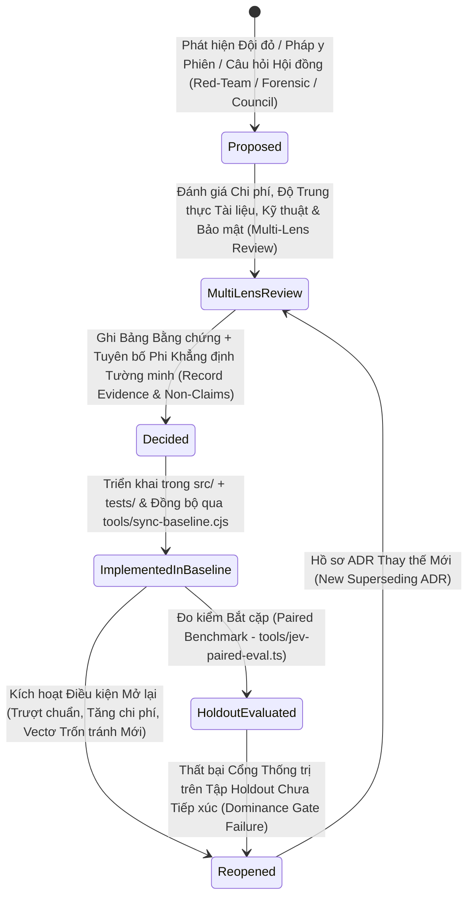

# Hồ sơ Quyết định Kiến trúc (Architecture Decision Records - ADRs) — `omp_extension`

> **Sổ cái Quyết định Chính tắc (Canonical Decision Ledger)** cho Tiện ích Mở rộng Oh-My-Pi TypeSafe (`omp-typesafe-extension` v1.0.0).  
> Mọi hồ sơ ADR trong `docs/decisions/` đều ghi lại phát biểu bài toán kiến trúc (architectural problem statement), bối cảnh thực nghiệm và đội đỏ (empirical and red-team context), đánh giá đa lăng kính (`cost` - chi phí, `docs-fidelity` - độ trung thực tài liệu, `engineering` - kỹ thuật, `security` - bảo mật), thiết kế được lựa chọn, ánh xạ triển khai mã nguồn, và các điều kiện kích hoạt mở lại tường minh (explicit reopen triggers).

---

## 1. Chỉ mục Tổng thể Các Hồ sơ Quyết định Kiến trúc (Master Index of Architecture Decision Records)

| Mã ADR (ADR ID) | Tệp Tài liệu (File) | Tiêu đề Quyết định (Title) | Trạng thái (Status) | Ngày (Date) | Bước Chuyển dịch Kiến trúc Cốt lõi (Core Architectural Shift) | Các Mô-đun Triển khai Chính (Primary Implementation Modules) |
|---|---|---|---|---|---|---|
| **ADR-01** | [`ADR-2026-10-05-predict-model-tier.md`](ADR-2026-10-05-predict-model-tier.md) | Định tuyến Mô hình Tầng Nhanh & Tiền Phân tích Đa Chân dung (`ck:predict` - Fast-Tier Model Routing & Multi-Persona Pre-Analysis) | Đã Chấp thuận (Accepted) | 2026-10-05 | Tách rời bộ máy tranh biện đa chân dung khỏi tệp gốc tiện ích mở rộng sang `src/debate-evaluator.ts`; định tuyến tiền phân tích tốc độ cao sang `jev-latest` kèm khiên bảo vệ toàn vẹn (integrity shields). | `src/debate-evaluator.ts`, `src/plan-evaluator.ts`, `src/typesafe-api-client.cjs` |
| **ADR-02** | [`ADR-20261012-typesafe-jev-alignment.md`](ADR-20261012-typesafe-jev-alignment.md) | Cải thiện Ứng dụng Thẩm phán Ngữ nghĩa TypeSafe JEV và Sự Liên kết Tác nhân (Improving TypeSafe JEV Semantic Judge Application and Agent Alignment) | Đã Quyết định (Decided) | 2026-10-12 | Áp dụng Tiêm Ngữ cảnh Tầng 1 (Phương án A - Tier 1 Contextual Injection) và Bộ tiêu chí Đa nhãn Nhận biết Nhiệm vụ Tầng 2 (Phương án C - Tier 2 Task-Aware Multi-Label Rubrics); chuyển Xác thực Tiền trạm (Phương án B - Pre-Flight Verification) thành kiểm tra tham vấn có giới hạn. | `src/cook-expert-judge.ts`, `src/verification-gate.ts`, `typesafe-planner.ts` |
| **ADR-03** | [`ADR-20261013-remediation-ratchet-and-wildcard-resolver.md`](ADR-20261013-remediation-ratchet-and-wildcard-resolver.md) | Chốt chặn Khắc phục Cổng 0, Bảo vệ Chống Trốn tránh Block, và Dự phòng Bộ Giải quyết Ba Tầng (Gate 0 Remediation Ratchet, Block Evasion Guard, and Tri-Tier Resolver Fallback) | Đã Quyết định (Decided) | 2026-10-13 | Chặn hành vi thử lại mù quáng trên bằng chứng không đổi thông qua chốt chặn mã băm diff SHA-256; đóng lỗ hổng trốn tránh `todo(op="block")`; mở rộng giới hạn văn bản khắc phục; bổ sung dự phòng bộ giải quyết ba tầng và hỗ trợ ký tự đại diện dự án `"*"`. | `src/typesafe-enabled-resolver.cjs`, `src/task-recovery.ts`, `src/todo-lifecycle-authority.ts`, `typesafe-planner.ts` |
| **ADR-04** | [`ADR-20261013-typesafe-bicameral-judge-alignment.md`](ADR-20261013-typesafe-bicameral-judge-alignment.md) | Đồng thuận Lưỡng viện Advisor-JEV, Loại bỏ Tường Ngưỡng Cứng, và Khắc phục Thích ứng Không Chặn (Bicameral Advisor-JEV Consensus, Threshold Elimination, and Non-Blocking Adaptive Remediation) | Đã Quyết định (Decided) | 2026-10-13 | Thay thế các bức tường ngưỡng vô hướng đơn mô hình cứng nhắc (`0.80`/`0.30`) bằng Đồng thuận Lưỡng viện kết hợp TypeSafe System One (`JEV`) và thùy Cố vấn (`Advisor`), quyền ghi đè tối cao của con người, cùng tổng hợp khắc phục XML. | `src/bicameral-consensus.ts`, `src/remediation-generator.ts`, `src/xml-enclosure.ts` |
| **ADR-05** | [`ADR-20261014-typesafe-jev-advisor-overhaul.md`](ADR-20261014-typesafe-jev-advisor-overhaul.md) | Kiểm toán Pháp y Đa Phiên đối với TypeSafe, Judge, JEV & Advisor (Multi-Session Forensic Audit of TypeSafe, Judge, JEV & Advisor) | Đã Quyết định (Decided) | 2026-10-14 | Mổ xẻ pháp y sau sự cố (forensic post-mortem) trên 5 phiên chạy OMP thực tế, xác định 7 nguyên nhân gốc rễ: leo thang `attemptCount` lệch một đơn vị (off-by-one), thiên kiến heuristic biểu thức chính quy, cắt cụt trạng thái gây mất dữ liệu, và thiếu ràng buộc tiêu chí theo phạm vi nhiệm vụ. | `src/contract-runtime.ts`, `src/task-contract.ts`, `src/judge-evidence-packet.ts`, `src/bicameral-consensus.ts` |
| **ADR-06** | [`ADR-20261015-advisor-judge-jev-true-calibration.md`](ADR-20261015-advisor-judge-jev-true-calibration.md) | Hiệu chuẩn Cố vấn Thực Dựa trên JEV, Xóa Bỏ Hoàn toàn Ngưỡng Cứng, và Độ Trung thực Trạng thái JEV Có Cấu trúc (True JEV-Backed Advisor Calibration & State Fidelity) | Đã Quyết định (Decided) | 2026-10-15 | Xóa bỏ hoàn toàn độ tự tin regex `0.90` gán cứng và các hệ số nhân vô hướng cũ; hiệu chuẩn ngữ nghĩa xác suất `noul` $P(\text{yes}) \in [0,1]$; cưỡng chế độ trung thực có cấu trúc của `JudgeEvidencePacket` (trần 32 KiB) và trích xuất tiêu chí theo phạm vi nhiệm vụ. | `src/bicameral-consensus.ts`, `src/semantic-approval-policy.ts`, `src/judge-evidence-packet.ts`, `src/evidence-collector.ts` |
| **ADR-07** | [`ADR-20261019-jev-atomic-advisor-direction.md`](ADR-20261019-jev-atomic-advisor-direction.md) | Định hướng Rà soát Nguyên tử JEV Có Giới hạn & Cố vấn Thực thụ (Bounded JEV Atomic Review & Genuine Advisor Direction) | Đã Quyết định (Decided) | 2026-10-19 | Lựa chọn **Phương án A (`Repaired-M`)** làm bản cơ sở/chuẩn đối sánh sản xuất và **Phương án B (`Bounded Hybrid-H`)** làm ứng viên đối chứng chạy bóng được kiểm soát bởi biên nhận Cố vấn gốc chỉ đọc thực thụ, cam kết theo giai đoạn, và đánh giá bắt cặp trên tập giữ lại. | `src/task-verification-runtime.ts`, `src/task-verification-macro.ts`, `src/atomic-judge.ts`, `src/atomic-evaluation.ts`, `src/advisor-runtime.ts`, `tools/jev-paired-eval.ts` |
| **ADR-08** | [`ADR-20261030-runtime-compatibility-and-doc-parity.md`](ADR-20261030-runtime-compatibility-and-doc-parity.md) | Đồng bộ Tài liệu theo Bản kê Schema v2, Tách rời Hoàn toàn khỏi .claude & Tương thích Môi trường Node/Bun Đa Nền tảng (Doc Parity to Schema v2 Manifest, Complete .claude Independence, and Multi-Runtime Node/Bun Compatibility) | Đã Quyết định (Decided) | 2026-10-30 | Nâng cấp Bản kê sang Schema v2 (2 gốc quản lý: target, global_omp_agents; loại bỏ hoàn toàn global_claude); đọc cấu hình tại ~/.omp/agent/typesafe.json; thay thế Object.hasOwn bằng Object.prototype.hasOwnProperty.call để tương thích 100% từ Node 14 đến Node 22 và Bun; khắc phục triệt để lỗi cú pháp Mermaid v11. | `tools/sync-baseline.cjs`, `tools/verify-omp-global.cjs`, `src/typesafe-policy-client.cjs`, `src/typesafe-api-client.cjs`, `tests/sync-baseline.test.ts` |
| **ADR-09** | [`ADR-20261030-autonomous-evidence-unblocking.md`](ADR-20261030-autonomous-evidence-unblocking.md) | Chuyển dịch từ Đóng băng Cứng sang Tự chủ Dựa trên Bằng chứng Khách quan để Chống Treo Todo (Shifting from Rigid Fail-Closed to Autonomous Evidence-Gated Execution to Prevent Todo Deadlocks) | Đã Quyết định (Decided) | 2026-10-30 | Giải quyết triệt để điểm nghẽn tê liệt/treo todo khi tác nhân AI thực thi tự chủ (không có popup UI); kích hoạt cơ chế tự chủ hoàn toàn qua excludeProjects (bảo vệ Bất biến Vàng bằng handleExcludedMutationGuard); thiết lập chuỗi bằng chứng kiểm thử thực nghiệm (exitCode 0, AST clean, Advisor) làm cơ sở gỡ bỏ todo tự động. | `src/contract-runtime.ts`, `src/project-exclusion-policy.ts`, `typesafe-planner.ts`, `docs/autonomous-evidence-unblocking-guide.md` |
| **ADR-10** | [`ADR-20261031-autonomous-todo-execution-engine.md`](ADR-20261031-autonomous-todo-execution-engine.md) | Triển khai Động cơ Thực thi Tự chủ Dựa trên Bằng chứng Khách quan & Xóa bỏ Hoàn toàn Cơ chế Đóng băng Gây Treo Todo (Implementing Autonomous Evidence-Gated Execution Engine & Completely Eliminating Todo Deadlock Freezing) | Đã Quyết định (Decided) | 2026-10-31 | Xóa bỏ rào cản HUMAN_REQUIRED khi !ctx.hasUI; tự động cấp quyền thực thi tự chủ cho tác nhân; lấy bằng chứng kiểm thử thực nghiệm (exitCode 0, AST clean diff, Advisor) làm cơ sở gỡ bỏ todo; cấm đóng băng, block và drop todo bừa bãi. | `src/contract-runtime.ts`, `typesafe-planner.ts`, `tests/autonomous-todo-resolution.test.ts` |
| **ADR-11** | [`ADR-20261031-autonomous-todo-and-judge-connection.md`](ADR-20261031-autonomous-todo-and-judge-connection.md) | Khôi phục Kết nối TypeSafe System One / Native Judge và Cơ chế Tự chủ Nghiên cứu, Khắc phục và Gỡ bỏ Nhiệm vụ (Restoring TypeSafe System One / Native Judge Connection & Autonomous Research, Remediation, and Todo Clearance Engine) | Đã Chấp thuận (Accepted) | 2026-10-31 | Khôi phục 100% kết nối TypeSafe System One và Native Judge bằng cách làm sạch danh sách loại trừ trong cấu hình toàn cục (~/.omp/agent/typesafe.json); triệt tiêu điểm nghẽn đóng băng todo thông qua Giao thức Tự giải quyết Nhiệm vụ 5 bước (Autonomous Resolution Protocol) kèm bằng chứng thực nghiệm. | `typesafe-planner.ts`, `src/typesafe-enabled-resolver.cjs`, `src/task-verification-runtime.ts`, `src/host-history.ts`, `~/.omp/agent/typesafe.json` |
| **ADR-12** | [`ADR-20261102-atomic-judge-proactive-advisor-autonomous-healing.md`](ADR-20261102-atomic-judge-proactive-advisor-autonomous-healing.md) | Hệ thống Thẩm phán Nguyên tử Jev, Cố vấn Chữa lành Tự động & Chốt chặn Middleware Chống Treo Todo (Atomic TypeSafe Jev Judge, Proactive Advisor Remediation Loop, and Autonomous Anti-Blocking Middleware) | Đã Chấp thuận (Accepted) | 2026-11-02 | Hiện thực hóa Vòng lặp Tự trị Tam giác: Thẩm phán Nguyên tử phân tách vi hạt, Cố vấn Độc lập tự động triệu hồi khi gặp sự cố kỹ thuật (stuck re-plan), và Chốt chặn Middleware cấm hỏi bừa người dùng (cấm ask spam) và cấm tự ý đóng băng todo (cấm block). | `src/atomic-judge.ts`, `src/atomic-decision-policy.ts`, `src/proactive-advisor-dispatch.ts`, `src/anti-blocking-middleware.ts`, `tools/ck-project-manager.cjs` |
| **ADR-13** | [`ADR-20261103-unified-judge-jev-architectural-standardization.md`](ADR-20261103-unified-judge-jev-architectural-standardization.md) | Chuẩn hóa Kiến trúc Thẩm phán Đa tầng, Đối chiếu Thượng nguồn OMP Native Judge & TypeSafe.ai JEV (Unified Multi-Tier Judge Architecture Standardization, Upstream OMP Native Judge & TypeSafe.ai JEV Audit) | Đã Quyết định (Decided) | 2026-11-03 | Chuẩn hóa Kiến trúc Thống nhất Vòng lặp Tự trị Tam giác Đa tầng (Autonomous Triad Unified Architecture): Kết hợp Preflight 0ms, Thẩm phán Vĩ mô M (32KB), Thẩm phán Vi hạt Nguyên tử H (DAG), Vòng lặp Cố vấn Chữa lành và Chốt chặn Middleware cấm spam ask / cấm block; hoàn tất kiểm toán đối chiếu thượng nguồn OMP và chấm điểm không gian làm việc đạt 9.605/10. | `src/atomic-judge.ts`, `src/task-verification-macro.ts`, `src/bicameral-consensus.ts`, `src/anti-blocking-middleware.ts`, `src/proactive-advisor-dispatch.ts`, `docs/research/omp-judge-and-typesafe-jev-comprehensive-audit.md` |
| **ADR-14** | [`ADR-20261106-workspace-layer-fail-closed-loader.md`](ADR-20261106-workspace-layer-fail-closed-loader.md) | Lớp Không gian làm việc với Bộ nạp Thất bại-Đóng để Kiểm thử Mã Đang Phát triển Trước Khi Thăng cấp (Workspace Layer with Fail-Closed Loader) | Đã Quyết định (Decided) | 2026-11-06 | `omp` tại gốc kho chạy cấu hình toàn cục + `typesafe-planner.ts` của không gian làm việc qua `.omp/config.yml` và bộ nạp nhập động tính toán (không thẻ `?mtime`); lỗi nạp chuyển thành chặn mọi công cụ ngoài danh sách chỉ-đọc; lớp phủ `--config tools/omp-target-gate-overlay.yml` chạy cổng đã triển khai | `.omp/config.yml`, `tools/omp-workspace-loader.ts`, `tools/omp-target-gate-overlay.yml`, `tools/verify-omp-workspace.cjs`, `typesafe-planner.ts` (`PROTECTED_INTEGRITY_PATTERNS`, chốt chặn `write`/`edit`/`ast_edit`), `src/file-mutation-targets.ts` |
| **ADR-15** | [`ADR-20261111-defer-macro-to-atomic-escalation.md`](ADR-20261111-defer-macro-to-atomic-escalation.md) | Hoãn Tầng 3 (Tự động Leo thang M sang H) và Giữ H ở Chế độ Chạy Bóng (Defer Macro-to-Atomic Escalation, Keep H Shadow-Only) | Đã Quyết định (Decided) | 2026-11-11 | Loại bỏ việc `H` chấp thuận sau khi `M` không phê duyệt (nới lỏng, vi phạm tighten-only và bất biến 5); giai đoạn 3 của kế hoạch 261103 thu hẹp còn gia cố Tầng 1 và Tầng 4; khóa ranh giới quyền hạn của `H` bằng test | `tests/h-authority-boundary.test.ts`, `src/atomic-judge.ts`, `src/task-verification-runtime.ts` |

---

## 2. Đồ thị Phả hệ & Tiến hóa Kiến trúc (Architectural Lineage & Evolution Graph)

14 hồ sơ ADR tạo thành một quỹ đạo kỹ thuật liên tục, có quan hệ nhân quả chặt chẽ từ bước định tuyến mô hình ban đầu (`2026-10-05`) qua giai đoạn gia cố pháp y (`2026-10-12` đến `2026-10-15`), kiến trúc Đồng thuận Lưỡng viện theo Giai đoạn + Đánh giá Bắt cặp `M`/`H` (`2026-10-19` đến `2026-10-26`), hoàn tất tách rời `.claude` (`2026-10-30` ADR-08), bước chuyển dịch giải phóng tự chủ (`2026-10-30` ADR-09), hoàn thiện động cơ tự chủ thực thi dựa trên bằng chứng kiểm thử (`2026-10-31` ADR-10 & ADR-11), Vòng lặp Tự trị Tam giác khép kín (`2026-11-02` ADR-12), và chuẩn hóa kiến trúc Thẩm phán đa tầng tối thượng kết hợp đối chiếu thượng nguồn OMP (`2026-11-03` ADR-13).

```mermaid
flowchart TD
    classDef early fill:#1e293b,stroke:#64748b,color:#f8fafc,stroke-width:1px
    classDef mid fill:#1e3a8a,stroke:#3b82f6,color:#f8fafc,stroke-width:1.5px
    classDef audit fill:#7c2d12,stroke:#f97316,color:#f8fafc,stroke-width:1.5px
    classDef modern fill:#064e3b,stroke:#10b981,color:#f8fafc,stroke-width:2px

    ADR01["<b>ADR-2026-10-05</b><br/>Định tuyến Mô hình Tầng Nhanh (jev-latest)<br/>& Tranh biện Đa Chân dung (Multi-Persona Debate)"]:::early
    ADR02["<b>ADR-20261012</b><br/>Tiêm Ngữ cảnh Tầng 1 &<br/>Bộ tiêu chí Đa nhãn Nhận biết Nhiệm vụ Tầng 2"]:::mid
    ADR03["<b>ADR-20261013 (A)</b><br/>Chốt chặn Cùng Bằng chứng Cổng 0,<br/>Chặn Trốn tránh Block & Bộ Giải quyết Ba Tầng"]:::mid
    ADR04["<b>ADR-20261013 (B)</b><br/>Đồng thuận Lưỡng viện Advisor-JEV &<br/>Khắc phục XML Không Chặn"]:::mid
    ADR05["<b>ADR-20261014</b><br/>Kiểm toán Pháp y 5 Phiên (5-Session Forensic Audit):<br/>7 Nguyên nhân Gốc rễ trong Judge/Advisor/State"]:::audit
    ADR06["<b>ADR-20261015</b><br/>Hiệu chuẩn Noul P(yes) Thực,<br/>Xóa Ngưỡng Cứng & Độ Trung thực Bằng chứng 32KB"]:::modern
    ADR07["<b>ADR-20261019</b><br/>Bản Cơ sở Sản xuất Repaired-M +<br/>Cố vấn Gốc Thực thụ + Bản bóng Hybrid-H"]:::modern
    HARDEN["<b>Gia cố Đội đỏ 2026-10-26 (Red-Team Hardening)</b><br/>Giai đoạn 1-6: Đường dẫn Thực TOCTOU, Cưỡng chế EGC,<br/>Xả Luồng, Chặn Giá trị Bí mật & Đồng bộ Một Chạm"]:::modern
    ADR08["<b>ADR-20261030 (ADR-08)</b><br/>Đồng bộ Tài liệu Schema v2, Tách rời .claude<br/>& Tương thích Môi trường Node/Bun Đa Nền tảng"]:::modern
    ADR09["<b>ADR-20261030 (ADR-09)</b><br/>Chuyển dịch sang Tự chủ Dựa trên Bằng chứng<br/>& Chống Treo Todo (Anti-Hang Architecture)"]:::modern
    ADR10["<b>ADR-20261031 (ADR-10)</b><br/>Động cơ Thực thi Tự chủ Dựa trên Bằng chứng<br/>& Xóa bỏ Đóng băng Treo Todo (Autonomous Engine)"]:::modern
    ADR11["<b>ADR-20261031 (ADR-11)</b><br/>Khôi phục Kết nối TypeSafe System One / Native Judge<br/>& Giao thức Tự giải quyết Nhiệm vụ 5 bước"]:::modern
    ADR12["<b>ADR-20261102 (ADR-12)</b><br/>Thẩm phán Nguyên tử Jev, Cố vấn Chữa lành Tự động<br/>& Chốt chặn Middleware Chống Treo Todo"]:::modern
    ADR13["<b>ADR-20261103 (ADR-13)</b><br/>Chuẩn hóa Kiến trúc Thẩm phán Đa tầng,<br/>Đối chiếu Thượng nguồn OMP & TypeSafe JEV"]:::modern
    ADR01 -->|"Thiết lập truyền tải jev-latest<br/>& bộ tiêu chí JSON có cấu trúc"| ADR02
    ADR02 -->|"Bộc lộ vòng lặp thử lại mù quáng &<br/>trốn tránh todo(op='block') khi chạy thực tế"| ADR03
    ADR02 -->|"Bộc lộ sự giòn gãy của<br/>ngưỡng vô hướng đơn mô hình"| ADR04
    ADR03 -->|"Kết hợp với dữ liệu viễn trắc trực tiếp<br/>từ 5 phiên chạy thực tế"| ADR05
    ADR04 -->|"Kiểm toán pháp y phát hiện Advisor<br/>heuristic & cắt cụt trạng thái"| ADR05
    ADR05 -->|"Khắc phục toàn bộ 7 khiếm khuyết<br/>pháp y trong JEV & Advisor"| ADR06
    ADR06 -->|"Hội đồng 3 Lăng kính (Chi phí, Tài liệu, Kỹ thuật)<br/>đánh giá Macro-M so với Atomic-H"| ADR07
    ADR07 -->|"Gia cố thời gian chạy sản xuất &<br/>triển khai giao dịch 3 thư mục gốc"| HARDEN
    HARDEN -->|"Nâng cấp Bản kê Schema v2 (2 gốc),<br/>độc lập .claude & tương thích Node 14/Bun"| ADR08
    ADR08 -->|"Giải phóng tác nhân tự chủ,<br/>chống treo todo & gỡ bỏ bằng chứng thực nghiệm"| ADR09
    ADR09 -->|"Hoàn thiện động cơ tự chủ không chặn,<br/>xóa bỏ HUMAN_REQUIRED & cấm đóng băng todo"| ADR10
    ADR10 -->|"Khôi phục kết nối TypeSafe/Judge<br/>& giao thức 5 bước tự giải quyết nhiệm vụ"| ADR11
    ADR11 -->|"Thiết lập Vòng lặp Tự trị Tam giác,<br/>Thẩm phán Nguyên tử & Cố vấn Chữa lành"| ADR12
    ADR12 -->|"Chuẩn hóa Kiến trúc Đa tầng Thống nhất,<br/>Đối chiếu Thượng nguồn & Chấm điểm 9.6/10"| ADR13
```

---

## 3. Ma trận So sánh Quyết định theo Chiều ngang & Chiều dọc (Horizontal & Vertical Decision Comparison Matrix)

### 3.1 Tiến hóa theo Chiều ngang Qua Các Chiều Quản trị (Horizontal Evolution Across Governance Dimensions)

| Chiều Quản trị (Governance Dimension) | Thế hệ 1 (`ADR-01` .. `ADR-02`) | Thế hệ 2 (`ADR-03` .. `ADR-04`) | Thế hệ 3 (`ADR-05` .. `ADR-06`) | Thế hệ 4 (`ADR-07` + `Gia cố 2026-10-26`) |
|---|---|---|---|---|
| **Định danh & Nguồn gốc Nhiệm vụ (Task Identity & Provenance)** | Khớp chuỗi `taskId` lỏng lẻo trên đối số công cụ `todo`. | Bản đồ trong bộ nhớ khóa theo `taskId` kèm `lastRejectedDiffHash`. | Các tiêu chí phạm vi nhiệm vụ được phân tích từ mục kế hoạch markdown đang hoạt động. | Mã hóa thân mật mã `incarnationId = canonicalDigest({ creation, target })` gắn chặt với lịch sử nhánh máy chủ trực tiếp (`src/host-history.ts`). |
| **Thu thập Bằng chứng (Evidence Collection)** | Chuỗi `git diff` thô bị cắt cụt truyền trực tiếp (inline). | Mã băm diff được lưu đệm cho chốt chặn thử lại Cổng 0; phản hồi từ chối 3.500 ký tự. | Đối tượng trạng thái có cấu trúc với cơ chế cắt tỉa diff bảo toàn lỗi và trần 32 KiB. | Ảnh chụp cơ sở `WorkspaceSnapshot` đã niêm phong + diff sau thay đổi + trần tạo tác 4.940B + biên nhận lệnh đã xác minh (`JudgeEvidencePacket`). |
| **Thẩm phán Ngữ nghĩa (`JEV` - Semantic Judge)** | Lời gọi `jev-latest` đơn lẻ với hệ số nhân vô hướng tùy tiện (`score * 0.8`). | Bộ tiêu chí đa nhãn (`meets_criteria`, `plan_drift`, `claude_account_untouched`). | Xác suất `noul` đã hiệu chuẩn $P(\text{yes}) \in [0, 1]$ không bị bóp méo phía trình khách. | **Bản Sản xuất `Repaired-M`** (`evaluateMonolithicTask`) + **Bản bóng `Hybrid-H`** (`evaluateAtomicTask`) dưới sự điều phối của `SemanticReviewScheduler`. |
| **Thùy Cố vấn (Advisor Lobe)** | Không có (chỉ đánh giá JEV đơn thùy). | Hàm heuristic nội tiến trình (`evaluateAdvisorIntent`) với độ tự tin bằng biểu thức chính quy. | Heuristic đa tín hiệu đã hiệu chuẩn + kiểm tra chéo JEV. | **Tác nhân Con Gốc Độc lập Thực thụ** (`advisor` / `ck:advisor`) được trung gian bởi `src/advisor-runtime.ts` với quyền truy cập tệp chỉ đọc khớp chính xác SHA và xác minh `AdvisorReceipt` đã quyết toán. |
| **Thực thi `todo` Gốc (Native `todo` Execution)** | Gọi HTTP đồng bộ trực tiếp bên trong hook `tool_call`. | Chặn trực tiếp `done` và `block`; dễ bị lỗi hết thời gian chờ của hook (hook timeouts). | Điều hướng XML thích ứng + dự phòng xác nhận giao diện người dùng của con người. | **Xác thực theo Giai đoạn (Staged Verification)**: `typesafe_review_task` đặt `APPROVED_PENDING_COMMIT` vào `createNativeStageRegistry`; tiền kiểm `todo(op="done")` gốc **không thực hiện bất kỳ HTTP/IO nào**. |
| **Triển khai & Giải quyết Cấu hình (Deployment & Config Resolution)** | Sao chép tệp thủ công; đường dẫn đơn `~/.claude/hooks/lib/typesafe-enabled-resolver.cjs`. | Dự phòng bộ giải quyết ba tầng + hỗ trợ ký tự đại diện `"projects": ["*"]` trong `.ck.json`. | Chuẩn hóa tương đồng truyền tải CJS và biên tập ẩn giữa `.claude` và OMP. | Đồng bộ giao dịch 3 gốc `tools/sync-baseline.cjs` kèm xác minh mã băm kế hoạch sau khóa, `.sync-manifest.json`, `.sync-journal.json`, và `verify-omp-global.cjs` `<3 giây`. |

### 3.2 Ma trận Truy xuất Nguồn gốc Mã nguồn theo Chiều dọc (Vertical Codebase Traceability Matrix: ADRs $\rightarrow$ `src/` & `tools/`)

| Tầng Phân hệ (Subsystem Layer) | Các ADR Chi phối (Governing ADRs) | Các Mô-đun Cụ thể trong `src/` & `tools/` (Concrete Modules) | Các Bất biến Đã Xác minh Chính (Key Verified Invariants) |
|---|---|---|---|
| **Kích hoạt Toàn cục & Cấu hình (Global Activation & Config)** | `ADR-03`, `ADR-07` | `src/typesafe-enabled-resolver.cjs`, `tools/verify-omp-global.cjs` | Chỉ tin cậy `~/.claude/.ck.json` + `TYPESAFE_API_KEY`; hỗ trợ ký tự đại diện `"*"`; dự phòng ba tầng (tri-tier fallback). |
| **Truyền tải Đầu ra & Biên tập Ẩn (Outbound Transport & Redaction)** | `ADR-01`, `ADR-06`, `ADR-07` | `src/typesafe-api-client.cjs`, `src/typesafe-redact.cjs`, `src/typesafe-redact-patterns.cjs`, `src/payload-safety.ts` | Trần trạng thái đổ đầy nước 32 KiB; bảo toàn số nguyên `TELEMETRY_COUNT_KEYS`; làm sạch bí mật nằm trong tên khóa. |
| **Hợp đồng & Nguồn gốc Nhánh (Contract & Branch Provenance)** | `ADR-05`, `ADR-07` | `src/contract-runtime.ts`, `src/task-contract*.ts`, `src/host-history.ts`, `src/host-tool-invocation.ts` | Mọi lời gọi công cụ đều kết nối vào `omp.typesafe.tool-execution.v1`; `incarnationId` ràng buộc thông tin khởi tạo & mục tiêu. |
| **Thu thập Bằng chứng & Biên nhận (Evidence & Receipt Capture)** | `ADR-05`, `ADR-06`, `ADR-07` | `src/task-evidence-runtime.ts`, `src/evidence-workspace.ts`, `src/evidence-collector.ts`, `src/verification-receipt.ts`, `src/judge-evidence-packet.ts` | Kiểm tra chống TOCTOU đường dẫn thực đơn nhất; giới hạn tạo tác bàn giao `4,940 B`; dọn dẹp bất đồng bộ `taskkill /t /f`. |
| **Lưỡng viện `M` & Cố vấn Gốc (Bicameral `M` & Native Advisor)** | `ADR-02`, `ADR-04`, `ADR-06`, `ADR-07` | `src/task-verification-runtime.ts`, `src/task-verification-macro.ts`, `src/bicameral-consensus.ts`, `src/advisor-*.ts` | Lưu đệm `M` qua các vòng Advisor; trung gian Advisor chỉ đọc khớp chính xác SHA; từ chối khi `applicable === false`. |
| **Bản bóng `H` & Đo kiểm Bắt cặp (Shadow `H` & Paired Benchmark)** | `ADR-07` | `src/atomic-judge.ts`, `src/atomic-evaluation.ts`, `src/evaluation-host*.ts`, `tools/jev-paired-*.ts` | Biên nhận máy chủ ký số Ed25519; phân chia thành phần liên thông 60/20/20; sổ cái tiếp xúc tập giữ lại chưa từng thấy. |
| **Phục hồi, EGC & Vòng đời Todo (Recovery, EGC & Todo Lifecycle)** | `ADR-03`, `ADR-04`, `ADR-07` | `src/task-recovery.ts`, `src/todo-lifecycle-authority.ts`, `src/remediation-generator.ts`, `src/xml-enclosure.ts`, `src/egc.ts` | Chốt chặn cùng bằng chứng Cổng 0; từ chối `"unsandboxed": true`; hoàn thành đơn mục tiêu (`targets.length === 1`). |

---

## 4. Tóm tắt Chuyên sâu Từng Hồ sơ Quyết định Kiến trúc (Deep-Dive Synopsis of Each ADR)

### 4.1 `ADR-2026-10-05-predict-model-tier.md`
- **Bài toán (Problem)**: Việc chạy tiền phân tích kiến trúc đa chân dung (`ck:predict` — Bảo mật (Security), Hiệu năng (Performance), Khả năng bảo trì (Maintainability), Phản biện (Devil's Advocate)) trên các mô hình LLM biên (frontier LLMs) hạng nặng gây ra độ trễ và chi phí token quá lớn ngay trước khi bắt đầu viết mã.
- **Quyết định (Decision)**: Tách quy trình đánh giá tranh biện sang `src/debate-evaluator.ts`, định tuyến việc chấm điểm chân dung có cấu trúc qua `jev-latest` bằng `src/typesafe-api-client.cjs`, và cưỡng chế dự phòng đóng băng an toàn (fail-closed fallback) khi không thể kết nối tới tầng mô hình.
- **Điều kiện Mở lại (Reopen Triggers)**: Khi độ trễ p95 của `jev-latest` vượt quá `2,000 ms` hoặc khi các tầng mô hình System One mới giới thiệu nguyên hàm đa chân dung gốc.

### 4.2 `ADR-20261012-typesafe-jev-alignment.md`
- **Bài toán (Problem)**: Tích hợp JEV đời đầu gặp phải tình trạng đói ngữ cảnh (context starvation)—thẩm phán ngữ nghĩa phải đánh giá các bản diff thô mà không hề biết tiêu chí giai đoạn đang hoạt động là gì hay các bài kiểm thử đã thực sự vượt qua hay chưa.
- **Quyết định (Decision)**: Áp dụng **Phương án A (Tiêm Ngữ cảnh Tầng 1 - Tier 1 Contextual Injection)** và **Phương án C (Bộ tiêu chí Đa nhãn Nhận biết Nhiệm vụ Tầng 2 - Tier 2 Task-Aware Multi-Label Rubrics)** để JEV đánh giá các yêu cầu nhiệm vụ tường minh song hành cùng kết quả kiểm thử tất định tại Cổng 1 (`src/verification-gate.ts`, `src/cook-expert-judge.ts`).
- **Điều kiện Mở lại (Reopen Triggers)**: Bất kỳ đợt tăng đột biến tỷ lệ âm tính giả (false-negative spike) nào vượt quá `10%` trên các bản cam kết TDD chuẩn mực đã có biên nhận kiểm thử Cổng 1 đạt.

### 4.3 `ADR-20261013-remediation-ratchet-and-wildcard-resolver.md`
- **Bài toán (Problem)**: Dữ liệu viễn trắc sản xuất trực tiếp đã bộc lộ bốn lỗi vận hành nghiêm trọng:
  1. Tác nhân lách qua các từ chối của Cổng 2 bằng cách gọi `todo(op="block")` thay vì sửa lỗi mã nguồn.
  2. Tác nhân gọi dồn dập `todo(op="done")` trong các vòng lặp chặt mà không sửa một dòng mã nào hoặc không chạy kiểm thử.
  3. Thông báo từ chối cắt cụt tiêu chí ở mức 60 ký tự (`[... chars truncated ...]`), khiến tác nhân mù thông tin về phần bị lỗi.
  4. Hàm `loadResolverModule()` thất bại trong các không gian làm việc không phải git hoặc khi đường dẫn hook toàn cục bị lệch, bỏ qua cấu hình `"projects": ["*"]`.
- **Quyết định (Decision)**:
  1. Bổ sung **Chốt chặn Cùng Bằng chứng Cổng 0 (Gate 0 Same-Evidence Ratchet)** (`lastRejectedDiffHash` / `recoveryProgressDigest`), từ chối cục bộ các lần thử lại y hệt mà không tốn lệnh gọi API.
  2. Bổ sung **Chốt Bảo vệ Chống Trốn tránh Block (Block Evasion Guard)** (`src/todo-lifecycle-authority.ts`), bắt buộc gọi `typesafe_prepare_todo_mutation` và có sự cấp phép tường minh của con người khi còn nợ từ chối chưa giải quyết.
  3. Mở rộng giới hạn trích đoạn khắc phục (`60 -> 300` ký tự mỗi tiêu chí, tổng cộng `1200 -> 3500` ký tự).
  4. Triển khai **Dự phòng Bộ Giải quyết Ba Tầng (Tri-Tier Resolver Fallback)** (`~/.claude/hooks/lib` -> `./src` -> bản cơ sở `target`) và khớp dự án ký tự đại diện `"*"` trong `src/typesafe-enabled-resolver.cjs`.
- **Điều kiện Mở lại (Reopen Triggers)**: Phát hiện bất kỳ thao tác `todo` mới nào (`rm`, `drop`, tua ngược con trỏ) được dùng để lách qua nợ từ chối chưa giải quyết.

### 4.4 `ADR-20261013-typesafe-bicameral-judge-alignment.md`
- **Bài toán (Problem)**: Các ngưỡng vô hướng gán cứng (`0.80` đạt / `0.30` trượt) gây ra tình trạng dừng sai (false-positive halts) đối với các đợt tái cấu trúc kiến trúc hợp lệ đòi hỏi sự tinh tế về ngữ nghĩa.
- **Quyết định (Decision)**: Giới thiệu **Đồng thuận Lưỡng viện (Bicameral Consensus)** (`src/bicameral-consensus.ts`) ghép đôi thùy phân biệt nhanh JEV với thùy Cố vấn giàu ngữ cảnh (`arbitrateConsensus`), cộng với các khối khắc phục XML có cấu trúc (`src/remediation-generator.ts`, `src/xml-enclosure.ts`) và quyền ghi đè tối cao của con người khi hai thùy rơi vào thế bế tắc (deadlock).
- **Điều kiện Mở lại (Reopen Triggers)**: Nếu logic Advisor heuristic bị biến đổi hoặc bị đánh đồng với điểm số JEV (sau đó đã được kích hoạt và giải quyết triệt để trong `ADR-20261014` và `ADR-20261019`).

### 4.5 `ADR-20261014-typesafe-jev-advisor-overhaul.md`
- **Bài toán (Problem)**: Cuộc kiểm toán pháp y trên 5 phiên chạy thực tế của người dùng (`CleanPC`, `omp_extension`, `DataGuard`, v.v.) đã phơi bày 7 lỗi hệ thống:
  1. Tăng biến đếm `attemptCount` lệch một đơn vị (off-by-one) gây leo thang sớm ngay ở lần từ chối đầu tiên.
  2. Các biểu thức chính quy heuristic của Advisor nội tiến trình mặc định gán độ tự tin `0.90` và ghi đè sai các từ chối hợp lệ của JEV.
  3. Việc cắt cụt gói trạng thái làm mất phần đuôi của đầu ra kiểm thử nơi chứa chi tiết các câu lệnh khẳng định bị lỗi.
  4. Việc trích xuất tiêu chí toàn kế hoạch làm rò rỉ các yêu cầu của giai đoạn không liên quan vào bước kiểm tra nhiệm vụ hiện tại.
  5. Vòng lặp thử lại không giới hạn khi con trỏ trạng thái `todo` bị tua ngược.
  6. Thiếu sự phân biệt giữa lỗi truyền tải `UNAVAILABLE` và phán quyết ngữ nghĩa `REJECTED`.
  7. Thiếu cơ chế lưu trữ bền vững trên nhánh phiên (session-branch persistence) cho các sự kiện xác thực qua các lần nén ngữ cảnh (compaction).
- **Quyết định (Decision)**: Lập danh mục toàn bộ 7 nguyên nhân gốc rễ làm mục tiêu khắc phục kỹ thuật bắt buộc cho `ADR-20261015` và `ADR-20261019`.
- **Điều kiện Mở lại (Reopen Triggers)**: Bất kỳ sự tái diễn nào của lỗi leo thang thử lại lệch một đơn vị hoặc rò rỉ tiêu chí chéo giai đoạn trong bản ghi phiên.

### 4.6 `ADR-20261015-advisor-judge-jev-true-calibration.md`
- **Bài toán (Problem)**: Việc triển khai các bản sửa lỗi từ cuộc kiểm toán pháp y `ADR-20261014` đòi hỏi sự căn chỉnh toán học chính xác với nguyên hàm `noul` (xác suất hiệu chuẩn `P(yes)`) của TypeSafe System One.
- **Quyết định (Decision)**:
  1. Loại bỏ toàn bộ các hệ số nhân xác suất tùy tiện (`score * 0.8`) và mức sàn regex `0.90` gán cứng.
  2. Triển khai cơ chế cắt tỉa bản diff và đầu ra kiểm thử có bảo toàn lỗi (`src/payload-safety.ts`) bên trong gói `JudgeEvidencePacket` giới hạn nghiêm ngặt 32 KiB.
  3. Giới hạn việc trích xuất tiêu chí nghiêm ngặt (strictly scoped) vào đúng mục giai đoạn của nhiệm vụ đã ràng buộc (`parseContractCriteria` trong `src/task-contract-source.ts`).
- **Điều kiện Mở lại (Reopen Triggers)**: Khi có thay đổi trong đường cong hiệu chuẩn `noul` của TypeSafe System One qua các bản phát hành `jev-1.13` / `jev-1.14+`.

### 4.7 `ADR-20261019-jev-atomic-advisor-direction.md`
- **Bài toán (Problem)**: Một hội đồng 3 lăng kính (`cost`, `docs-fidelity`, `engineering`) đã đánh giá việc có nên thay thế bộ tiêu chí nhiệm vụ nguyên khối (`M`) bằng phân rã vị từ nguyên tử (`H`) hay không, và làm thế nào để biến thùy Advisor thành một tác nhân suy luận độc lập thực thụ thay vì một hàm heuristic nội tiến trình.
- **Quyết định (Decision)**:
  1. **Giữ `Repaired-M` làm Bản Cơ sở Sản xuất (`Phương án A - Option A`)**: Sửa chữa truy xuất nguồn gốc bằng chứng (`src/task-evidence-runtime.ts`), thẩm quyền lịch sử gốc (`src/host-history.ts`), xác thực theo giai đoạn (`src/task-verification-runtime.ts`), và thực thi Cố vấn gốc chỉ đọc độc lập thực thụ (`src/advisor-runtime.ts`, `src/advisor-host.ts`).
  2. **Xây dựng `Bounded Hybrid-H` làm Ứng viên Đối chứng Bóng Có Gắn cổng (`Phương án B - Option B`)**: Triển khai `src/atomic-judge.ts`, `src/atomic-evaluation.ts`, `src/evaluation-host.ts`, và `tools/jev-paired-eval.ts` để chạy các bài đo kiểm bắt cặp `M` so với `H` với biên nhận ký số Ed25519, cận thống kê Clopper-Pearson, và các cổng thống trị nghiêm ngặt (`strictDominanceGates`) trước bất kỳ quyết định thăng cấp sản xuất nào đối với `H`.
- **Điều kiện Mở lại (Reopen Triggers)**: Khi hoàn tất bài đo kiểm trên 20% tập giữ lại chưa từng tiếp xúc thông qua lệnh `tools/jev-paired-eval.ts decide`.

### 4.8 `ADR-20261106-workspace-layer-fail-closed-loader.md`
- **Bài toán (Problem)**: Cần kiểm thử mã đang phát triển trong `omp` thật trước khi `sync`, dùng đúng cấu hình toàn cục, mà không phá Bất biến Vàng và không để lỗi nạp biến thành "không có cổng".
- **Quyết định (Decision)**: `.omp/config.yml` vô hiệu hóa bộ nạp môi trường của `typesafe-planner` và nạp `tools/omp-workspace-loader.ts` (nhập động tính toán, không thẻ `?mtime`); khi lỗi, bộ nạp chặn mọi công cụ ngoài danh sách chỉ-đọc (fail closed). Lối thoát `--config tools/omp-target-gate-overlay.yml` chạy cổng đã triển khai. Đã loại: đường dẫn trực tiếp, trình trung chuyển, `--trusted-extension`.
- **Điều kiện Mở lại (Reopen Triggers)**: Khi `omp` đổi quy tắc hợp nhất cấu hình dự án hoặc cơ chế thẻ `?mtime`; hoặc khi cần Cố vấn rà soát `.omp/config.yml`.

### 4.9 `ADR-20261111-defer-macro-to-atomic-escalation.md`
- **Bài toán (Problem)**: Kế hoạch 261103 yêu cầu `H` tự động chấp thuận khi `M` không phân giải được mâu thuẫn tiêu chí con.
- **Quyết định (Decision)**: Hoãn Tầng 3; `H` giữ chế độ chạy bóng, không được nới lỏng phán quyết của `M`. Biến thể hợp lệ về sau: `H` chỉ bổ sung lý do hoặc phủ quyết, trạng thái gộp lấy trạng thái chặt hơn.
- **Điều kiện Mở lại (Reopen Triggers)**: Khi `tools/jev-paired-eval.ts decide` đạt trên tập giữ lại, hoặc khi `M` có tín hiệu tường minh cho mâu thuẫn tiêu chí con.

---

## 5. Vòng đời của Một Quyết định Kiến trúc & Giao thức Mở lại (Lifecycle of an Architectural Decision & Reopen Protocol)

### Các Quy tắc Bắt buộc Khi Soạn thảo Hồ sơ ADR Trong Tương lai (Mandatory Rules for Authoring Future ADRs)
1. **Quy chiếu Nguồn Bằng chứng (Evidence Attribution)**: Phân biệt rõ tài liệu chính thức của nhà cung cấp, số liệu đo kiểm cục bộ đã ghi nhận, và kết quả kiểm tra mã nguồn tĩnh (`R` = truy xuất / retrieval, `P` = công bố / publication, `I` = kiểm tra mã nguồn / inspection, `Measured` = lượt chạy kiểm thử thực nghiệm).
2. **Phân tách Giữa Định hướng và Cấp phép Sản xuất (Direction vs. Authorization Separation)**: Việc đánh dấu một ADR là `Decided` (Đã Quyết định) chỉ ghi nhận định hướng kiến trúc; việc kích hoạt sản xuất cho bất kỳ mô hình ứng viên hay chính sách mới nào đòi hỏi phải vượt qua các bộ kiểm thử tất định (`npm test`) và, đối với việc thăng cấp mô hình, phải vượt qua các cổng thống trị của `tools/jev-paired-eval.ts decide` trên các ca giữ lại chưa từng tiếp xúc.
3. **Khả năng Truy xuất Nguồn gốc (Traceability)**: Mọi ADR bắt buộc phải ánh xạ các điều khoản quyết định của mình tới các mô-đun cụ thể trong `src/` và các bài kiểm thử xác minh trong `tests/`.
4. **Kỷ luật Số Dòng & Ngôn ngữ (Line-Count & Language Discipline)**: Mọi tệp ADR và tệp chỉ mục trong `docs/decisions/` phải giữ dưới `800 dòng` (mục tiêu `180–750 dòng`) và tuân thủ quy chuẩn viết 100% bằng tiếng Việt kèm thuật ngữ tiếng Anh trong ngoặc đơn.

---

## 6. Ma trận Xác minh Hồ sơ ADR – Bộ Kiểm thử (ADR-to-Test Suite Verification Matrix)

Mọi quyết định kiến trúc trong `docs/decisions/` đều được bảo chứng bởi các bộ kiểm thử hồi quy tất định và kiểm soát biên trong `tests/`:

| Mã ADR (ADR ID) | Bề mặt Quyết định Chính (Primary Decision Surface) | Các Bộ Kiểm thử Hồi quy Chuyên biệt (`tests/`) | Các Kịch bản Kiểm thử Đã Xác minh Chính (Key Verified Test Scenarios) |
|---|---|---|---|
| **ADR-01** | Định tuyến `jev-latest` tầng nhanh & tiền phân tích đa chân dung (`ck:predict`) | `tests/debate-evaluator.test.ts`, `tests/plan-evaluator.test.ts`, `tests/typesafe-api-client.test.ts` | Xây dựng bộ tiêu chí đa chân dung, dự phòng mô hình về `jev-latest`, lùi thời gian nghỉ khi gặp HTTP 429/529, và xử lý lỗi đóng băng an toàn (fail-closed). |
| **ADR-02** | Tiêm ngữ cảnh Tầng 1 & bộ tiêu chí đa nhãn nhận biết nhiệm vụ Tầng 2 | `tests/cook-expert-judge.test.ts`, `tests/verification-gate.test.ts`, `tests/ast-analyzer.test.ts` | Phát hiện trốn tránh kiểm thử AST tại Cổng 1 (xóa khẳng định, đóng chú thích `expect`, thêm `.skip`) và lắp ráp bộ tiêu chí đa nhãn tại Cổng 2. |
| **ADR-03** | Chốt chặn khắc phục Cổng 0, chặn trốn tránh `todo(op="block")` & bộ giải quyết ký tự đại diện | `tests/typesafe-enabled-resolver.test.ts`, `tests/task-recovery.test.ts`, `tests/todo-lifecycle-authority.test.ts` | Giải quyết ký tự đại diện `"projects": ["*"]`, dự phòng bộ giải quyết ba tầng, từ chối Cổng 0 khi diff không đổi, và chặn nợ khi gọi `block`/`drop`. |
| **ADR-04** | Đồng thuận lưỡng viện Advisor-JEV & khắc phục XML không chặn | `tests/bicameral-consensus.test.ts`, `tests/remediation-generator.test.ts`, `tests/xml-enclosure.test.ts` | Tổng hợp hai thùy trong `arbitrateConsensus`, bọc XML `<typesafe_remediation>` an toàn với thẻ đóng, và ghi đè tối cao của con người. |
| **ADR-05** | Khắc phục kiểm toán pháp y 5 phiên (bộ đếm lần thử, phạm vi tiêu chí, cắt cụt trạng thái) | `tests/contract-runtime.test.ts`, `tests/task-contract.test.ts`, `tests/judge-evidence-packet.test.ts` | Tiến trình tăng `attemptCount` chính xác, phân tích tiêu chí theo phạm vi giai đoạn (`parseContractCriteria`), và đổ đầy nước gói 32 KiB. |
| **ADR-06** | Hiệu chuẩn xác suất `noul` $P(\text{yes})$ thực của JEV, xóa ngưỡng cứng & độ trung thực trạng thái có cấu trúc | `tests/semantic-approval-policy.test.ts`, `tests/payload-safety.test.ts`, `tests/typesafe-redact.test.ts` | Ngữ nghĩa xác suất `noul` không nhân hệ số, cắt tỉa diff bảo toàn lỗi, và bảo toàn số nguyên `TELEMETRY_COUNT_KEYS`. |
| **ADR-07** | Bản cơ sở `Repaired-M`, trung gian `Advisor` gốc thực thụ & đánh giá bóng `Hybrid-H` | `tests/task-verification-runtime.test.ts`, `tests/advisor-runtime.test.ts`, `tests/atomic-judge.test.ts`, `tests/jev-paired-eval.test.ts` | Đặt giai đoạn tiền kiểm `todo(op="done")` không I/O, trung gian Advisor chỉ đọc khớp chính xác SHA, tổng hợp `M` lưu đệm, và đo kiểm bắt cặp ký số Ed25519. |
| **ADR-08** | Đồng bộ tài liệu Schema v2, tách rời hoàn toàn khỏi `.claude` & tương thích Node/Bun đa nền tảng | `tools/sync-baseline.cjs`, `tools/verify-omp-global.cjs`, `src/typesafe-policy-client.cjs` | Loại bỏ hoàn toàn `.claude` khỏi bản kê, quản lý 2 gốc (`target`, `global_omp_agents`), thay thế `Object.hasOwn` để tương thích ngược mọi môi trường Node/Bun. |
| **ADR-09** | Chuyển dịch sang tự chủ dựa trên bằng chứng & chống treo todo | `src/contract-runtime.ts`, `src/project-exclusion-policy.ts`, `typesafe-planner.ts` | Cơ chế tự chủ không chặn khi không có UI, cho phép tác nhân tự phân tích và gỡ bỏ rào cản qua bằng chứng thực nghiệm. |
| **ADR-10** | Động cơ thực thi tự chủ dựa trên bằng chứng & xóa bỏ đóng băng treo todo | `src/contract-runtime.ts`, `typesafe-planner.ts`, `tests/autonomous-todo-resolution.test.ts` | Xóa bỏ rào cản `HUMAN_REQUIRED` khi `!ctx.hasUI`, cấp quyền thực thi tự chủ, cấm đóng băng, block và drop todo bừa bãi. |
| **ADR-11** | Khôi phục kết nối TypeSafe System One / Native Judge & giao thức tự giải quyết 5 bước | `typesafe-planner.ts`, `src/typesafe-enabled-resolver.cjs`, `src/typesafe-api-client.cjs`, `tests/autonomous-todo-resolution.test.ts` | Làm sạch `excludeProjects`, chuẩn hóa tiền tố `typesafe/`, thu hẹp biên nhận kiểm thử xuống <32KB và áp dụng chu trình tự giải quyết 5 bước. |

---

## 7. Tóm tắt Các Bất biến Kiến trúc Không Thể Thương lượng (Summary of Non-Negotiable Architectural Invariants)

Xuyên suốt cả bảy hồ sơ ADR, năm bất biến sau đây được khóa cố định vĩnh viễn trên toàn bộ kho mã nguồn:

1. **Proxy Bất biến Vàng (Golden Invariant Proxy)**: Tệp `C:/Users/thant/.omp/agent/extensions/typesafe-planner.ts` luôn giữ nguyên là trình trung chuyển 1 dòng xuất lại (re-exporting) `C:/Users/thant/Projects/omp_extension/typesafe-planner.ts`.
2. **Ranh giới Không Chạm `.claude` (Zero-Touch `.claude` Boundary)**: Cả tác nhân chính, tác nhân con thực thi lẫn bộ thu thập bằng chứng đều tuyệt đối không được sửa đổi `~/.claude` hoặc đưa các đường dẫn `.claude/` vào gói dữ liệu gửi đi (`isPrivateEvidencePath`).
3. **Thẩm quyền Cam kết theo Giai đoạn (Staged Commit Authority)**: Công cụ `todo(op="done")` gốc không bao giờ thực hiện I/O mạng hay tiến trình con; nó chỉ cam kết một trạng thái `APPROVED_PENDING_COMMIT` đã được xác thực và còn mới từ `createNativeStageRegistry`.
4. **Cố vấn Độc lập Thực thụ (Genuine Independent Advisor)**: Thùy `Advisor` bắt buộc phải thực thi như một tác vụ con gốc chỉ đọc cô lập được hậu thuẫn bởi kết quả `toolResult` đã quyết toán trên nhánh lịch sử (`hasSettledAdvisorHistory`), tuyệt đối không bao giờ là một hàm heuristic biểu thức chính quy nội tiến trình.
5. **Ứng viên Đối chứng Chỉ Chạy Bóng Cho Tới Khi Thống trị Tập Giữ lại (Shadow-Only Challenger Until Holdout Dominance)**: `Bounded Hybrid-H` (`src/atomic-judge.ts`) giữ nguyên tư cách phi thẩm quyền cho tới khi lệnh `tools/jev-paired-eval.ts decide` xác nhận vượt qua toàn bộ các cổng thống trị trên tập dữ liệu giữ lại chưa từng tiếp xúc.
