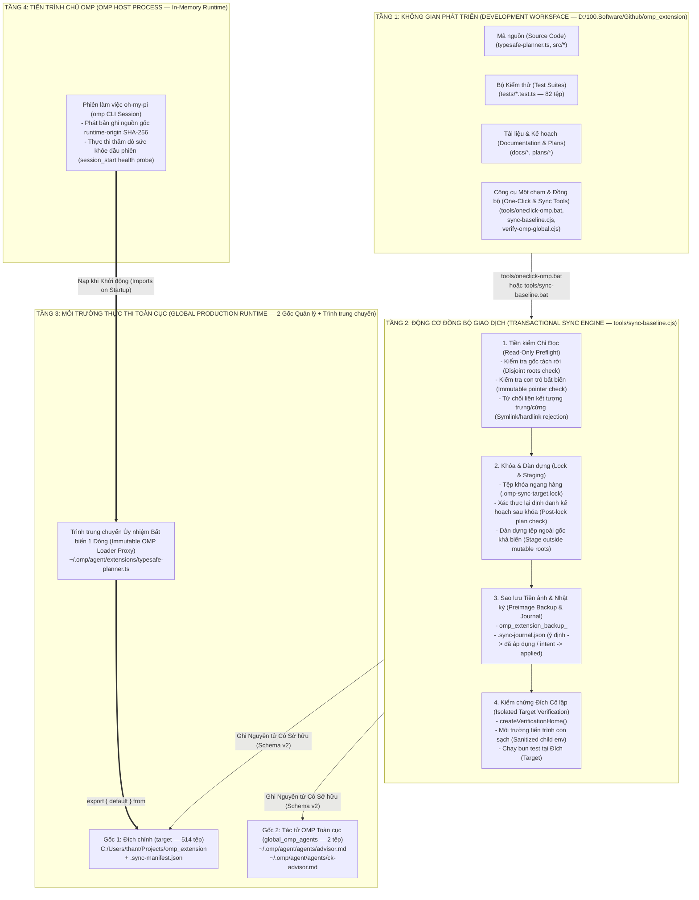
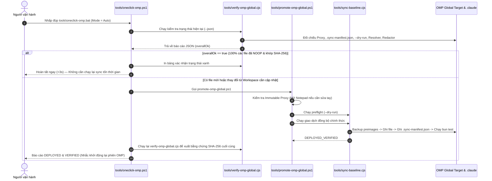
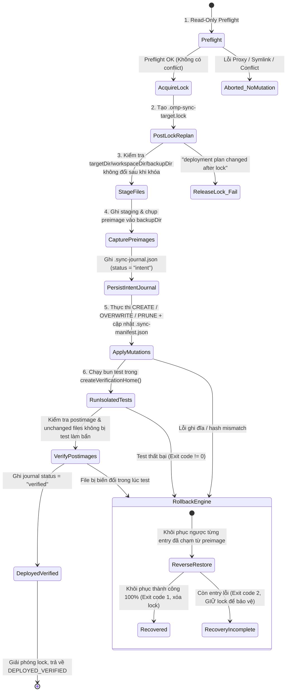

# Hướng dẫn Triển khai & Thăng cấp Toàn cục (Deployment & Promotion Guide — `omp-typesafe-extension`)

Tài liệu hướng dẫn triển khai (`deployment`), đồng bộ hóa cơ sở theo giao dịch (`transactional baseline synchronization`), sao lưu tự động (`automated backup`), khôi phục sự cố (`rollback & disaster recovery`) và vận hành **Một chạm (One-Click Operations)** cho `omp_extension`.

---

## 1. Tổng quan Kiến trúc Triển khai (Deployment Topology)

Hệ thống triển khai của `omp_extension` được thiết kế theo mô hình **Ba Tầng Tách Biệt (Three-Tier Isolated Promotion)** nhằm bảo toàn tuyệt đối **Bất biến Vàng (Golden Invariant)**: không bao giờ chỉnh sửa trực tiếp tệp nạp tiện ích mở rộng (`extension loader`) của OMP Toàn cục (`OMP Global`), đồng thời đảm bảo mọi thay đổi từ thư mục phát triển (`development workspace`) đều phải vượt qua bộ kiểm thử độc lập trước khi kích hoạt.

Kiểm tra chuỗi thư mục cha (Parent-Chain Verification) kiểm từng node một lần trong mỗi lượt, giữ kiểm loại directory, cấm symlink, định danh `dev`/`ino`/`mode` và đường dẫn canonical. Không lưu cache xuyên lượt hoặc bỏ kiểm trước mutation. Sửa này loại việc duyệt lại ancestor chain cho từng ancestor; module sync có 38 test đạt sau thay đổi, không tăng deadline để che slowness. Thời gian suite phụ thuộc filesystem và phải được kiểm chứng bằng receipt thật, không dùng kết quả của lần khác làm approval.

Trong mỗi lượt, sau khi kiểm định danh và loại của mọi ancestor, chỉ phân giải canonical cho thư mục hiện hữu sâu nhất; phép phân giải đi qua toàn chuỗi. Giữ mọi checkpoint trước/sau mutation, không cache kết quả giữa các lượt, không bỏ fsync hoặc kiểm descriptor. Bộ sync/security/installation đạt 71 pass, 2 skip, 0 fail sau sửa; chưa coi đó là bảo đảm thời gian dưới 300 giây trên mọi tải hệ thống.

### 1.1 Sơ đồ Kiến trúc Triển khai Từ Trên Xuống (Top-Down Deployment Topology)



---

## 2. Quy tắc Bất biến Vàng (Golden Invariant)

| Thành phần | Đường dẫn chuẩn | Quyền hạn của Script / Agent | Nội dung bắt buộc |
|---|---|---|---|
| **OMP Loader Proxy** | `C:\Users\thant\.omp\agent\extensions\typesafe-planner.ts` | **READ-ONLY (Immutable)** — Không script hay agent nào được phép ghi đè | `export { default } from "C:/Users/thant/Projects/omp_extension/typesafe-planner.ts";` |
| **Active Target** | `C:\Users\thant\Projects\omp_extension` | Quản lý độc quyền bởi `tools/sync-baseline.cjs` thông qua `.sync-manifest.json` (Schema v2) | Bản sao đã kiểm thử 100% từ Workspace (514 tệp) |
| **Global OMP Agents** | `C:\Users\thant\.omp\agent\agents\{advisor,ck-advisor}.md` | Quản lý độc quyền 2 file định nghĩa agent độc lập | Đồng bộ byte-for-byte với `agents/*.md` |
> **Tại sao không sửa trực tiếp file trong `.omp/agent/extensions/`?**
> `typesafe-planner.ts` nạp hàng chục module tương đối (`./src/*`). Nếu đặt toàn bộ mã nguồn vào `.omp/agent/extensions/` hoặc sửa trực tiếp tại đó, cấu trúc module resolution sẽ bị phá vỡ và mất khả năng kiểm soát giao dịch/rollback.

---

## 3. Vận hành Tự động Hóa Tối Đa (One-Click Operations)

Thư mục `tools/` và `package.json` cung cấp bộ công cụ **One-Click** giúp kiểm tra, đồng bộ và xác thực chỉ với **1 cú nhấp chuột** hoặc **1 câu lệnh duy nhất**.

| **1. Kiểm tra hiện trạng 2 gốc (Extension Verification)** | Nhấp đúp `tools\verify-omp-global.bat` | `bun run verify:global` | Phụ thuộc máy | Ngoại tuyến mặc định, kiểm tra 2 gốc `target` và `global_omp_agents` |
| **2. Đồng bộ giao dịch 2 gốc (One-Click Sync)** | Nhấp đúp `tools\oneclick-omp.bat` | `bun run oneclick` | Phụ thuộc inventory và test | Đồng bộ giao dịch schema 2, bảo vệ Bất biến Vàng, tự động hậu kiểm |
| **3. Đồng bộ có hướng dẫn sửa Proxy** | Nhấp đúp `tools\sync-baseline.bat` | `bun run sync:global` | ~6–8 phút | Chạy `sync-baseline.cjs`, kiểm thử cô lập tại đích, tạo backup |
| **4. Kiểm tra thử kế hoạch triển khai (Dry-Run Preflight)** | — | `bun run sync:dry-run` | ~2–5 giây | **Read-only 100%** (Liệt kê hành động quản lý dự kiến) |

### 3.2 Sơ đồ Luồng Hoạt động của `tools\oneclick-omp.bat`



---

## 4. Chi tiết Giao dịch Đồng bộ (`tools/sync-baseline.cjs`)

### 4.1 6 Giai đoạn của Giao dịch Đồng bộ



### 4.2 Ma trận Phân loại Hành động (`createPlan`)

Khi `sync-baseline.cjs` đối chiếu từng file giữa Workspace (`sourceHash`), Đích (`currentHash`), và `.sync-manifest.json` (`prior.deployedHash`):

| Trạng thái tại Đích | Quan hệ Hash | Chế độ thường | Chế độ `--bootstrap` (Chỉ lần đầu khi chưa có manifest) | Ý nghĩa bảo mật |
|---|---|---|---|---|
| Chưa tồn tại | `destination == null` | `CREATE` | `CREATE` | Tạo mới file thuộc danh mục quản lý |
| Đã tồn tại | `currentHash === sourceHash` | `NOOP` | `NOOP` | Đã khớp tuyệt đối byte-for-byte; chỉ ghi nhận vào manifest |
| Đã tồn tại | `currentHash !== sourceHash` và `currentHash === prior.deployedHash` | `OVERWRITE` | — | File đích chưa bị sửa ngoài luồng kể từ lần sync trước; cập nhật an toàn lên bản mới |
| Đã tồn tại | `currentHash !== sourceHash` và `currentHash !== prior.deployedHash` | **CONFLICT (Hủy giao dịch)** | `BOOTSTRAP_OVERWRITE` *(chỉ khi chưa có manifest)* | Chặn ghi đè lên file đích đã bị chỉnh sửa thủ công ngoài luồng |
| File đã xóa khỏi Workspace | `currentHash === prior.deployedHash` | `PRUNE` | — | Dọn dẹp file cũ do chính workspace từng triển khai |
| File đã xóa khỏi Workspace | `currentHash !== prior.deployedHash` | **CONFLICT (Hủy giao dịch)** | — | Không xóa file đích nếu file đó đã bị sửa đổi ngoài luồng |

---

## 5. Cô lập Môi trường Tiến trình Con (`src/typesafe-child-env.cjs`)

Mọi tiến trình con do `promote-omp-global.ps1` và `sync-baseline.cjs` khởi chạy đều đi qua bộ lọc `buildChildEnvironment(purpose)`:

1. **Danh sách trắng (Allowlist) theo mục đích (`purpose`)**:
   - `deployment-sync`: Chỉ cho phép các biến hệ thống cốt lõi (`SystemRoot`, `ComSpec`, `PATH`, `PATHEXT`, `TEMP`, `TMP`, `USERPROFILE`, `HOME`, ...) và các biến điều khiển đường dẫn hợp lệ (`OMP_WORKSPACE_DIR`, `OMP_TARGET_DIR`, `OMP_HOME_DIR`, `OMP_EXTENSION_POINTER`, `OMP_BACKUP_DIR`, `OMP_BUN_BIN`).
   - `deployment-verify`: Chạy `bun test` trong thư mục `HOME` tạm thời cô lập (`typesafe-verification-home-*`), loại bỏ hoàn toàn `TYPESAFE_API_KEY`, `NODE_OPTIONS`, `HTTPS_PROXY`, `OMP_FAULT_INJECT`, v.v.
2. **Chống rò rỉ Secret vào biến môi trường được phép**:
   - Nếu giá trị của bất kỳ biến môi trường nào trong allowlist vô tình chứa chuỗi giá trị của `TYPESAFE_API_KEY` hoặc secret nhạy cảm, `buildChildEnvironment` lập tức từ chối với lỗi `UNSAFE_ALLOWED_VALUE`.
3. **Khóa cấu hình Git an toàn**:
   - Tự động gắn `GIT_CONFIG_NOSYSTEM=1`, `GIT_TERMINAL_PROMPT=0`, `GIT_OPTIONAL_LOCKS=0` và vô hiệu hóa `fsmonitor`/`hooksPath` ngoại lai.

---

## 6. Quy trình Khôi phục Sự cố (Disaster Recovery & Rollback)

### 6.1 Ý nghĩa các Mã Kết thúc của `sync-baseline.cjs`

| Kết quả trả về | Exit Code | Trạng thái Đích (`target`) | Trạng thái Lock (`.omp-sync-target.lock`) | Hành động tiếp theo |
|---|---|---|---|---|
| `DEPLOYED_VERIFIED` | `0` | Đã cập nhật & vượt qua 100% `bun test` | Đã giải phóng | Khởi động lại phiên OMP (`omp`) để nạp code mới |
| `BACKUP_INCOMPLETE` | `1` | Chưa có bất kỳ file nào bị chạm tới | Đã giải phóng | Kiểm tra quyền ổ đĩa / đường dẫn backup rồi chạy lại |
| `RECOVERED` | `1` | Đã tự động rollback 100% về trạng thái trước khi chạy | Đã giải phóng | Xem log lỗi test/build trong terminal, sửa tại Workspace rồi chạy lại |
| `RECOVERY_INCOMPLETE` | `2` | Có ít nhất 1 entry không thể tự khôi phục | **ĐƯỢC GIỮ LẠI** để chặn chạy đè | Mở `.sync-journal.json` trong thư mục backup được in ra để kiểm tra `unresolved`, khôi phục từ `preimages/`, sau đó xóa file `.omp-sync-target.lock` |

### 6.2 Khôi phục Thủ công từ Bản Sao lưu (`omp_extension_backup_<timestamp>`)

Mỗi lần chạy `sync-baseline.cjs` đều tạo thư mục sao lưu tại `C:\Users\thant\Projects\omp_extension_backup_<YYYY-MM-DDTHH-mm-ss-sssZ>` chứa:
- `.sync-journal.json`: Nhật ký giao dịch chi tiết từng file (`destination`, `preimage`, `postimage`, `backupPath`, `applied`).
- `preimages/`: Bản sao nguyên vẹn của mọi file trước khi bị ghi đè hoặc xóa.

Để kiểm tra nhanh bản sao lưu mới nhất:
```bash
node tools/verify-omp-global.cjs
```
 Dòng `[5] Latest Verified Backup` sẽ hiển thị chính xác thư mục sao lưu gần nhất và trạng thái `status=verified`.
