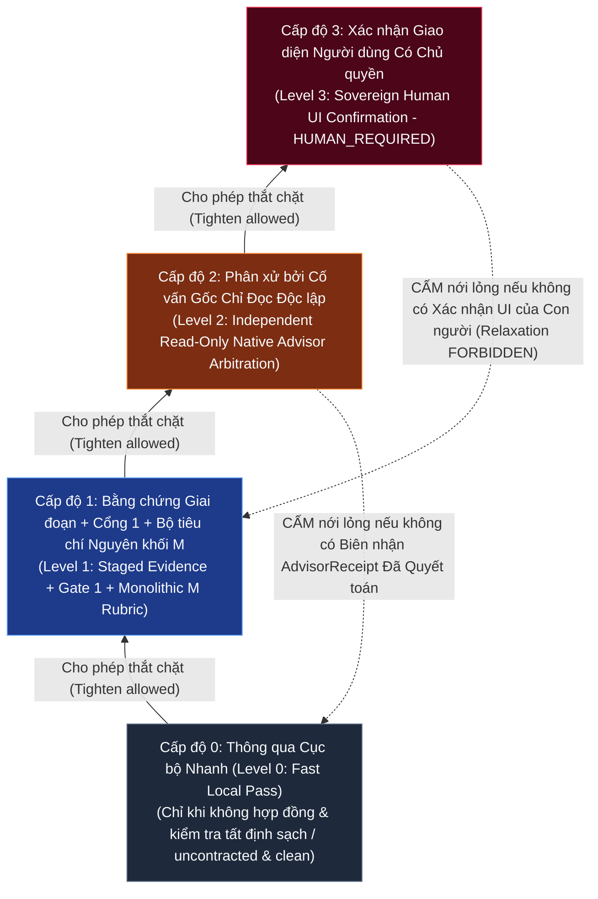
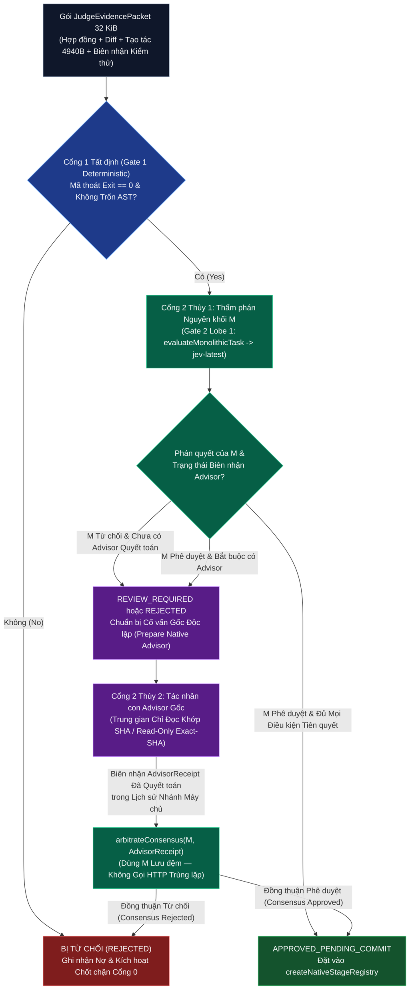
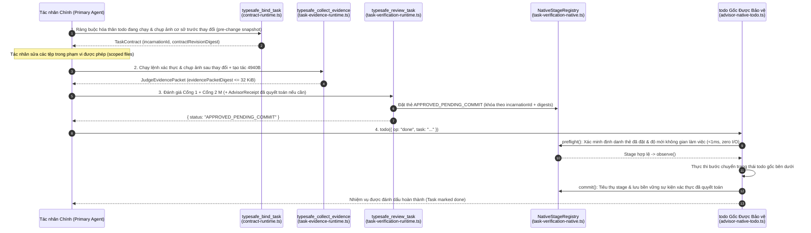

# Hướng dẫn Thiết kế Kiến trúc (Architectural Design Guidelines) — `omp_extension`

> **Tài liệu Tham chiếu Chính tắc về Thiết kế Hệ thống & Mẫu Kiến trúc (Canonical System Design & Pattern Reference)** cho `omp-typesafe-extension` (`v1.0.0`).  
> Giải thích các nguyên lý toán học, bảo mật và thiết kế tương tác chi phối Quản trị Đóng băng An toàn khi Lỗi (Fail-Closed Governance), Lưới Định tuyến Chỉ Thắt chặt (Tighten-Only Routing Lattice), Đồng thuận Lưỡng viện (Bicameral Consensus: `M` + `Advisor` so với Bản bóng `H`), Xác thực theo Giai đoạn Không I/O (Staged Zero-IO Verification), Trung gian Cố vấn Chỉ Đọc (Read-Only Advisor Mediation), và Trải nghiệm Điều hướng Khắc phục XML Thích ứng (Adaptive XML Remediation UX).

---

## 1. Triết lý Thiết kế Cốt lõi (Core Design Philosophy)

### 1.1 Mặc định Đóng băng An toàn khi Lỗi (Fail-Closed by Default)
Mọi ranh giới bảo mật, hợp đồng và xác thực trong `omp_extension` đều được thiết kế theo nguyên tắc **đóng băng an toàn khi lỗi (fail-closed)**:
- Nếu một lời gọi công cụ (tool call) không thể kết nối vào chứng nhân thực thi `AsyncLocalStorage` đang hoạt động (`omp.typesafe.tool-execution.v1` trong `src/host-tool-invocation.ts`), lời gọi đó sẽ bị từ chối ngay lập tức.
- Nếu một thao tác đọc tệp gặp phải liên kết tượng trưng (symlink), điểm nối Windows (Windows junction), liên kết cứng đa điểm (`nlink > 1`), hoặc phân đoạn đường dẫn `.claude` (`src/typesafe-evidence-file.cjs`), thao tác đọc sẽ bị từ chối trước khi bất kỳ byte dữ liệu nào được nạp vào bộ nhớ.
- Nếu một lệnh gọi `todo(op="done")` thiếu thẻ `APPROVED_PENDING_COMMIT` đã được đặt trước (pre-staged token) khớp chính xác với `incarnationId`, `contractRevisionDigest`, và `evidencePacketDigest` (`src/task-verification-native.ts`), bước chuyển trạng thái sẽ bị chặn đứng.

### 1.2 Lưới Chính sách Chỉ Thắt chặt (`validateRoutingTightenOnly` - The Tighten-Only Lattice)
Các phán quyết của AI (`typesafe_judge`, định tuyến System One, ảnh chụp chính sách) tuân theo quy tắc **chỉ thắt chặt (tighten-only)**:
- Đầu ra của một mô hình ngữ nghĩa (semantic model output) có thể **nâng cao (raise)** mức độ xác thực bắt buộc (ví dụ: từ thông qua nhanh sang `REVIEW_REQUIRED` hoặc `REJECTED`) hoặc bổ sung các cổng khắc phục bắt buộc (remediation gates).
- Đầu ra của mô hình ngữ nghĩa **tuyệt đối không bao giờ (never)** được phép nới lỏng (relax) một lỗi tất định tại Cổng 1 (Gate 1 deterministic failure — chẳng hạn như mã thoát kiểm thử khác 0, cờ cảnh báo trốn tránh kiểm thử AST, hoặc thiếu tạo tác bàn giao) và **tuyệt đối không bao giờ** được cấp quyền biến đổi tệp nằm ngoài phạm vi `TaskContract` đã ràng buộc.

### 1.3 Phân tách Quyền lực Tứ trụ Nghiêm ngặt (Strict Four-Way Separation of Powers)
Một bài học nền tảng từ `ADR-20261014` và `ADR-20261019` là **không một thẩm quyền đơn lẻ nào được phép vừa sinh lập luận suy diễn vừa tự chứng nhận hoàn thành (no single authority may both generate reasoning and self-certify completion)**:

| Trụ cột Thẩm quyền (Authority Pillar) | Phân hệ Triển khai (Implementing Subsystem) | Những gì Được phép Làm (What It Can Do) | Những gì TUYỆT ĐỐI KHÔNG Được Làm (What It Can NEVER Do) |
|---|---|---|---|
| **1. Bằng chứng Tất định (Deterministic Proof)** | `src/evidence-workspace.ts`, `src/verification-receipt.ts`, `src/ast-analyzer.ts`, `src/egc.ts` | Chứng minh chính xác bản diff tệp SHA-256, mã thoát kiểm thử, kích thước tạo tác, và sự vắng mặt của hành vi xóa câu lệnh khẳng định kiểm thử. | Phán xét liệu ngữ nghĩa mã nguồn có thực sự giải quyết đúng mục tiêu kiến trúc của người dùng hay không. |
| **2. Thẩm phán Ngữ nghĩa (`M` / Bản bóng `H` - Semantic Judge)** | `src/task-verification-macro.ts`, `src/cook-expert-judge.ts`, `src/atomic-judge.ts` | Xuất ra các xác suất `noul` đã hiệu chuẩn $P(\text{yes}) \in [0, 1]$ và các nhãn lựa chọn `choice` trên gói `JudgeEvidencePacket` 32 KiB. | Sinh lập luận hội thoại tự do, biến đổi tệp, hoặc ghi đè một lỗi kiểm thử tất định. |
| **3. Cố vấn Gốc Độc lập (Independent Native Advisor)** | `src/advisor-runtime.ts`, `src/advisor-host.ts`, `src/advisor-readonly.ts` | Kiểm tra các tệp không gian làm việc khớp chính xác mã băm SHA trong một phiên con chỉ đọc cô lập và phát hành bản đánh giá `AdvisorAssessment` có cấu trúc. | Sửa tệp, chạy lệnh shell, hoặc trực tiếp đánh dấu hoàn thành (`done`) cho một mục `todo`. |
| **4. Thẩm quyền Con người Tối cao (Sovereign Human Authority)** | `ctx.ui.confirm` trong `src/todo-lifecycle-authority.ts`, `src/task-verification-historical.ts`, `src/evaluation-host.ts` | Cấp phép thu hẹp phạm vi (`drop`/`rm`), xóa nợ từ chối lịch sử (forgive historical rejection debt), hoặc cấp phép chạy đánh giá bắt cặp có trả phí. | Bị giả mạo bởi các cờ trong prompt, tham số của tác nhân, hoặc đầu ra của mô hình ngôn ngữ. |

---

## 2. Thiết kế Đồng thuận Lưỡng viện — Bản Cơ sở Sản xuất `M` so với Ứng viên Đối chứng Bóng `H` (Bicameral Consensus Design)

### 2.1 Tại sao Cần Đồng thuận Lưỡng viện? (Why Bicameral Consensus?)
Các cổng ngữ nghĩa đơn mô hình (single-model semantic gates) thường mắc phải hai chế độ lỗi đối lập nhau:
1. **Từ chối Quá mức do Phân biệt Thuần túy (Discriminative Over-Rejection)**: Các bộ phân loại không sinh văn bản tốc độ cao (`jev-latest` - fast zero-generation classifiers) rất xuất sắc trong việc ước lượng xác suất hiệu chuẩn nhanh (`noul`) trên trạng thái có cấu trúc, nhưng có thể gắn cờ nhầm các đợt tái cấu trúc đa giai đoạn hợp lệ là cận biên (`marginal`) khi ngữ cảnh trải rộng trên nhiều tệp.
2. **Đóng dấu Cao su do Sinh Hội thoại (Generative Rubber-Stamping)**: Các mô hình LLM hội thoại được gọi bên trong cùng ngữ cảnh của tác nhân thường mắc hội chứng chiều lòng (sycophancy) và thiên kiến chi phí chìm (sunk-cost bias), tự hợp thức hóa các bản triển khai đang lỗi là "đủ tốt".

**Đồng thuận Lưỡng viện (Bicameral Consensus)** (`src/bicameral-consensus.ts` + `src/task-verification-runtime.ts`) giải quyết triệt để mâu thuẫn này bằng cách ghép đôi:
- **Thùy 1 — Thẩm phán Vĩ mô Nguyên khối (`M` - Monolithic Macro Judge)**: Đánh giá gói `JudgeEvidencePacket` của toàn bộ nhiệm vụ qua ba nguyên hàm System One đồng thời:
  - `meets_criteria` (`noul` $\in [0, 1]$: xác suất đã hiệu chuẩn rằng mọi tiêu chí giai đoạn đã ràng buộc đều được thỏa mãn; ngưỡng sàn tiêu chuẩn `0.70`, ngưỡng sàn nghiêm ngặt `0.80`).
  - `plan_drift` (`choice`: `"no_drift"` | `"minor_drift"` | `"major_drift"`).
  - `claude_account_untouched` (`noul` / bất biến boolean xác minh không có bất kỳ sự can thiệp nào vào `.claude`).
- **Thùy 2 — Cố vấn Gốc Chỉ Đọc Độc lập (`Advisor` - Independent Read-Only Native `Advisor`: `advisor` / `ck:advisor`)**: Được khởi tạo như một tác nhân con gốc tách biệt với gói dữ liệu nhà cung cấp đã được lọc sạch (`projectAdvisorPayload` trong `src/advisor-guards.ts`) và quyền truy cập chỉ đọc bị giới hạn nghiêm ngặt vào các tệp được cấp phép khớp chính xác mã băm SHA (`src/advisor-readonly.ts`).

### 2.2 Bản Sản xuất `Repaired-M` so với Ứng viên Bóng `Hybrid-H` (`ADR-20261019`)
Theo quyết định tại `ADR-20261019`, `omp_extension` triển khai song song hai kiến trúc đánh giá ngữ nghĩa:

| Khía cạnh Kiến trúc (Architectural Aspect) | Bản Cơ sở Sản xuất: `Repaired-M` (`src/task-verification-macro.ts`) | Ứng viên Đối chứng Bóng: `Bounded Hybrid-H` (`src/atomic-judge.ts`) |
|---|---|---|
| **Tư cách Thẩm quyền (Authority Status)** | **Cổng Sản xuất Có Thẩm quyền (Authoritative Production Gate)** cho `typesafe_review_task`. | **Ứng viên Chỉ Chạy Bóng (Shadow-Only Candidate)** (`src/atomic-evaluation.ts`); không bao giờ cấp phép hoàn thành `todo` gốc. |
| **Cấu trúc Tô-pô Bằng chứng (Evidence Topology)** | Một gói `JudgeEvidencePacket` toàn nhiệm vụ duy nhất ($\le 32\text{ KiB}$) bao quát tất cả tiêu chí nhiệm vụ cùng lúc. | Các vị từ nguyên tử theo thứ tự phụ thuộc (dependency-ordered atomic predicates) được phân hoạch qua tập các gói giới hạn (`EvidencePacketSetManifest`). |
| **Tổng hợp Quyết định (Decision Composition)** | Bộ tiêu chí vĩ mô (`meets_criteria`, `plan_drift`, `claude_account_untouched`) kết hợp với `AdvisorReceipt`. | Các kiểm tra tất định (`src/atomic-checks.ts`) + chính sách `noul` trên từng vị từ (`support_only`, `counterevidence_only`, `closed_world_boolean` trong `src/atomic-decision-policy.ts`). |
| **Đồng thời & Lập lịch (Concurrency & Scheduling)** | Điều phối gói đơn qua `callTypeSafeJudge`. | Được lập lịch thông qua `SemanticReviewScheduler` (`src/typesafe-policy-client.cjs`) với giới hạn đồng thời theo đợt (bounded wave concurrency) và kiểm soát hạn chót (deadline admission). |
| **Cổng Thăng cấp (Promotion Gate)** | Bản chuẩn đối sánh hiện hành (current baseline comparator). | Phải vượt qua các cổng thống trị nghiêm ngặt `strictDominanceGates` (`tools/jev-paired-metrics.ts`) trên tập dữ liệu giữ lại chưa từng tiếp xúc (`tools/jev-paired-exposure.ts`) trước khi thay thế `M`. |

---

## 3. Thiết kế Xác thực theo Giai đoạn — Tại sao Tiền kiểm `todo` Gốc Không Thực hiện I/O (Staged Verification Design)

### 3.1 Bài toán Hết thời gian chờ Hook trong Các Kiến trúc Đời đầu (The Hook Timeout Problem in Early Architectures)
Trong các phiên bản đầu tiên của tiện ích mở rộng, việc chặn `todo(op="done")` bên trong hook `tool_call` đã kích hoạt đồng bộ lệnh `git diff`, chạy kiểm thử, và gửi yêu cầu HTTP `jev-latest` ngay bên trong hàm gọi lại của hook (hook callback). Cách làm này gây ra ba khuyết tật cấu trúc nghiêm trọng:
1. Lỗi hết thời gian chờ của hook (hook timeouts) khi bộ kiểm thử chạy mất $>10\text{ giây}$ hoặc khi `api.typesafe.ai` gặp tình trạng lùi thời gian chờ (backoff) do `HTTP 429/529`.
2. Phát sinh các tác dụng phụ ẩn (hidden side effects) ngay trong một lời gọi công cụ chuyển đổi trạng thái gốc.
3. Không thể điều phối một tác nhân con `task` gốc (`Advisor`) từ bên trong một hook tiền kiểm `todo` đồng bộ.

### 3.2 Giải pháp Xác thực theo Giai đoạn (`createNativeStageRegistry` - The Staged Verification Solution)
`omp_extension` tách rời hoàn toàn **công việc xác thực (verification work)** khỏi **cam kết trạng thái gốc (native state commitment)** thông qua năm giai đoạn tường minh:

Các bất biến cốt lõi của `createNativeStageRegistry` (`src/task-verification-native.ts`):
- **Định danh Đối tượng Dùng Một Lần (Single-Use Object Identity)**: Một thẻ `APPROVED_PENDING_COMMIT` đã đặt sẽ bị tiêu thụ ngay khi gọi `commit()` và bị vô hiệu hóa tức thì nếu bất kỳ tệp nào trong không gian làm việc hoặc phiên bản hợp đồng bị thay đổi trước khi `todo(op="done")` được gọi.
- **Lưu đệm Kết quả `M` Qua Các Vòng Cố vấn (Cached `M` Across Advisor Rounds)**: Khi `typesafe_review_task` trả về `REVIEW_REQUIRED` vì cần một biên nhận `AdvisorReceipt` độc lập, kết quả đánh giá `M` đã đạt sẽ được lưu đệm theo bộ khóa `(incarnationId, contractRevisionDigest, evidencePacketDigest)`. Sau khi tác nhân cha thực thi `task` Advisor gốc và chạy lại `typesafe_review_task`, hệ thống thực thi sẽ kết hợp kết quả `M` đã lưu đệm với `AdvisorReceipt` vừa quyết toán **mà không thực hiện lại lời gọi HTTP trùng lặp**.

---

## 4. Mẫu Trung gian Cố vấn Gốc Chỉ Đọc (Read-Only Native Advisor Mediation Pattern)

Để đảm bảo rằng thùy `Advisor` (`advisor` / `ck:advisor`) là một **tác nhân suy luận độc lập thực thụ (genuine independent reasoning agent)** chứ không phải một con dấu cao su dễ bị tiêm lệnh (`ADR-20261019`), các mô-đun `src/advisor-runtime.ts`, `src/advisor-host.ts`, và `src/advisor-host-hooks.ts` cưỡng chế sáu chốt kiểm soát cô lập:

```mermaid
flowchart LR
    classDef prep fill:#1e3a8a,stroke:#60a5fa,color:#f8fafc
    classDef med fill:#065f46,stroke:#34d399,color:#f8fafc
    classDef guard fill:#7c2d12,stroke:#fb923c,color:#f8fafc
    classDef settle fill:#581c87,stroke:#c084fc,color:#f8fafc

    P1["typesafe_prepare_advisor<br/>Khởi tạo AdvisorRequest &<br/>Bảng kê Tệp Khớp SHA (Exact-SHA Manifest)"]:::prep
    P2["Trình bọc task Gốc (Native task Wrapper)<br/>(advisor-host-dispatch.ts)<br/>Cấp phát ChildRoute & Ngân sách (Budget)"]:::prep
    G1["Hook before_provider_request<br/>(projectAdvisorPayload)<br/>Tước bỏ Lịch sử Cha & Công cụ Thừa"]:::guard
    G2["read / grep / glob Được Bảo vệ<br/>(advisor-readonly.ts)<br/>Xác minh Khớp Mã băm SHA-256 của Tệp"]:::med
    G3["guardAdvisorTool<br/>Chặn edit / write / bash /<br/>task / todo trong Phiên Con"]:::guard
    S1["collectAdvisorHostSettlement<br/>Xác minh toolResult Đã Quyết toán trong<br/>Nhánh Máy chủ & Khởi tạo AdvisorReceipt"]:::settle

    P1 --> P2 --> G1 --> G2 --> G3 --> S1
```

1. **Ghim Chặt Prompt & Lược đồ Thuộc Sở hữu Máy chủ (`src/advisor-native-prompt.ts`, `src/advisor-native-schema.ts` - Server-Owned Prompt & Schema Pinning)**: Tác nhân cha không thể tự ý viết các chỉ thị hội thoại tùy tiện để dẫn dắt thiên kiến của Advisor. Công cụ `typesafe_prepare_advisor` tuần tự hóa một bản giao việc công khai, có giới hạn kích thước và đã biên tập ẩn thông tin (`prepareAdvisorPublicContext` trong `src/advisor-public-context.ts`) cùng một lược đồ đầu ra JSON cố định (`advisorOutputSchema` trong `src/advisor-protocol.ts`).
2. **Chiếu Gói dữ liệu Nhà cung cấp (`projectAdvisorPayload` trong `src/advisor-guards.ts` - Provider Payload Projection)**: Hook `before_provider_request` chặn bắt gói dữ liệu LLM gửi đi của tác nhân con Advisor (hỗ trợ cả định dạng OpenAI Responses/Chat Completions và Anthropic Messages), đồng thời tước bỏ toàn bộ lịch sử hội thoại xung quanh của tác nhân cha cũng như các khai báo công cụ không được cấp phép.
3. **Phiên Đọc Được Cấp phép Khớp Chính xác SHA (`src/advisor-readonly.ts`, `src/advisor-read-session.ts` - Exact-SHA Authorized Read Session)**: Khi tác nhân con Advisor gọi `read`, `grep`, hoặc `glob`, hàm `authorizeAdvisorRead` xác minh rằng đường dẫn được yêu cầu nằm trong bảng kê bằng chứng được cấp phép và mã băm SHA-256 hiện tại trên đĩa của tệp đó khớp tuyệt đối với mã băm ảnh chụp đã thu thập trong bước `typesafe_collect_evidence`.
4. **Từ chối Cứng Công cụ Ghi/Thực thi (`guardAdvisorTool` trong `src/advisor-guards.ts` - Hard Write/Exec Tool Refusal)**: Mọi nỗ lực của phiên con Advisor nhằm gọi `edit`, `write`, `bash`, `eval`, `todo`, hoặc `task` lồng nhau đều bị chặn tất định.
5. **Bảo vệ Ngân sách & Xả Luồng Dữ liệu (`src/advisor-native-budget.ts` - Budget & Stream Drain Protection)**: Các lượt điều phối Advisor được kiểm soát thu nhận qua `SemanticReviewScheduler` với hạn chót thời gian thực nghiêm ngặt (strict wall-clock deadlines); khi hết thời gian chờ hoặc hủy bỏ (timeout/abort), các luồng phản hồi bên dưới được xả/hủy tường minh (Gia cố Giai đoạn 4 - Phase 4 Hardening) để ngăn chặn rò rỉ socket.
6. **Từ chối Bản Đánh giá Không Áp dụng (`src/advisor-protocol.ts` - Non-Applicable Assessment Rejection)**: Nếu một bản `AdvisorAssessment` báo cáo `applicable === false`, hàm `validateAdvisorReceipt` sẽ từ chối coi đó là sự phê duyệt ngữ nghĩa (Gia cố Giai đoạn 4 - Phase 4 Hardening).

---

## 5. Thiết kế Trải nghiệm Điều hướng Thích ứng & Khắc phục XML (Adaptive Steering & XML Remediation UX Design)

Khi một lượt rà soát nhiệm vụ hoặc biến đổi `todo` gốc bị từ chối, tiện ích mở rộng tránh trả về các thông báo lỗi văn bản tự do thiếu cấu trúc gây nhầm lẫn cho tác nhân hoặc làm lãng phí token ngữ cảnh. Thay vào đó, hệ thống tổng hợp **khối điều hướng khắc phục XML có cấu trúc, an toàn trước tiêm lệnh (structured, injection-safe XML remediation steering)** (`src/remediation-generator.ts`, `src/xml-enclosure.ts`, `src/task-recovery.ts`).

### 5.1 Bao đóng XML An toàn với Thẻ Đóng (`src/xml-enclosure.ts` - Closing-Tag-Safe XML Enclosure)
Các chuỗi không tin cậy (trích đoạn diff, luồng lỗi kiểm thử stderr, tiêu chí kế hoạch) có thể chứa các thẻ văn bản `</typesafe_remediation>` hoặc `</evidence>` nhằm mục đích phá vỡ cấu trúc khối prompt XML. Hàm `encloseUntrusted(tagName, rawText)` thực thi `sanitizeXmlText(rawText)` để vô hiệu hóa mọi chuỗi thẻ đóng trước khi bọc nội dung.

### 5.2 Kế hoạch Phục hồi theo Thứ tự Phụ thuộc & Chốt chặn Cùng Bằng chứng (`src/task-recovery.ts` - Dependency-Ordered Recovery Plans & Same-Evidence Ratchet)
1. **Chốt chặn Mã băm Tiến độ (Progress Digest Ratchet)**: Mỗi lần từ chối đều ghi lại một mã băm `recoveryProgressDigest` được tính toán trên `evidencePacketDigest`, danh sách ID tiêu chí thất bại, và mã băm biên nhận lệnh kiểm thử.
2. **Từ chối Cục bộ Không Tốn Token Khi Thử lại Không Đổi (Zero-Token Local Refusal on Unchanged Retries)**: Nếu tác nhân gọi lại `typesafe_review_task` hoặc `todo(op="done")` mà không hề thay đổi bản diff không gian làm việc hay biên nhận kiểm thử (`stateProgressDigest` không đổi), `createTaskRecoveryPolicy` lập tức trả về kết quả từ chối đã lưu đệm và tăng bộ đếm chốt chặn (ratchet counter) mà không gọi lại `jev-latest`.
3. **Khắc phục Có Thể Hành động Theo Từng Tiêu chí (`generateRemediationBlock` - Actionable Criterion-Scoped Remediation)**: Đầu ra từ chối định dạng các trích đoạn có độ trung thực cao (tối đa `300 ký tự` cho mỗi yêu cầu, `200 ký tự` cho mỗi tiêu đề nhiệm vụ, và tổng cộng `3,500 ký tự` theo `ADR-20261013`) bên trong phong bì XML `<typesafe_remediation>` liệt kê rõ:
   - Mã định danh chính xác của các tiêu chí bị lỗi hoặc chưa được xác thực theo thứ tự phụ thuộc (dependency order).
   - Nguyên nhân lỗi tất định cụ thể (mã thoát khác 0, các dòng vi phạm trốn tránh kiểm thử AST, đường dẫn tạo tác bị thiếu).
   - Chuỗi lời gọi công cụ tiếp theo chính xác cần thực hiện để phục hồi (`edit` $\rightarrow$ `typesafe_collect_evidence` $\rightarrow$ `typesafe_review_task`).
