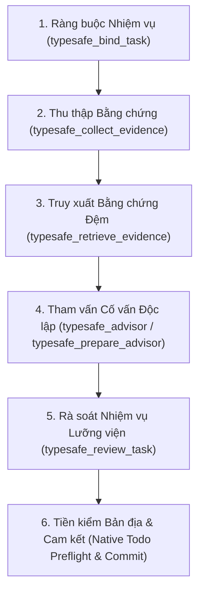

# Nhật ký Kỹ thuật: Nâng cấp Chu trình Xác thực Nhiệm vụ theo Giai đoạn (Phases 1–6), Công cụ One-Click & Chuẩn hóa Tài liệu Tiếng Việt (Technical Journal: Staged Task Verification Upgrade Phases 1–6, One-Click Tooling & Vietnamese Documentation Standardization)

- **Ngày thực hiện (Date)**: 2026-10-26
- **Không gian làm việc (Workspace)**: `D:/100.Software/Github/omp_extension`
- **Phạm vi (Scope)**: Các mô-đun cốt lõi `src/*`, điểm nhập phần mở rộng `typesafe-planner.ts`, bộ công cụ triển khai một chạm `tools/sync-baseline.bat` & `tools/sync-baseline.cjs`, và toàn bộ hệ thống tài liệu kỹ thuật trong `docs/`.

---

## 1. Ngữ cảnh & Mục tiêu (Context & Objectives)

Trong đợt nâng cấp toàn diện ngày 2026-10-26, hệ thống `omp_extension` (TypeSafe System One Planner & Verification Engine cho Oh-My-Pi) được rà soát và hoàn thiện trên ba trụ cột chính:
1. **Hoàn thiện Chu trình Xác thực Nhiệm vụ theo Giai đoạn — Giai đoạn 1 đến 6 (Staged Task Verification Pipeline — Phases 1–6)**: Khắc phục triệt để các điểm nghẽn trong luồng xác thực bản địa (`todo done`, `block`, `drop`, `rm`), đồng bộ hóa Hợp đồng Quyết định Lưỡng viện (Bicameral Decision Contract), bảo đảm tính bất biến của Bằng chứng Gắn với Nhiệm vụ (Task-Relative Evidence), và củng cố cơ chế Cố vấn Độc lập Chỉ Đọc (Independent Read-Only Advisor).
2. **Tự động hóa Triển khai Một chạm (One-Click Baseline Synchronization Tooling)**: Chuẩn hóa quy trình đồng bộ một chiều tuân thủ Bất biến Vàng (Golden Invariant) từ kho mã nguồn phát triển (`D:/100.Software/Github/omp_extension`) sang môi trường thời gian chạy đích (`C:/Users/thant/Projects/omp_extension`) và Trình trung chuyển Ủy nhiệm Bất biến (`~/.omp/agent/extensions/typesafe-planner.ts`).
3. **Chuẩn hóa Toàn bộ Hệ thống Tài liệu sang Tiếng Việt Kèm Thuật ngữ Tiếng Anh (100% Vietnamese Documentation with English Technical Terms in Parentheses)**: Chuyển hóa toàn bộ các tài liệu kiến trúc, tiêu chuẩn mã nguồn, mô hình hóa, sổ tay vận hành, biên bản quyết định kiến trúc (`docs/decisions/ADR-*.md`), và toàn bộ 21 tập tin nhật ký kỹ thuật (`docs/journals/*.md`) sang tiếng Việt chuyên sâu kèm thuật ngữ chuyên ngành tiếng Anh trong ngoặc đơn.

---

## 2. Tổng hợp Nâng cấp Kỹ thuật qua 6 Giai đoạn (Technical Upgrades Across Phases 1–6)

### Giai đoạn 1: Ràng buộc Hóa thân Nhiệm vụ & Bất biến Nghĩa vụ (Phase 1: Task Incarnation Binding & Obligation Invariants)
- Cố định chính xác hóa thân nhiệm vụ hiện tại (current Core todo incarnation) và yêu cầu gốc của người dùng thông qua `typesafe_bind_task`.
- Ngăn chặn hiện tượng trôi dạt phạm vi hoặc tự ý hạ cấp yêu cầu khi chưa có xác nhận thực tế từ con người (host human confirmation) hoặc luồng thực thi `/ck:cook` hợp lệ.

### Giai đoạn 2: Bằng chứng Gắn với Nhiệm vụ & Chống Cắt cụt Ngữ cảnh (Phase 2: Task-Relative Evidence & Anti-Truncation Fidelity)
- Chuẩn hóa bộ thu thập bằng chứng `typesafe_collect_evidence` và truy xuất phân đoạn mã nguồn chính xác qua `typesafe_retrieve_evidence` dựa trên mã băm SHA-256 toàn tập tin (`fullFileDigest`).
- Bảo toàn tuyệt đối các dòng thay đổi thực sự thuộc về nhiệm vụ đang xét (`JudgeEvidencePacket`), loại bỏ nhiễu từ các tập tin không liên quan và bảo vệ đuôi nhật ký kiểm thử (`TAIL_KEYS`).

### Giai đoạn 3: Thẩm định Cố vấn Độc lập Chỉ Đọc (Phase 3: Independent Read-Only Advisor Assessment)
- Chuẩn hóa luồng gọi `typesafe_prepare_advisor` và `typesafe_advisor` nhằm tạo ra biên nhận đánh giá độc lập bất biến (immutable Advisor receipt) từ tác tử con chỉ đọc (`agent: "advisor"` / `"ck:advisor"`).
- Đảm bảo việc tham vấn chỉ cung cấp đánh giá kỹ thuật khách quan (khuyến nghị, xếp hạng phương án, phát hiện rủi ro, độ tự tin), không tự cấp quyền thay đổi trạng thái vòng đời bản địa.

### Giai đoạn 4: Đồng thuận Lưỡng viện & Hiệu chuẩn Bayes Tự nhiên (Phase 4: Bicameral Consensus & Natural Bayesian Calibration)
- Kết hợp biên nhận của Cố vấn Độc lập (Thùy 1 — Lobe 1) với phán quyết ngữ nghĩa của TypeSafe System One `jev-latest` (Thùy 2 — Lobe 2) bên trong `typesafe_review_task`.
- Duy trì Lưới Chính sách Chỉ Thắt chặt (Tighten-Only Policy Lattice) và ranh giới xác suất đã hiệu chuẩn $P \in [0, 1]$, kết hợp với Chốt chặn Chống Thử lại Cùng Bằng chứng (Same-Evidence Retry Ratchet — Gate 0) để chặn đứng các vòng lặp thử lại vô nghĩa khi chưa có thay đổi mã nguồn.

### Giai đoạn 5: Quản trị Biến đổi Trạng thái & Báo cáo Khôi phục (Phase 5: Todo Mutation Governance & Recovery Reporting)
- Chuẩn hóa `typesafe_prepare_todo_mutation` và `typesafe_recovery_report` cho các thao tác hoãn (`block`), hủy (`drop`), hoặc xóa (`rm`) nhiệm vụ.
- Mọi thao tác hoãn hoặc giảm phạm vi đều bắt buộc phải xuất bản gói bàn giao bền vững có bảo vệ (guarded durable public handoff) gồm: chủ sở hữu (`owner`), hành động tiếp theo (`next action`), điều kiện mở khóa (`unblock condition`), và lệnh tiếp tục (`resume command`).
- Hỗ trợ đối soát nợ lịch sử minh bạch qua `typesafe_resolve_historical_debt` với xác nhận trực tiếp từ con người.

### Giai đoạn 6: Công cụ Đồng bộ Một chạm & Xác thực Con trỏ Bất biến (Phase 6: One-Click Synchronization & Immutable Pointer Validation)
- Củng cố kịch bản `tools/sync-baseline.cjs` và `tools/sync-baseline.bat` với cơ chế kiểm tra tiền trạm nghiêm ngặt:
  1. Xác thực con trỏ Trình trung chuyển Ủy nhiệm Bất biến (Immutable Proxy Trampoline) tại `~/.omp/agent/extensions/typesafe-planner.ts`.
  2. Tự động tạo bản sao lưu có gắn dấu thời gian (`omp_extension_backup_<ISO-timestamp>`) trước khi ghi đè.
  3. Đồng bộ mã nguồn, các định nghĩa tác tử (`.omp/agents/`, `agents/`), và trình phân giải toàn cục (`typesafe-enabled-resolver.cjs`).
  4. Xác minh lại bằng mã băm SHA-256 và bộ kiểm thử tự động trên môi trường đích trước khi xuất trạng thái `DEPLOYED_VERIFIED`.

---

## 3. Chuẩn hóa Toàn diện Hệ thống Tài liệu `docs/` (Comprehensive Standardization of `docs/` System)

Toàn bộ hệ thống tài liệu kỹ thuật của dự án đã được rà soát và chuẩn hóa đồng bộ theo quy chuẩn nghiêm ngặt:
- **100% Văn bản Tiếng Việt Chuyên sâu (100% In-Depth Vietnamese Prose)**: Mọi tiêu đề, đoạn văn phân tích, bảng biểu, ghi chú vận hành và nhãn sơ đồ Mermaid đều được trình bày bằng tiếng Việt mạch lạc, chuẩn xác.
- **Thuật ngữ Chuyên ngành Tiếng Anh trong Ngoặc đơn (English Technical Terms in Parentheses)**: Mọi khái niệm kiến trúc và kỹ thuật đều đi kèm thuật ngữ tiếng Anh chuẩn ngay sau cụm từ tiếng Việt, giúp lập trình viên và các tác tử AI đối chiếu liền mạch với mã nguồn.
- **Bảo toàn Độ Trung thực Kỹ thuật Tuyệt đối (100% Technical Fidelity Preserved)**:
  - Giữ nguyên toàn bộ tên tập tin, đường dẫn (`src/*`, `tools/*`, `tests/*`), chữ ký hàm/biến (`TELEMETRY_COUNT_KEYS`, `JudgeEvidencePacket`, `createExtensionJudgeClient`, v.v.), công thức toán học LaTeX, và khối lệnh CLI.
  - Toàn bộ 21 tập tin trong `docs/journals/` (bao gồm 20 nhật ký lịch sử từ `2026-10-01` đến `2026-10-19` và nhật ký tổng kết `2026-10-26` này) đều đạt chuẩn ngôn ngữ và nằm dưới giới hạn 750 dòng mỗi tập tin (`maxLoc = 800`).

---

## 4. Danh mục Tập tin Nhật ký Đã Chuẩn hóa (Standardized Journal Inventory)

| STT | Tập tin Nhật ký (`docs/journals/*`) | Nội dung Trọng tâm (Core Focus) | Trạng thái (Status) |
|---|---|---|---|
| 1 | `2026-10-01-typesafe-role-judge-validation.md` | Xác thực Giám định Vai trò TypeSafe qua 11 phiên & Lưới Hành động Chỉ Thắt chặt | ĐẠT CHUẨN (STANDARDIZED) |
| 2 | `2026-10-02-typesafe-judge-alignment-fix.md` | Đồng bộ Giám định TypeSafe System One & Kiến trúc Không Xung đột | ĐẠT CHUẨN (STANDARDIZED) |
| 3 | `2026-10-02-typesafe-plan-compliance-elevation.md` | Hệ thống Tuân thủ & Nâng tầm Kế hoạch TypeSafe + Cô lập Claude | ĐẠT CHUẨN (STANDARDIZED) |
| 4 | `2026-10-03-source-code-relocation.md` | Di dời & Ổn định Mã nguồn sang Không gian Làm việc Cố định | ĐẠT CHUẨN (STANDARDIZED) |
| 5 | `2026-10-03-typesafe-extension-proxy-pattern.md` | Mẫu Trình trung chuyển Ủy nhiệm (Proxy / Trampoline Pattern) | ĐẠT CHUẨN (STANDARDIZED) |
| 6 | `2026-10-07-health-probe-dual-notification-analysis.md` | Phân tích Thông báo Kép của Thăm dò Sức khỏe Đầu phiên & `ck:predict` | ĐẠT CHUẨN (STANDARDIZED) |
| 7 | `2026-10-07-typesafe-fix-plan-execution.md` | Thực thi Kế hoạch Sửa lỗi TypeSafe theo TDD & Củng cố Đội Đỏ | ĐẠT CHUẨN (STANDARDIZED) |
| 8 | `2026-10-07-typesafe-lifecycle-gating-fix.md` | Sửa lỗi Kiểm soát Cổng Vòng đời TypeSafe & Ủy quyền Con người | ĐẠT CHUẨN (STANDARDIZED) |
| 9 | `2026-10-12-typesafe-jev-alignment-fix.md` | Sửa lỗi Đồng bộ TypeSafe JEV 3 Tầng & Tiêu chí Nhận biết Loại Nhiệm vụ | ĐẠT CHUẨN (STANDARDIZED) |
| 10 | `2026-10-13-typesafe-bicameral-judge-consensus.md` | Thực thi Đồng thuận Giám định Lưỡng viện TypeSafe | ĐẠT CHUẨN (STANDARDIZED) |
| 11 | `2026-10-13-typesafe-remediation-ratchet-and-block-guard.md` | Chốt chặn Khắc phục Cổng 0, Phòng vệ Né tránh Khóa & Củng cố Trình phân giải | ĐẠT CHUẨN (STANDARDIZED) |
| 12 | `2026-10-14-fix-advisor-decision-answering.md` | Sửa lỗi Trả lời Quyết định của Advisor & `ck:advisor` | ĐẠT CHUẨN (STANDARDIZED) |
| 13 | `2026-10-15-advisor-judge-jev-true-calibration.md` | Hiệu chuẩn Chân thực Advisor, Thanh lọc Ngưỡng 0.80 & Độ Trung thực Trạng thái | ĐẠT CHUẨN (STANDARDIZED) |
| 14 | `2026-10-15-judge-baseline-audit-p0-p6.md` | Kiểm toán Đường cơ sở Giám định P0–P6 & Xác thực Con trỏ Bất biến | ĐẠT CHUẨN (STANDARDIZED) |
| 15 | `2026-10-15-session-start-health-notification-fix.md` | Sửa lỗi Thông báo Sức khỏe lúc Khởi động Phiên qua `safeSendMessage` | ĐẠT CHUẨN (STANDARDIZED) |
| 16 | `2026-10-19-jev-atomic-direction-and-handoff.md` | Định hướng Nguyên tử JEV & Chuyển giao Triển khai Tự động 10 Giai đoạn | ĐẠT CHUẨN (STANDARDIZED) |
| 17 | `261014-redteam-5-sessions-typesafe-jev-advisor.md` | Kiểm toán Đội Đỏ trên 5 Phiên `oh-my-pi` & Đại tu 4 Giai đoạn | ĐẠT CHUẨN (STANDARDIZED) |
| 18 | `261014-typesafe-todo-done-verdict-fidelity.md` | Độ Trung thực Phán quyết `todo done` & Kiến trúc Hiệu chuẩn Nguyên hàm Kép | ĐẠT CHUẨN (STANDARDIZED) |
| 19 | `261018-0838-jev-session-forensics-recovery.md` | Khôi phục Điều tra Pháp y Phiên làm việc JEV | ĐẠT CHUẨN (STANDARDIZED) |
| 20 | `261018-1125-deployment-evidence-phase-five-blocker.md` | Bằng chứng Triển khai, Sửa lỗi Ranh giới & Điểm Nghẽn Giai đoạn 5 | ĐẠT CHUẨN (STANDARDIZED) |
| 21 | `2026-10-26-typesafe-review-fix-and-vietnamese-docs-standardization.md` | Tổng kết Nâng cấp Phases 1–6, Công cụ One-Click & Chuẩn hóa Tài liệu Tiếng Việt | MỚI TẠO (NEWLY CREATED) |
