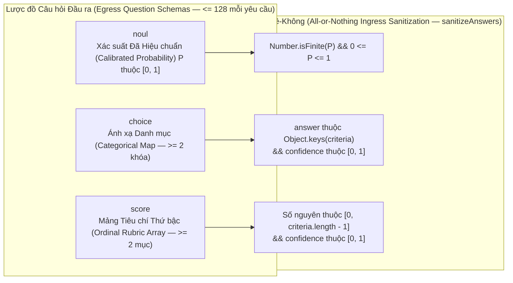
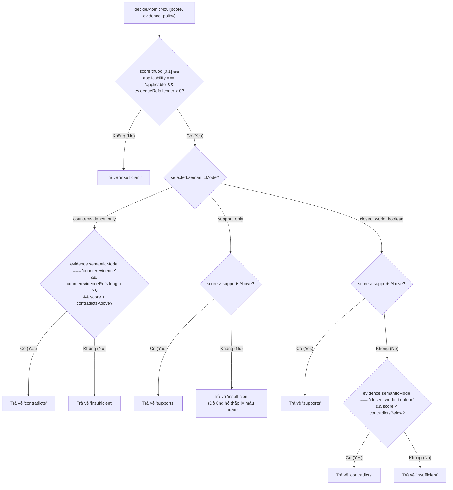

# Đặc tả Mô hình & Đánh giá Chuẩn tắc (Model & Canonical Evaluation Specification)

## 1. Liên kết Mô hình Chuẩn tắc TypeSafe System One (TypeSafe System One Canonical Model Alignment)

Tiện ích Mở rộng OMP TypeSafe (OMP TypeSafe Extension) tích hợp trực tiếp với bộ máy đánh giá **TypeSafe System One** (`https://api.typesafe.ai/v1/systemone`). Xuyên suốt tất cả các cổng xác thực (Verification Gates), ảnh chụp chính sách (Policy Snapshots) và các bộ đánh giá chuyên gia (Expert Evaluators), bí danh yêu cầu chuẩn tắc (Canonical Request Alias) và mô hình sản xuất được phân giải (Resolved Production Model) là:

$$\mathbf{Requested\ Model} = \texttt{"jev-latest"} \quad \longrightarrow \quad \mathbf{Resolved\ Model} = \texttt{"jev-1.14.0"}$$

### 1.1 Chuẩn hóa Bí danh so với Ghim cứng Kiểm chuẩn (Alias Normalization vs. Benchmark Pinning)
- **Thời gian chạy Sản xuất (Production Runtime — `src/typesafe-api-client.cjs`, `src/typesafe-policy-client.cjs`)**: Các yêu cầu mặc định sử dụng `model: "jev-latest"`, cho phép nâng cấp bản vá từ thượng nguồn một cách trong suốt trong khi vẫn ghi nhật ký định danh `resolvedModel` thực tế vào `TypeSafeAttemptReceipt` và `ReviewFailureFact`. Các bí danh cũ như `jev-fast` bị nghiêm cấm hoàn toàn.
- **Bộ Kiểm chuẩn Ghép cặp (Paired Benchmark Suite — `tools/jev-paired-inputs.ts`, `tools/jev-paired-metrics.ts`)**: Các bí danh nổi (`latest`, `default`, `auto` — Floating Aliases) bị từ chối tường minh trong trường `resolvedModel` (`isFloatingModelAlias`). Mọi lượt thử kiểm chuẩn bắt buộc phải báo cáo một mã định danh mô hình bất biến cụ thể (ví dụ: `jev-1.14.0`) khớp với giao thức đóng băng đã đăng ký trước (Preregistered Frozen Protocol), nếu không hàm `decide()` sẽ gắn cờ `resolved_model_missing` hoặc `resolved_model_drift`.

---

## 2. Hiệu chuẩn Toán học của các Nguyên hàm System One (`noul`, `choice`, `score` — Mathematical Calibration of System One Primitives)

Mọi câu hỏi được gửi tới `https://api.typesafe.ai/v1/systemone` đều bắt buộc phải tuân thủ một trong ba lược đồ nguyên hàm đã hiệu chuẩn (Calibrated Primitive Schemas), được xác thực ở cả chiều đi ra (`validateInput` — Egress) lẫn chiều đi vào (`sanitizeAnswers` — Ingress trong `src/typesafe-api-client.cjs:187-201, 332-362`):



### 2.1 `noul` — Xác suất Đã Hiệu chuẩn ($P \in [0, 1]$ — Calibrated Probability)
- **Bất biến Toán học (Mathematical Invariant)**: Một câu trả lời `noul` biểu diễn một xác suất đã chuẩn hóa và hiệu chuẩn $P \in [0, 1]$. Các hệ số nhân khoảng (Range Multipliers, chẳng hạn nhân $P \times 0.8$) không bao giờ được áp dụng vì chúng làm biến dạng tính hiệu chuẩn của xác suất (Probability Calibration Distortion).
- **Tiêu chí Đầu ra Tùy chọn (Optional Egress Criteria)**: Khi được cung cấp, `criteria` phải là một đối tượng thuần túy (Plain Object) chứa các chuỗi mô tả không rỗng tùy chọn cho hai khóa `"true"` và `"false"`.
- **Chính sách Phê duyệt (Approval Policy — `src/semantic-approval-policy.ts`)**:
  - Được điều khiển bởi biến môi trường `TYPESAFE_AUTO_APPROVAL_THRESHOLD` (mặc định là `0.50`).
  - Tại đúng giá trị mặc định `0.50`, phép so sánh sử dụng bất đẳng thức nghiêm ngặt ($P > 0.50$).
  - Khi một ngưỡng tùy chỉnh $\tau \in [0, 1]$ được cấu hình (ví dụ: $\tau = 0.70$ hoặc $\tau = 0.80$; các giá trị $> 1$ được chuẩn hóa thông qua phép chia $\tau / 100$), phép so sánh sử dụng bất đẳng thức bao hàm ($P \ge \tau$).

### 2.2 `choice` — Phân loại Danh mục Kèm Độ tin cậy (Categorical Classification with Confidence)
- **Yêu cầu Đầu ra (Egress Requirement)**: `criteria` phải là một đối tượng thuần túy chứa $\ge 2$ khóa chuỗi không rỗng ánh xạ từng mã định danh danh mục tới định nghĩa ngữ nghĩa của nó (không khóa nào được khớp với `detectSecret`, nếu không `preparePayload` sẽ ném lỗi `payload_rejected_secret_in_key`).
- **Đảm bảo Đầu vào (Ingress Guarantee)**: Trả về `{ choice: string, confidence: number }` trong đó `choice` được đảm bảo là một khóa chính xác của `criteria` và $\text{confidence} \in [0, 1]$.

### 2.3 `score` — Bộ tiêu chí Thứ bậc Rời rạc ($0 \dots K-1$ — Discrete Ordinal Rubric)
- **Yêu cầu Đầu ra (Egress Requirement)**: `criteria` phải là một mảng gồm $K \ge 2$ chuỗi không rỗng được sắp xếp theo thứ tự từ chất lượng/mức độ nghiêm trọng thấp nhất (`0`) đến cao nhất (`K - 1`).
- **Đảm bảo Đầu vào (Ingress Guarantee)**: Trả về `{ score: number, confidence: number }` trong đó `score` là một số nguyên nằm trong đoạn $[0, K - 1]$ (thường là $0 \dots 3$ đối với các bộ tiêu chí 4 mức hoặc $0 \dots 2$ đối với `typesafe_rerank`).

---

## 3. Bộ tiêu chí Nguyên khối `M` so với Chính sách Vị từ Nhánh Bóng `H/Atomic` (Monolithic `M` Rubric vs. Shadow `H/Atomic` Predicate Policies)

### 3.1 Bộ tiêu chí Nguyên khối `M` trong Sản xuất (`src/task-verification-macro.ts`, `src/cook-expert-judge.ts`, `src/verification-gate.ts`)

Trong quy trình xác thực theo giai đoạn trên môi trường sản xuất (`typesafe_review_task`), hàm `evaluateMonolithicTask` yêu cầu **một** gói bằng chứng toàn nhiệm vụ duy nhất `JudgeEvidencePacket` ($\le 32,768$ byte) bao phủ toàn bộ các tiêu chí hợp đồng gốc và gửi đi bộ tiêu chí `M`:

| Khóa Câu hỏi (Question Key) | Kiểu Nguyên hàm (Primitive Type) | Tùy chọn / Thang đo (Options / Scale) | Điều kiện Đạt (Pass Condition) | Xử lý Khi Thất bại (Failure Disposition) |
|---|---|---|---|---|
| `deliverables_verdict` | `choice` | `APPROVE` \| `REJECT` \| `NEXT_ACTION_REQUIRED` | `=== "APPROVE"` | `NEXT_ACTION_REQUIRED` $\rightarrow$ `EVIDENCE_REQUIRED`; `REJECT` $\rightarrow$ `REJECTED` |
| `meets_criteria` | `noul` | $P \in [0, 1]$ | Vượt qua `SemanticApprovalPolicy` (ngưỡng cổng mặc định $\ge 0.70$ / $0.80$; ngưỡng chính sách mặc định $> 0.50$) | Nếu `APPROVE` & $0.25 \le P < \tau$ $\rightarrow$ `EVIDENCE_REQUIRED`; nếu $P < 0.25$ $\rightarrow$ `REJECTED` |
| `architectural_drift` *(hoặc `plan_drift`)* | `choice` | `no_drift` \| `unapproved_deviation` \| `scope_creep` \| `other` | `=== "no_drift"` | Bất kỳ lựa chọn nào khác $\rightarrow$ `REJECTED` |
| `scope_mode` | `choice` | `HOLD` \| `EXPANSION` \| `REDUCTION` \| `other` | `!== "REDUCTION"` | `REDUCTION` $\rightarrow$ `REJECTED` |
| `claude_account_untouched` | `noul` | $P \in [0, 1]$ | Vượt qua ngưỡng cô lập ($1.0$ trong cổng độc lập) | Vi phạm $\rightarrow$ `REJECTED` |
| `criterion_0 .. criterion_{N-1}` | `choice` | `satisfied` \| `violated` \| `evidence_missing` | Tất cả `=== "satisfied"` | Bất kỳ `violated` nào $\rightarrow$ `REJECTED`; bất kỳ `evidence_missing` nào $\rightarrow$ `EVIDENCE_REQUIRED` |

---

### 3.2 Chính sách Quyết định Vị từ Nhánh Bóng `H/Atomic` (`src/atomic-decision-policy.ts`, `src/atomic-judge.ts`)

Bộ đánh giá nhánh bóng `H` phân rã quá trình xác thực thành các vị từ nguyên tử có thứ tự phụ thuộc (`q_<hash>` cho các tiêu chí hợp đồng và `parent_<hash>` cho các yêu cầu tích hợp cha), được ánh xạ sang kiểu quan hệ `AtomicRelation = "supports" | "contradicts" | "insufficient"`.

Khi một vị từ nguyên tử sử dụng `answerType: "noul"`, hàm `decideAtomicNoul(score, evidence, policy)` (`src/atomic-decision-policy.ts:48-57`) thực thi **ngữ nghĩa nhận thức luận thế giới mở so với thế giới đóng (Open-World vs. Closed-World Epistemic Semantics)**:
- **Điều kiện Tiền đề (Precondition)**: Nếu `!probability(score) || evidence.applicability !== "applicable" || evidence.evidenceRefs.length === 0`, quan hệ trả về ngay lập tức là `"insufficient"`. Một đoạn trích dẫn (Excerpt) không bao giờ đủ cơ sở để kết luận sự vắng mặt toàn cục (Global Absence).

| Chế độ Ngữ nghĩa `semanticMode` (Policy) | Định hướng Bắt buộc `orientation` | Tham số (Parameters) | Quy tắc Quyết định (`decideAtomicNoul`) | Ý nghĩa Nhận thức luận (Epistemic Meaning) |
|---|---|---|---|---|
| **`support_only`** | `"support_probability"` | `supportsAbove` $\in [0, 1]$ | $\text{score} > \text{supportsAbove} \implies \texttt{"supports"}$<br/>Ngược lại $\implies \texttt{"insufficient"}$ | Ủng hộ thế giới mở (Open-World Support): xác suất $P(\text{support})$ thấp chỉ báo hiệu thiếu bằng chứng, **không bao giờ** đồng nghĩa với sự mâu thuẫn. |
| **`counterevidence_only`** | `"contradiction_probability"` | `contradictsAbove` $\in [0, 1]$ | Nếu `evidence.semanticMode === "counterevidence"` và `counterevidenceRefs.length > 0` và $\text{score} > \text{contradictsAbove} \implies \texttt{"contradicts"}$<br/>Ngược lại $\implies \texttt{"insufficient"}$ | Bộ phát hiện phản chứng (Contradiction Detector): chỉ có thể bác bỏ một tuyên bố khi trích dẫn được phản chứng cụ thể. |
| **`closed_world_boolean`** | `"support_probability"` | `supportsAbove`, `contradictsBelow` ($0 \le \text{contradictsBelow} \le \text{supportsAbove} \le 1$) | $\text{score} > \text{supportsAbove} \implies \texttt{"supports"}$<br/>$\text{score} < \text{contradictsBelow} \implies \texttt{"contradicts"}$<br/>Thuộc đoạn $[\text{contradictsBelow}, \text{supportsAbove}] \implies \texttt{"insufficient"}$ | Logic Boole thế giới đóng (Closed-World Boolean): chỉ được phép dùng khi toàn bộ miền dữ liệu liên quan đều hiện diện đầy đủ trong gói bằng chứng. |



---

## 4. Các API Nhà cung cấp Cố vấn Chỉ Đọc & Phép chiếu Tải trọng (`src/advisor-guards.ts`)

Để ngăn chặn hành vi tuồn dữ liệu ra ngoài (Data Exfiltration), tiêm lệnh (Prompt Injection) hoặc rò rỉ lịch sử hội thoại chưa biên tập khi khởi chạy tác tử con bản địa `advisor` / `ck:advisor`, hàm `projectAdvisorPayload` (`src/advisor-guards.ts:8-97`) thực thi một danh sách trắng tường minh gồm các phương ngữ API nhà cung cấp đã được ghim cứng (Pinned Provider API Dialects):

```typescript
export const advisorProviderApis: Readonly<Record<string, true>> = Object.freeze({
  "openai-codex-responses": true,
  "openai-responses": true,
  "azure-openai-responses": true,
  "openai-completions": true,
  "anthropic-messages": true,
});
```

### 4.1 Các Bất biến Phép chiếu Tải trọng Nhà cung cấp (Provider Payload Projection Invariants)
1. **Xác minh Phương ngữ (Dialect Verification)**: Tải trọng phải khớp với hình dạng OpenAI Responses (`Array.isArray(payload.input)`) hoặc hình dạng Chat Completions / Anthropic Messages (`Array.isArray(payload.messages)`). Bất kỳ khóa cấp cao nhất nào không xác định đều làm ném lỗi `advisor_provider_payload_shape_unsupported`.
2. **Không Lưu giữ tại Nhà cung cấp (Zero Provider Retention)**: Trên các phương ngữ Responses (`Array.isArray(payload.input)`), thuộc tính `result.store = false` luôn bị cưỡng bức thiết lập để các nhà cung cấp thượng nguồn không lưu giữ lại tải trọng đánh giá.
3. **Bản kê Công cụ Bị Giới hạn (Restricted Tool Manifest)**: Chỉ có `{ read, grep, glob, yield }` được phép xuất hiện (`advisor_provider_unexpected_tool_exposed`), và công cụ `yield` bắt buộc phải mang đúng lược đồ `advisorOutputSchema` (`advisor_provider_terminal_yield_schema_required`).
4. **Thay thế Ngữ cảnh & Trần Byte (Context Replacement & Byte Ceiling)**: Lịch sử phiên xung quanh bị thay thế hoàn toàn bằng `publicAdvisorMessages(request)` cộng với các lượt đọc/tìm kiếm `AdvisorPublicTransaction` đã được xác minh, giới hạn tổng dung lượng ở mức `maxContextBytes = 262,144` byte (`256 KiB`).

---

## 5. Biến Môi trường & Ghi đè Chính sách (Environment Variable & Policy Overrides)

| Biến Môi trường (Environment Variable) | Giá trị Mặc định (Default Value) | Các Mô-đun Tiêu thụ (Consuming Modules) | Tác động & Ràng buộc Bảo mật (Effect & Security Constraints) |
|---|---|---|---|
| `TYPESAFE_API_KEY` | `""` (Tắt — Disabled) | `typesafe-planner.ts`, `typesafe-enabled-resolver.cjs`, `typesafe-api-client.cjs` | Kích hoạt các lời gọi TypeSafe System One và đăng ký giá trị bí mật để làm sạch đường ra cũng như môi trường tiến trình con. |
| `TYPESAFE_AUTO_APPROVAL_THRESHOLD` | `0.50` (toán tử so sánh `>`) | `src/semantic-approval-policy.ts` | Đặt ngưỡng phê duyệt `noul` $\tau \in [0, 1]$ (các giá trị $>1$ được chia cho $100$; giá trị tùy chỉnh dùng toán tử $\ge$). Được đóng băng trong `WeakSet` lúc khởi động. |
| `TYPESAFE_BASELINE` | `"review"` | `typesafe-planner.ts`, `src/typesafe-policy-client.cjs` | Đường cơ sở bảo mật định tuyến tối thiểu (`auto`, `review`, `block`) cho công cụ `typesafe_judge`. |
| `TYPESAFE_LATTICE` | `"auto,review,block"` | `typesafe-planner.ts`, `src/typesafe-policy-client.cjs` | Lưới định tuyến chỉ thắt chặt (Tighten-Only Routing Lattice) có thứ tự; mọi lựa chọn thấp hơn `TYPESAFE_BASELINE` đều thất bại với lỗi `lattice-violation`. |
| `TYPESAFE_PREDICT_MODEL` | `"jev-latest"` | `src/debate-evaluator.ts`, `typesafe-planner.ts` | Ghi đè mô hình chính cho cuộc tranh luận 5 nhân cách `runMultiPersonaDebate`. |
| `TYPESAFE_DEBATE_MODEL` | `"jev-latest"` | `src/debate-evaluator.ts`, `typesafe-planner.ts` | Ghi đè mô hình dự phòng cho cuộc tranh luận 5 nhân cách nếu `TYPESAFE_PREDICT_MODEL` không được đặt. |
| `PI_CODING_AGENT_DIR` | `~/.omp/agent` | `src/egc.ts` | Thư mục có tệp `settings.json` được EGC băm và theo dõi nhằm chống giả mạo trong thời gian chạy. |

---

## 6. Đặc tả Kiểm chuẩn Ghép cặp `M`/`H` & Các Cổng Thống trị Nghiêm ngặt (`tools/jev-paired-*`)

Nhánh `H/atomic` luôn duy trì ở **chế độ bóng (Shadow Mode — `retain_repaired_M`)** cho đến khi một lượt chạy `model_benchmark` đã đăng ký trước được đánh giá bởi lệnh `tools/jev-paired-eval.ts decide` vượt qua toàn bộ các cổng trong `strictDominanceGates` (`tools/jev-paired-metrics.ts:139-157`) với không cổng thất bại (`failedGates = 0`) và không cổng chưa xác định (`unknownGates = 0`).

### 6.1 Phân hoạch Kho dữ liệu & Kiểm soát Phơi nhiễm Tập Kiểm thử Ẩn (Corpus Partitioning & Holdout Exposure Control)
- **Phân chia Thành phần Liên thông (`60% dev / 20% calibration / 20% holdout` — Connected-Component Split)**: Hàm `connectedGroups(cases)` (`tools/jev-paired-validation.ts`) gom nhóm các ca kiểm thử dùng chung `parentId`, `familyId`, `derivationIds`, `independentGroup` hoặc `projectId` thông qua cấu trúc dữ liệu các tập hợp rời nhau (Union-Find) để các ca có liên hệ với nhau không bao giờ bị vắt ngang qua các tập phân chia.
- **Sổ cái Phơi nhiễm Tập Holdout Một lần (`tools/jev-paired-exposure.ts` — One-Time Holdout Exposure Ledger)**: Hàm `claimUnseenHoldout` ghi lại các khóa nguồn gốc của tập holdout đã bị phơi nhiễm vào tệp `holdout-exposures.json`; bất kỳ hành vi tái sử dụng một nhóm holdout đã phơi nhiễm nào qua các lượt chạy kiểm chuẩn đều làm quá trình xác thực thất bại.

### 6.2 9 Cổng Thống trị Nghiêm ngặt (`strictDominanceGates` — The 9 Strict Dominance Gates)
Đối với mọi quần thể chính bắt buộc (`challenge`, `natural`) và mọi tầng giao thức bắt buộc (Protocol Stratum), nhánh `H` được đem so sánh trực tiếp với nhánh `M` trên các ca kiểm thử ẩn chuẩn tắc độc lập:

| Mã Cổng (Gate ID) | Điều kiện Toán học cho `H` so với `M` (Mathematical Condition) | Mã Lỗi nếu Vi phạm (Failure Code if Violated) |
|---|---|---|
| **1. Không Phê duyệt Mất An toàn (Zero Unsafe Approvals)** | $\text{unsafe}(H) = 0$ (trong đó $\text{gold} \ne \texttt{APPROVE}$ nhưng $\text{disp}(H) = \texttt{APPROVE}$) | `<group>:unsafe_approvals` |
| **2. Không Hồi quy Riêng ở H (Zero H-Only Regressions)** | $h_{\text{only\_wrong}} = \sum \mathbb{I}[\text{M đúng} \land \text{H sai}] = 0$ | `<group>:h_only_wrong` |
| **3. Không Bỏ sót Lỗi Tích hợp (Zero Integration Misses)** | $\text{integrationMisses}(H) = 0$ trên tất cả các ca có `integrationRequired && integrationDefect` | `<group>:integration_misses` |
| **4. Cải thiện Ghép cặp Dương (Positive Paired Improvement)** | Trên các quần thể chính, cận dưới khoảng tin cậy 95% $\text{pairedImprovement}(a, b, n) > 0$; trên các tầng phụ, $\text{correct}(H) \ge \text{correct}(M)$ | `<group>:correctness_lower_not_positive` / `<group>:stratum_correctness_worse` |
| **5. Tỷ lệ Lỗi Không Kém hơn (Non-Inferior Error Rate)** | $\text{errors}(H) \le \text{errors}(M)$ | `<group>:errors_worse` |
| **6. Tỷ lệ Trì hoãn Không Kém hơn (Non-Inferior Deferral Rate)** | $\text{unnecessaryDeferrals}(H) \le \text{unnecessaryDeferrals}(M)$ | `<group>:unnecessary_deferrals_worse` |
| **7. Chi phí Định giá Không Cao hơn (Non-Inferior Priced Cost)** | $\text{cost}(H) \le \text{cost}(M)$ (được xác minh đối chiếu với các biên lai truyền tải có chữ ký) | `<group>:priced_cost_worse` |
| **8. Độ trễ P95 Không Kém hơn (Non-Inferior P95 Latency)** | $p_{95}(H) \le p_{95}(M)$ (độ trễ bách phân vị thứ 95 theo hạng gần nhất — Nearest-Rank) | `<group>:p95_latency_worse` |
| **9. Tải Người Đánh giá Không Nặng hơn (Non-Inferior Reviewer Load)** | $\text{reviewerActions}(H) \le \text{reviewerActions}(M)$ | `<group>:reviewer_actions_worse` |

Nếu bất kỳ cổng nào thất bại hoặc bất kỳ quan sát bắt buộc nào (chẳng hạn như hạch toán lượt gọi Cố vấn trả phí, xác minh biên lai máy chủ Ed25519 hoặc định danh cụ thể `resolvedModel`) bị thiếu, hàm `decide()` sẽ xuất kết quả tất định là `selection: "retain_repaired_M"`.

---

## 7. Các Bộ Tiêu chí Chuyên biệt: Nâng cấp Kế hoạch, Tranh luận 5 Nhân cách & Chuyên gia Ba Vai trò (Specialized Rubrics)

Ngoài việc xác thực hoàn thành nhiệm vụ theo giai đoạn (`M` và `H`), tiện ích mở rộng còn cung cấp các lược đồ đánh giá System One chuyên biệt dành cho việc lập kế hoạch kiến trúc, tranh luận tiền triển khai và phản tư theo yêu cầu.

### 7.1 Bộ Tiêu chí Nâng cấp Kế hoạch (`src/plan-evaluator.ts` — `purpose: "plan"` — Plan Elevation Rubric)
Được gọi bởi công cụ `typesafe_elevate_plan` trên các bản nháp kế hoạch có kích thước giới hạn $\le 32,768$ byte UTF-8:

| Mã Câu hỏi (Question ID) | Nguyên hàm (Primitive) | Thang đo / Tùy chọn (Scale / Options) | Yêu cầu Đạt (Pass Requirement) |
|---|---|---|---|
| `scope_alignment` | `choice` | `aligned` \| `scope_reduction` \| `scope_creep` | `=== "aligned"` |
| `algorithm_depth` | `score` | `0` (Sơ sài — Stub) .. `3` (Cấp sản xuất — Production-grade) | `score >= 2` |
| `task_actionability` | `noul` | $P \in [0, 1]$ | Vượt qua `SemanticApprovalPolicy` (mặc định $> 0.50$) |
| `claude_isolation_adherence` | `noul` | $P \in [0, 1]$ | Vượt qua `SemanticApprovalPolicy` (mặc định $> 0.50$) |

Nếu số lần thử `attempt >= 3` mà bản kế hoạch vẫn trượt xác thực, `evaluatePlanDraft` sẽ đặt cờ `escalateToUser: true`.

### 7.2 Bộ Tiêu chí Tranh luận Đa Nhân cách (`src/debate-evaluator.ts` — `purpose: "debate"` — Multi-Persona Debate Rubric)
Được tự động nối chuỗi bởi `typesafe_elevate_plan` ngay sau khi `evaluatePlanDraft` phê duyệt (sử dụng `TYPESAFE_PREDICT_MODEL` / `TYPESAFE_DEBATE_MODEL` $\rightarrow$ `"jev-latest"`). Gửi đi 5 câu hỏi thứ bậc `score` (thang điểm `0..3`):

| Mã Câu hỏi Nhân cách (Persona Question ID) | Trọng tâm Đánh giá (Focus Area) | Ngưỡng Phủ quyết (Veto Threshold) | Trọng số trong Trung bình Đồng thuận (Weight) |
|---|---|---|---|
| `persona_architect` | Tính mô-đun, độ ghép nối, các bất biến biên | **Phủ quyết Cứng nếu $< 1$ (Hard Veto)** | $1/5$ |
| `persona_security` | Cô lập bí mật, chống TOCTOU, ranh giới đặc quyền | **Phủ quyết Cứng nếu $< 1$ (Hard Veto)** | $1/5$ |
| `persona_performance` | Độ trễ, giới hạn bộ nhớ, hiệu quả sử dụng token | Không phủ quyết đơn lẻ | $1/5$ |
| `persona_ux` | Độ rõ ràng khi báo lỗi, công thái học vận hành, khôi phục | Không phủ quyết đơn lẻ | $1/5$ |
| `persona_devils_advocate` | Giả định ngầm, lỗi hồi quy ở các trường hợp biên | **Phủ quyết Cứng nếu $< 1$ (Hard Veto)** | $1/5$ |

$$\text{Consensus Score} = \frac{1}{5} \sum_{i=1}^{5} S_i \ge 1.50 \quad \land \quad S_{\text{architect}} \ge 1 \quad \land \quad S_{\text{security}} \ge 1 \quad \land \quad S_{\text{devils\_advocate}} \ge 1$$

### 7.3 Bộ Đánh giá Chuyên gia Ba Vai trò (`src/cook-expert-judge.ts` — `purpose: "expert"` — Tri-Role Expert Evaluators)
Được gọi thông qua công cụ `typesafe_expert_review` (`advisoryOnly: true`):
1. **`scope_arbiter` (`evaluateScopeArbiter` — Trọng tài Phạm vi)**: Đánh giá `scope_mode` (`choice`: `HOLD` | `EXPANSION` | `REDUCTION`) và `scope_preservation` (`noul`). Từ chối ngay nếu rơi vào `REDUCTION`.
2. **`drift_guard` (`evaluateDriftGuard` — Bảo vệ Chống Trôi Kiến trúc)**: Đánh giá `architectural_drift` (`choice`: `no_drift` | `unapproved_deviation` | `scope_creep`) và `alignment_score` (`noul`). Bắt buộc đạt `no_drift`.
3. **`risk_security_triage` (`evaluateRiskSecurityTriage` — Phân loại Rủi ro & Bảo mật)**: Đánh giá `risk_level` (`score` từ `0..3`, trong đó `0` là rủi ro tối thiểu và `3` là lỗ hổng nghiêm trọng) cùng `mitigation_adequacy` (`noul`). Bắt buộc đạt `risk_level <= 1.5`.

---

## 8. Các Bộ Ước lượng Thống kê & Giao thức Máy chủ Ed25519 (`tools/jev-paired-*`)

### 8.1 Bộ Ước lượng Nhị thức Chính xác & Phi Tham số (`tools/jev-paired-statistics.ts`)
Để tránh sai số xấp xỉ chuẩn (Normal-Approximation Errors) trên các nhóm mẫu kiểm thử ẩn có kích thước nhỏ hoặc không có biến cố nào xảy ra (Zero-Event Cohorts), bộ kiểm chuẩn ghép cặp tính toán các khoảng mẫu hữu hạn chính xác trong không gian logarit (Log-Space):
- **Đuôi Phân phối Nhị thức trong Không gian Log (`binomialTail` — Log-Space Binomial Tail)**: Tính toán xác suất tích lũy chính xác sử dụng công thức truy hồi hàm log-gamma (`lgamma`) nhằm ngăn chặn hiện tượng tràn dưới số thực dấu phẩy động (Floating-Point Underflow).
- **Khoảng Tin cậy Chính xác 95% Clopper-Pearson (`clopperPearson(k, n, alpha = 0.05)`)**: Được sử dụng trong `riskSummary` cho hai chỉ số `falseApprovalRisk` và `unsafeApprovalFraction`.
- **Cận Trên 95% khi Không có Biến cố (`zeroEventUpper(n, alpha = 0.05)` — Zero-Event 95% Upper Bound)**: Khi có $k = 0$ lần phê duyệt mất an toàn xảy ra trên $n$ ca kiểm thử không được phép phê duyệt:
  $$U_{0.95}(0, n) = 1 - \alpha^{1/n} = 1 - (0.05)^{1/n}$$
- **Cận Dưới Cải thiện Ghép cặp Kiểu McNemar (`pairedImprovement(a, b, n)`)**: Cho $a = \#\{\text{H đúng} \land \text{M sai}\}$ và $b = \#\{\text{M đúng} \land \text{H sai}\}$ trên $n$ cặp kiểm thử ẩn độc lập, hàm tính toán cận dưới tin cậy một phía 95% (One-Sided 95% Lower Confidence Bound) cho đại lượng $(a - b) / n$.
- **Khoảng Phân vị P95 Theo Thống kê Thứ tự Phi Phân phối (`quantileInterval(values, q = 0.95)`)**: Sử dụng phép nghịch đảo đuôi nhị thức trên các thứ hạng độ trễ đã sắp xếp (`nearestRank`) để chặn khoảng độ trễ $p_{95}$ mà không cần giả định phân phối chuẩn Gauss.

### 8.2 Giao thức Máy chủ Bản địa Có Chữ ký Ed25519 (`EVALUATION_HOST_PROTOCOL` — Ed25519 Signed Native Host Protocol)
Khi lệnh `tools/jev-paired-eval.ts benchmark` yêu cầu thực thi Cố vấn bản địa trực tiếp (`exit code 3`), nó phối hợp với công cụ `typesafe_eval_host` (`src/evaluation-host.ts`) thông qua giao thức `EVALUATION_HOST_PROTOCOL = "jev-paired-native-host-v1"`:
1. **`identity`**: Khởi tạo một cặp khóa **Ed25519** tạm thời theo từng phiên (Ephemeral Per-Session Keypair) bên trong `EvaluationHost` và trả về `{ sessionId, publicKey, publicKeyDigest }`.
2. **`authorize`**: Xác minh mã băm gói dữ liệu đã đóng băng, các mã định danh mô hình và mức trần chi phí, sau đó yêu cầu sự xác nhận tương tác trực tiếp của con người trên máy chủ (`ctx.ui.confirm`).
3. **Chu trình `prepare` $\rightarrow$ Công cụ `task` Bản địa $\rightarrow$ `collect`**: Thực thi nhánh Cố vấn bóng (`mutationAllowed: false, authorityReusable: false`) và ký điện tử lên phong bì kết quả `NativeHostEnvelope` bằng khóa riêng Ed25519 của phiên.
4. **Xác minh Nhật ký Biên lai (`readNativeReceiptJournal` — Journal Verification)**: Xác minh lại toàn bộ chữ ký Ed25519, thứ tự lịch trình và tính duy nhất của biên lai giữa các nhánh trước khi chấp nhận bất kỳ tập dữ liệu nào vào hàm `computeMetrics` và `decide`.
