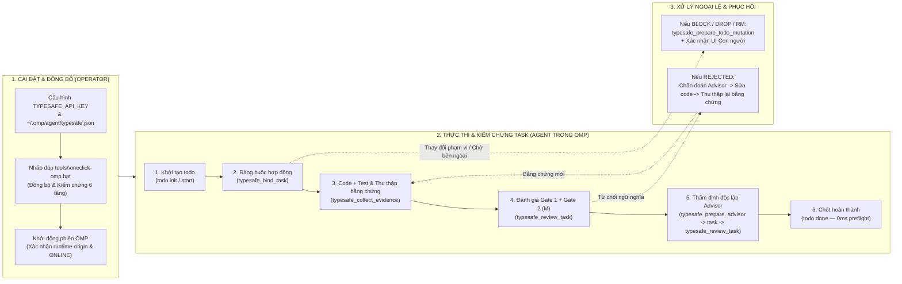
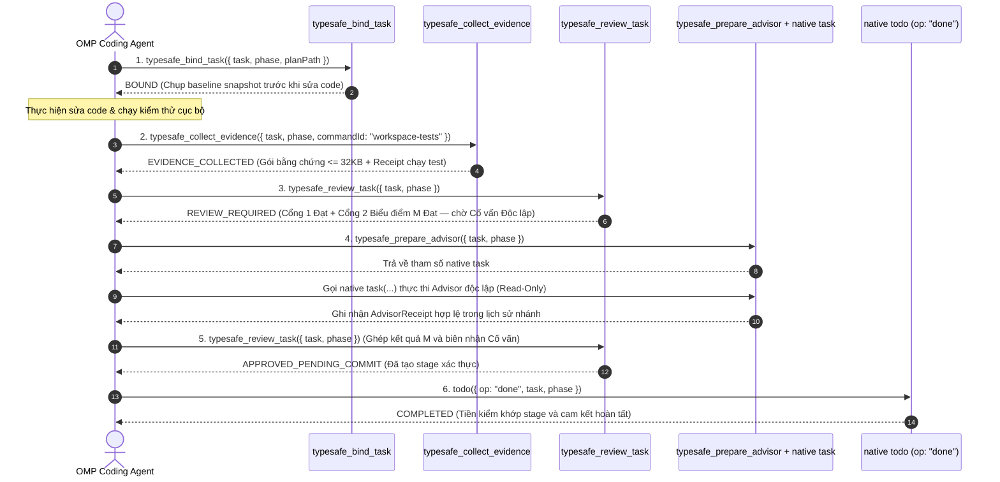

# Tài liệu Hướng dẫn Sử dụng & Vận hành Toàn diện (`operations-and-user-guide.md`)

Tài liệu hướng dẫn chi tiết từ cài đặt, cấu hình, sử dụng 16 công cụ `typesafe_*`, quy trình xác thực theo giai đoạn (Staged Verification Workflow), đến vận hành tự động **One-Click** và xử lý sự cố cho `omp_extension`.

---

## 1. Tổng quan Luồng Vận hành Người dùng & Agent (End-to-End User & Agent Journey)



---

## 2. Yêu cầu Hệ thống & Cài đặt Ban đầu

### 2.1 Yêu cầu Môi trường (Prerequisites)

| Thành phần | Phiên bản yêu cầu | Mục đích sử dụng | Lệnh kiểm tra |
|---|---|---|---|
| **Bun Runtime** | $\ge 1.0$ (Khuyến nghị $\ge 1.3$) | Chạy extension TypeScript, test runner (`bun test`), và paired benchmark | `bun --version` |
| **Node.js** | $\ge 18.0$ | Thực thi giao dịch đồng bộ `tools/sync-baseline.cjs` và `verify-omp-global.cjs` | `node --version` |
| **Git CLI** | $\ge 2.30$ | Thu thập `git status`, `git diff`, chụp snapshot cây thư mục làm việc | `git --version` |
| **PowerShell** | $\ge 5.1$ (Windows STA) | Chạy bộ công cụ tự động `promote-omp-global.ps1` và `oneclick-omp.ps1` | `$PSVersionTable.PSVersion` |
| **`TYPESAFE_API_KEY`** | API Key hợp lệ từ TypeSafe AI | Xác thực với TypeSafe | Chỉ kiểm tra biến đã được đặt; không in giá trị khóa |

### 2.2 Cấu hình kích hoạt extension của OMP (OMP-Owned Activation)

Resolver `src/typesafe-enabled-resolver.cjs` chỉ đọc `~/.omp/agent/typesafe.json` thuộc profile mặc định. Không đọc/import `.claude/.ck.json`, không tự bật từ API key, không dùng cấu hình trong repo để cấp consent. Đây là cấu hình activation riêng của extension, không phải model role/auth của native judge. Chưa hỗ trợ lựa chọn profile extension qua `PI_CODING_AGENT_DIR`.

```json
{
  "typesafe": {
    "enabled": true,
    "projects": ["D:/100.Software/Github/omp_extension"],
    "excludeProjects": []
  }
}
```
- `projects` nên liệt kê đường dẫn dự án được phép. `"*"` cho phép mọi dự án; chỉ dùng khi người vận hành thực sự chọn phạm vi đó.
- `"excludeProjects"`: Danh sách đường dẫn tuyệt đối cần loại trừ (hỗ trợ kiểm tra hai chiều cả thư mục cha/con và Git worktree).

### 2.3 Liên kết Proxy với OMP (Golden Invariant)

File `C:\Users\<user>\.omp\agent\extensions\typesafe-planner.ts` **bắt buộc** chỉ chứa đúng 1 dòng trampoline trỏ về thư mục Active Deployment Target (`C:/Users/<user>/Projects/omp_extension`):

```typescript
export { default } from "C:/Users/thant/Projects/omp_extension/typesafe-planner.ts";
```
> **Tuyệt đối không sửa trực tiếp file này và không trỏ thẳng vào thư mục phát triển `D:/100.Software/...`.** Mọi thay đổi phát triển tại `D:/100.Software/Github/omp_extension` được đẩy sang `C:/Users/thant/Projects/omp_extension` thông qua công cụ One-Click.

---

## 3. Hướng dẫn Sử dụng Bộ Công cụ One-Click (`tools/`)

### 3.1 Ba File `.bat` Chạy Ngay Bằng Nhấp Đúp Chuột

1. **`tools\oneclick-omp.bat`** *(Khuyên dùng hàng ngày)*:
   - Tự động kiểm tra xem OMP Global đã khớp 100% với Workspace chưa.
   - Nếu **đã khớp trên đĩa**: chạy verifier lần nữa và giữ nguyên mã thoát của hậu kiểm; lỗi không được biến thành thành công.
   - Nếu **có cập nhật mới ở Workspace**: Chạy tiền kiểm (Preflight), tạo backup, đồng bộ hai gốc `target` và `global_omp_agents`, chạy kiểm thử cô lập và hậu kiểm SHA-256. Manifest phiên bản 1 được chuyển sang phiên bản 2 mà không truy cập tệp Claude legacy.
2. **`tools\verify-omp-global.bat`** *(Kiểm tra cài đặt trên đĩa — Disk Verification)*:
   - Mặc định ngoại tuyến dù có `TYPESAFE_API_KEY`; thêm `--live`/`--require-live` để gọi HTTP. Không chứng minh native judge hoặc mã đã nạp.
3. **`tools\sync-baseline.bat`** *(Đồng bộ có hướng dẫn sửa Proxy)*:
   - Điều phối `promote-omp-global.ps1`; nếu proxy sai hoặc thiếu, dừng và báo người sở hữu cài đặt. Không sửa, tạo lại hoặc tự phục hồi proxy bất biến.

### 3.2 Các Lệnh Tiện ích qua `bun` / `npm`

```bash
# Kiểm tra nhanh cài đặt & đối chiếu 468+ files SHA-256
bun run verify:global

# Kiểm tra cài đặt + Gửi request thật tới TypeSafe System One (jev-latest)
bun run verify:live

# Chạy thử kế hoạch đồng bộ (Dry-Run, không ghi đĩa)
bun run sync:dry-run

# Chạy đồng bộ giao dịch đầy đủ từ Workspace sang OMP Global
bun run sync:global

# Chạy quy trình thông minh One-Click (Auto Verify -> Sync if needed -> Verify)
bun run oneclick

# Kiểm tra Lớp Không gian làm việc (ngoại tuyến, chỉ đọc)
bun run verify:workspace

# Như trên, cộng khởi động omp RPC tại gốc kho và tại thư mục tạm (có thể gọi HTTP kiểm tra sức khỏe một lần mỗi lần khởi động)
bun run verify:workspace --runtime
```

### 3.3 Chạy `omp` tại gốc kho: Lớp Không gian làm việc (Workspace Layer)

- Khởi động `omp` tại gốc kho chạy **cấu hình toàn cục** (`settings`, `plugins`, `skills`, `auth`) **cộng với** `typesafe-planner.ts` của không gian làm việc, qua `.omp/config.yml` và `tools/omp-workspace-loader.ts`. Dùng để thử mã mới trước khi `sync`.
- Nếu điểm vào không gian làm việc hỏng, phiên vẫn chạy nhưng mọi công cụ ngoài `read`, `grep`, `glob`, `find`, `ast_grep` (cục bộ, không URL) bị chặn (thất bại-đóng; cũng áp dụng khi nạp xong mà không đăng ký trình xử lý `tool_call` nào) và có thông điệp `typesafe-workspace-loader-error`. Sửa tệp từ bên ngoài phiên, hoặc khởi động `omp --config tools/omp-target-gate-overlay.yml` để chạy cổng **đã triển khai** từ chính gốc kho.
- Sau `sync`, muốn xác nhận mã đã triển khai đang chạy, KHÔNG khởi động lại trong kho thường: dùng lớp phủ nói trên hoặc `omp` từ một thư mục tạm.
- `bun run judge:start` (`tools/native-judge-launch.cjs`) kế thừa thư mục hiện tại: chạy từ gốc kho sẽ dùng mã không gian làm việc; chạy từ nơi khác dùng mã đã triển khai.
- `.omp/config.yml` của bất kỳ kho nào cũng có thể vô hiệu hóa một tiện ích môi trường; đây là tính chất của máy chủ `omp`. Vì vậy `~/.omp/agent/config.yml` không nên đặt `extensions`/`disabledExtensions` khác rỗng (mảng dự án sẽ thay thế chúng; `verify:workspace` cảnh báo).

---

## 4. Hướng dẫn Quy trình Xác thực Theo Giai đoạn (Staged Task Verification Workflow)

Trong kiến trúc hiện hành của `omp_extension`, công cụ `todo(op="done")` gốc chỉ thực hiện kiểm tra xác nhận đã chuẩn bị sẵn (preflight $<5\text{ms}$, không gọi HTTP, không chạy test, không sinh subagent). Để hoàn thành một task hợp lệ, Agent thực hiện tuần tự **5 bước chuẩn**:



### 4.1 Bảng Tra cứu 16 Công cụ `typesafe_*` Đăng ký trong OMP

| Nhóm | Tên Công cụ | Tham số chính | Chức năng & Kết quả trả về |
|---|---|---|---|
| **1. Ràng buộc & Bằng chứng** | `typesafe_bind_task` | `{ task, phase?, planPath?, phaseHeading?, originalUserEntryId? }` | Khóa mục tiêu `todo` hiện tại với yêu cầu gốc của người dùng và chụp ảnh nền (baseline snapshot) của workspace. |
| | `typesafe_collect_evidence` | `{ task, phase?, commandId?, artifactPaths?, selections? }` | Thu thập diff, file mã nguồn, artifact ($\le 4,940\text{ B}$), và chạy lệnh kiểm thử được duyệt (`workspace-tests` $\rightarrow$ `bun test`) trong môi trường cô lập. |
| | `typesafe_retrieve_evidence` | `{ task, phase?, path, fullFileDigest, spans? }` | Đọc chính xác các dòng mã nguồn từ bộ nhớ đệm snapshot (giới hạn $\le 16\text{ KB}$ sau khi lọc secret). |
| **2. Kiểm duyệt & Advisor** | `typesafe_review_task` | `{ task, phase? }` | Chạy Gate 1 + Gate 2 (`M` rubric) và ghép kết quả với biên nhận `AdvisorReceipt`. Trả về `REVIEW_REQUIRED`, `APPROVED_PENDING_COMMIT`, `EVIDENCE_REQUIRED`, `REJECTED`, hoặc `UNAVAILABLE`. |
| | `typesafe_prepare_advisor` | `{ mode: "task_review" \| "parent_review" \| "consultation", task?, phase?, question? }` | Chuẩn bị gói ngữ cảnh công khai đã lọc secret và trả về tham số gọi subagent `task` cho Advisor độc lập (chỉ đọc). |
| | `typesafe_advisor` | `{ requestId, assessment }` | Công cụ nội bộ dành riêng cho subagent Advisor nộp kết quả thẩm định có cấu trúc. |
| **3. Quản lý Vòng đời & Phục hồi** | `typesafe_prepare_todo_mutation` | `{ input, handoff? }` | Chuẩn bị quyền thực thi cho `block`, `drop`, `rm`, hoặc `init` thay thế ngoài luồng preflight. Tự động xuất báo cáo phục hồi khi `block`. |
| | `typesafe_resolve_historical_debt` | `{ incarnationId, reason }` | Yêu cầu xác nhận từ người dùng trên UI để đối soát nợ lịch sử của các task cũ (`HUMAN_RECONCILED_NO_NATIVE_APPROVAL`). |
| | `typesafe_recovery_report` | `{ task, phase? }` | Xuất file báo cáo phục hồi bền vững (`# TypeSafe recovery handoff`) chứa mục tiêu, người sở hữu, điều kiện gỡ chặn và lệnh tiếp tục. |
| **4. Đánh giá Chuyên sâu & Tranh biện** | `typesafe_judge` | `{ state, questions, model? }` | Gửi truy vấn xác suất `noul`, phân loại `choice`, hoặc thang điểm `score` ($0\dots 3$) trực tiếp tới TypeSafe System One (`jev-latest`). |
| | `typesafe_rerank` | `{ state, candidates, criteria, model? }` | Xếp hạng danh sách phương án ứng viên theo tiêu chí với điểm số và độ tự tin chuẩn hóa. |
| | `typesafe_evaluate_multi` | `{ state, labels, instructions, model? }` | Đánh giá đồng thời nhiều nhãn xác suất (`noul`) trong một lượt gọi duy nhất. |
| | `typesafe_elevate_plan` | `{ planTitle, planContent, userPrompt? }` | Kiểm tra tính cô lập `.claude`, cấu trúc kế hoạch và chấm điểm chất lượng kế hoạch trước khi thực thi. |
| | `typesafe_verify_completion` | `{ taskId, criteria, planPath?, testCommand? }` | Công cụ kiểm chứng độc lập Gate 1 + Gate 2 trả về khối hướng dẫn `<remediation>` XML. |
| | `typesafe_expert_review` | `{ role: "scope_arbiter" \| "drift_guard" \| "risk_security_triage", ... }` | Đánh giá chuyên sâu theo 3 vai trò chuyên gia: giữ phạm vi, chống trôi dạt kiến trúc, và phân loại rủi ro bảo mật. |
| **5. Thực nghiệm Đối chứng** | `typesafe_eval_host` | `{ action: "identity" \| "authorize" \| "prepare" \| "collect", ... }` | Cầu nối chạy thực nghiệm đối chứng `M` (Monolithic) vs `H` (Atomic Shadow) có chữ ký Ed25519. |

---

## 5. Cấu hình Biến Môi trường (Environment Variables Reference)

| Biến môi trường | Giá trị mặc định | Phạm vi tác động | Mô tả chi tiết |
|---|---|---|---|
| `TYPESAFE_API_KEY` | *(Bắt buộc)* | Toàn cục | Khóa xác thực Bearer gửi tới `https://api.typesafe.ai/v1/systemone`. |
| `TYPESAFE_DEFAULT_MODEL` | `jev-latest` | Judge / Gate 2 | Model chuẩn của TypeSafe System One (hiện phân giải về `jev-1.14.0`). |
| `TYPESAFE_PREDICT_MODEL` | `jev-latest` | Multi-Persona Debate | Model dùng cho vòng tranh biện 5 góc nhìn (`ck:predict`). |
| `TYPESAFE_AUTO_APPROVAL_THRESHOLD` | `0.80` | `verification-gate.ts` | Ngưỡng xác suất `meets_criteria` tối thiểu để tự động phê duyệt ở chế độ standalone. |
| `TYPESAFE_ALLOW_MODIFICATION` | *(Không bật)* | Integrity Shield | Đặt `=1` khi người vận hành cần cho phép chỉnh sửa các file hạ tầng được bảo vệ. |
| `OMP_WORKSPACE_DIR` | Thư mục repo gốc | `sync-baseline.cjs` | Ghi đè đường dẫn workspace nguồn khi chạy kiểm thử hoặc đồng bộ tùy chỉnh. |
| `OMP_TARGET_DIR` | `C:/Users/<user>/Projects/omp_extension` | `sync-baseline.cjs` | Ghi đè đường dẫn thư mục đích triển khai. |
| `OMP_EXTENSION_POINTER` | `~/.omp/agent/extensions/typesafe-planner.ts` | `sync-baseline.cjs` | Đường dẫn tới file proxy trampoline bất biến của OMP. |

---

## 6. Sổ tay Xử lý Tình huống Thực tế (Operational Runbook)

### 6.1 Khi Task bị Từ chối Ngữ nghĩa (`REJECTED` ở Gate 2)
1. **Tuyệt đối không gọi lại `typesafe_review_task` hoặc `todo done` với cùng bằng chứng cũ** (Same-evidence retry ratchet sẽ chặn ngay mà không tốn cuộc gọi mạng).
2. Chạy `typesafe_prepare_advisor` để lấy chẩn đoán độc lập từ Advisor (chỉ đọc).
3. Sửa mã nguồn tại agent cha theo đúng các mục khuyến nghị của Advisor.
4. Chạy lại test cục bộ và gọi `typesafe_collect_evidence` để tạo gói bằng chứng có mã băm (`evaluatedTreeDigest`) mới, sau đó mới gọi lại `typesafe_review_task`.

### 6.2 Khi Cần Tạm dừng Task Do Chờ Tác nhân Bên ngoài (`block`)
1. Chuẩn bị báo cáo bàn giao (`handoff`) gồm đầy đủ: `goal` (mục tiêu gốc), `owner` (người phụ trách), `nextAction` (hành động tiếp theo), `unblockCondition` (điều kiện mở khóa quan sát được), và `resumeCommand` (lệnh chạy lại).
2. Gọi `typesafe_prepare_todo_mutation({ input: { op: "block", task, reason }, handoff })`.
3. Xác nhận trên hộp thoại UI của Host (nếu được yêu cầu), sau đó gọi lệnh `todo({ op: "block", task, reason })`.

### 6.3 Khi Thay đổi hoặc Xoay vòng `TYPESAFE_API_KEY`
1. Nếu key cũ bị lỗi `401`/`403`, `AuthManager` và `checkCredentialCooldown` sẽ đưa hash của key cũ vào trạng thái khóa/cooldown để tránh spam API.
2. Cập nhật `TYPESAFE_API_KEY` mới vào môi trường hệ thống và **khởi động lại phiên OMP**. Khi nhận thấy mã băm SHA-256 (16 ký tự đầu) của key mới khác với key cũ, hệ thống tự động mở khóa trạng thái xác thực.
