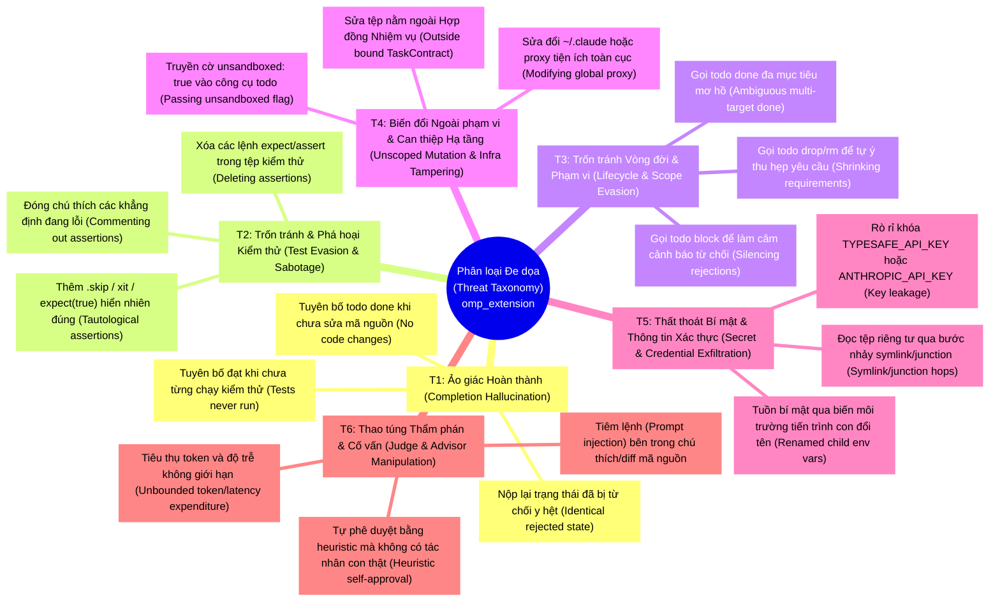
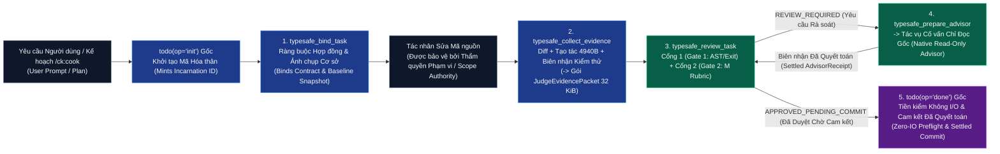
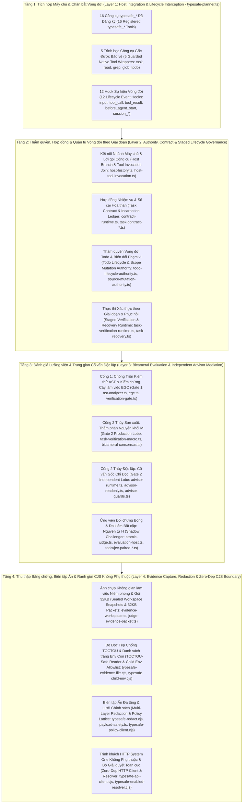

# Yêu cầu Phát triển Sản phẩm (Product Development Requirements - PDR) — `omp_extension`

> **Tên Sản phẩm (Product Name)**: Tiện ích Mở rộng Oh-My-Pi TypeSafe (`omp-typesafe-extension`)  
> **Phiên bản (Version)**: `1.0.0`  
> **Môi trường Thực thi Mục tiêu (Runtime Targets)**: Oh-My-Pi (`omp` v18.12.3+) & Claude Code (`~/.claude` MCP/Hooks) trên Bun $\ge 1.0$ / Node.js $\ge 18.0$  
> **Thư mục Gốc Kho Mã nguồn (Repository Root)**: `D:/100.Software/Github/omp_extension`  
> **Thư mục Gốc Triển khai Thời gian chạy (Runtime Deployment Root)**: `C:/Users/thant/Projects/omp_extension` (được nạp thông qua trình trung chuyển ủy nhiệm bất biến (immutable proxy) tại `C:/Users/thant/.omp/agent/extensions/typesafe-planner.ts`)

---

## 1. Tầm nhìn Điều hành & Định danh Hệ thống (Executive Vision & System Identity)

Các tác nhân lập trình tự hành (autonomous coding agents) hoạt động trong các luồng công việc dài hạn (long-horizon workflows như `/ck:cook`, kế hoạch đa giai đoạn (multi-phase plans), ủy quyền tác nhân con song song (parallel subagent delegation)) thường xuyên mắc phải **thiên kiến hoàn thành sớm (premature completion bias)**: tuyên bố nhiệm vụ hoàn tất (`done`) khi kiểm thử (tests) vẫn thất bại, xóa các câu lệnh khẳng định kiểm thử đang lỗi (failing assertions) để làm bộ kiểm thử vượt qua, âm thầm loại bỏ các yêu cầu bắt buộc thông qua `todo(op="drop" | "block")`, hoặc thay đổi các tệp nằm ngoài phạm vi nhiệm vụ được cấp phép (authorized task scope).

`omp-typesafe-extension` là một **môi trường thực thi quản trị vòng đời và xác thực lưỡng viện theo cơ chế đóng băng an toàn khi lỗi (fail-closed, bicameral verification and lifecycle governance runtime)** dành cho Oh-My-Pi (`omp`). Hệ thống chặn bắt vòng đời nhiệm vụ của tác nhân (task lifecycle), các thao tác biến đổi tệp (file mutations), thực thi lệnh (command execution) và ủy quyền tác nhân con (subagent delegation) nhằm cưỡng chế một chuỗi giám hộ mật mã (cryptographic chain of custody) xuyên suốt từ **Ý định Người dùng (User Intent) $\rightarrow$ Hợp đồng Nhiệm vụ Đã Ràng buộc (Bound Task Contract) $\rightarrow$ Bằng chứng Không gian làm việc Đã Niêm phong (Sealed Workspace Evidence) $\rightarrow$ Đồng thuận Lưỡng viện (Bicameral Consensus: Thẩm phán `M` Judge + Cố vấn Độc lập Chỉ Đọc `Advisor`) $\rightarrow$ Cam kết Gốc theo Giai đoạn (Staged Native Commit)**.

### Các Giá trị Cốt lõi (Core Value Propositions)
1. **Không Cho phép Hoàn thành Chưa Xác thực (Zero Unverified Completions)**: Không một lệnh gọi `todo(op="done")` gốc (native) nào có thể thành công nếu không có trạng thái `APPROVED_PENDING_COMMIT` hợp lệ, còn mới (fresh), được hậu thuẫn bởi biên nhận kiểm thử/không gian làm việc tất định (deterministic workspace/test receipts) và phê duyệt ngữ nghĩa lưỡng viện (bicameral semantic approval).
2. **Tiền kiểm Gốc Không Chặn, Không Vào/Ra (Non-Blocking, Zero-IO Native Preflight)**: Các tác vụ xác thực nặng (so sánh khác biệt ảnh chụp (snapshot diffing), thực thi kiểm thử (test execution), đánh giá HTTP TypeSafe System One `jev-latest`, và suy luận của tác nhân con Cố vấn gốc (native Advisor subagent reasoning)) đều chạy trong các công cụ phân giai đoạn tường minh (`typesafe_bind_task`, `typesafe_collect_evidence`, `typesafe_review_task`, `typesafe_prepare_advisor`). Bước tiền kiểm (preflight) của trình bọc `todo` gốc thực thi trong $<1\text{ ms}$ mà không phát sinh bất kỳ truy cập mạng hay tiến trình con nào (zero network or subprocess I/O).
3. **Phân tách Quyền lực Thực sự (Genuine Separation of Powers)**: Các kiểm tra tất định (`Gate 1` - Deterministic Checks), phán quyết xác suất phân biệt tốc độ cao (`TypeSafe System One / JEV` - Discriminative Probability Judgments), rà soát kiến trúc độc lập chỉ đọc (`Advisor` Subagent - Independent Read-Only Architectural Review), và quyền ghi đè tối cao (`Human UI Confirmation` - Sovereign Overrides) được cô lập nghiêm ngặt để không một thành phần đơn lẻ nào có thể ảo giác (hallucinate) hoặc tự chứng nhận hoàn thành (self-certify completion).
4. **Bảo mật & Quyền riêng tư Phòng thủ Chiều sâu (Defense-in-Depth Security & Privacy)**: Các gói dữ liệu gửi đi (outbound payloads) được làm sạch bởi cơ chế biên tập ẩn thông tin đa tầng (`typesafe-redact.cjs`, `typesafe-redact-patterns.cjs`, `payload-safety.ts`), các thao tác đọc không gian làm việc chặn đứng hành vi vượt rào qua liên kết tượng trưng/điểm nối/liên kết cứng (symlink/junction/hardlink traversal) cũng như truy cập vào `~/.claude` (`typesafe-evidence-file.cjs`), và các tiến trình con (child processes) chạy dưới danh sách trắng biến môi trường nghiêm ngặt (strict environment allowlist) có quét các giá trị bí mật bị rò rỉ (`typesafe-child-env.cjs`).

---

## 2. Phân loại Vấn đề & Mô hình Đe dọa (Problem Taxonomy & Threat Model)

Tiện ích mở rộng này được thiết kế chuyên biệt nhằm vô hiệu hóa sáu nhóm lỗi tác nhân tự hành (autonomous agent failure) và sự trượt chuẩn đối kháng (adversarial drift) ghi nhận từ các phiên chạy thực tế (production sessions):

| Mã Đe dọa (Threat ID) | Vectơ Lỗi / Tấn công (Failure / Attack Vector) | Biểu hiện Cụ thể trong Phiên Tác nhân (Concrete Manifestation in Agent Sessions) | Kiến trúc Đối phó trong `omp_extension` (Countermeasure Architecture) |
|---|---|---|---|
| **T1** | **Ảo giác Hoàn thành (Completion Hallucination)** | Tác nhân đánh dấu `todo(op="done")` trước khi sửa tệp, hoặc thử lại `done` liên tục mà không khắc phục lỗi kiểm thử đã báo cáo. | Ràng buộc mật mã `TaskContract` (`src/contract-runtime.ts`), so sánh khác biệt `WorkspaceSnapshot` trước/sau (`src/evidence-workspace.ts`), và chốt chặn thử lại cùng bằng chứng tại Cổng 0 (Gate 0 same-evidence retry ratchet trong `src/task-recovery.ts`). |
| **T2** | **Trốn tránh & Phá hoại Kiểm thử (Test Evasion & Sabotage)** | Tác nhân xóa các dòng `expect(...)`, đóng chú thích các khẳng định (assertions), thêm `describe.skip`, hoặc viết `expect(true).toBe(true)` để biến bộ kiểm thử đỏ thành xanh. | Bộ phân tích bảo toàn AST/diff (`analyzeDiffForTestEvasion` trong `src/ast-analyzer.ts`) + Sổ cái Cam kết Gắn cổng Bằng chứng (Evidence-Gated Commit ledger trong `src/egc.ts`) xác minh độ sạch của cây làm việc git (git worktree cleanliness) và biên nhận lệnh kiểm thử. |
| **T3** | **Trốn tránh Vòng đời & Phạm vi (Lifecycle & Scope Evasion)** | Sau khi bị Cổng 2 (Gate 2) từ chối, tác nhân gọi `todo(op="block")` hoặc `todo(op="drop")` để bỏ rơi nhiệm vụ và làm im lặng lời nhắc của hook dừng (stop-hook reminder). | `createTodoLifecycleAuthority` (`src/todo-lifecycle-authority.ts`) bắt buộc gọi `typesafe_prepare_todo_mutation` và xác nhận giao diện người dùng tường minh (explicit human UI confirmation) bất cứ khi nào còn tồn tại nợ từ chối chưa giải quyết (unresolved rejection debt). |
| **T4** | **Biến đổi Ngoài phạm vi & Can thiệp Hạ tầng (Unscoped Mutation & Infra Tampering)** | Tác nhân sửa các mô-đun không liên quan, sửa đổi `~/.omp/agent/typesafe.json`, hoặc ghi đè `~/.omp/agent/extensions/typesafe-planner.ts`. | `sourceMutationAllowed` (`src/source-mutation-authority.ts`), `isPrivateEvidencePath` (`src/evidence-privacy.ts`), kiểm tra proxy Bất biến Vàng (Golden Invariant proxy check trong `tools/verify-omp-global.cjs`), và từ chối `"unsandboxed": true` (`src/egc.ts`). |
| **T5** | **Thất thoát Bí mật & Thông tin Xác thực (Secret & Credential Exfiltration)** | Tác nhân đưa khóa API vào diff/prompt, sao chép `TYPESAFE_API_KEY` sang biến môi trường lành tính (`FOO`), hoặc đi theo điểm nối (junction) trong không gian làm việc vào `~/.ssh`. | Biên tập ẩn thông tin hai lớp (`src/typesafe-redact.cjs` + `src/payload-safety.ts`), bộ chặn biến môi trường chứa giá trị bí mật (`src/typesafe-child-env.cjs`), và xác minh chuỗi thư mục đường dẫn thực đơn nhất (single-realpath directory chain verification trong `src/typesafe-evidence-file.cjs`). |
| **T6** | **Thao túng Thẩm phán & Cố vấn (Judge & Advisor Manipulation)** | Nội dung tệp không tin cậy tiêm thẻ đóng `</evidence>` để giả mạo prompt, hoặc một hàm heuristic nội bộ tự đóng dấu phê duyệt cho nhiệm vụ bị từ chối. | Làm sạch XML an toàn với thẻ đóng (`encloseUntrusted` trong `src/xml-enclosure.ts`), lưới định tuyến chỉ thắt chặt (tighten-only routing lattice trong `src/typesafe-policy-client.cjs`), và xác minh kết quả quyết toán tác nhân con `Advisor` gốc chỉ đọc thực sự (`src/advisor-host-settlement.ts`). |

---

## 3. Các Bên liên quan, Chân dung & Vai trò Vận hành (Stakeholders, Personas & Operating Roles)

| Chân dung / Tác nhân (Persona / Actor) | Vai trò trong Hệ thống (Role in System) | Cấp độ Thẩm quyền (Authority Level) | Giao diện Chính (Primary Interfaces) |
|---|---|---|---|
| **Người Vận hành Có Chủ quyền (Sovereign Human Operator)** | Chủ sở hữu dự án & thẩm quyền tối hậu đối với việc thu hẹp phạm vi (scope reduction), xóa nợ lịch sử (historical debt forgiveness), và thăng cấp tập kiểm chứng độc lập (holdout promotion). | **Cao nhất / Tối cao (Highest / Sovereign)**: Có thể phê duyệt/từ chối các hộp thoại xác nhận UI đối với việc cắt giảm phạm vi, giải quyết nợ và chạy đánh giá bắt cặp (paired evaluation runs). | Giao diện dòng lệnh tương tác OMP TUI (`ctx.ui.confirm`), các công cụ CLI (`tools/oneclick-omp.bat`, `tools/jev-paired-eval.ts`). |
| **Tác nhân Lập trình Chính (Primary Coding Agent: `Main` / `Task`)** | Thực thi các kế hoạch triển khai (`/ck:cook`), viết mã, chạy các bộ kiểm thử xác minh, và thúc đẩy các giai đoạn `todo`. | **Thực thi Có Ràng buộc (Constrained Executor)**: Phải ràng buộc nhiệm vụ (bind tasks), thu thập bằng chứng (collect evidence), yêu cầu rà soát (request review), và khắc phục các từ chối trước khi gọi `todo(op="done")`. | `typesafe_bind_task`, `typesafe_collect_evidence`, `typesafe_review_task`, `typesafe_prepare_advisor`, `todo` được bảo vệ (guarded `todo`). |
| **Cố vấn Gốc Độc lập (Independent Native Advisor: `advisor` / `ck:advisor`)** | Tác nhân con chuyên gia chỉ đọc (read-only specialist subagent) được khởi tạo qua công cụ `task` gốc để phân xử các rà soát nhiệm vụ mơ hồ hoặc gây tranh cãi cùng các đánh đổi kiến trúc (architectural trade-offs). | **Người Đánh giá Chỉ Đọc (Read-Only Assessor)**: Chỉ có thể `read`/`grep`/`glob` các tệp được cấp phép khớp chính xác mã băm SHA (exact-SHA authorized files trong `src/advisor-readonly.ts`); không thể sửa tệp hoặc cam kết `todo`. | Được khởi tạo thông qua bộ mô tả `task` gốc do `typesafe_prepare_advisor` hoặc `typesafe_advisor` chuẩn bị. |
| **Thẩm phán TypeSafe System One (`M` & Bản bóng `H` - Shadow `H`)** | Bộ đánh giá ngữ nghĩa phân biệt tốc độ cao (`jev-latest` - high-speed discriminative semantic evaluator) chấm điểm các câu hỏi `noul`, `choice`, và `score` trên các gói `JudgeEvidencePacket` có giới hạn kích thước. | **Người Gác cổng Chỉ Thắt chặt (Tighten-Only Gatekeeper)**: Có thể yêu cầu rà soát thêm hoặc từ chối hoàn thành; không thể cấp phép cho các biến đổi chưa xác thực hoặc bỏ qua lỗi tại Cổng 1 (Gate 1 failures). | `src/typesafe-api-client.cjs`, `src/task-verification-macro.ts` (`M`), `src/atomic-judge.ts` (`H`). |
| **Kỹ sư Phát hành & Thăng cấp (Release & Promotion Engineer)** | Duy trì kho mã nguồn `D:/100.Software/Github/omp_extension` và thăng cấp các bản cơ sở đã xác minh (verified baselines) lên 3 thư mục gốc thời gian chạy toàn cục (global runtime roots). | **Người Vận hành Hạ tầng (Infrastructure Operator)**: Chạy đồng bộ giao dịch (transactional sync) và các bộ xác minh toàn cục (global verification suites). | `tools/sync-baseline.cjs`, `tools/promote-omp-global.ps1`, `tools/verify-omp-global.cjs`. |

---

## 4. Kiến trúc Hệ thống Cấp cao — Góc nhìn Ngang & Dọc (High-Level System Architecture)

### 4.1 Đường ống Xác thực Đầu-Cuối theo Chiều ngang (Horizontal End-to-End Verification Pipeline)

### 4.2 Ngăn xếp Kiến trúc Phân tầng theo Chiều dọc (Vertical Layered Architecture Stack)

---

## 5. Ma trận Yêu cầu Chức năng (Functional Requirements Matrix: `FR-01` .. `FR-20`)

| Mã YC (Req ID) | Tên Yêu cầu (Requirement Name) | Đặc tả Chi tiết (Detailed Specification) | Các Mô-đun Triển khai (Implementing Modules: `src/` & `tools/`) |
|---|---|---|---|
| **FR-01** | **Kích hoạt Toàn cục & Giải quyết Dự án Ký tự đại diện (Global Activation & Wildcard Project Resolution)** | Giải quyết đồng bộ (synchronously resolve) trạng thái bật/tắt TypeSafe bằng `TYPESAFE_API_KEY` và `~/.omp/agent/typesafe.json` (cờ `enabled`, danh sách cho phép `projects` hỗ trợ ký tự đại diện `"*"`, danh sách từ chối `excludeProjects`). Tuyệt đối không đọc cấu hình cục bộ trong kho mã để ngăn không gian làm việc tự vô hiệu hóa bảo mật. | `src/typesafe-enabled-resolver.cjs` (`resolveTypeSafeEnabled`, `projectInGlobalAllowlist`) |
| **FR-02** | **Lịch sử Nhánh Máy chủ & Chứng thực Lời gọi (Host Branch History & Invocation Witnessing)** | Đọc phả hệ phiên trực tiếp (live session ancestry) từ `ctx.sessionManager.getBranch()`, xác minh các liên kết cha (parent links) và giới hạn $<100,000$ mục, đồng thời ràng buộc mọi lời gọi công cụ đã đăng ký thông qua chứng nhân thực thi `AsyncLocalStorage` (`omp.typesafe.tool-execution.v1`). | `src/host-history.ts` (`readHostBranch`), `src/host-tool-invocation.ts` (`createHostToolInvocationRuntime`) |
| **FR-03** | **Hóa thân Nhiệm vụ Tất định & Ràng buộc Hợp đồng (Deterministic Task Incarnation & Contract Binding)** | Khởi tạo mã định danh duy nhất `incarnationId = canonicalDigest({ creation, target })` cho mỗi mục `todo` gốc và ràng buộc các hợp đồng nhiệm vụ đang hoạt động (`typesafe_bind_task`) với phạm vi nguồn kế hoạch/giai đoạn tường minh cùng ảnh chụp cơ sở trước thay đổi (pre-change baseline snapshots). | `src/contract-runtime.ts` (`createContractRuntime`), `src/task-contract.ts` (`createTaskContract`, `taskIncarnationId`) |
| **FR-04** | **Cưỡng chế Biến đổi Mã nguồn Theo Phạm vi (Scoped Source Mutation Enforcement)** | Giới hạn các thao tác ghi/sửa tệp trong khi nhiệm vụ có hợp đồng đang hoạt động chỉ vào các đường dẫn giao cắt với `approvedContractScope`; lan truyền quyền biến đổi hẹp (narrow mutation grants) cho các tác nhân con thực thi (không phải Advisor) qua `AsyncLocalStorage` và phả hệ phiên (session lineage). | `src/source-mutation-authority.ts` (`sourceMutationAllowed`), `src/advisor-mutation-delegation.ts` (`createNativeMutationDelegation`) |
| **FR-05** | **Ảnh chụp & So sánh Không gian làm việc Gia cố Chống TOCTOU (TOCTOU-Hardened Workspace Snapshot & Diffing)** | Thu thập ảnh chụp không gian làm việc trước và sau thay đổi (tối đa 4.096 tệp, tổng cộng 64 MiB, 512 KiB/tệp), từ chối liên kết tượng trưng (symlinks), điểm nối Windows (Windows junctions), liên kết cứng đa điểm (`nlink > 1`), và các đường dẫn `.claude` thông qua kiểm tra chuỗi thư mục đường dẫn thực đơn nhất (single-realpath directory chain checks). | `src/evidence-workspace.ts` (`captureWorkspaceSnapshot`, `taskSnapshotDiff`), `src/typesafe-evidence-file.cjs` (`readWorkspaceEvidenceFile`) |
| **FR-06** | **Thu thập Tạo tác Bàn giao Có Giới hạn (Bounded Deliverable Artifact Collection)** | Phát hiện và liên kết các tạo tác bàn giao nhiệm vụ (task deliverable artifacts) được tham chiếu bởi hợp đồng hoặc bản diff, giới hạn tổng dung lượng tuần tự hóa ở mức `DELIVERABLE_ARTIFACT_MAX_BYTES = 4940` byte và từ chối các tệp bị thiếu hoặc vượt quá kích thước. | `src/evidence-artifacts.ts` (`collectTaskArtifacts`), `src/evidence-collector.ts` (`DELIVERABLE_ARTIFACT_MAX_BYTES`) |
| **FR-07** | **Thực thi Biên nhận Lệnh Xác thực (Verified Command Receipt Execution)** | Thực thi các lệnh xác thực được phê duyệt (`npm test`, `bun test`, v.v.) nằm giữa các ảnh chụp không gian làm việc trước (pre), sau (post), và ổn định (stability) trong một môi trường tiến trình con đã làm sạch, ghi lại mã thoát (exit code), thời lượng, mã băm stdout/stderr, và các khác biệt tác dụng phụ ngoài ý muốn (unexpected side-effect diffs). | `src/verification-receipt.ts` (`collectVerificationReceipt`, `validateVerificationReceipt`), `src/evidence-collector.ts` (`executeTestCommand`) |
| **FR-08** | **Xây dựng Gói Bằng chứng `JudgeEvidencePacket` 32 KiB (32 KiB JudgeEvidencePacket Construction)** | Tập hợp các tiêu chí hợp đồng nhiệm vụ, các đoạn diff (diff hunks), trích đoạn mã nguồn lưu đệm (`typesafe_retrieve_evidence`), bảng kê tạo tác (artifact manifests), và biên nhận lệnh vào một gói `JudgeEvidencePacket` đã biên tập ẩn thông tin và phân bổ dung lượng theo thuật toán đổ đầy nước (water-filled), đảm bảo nghiêm ngặt $\le 32,768$ byte. | `src/judge-evidence-packet.ts` (`buildJudgeEvidencePacket`, `buildJudgeEvidencePacketSet`), `src/evidence-selection.ts` (`retrieveEvidenceSource`) |
| **FR-09** | **Cổng 1 Chống Trốn Kiểm thử AST & Bảo vệ Cây làm việc EGC (Gate 1 AST Test-Evasion & EGC Worktree Guard)** | Quét các bản diff chạm tới tệp kiểm thử (`*.test.*`, `*.spec.*`) để phát hiện hành vi xóa câu lệnh khẳng định (deleted assertions), đóng chú thích `expect`/`assert`, tiêm `.skip`/`xit`, và biểu thức hiển nhiên đúng (tautologies); xác minh sổ cái EGC và từ chối tham số `"unsandboxed": true` trên các lệnh gọi `todo`. | `src/ast-analyzer.ts` (`analyzeDiffForTestEvasion`), `src/egc.ts` (`evaluateEgcGate`, `EgcEvidenceRefusal`), `src/verification-gate.ts` |
| **FR-10** | **Cổng 2 Đánh giá Ngữ nghĩa Nguyên khối `M` (Gate 2 Monolithic `M` Semantic Evaluation)** | Đánh giá toàn bộ nhiệm vụ trên một gói `JudgeEvidencePacket` duy nhất bằng bộ tiêu chí (rubric) `M` sản xuất (`meets_criteria`, `plan_drift`, `claude_account_untouched`), cưỡng chế các ngưỡng `noul` đã hiệu chuẩn (`0.70` tiêu chuẩn / `0.80` nghiêm ngặt) và không trượt kế hoạch (zero drift). | `src/task-verification-macro.ts` (`evaluateMonolithicTask`), `src/cook-expert-judge.ts` (`runPhaseMacroCheck`), `src/semantic-approval-policy.ts` |
| **FR-11** | **Trung gian Cố vấn Gốc Chỉ Đọc Độc lập (Independent Read-Only Native Advisor Mediation)** | Chuẩn bị các bộ mô tả `task` gốc có thể thực thi (`typesafe_prepare_advisor`, `typesafe_advisor`) cho `advisor` / `ck:advisor`, cưỡng chế chỉ đọc `read`/`grep`/`glob` đối với các tệp được cấp phép khớp chính xác mã băm SHA, và xác minh các biên nhận `toolResult` đã quyết toán trên nhánh lịch sử. | `src/advisor-runtime.ts`, `src/advisor-host.ts`, `src/advisor-readonly.ts`, `src/advisor-guards.ts`, `src/advisor-host-settlement.ts` |
| **FR-12** | **Tổng hợp Đồng thuận Lưỡng viện & Lưu đệm (Bicameral Consensus Composition & Caching)** | Kết hợp kết quả đánh giá Cổng 2 `M` với các biên nhận `AdvisorReceipt` đã quyết toán (`arbitrateConsensus`) mà không lặp lại các lời gọi HTTP `M` không đổi khi `evidencePacketDigest` và `contractRevisionDigest` giữ nguyên. | `src/bicameral-consensus.ts` (`arbitrateConsensus`, `verifyTodoCompletion`), `src/task-verification-runtime.ts` (`createTaskVerificationRuntime`) |
| **FR-13** | **Cam kết `todo(op="done")` Gốc theo Giai đoạn Không I/O (Zero-IO Staged Native Commit)** | Đưa trạng thái `APPROVED_PENDING_COMMIT` vào `createNativeStageRegistry` ngay khi vượt qua `typesafe_review_task`; xác thực định danh đối tượng chính xác (exact object identity), tính duy nhất của mục tiêu (`targets.length === 1`), và độ mới (freshness) trong bước tiền kiểm `todo` gốc mà không gọi HTTP hay tiến trình con. | `src/task-verification-native.ts` (`createNativeStageRegistry`), `src/advisor-native-todo.ts` (`executeAdvisorNativeTodo`) |
| **FR-14** | **Chốt chặn Thử lại Cùng Bằng chứng & Phục hồi Phụ thuộc (Same-Evidence Retry Ratchet & Dependency Recovery)** | Tính toán `recoveryProgressDigest` qua các lần từ chối; chặn các nỗ lực rà soát hoặc `done` lặp lại trên bằng chứng không thay đổi (`Gate 0 Ratchet`), đồng thời tổng hợp các kế hoạch phục hồi `TaskRecoveryPlan` theo thứ tự phụ thuộc và các khối khắc phục XML. | `src/task-recovery.ts` (`createTaskRecoveryPolicy`, `recordRecoveryAttempt`), `src/remediation-generator.ts` (`generateRemediationBlock`) |
| **FR-15** | **Bảo vệ Biến đổi Todo & Giải quyết Nợ Lịch sử (Guarded Todo Mutation & Historical Debt Resolution)** | Bắt buộc gọi `typesafe_prepare_todo_mutation` (với người chịu trách nhiệm (owner), hành động tiếp theo (next action), điều kiện gỡ chặn (unblock condition), và lệnh tiếp tục (resume command)) trước khi `block`/`drop`/`rm`; yêu cầu xác nhận UI của con người khi còn nợ từ chối hoặc thông qua `typesafe_resolve_historical_debt`. | `src/todo-lifecycle-authority.ts` (`createTodoLifecycleAuthority`), `src/task-verification-historical.ts` (`createHistoricalDebtResolver`) |
| **FR-16** | **Biên tập Ẩn Đầu ra Đa tầng & Bảo toàn Viễn trắc (Multi-Layer Outbound Redaction & Telemetry Preservation)** | Quét sạch các khóa Anthropic/OpenAI/TypeSafe, mã thông báo Bearer, khối PEM, chuỗi bí mật entropy cao, khóa JSON chứa bí mật, và thư mục người dùng khỏi mọi gói dữ liệu API gửi đi và đầu ra công cụ công khai trong khi vẫn bảo toàn nguyên vẹn các khóa số nguyên `TELEMETRY_COUNT_KEYS`. | `src/typesafe-redact.cjs` (`redactPayload`, `redactEvidenceState`), `src/typesafe-redact-patterns.cjs`, `src/payload-safety.ts` (`preparePayloadSafe`) |
| **FR-17** | **Các Nguyên hàm System One Lập trình Trực tiếp (Direct Programmable System One Primitives)** | Cung cấp các công cụ độc lập để phán quyết có cấu trúc nhanh (`typesafe_judge`), xếp hạng ứng viên (`typesafe_rerank`), chấm điểm đa chiều (`typesafe_evaluate_multi`), nâng cấp kế hoạch (`typesafe_elevate_plan`), và phân loại chuyên gia (`typesafe_expert_review`). | `typesafe-planner.ts`, `src/plan-evaluator.ts`, `src/debate-evaluator.ts`, `src/cook-expert-judge.ts` |
| **FR-18** | **Thẩm phán Nguyên tử `H` Chạy Bóng & Máy chủ Đánh giá Bắt cặp (Shadow Atomic `H` Judge & Paired Evaluation Host)** | Cung cấp bộ đánh giá vị từ nguyên tử theo thứ tự phụ thuộc (ứng viên đối chứng `H`) và máy chủ đánh giá nội phiên ký số Ed25519 (`typesafe_eval_host`) cùng trình chạy CLI (`tools/jev-paired-eval.ts`) để đo kiểm đối sánh trên tập giữ lại (holdout benchmarking) với `M`. | `src/atomic-judge.ts`, `src/atomic-evaluation.ts`, `src/evaluation-host.ts`, `tools/jev-paired-eval.ts`, `tools/jev-paired-metrics.ts` |
| **FR-19** | **Thăng cấp Bản cơ sở 2 Thư mục Gốc Có Giao dịch (Transactional 2-Root Baseline Promotion)** | Đồng bộ hóa các tệp kho mã đã xác minh sang `target` (`C:/Users/thant/Projects/omp_extension`) và `global_omp_agents` (`~/.omp/agent/agents`) theo Bản kê Schema v2 (độc lập hoàn toàn khỏi `.claude`) kèm xác minh khóa (lock verification), sao lưu ảnh trước (preimage backups), `.sync-journal.json`, và hoàn tác (rollback). | `tools/sync-baseline.cjs`, `tools/promote-omp-global.ps1`, `tools/sync-baseline.bat`, `tools/oneclick-omp.ps1` |
| **FR-20** | **Xác minh Sức khỏe Toàn cục 6 Tầng & API Trực tiếp (6-Layer Global Health & Live API Verification)** | Xác minh tính toàn vẹn của proxy, sự đồng nhất mã băm SHA-256 trong `.sync-manifest.json` trên 2 thư mục gốc (Schema v2), hành vi của bộ giải quyết (resolver), các bất biến bảo mật của bộ biên tập ẩn và môi trường tiến trình con, cùng kết nối `jev-latest` trực tiếp trong $<3\text{ giây}$. | `tools/verify-omp-global.cjs`, `tools/verify-omp-global.bat` |

---

## 6. Ma trận Yêu cầu Phi chức năng (Non-Functional Requirements Matrix: `NFR-01` .. `NFR-10`)

| Mã NFR (NFR ID) | Danh mục (Category) | Ràng buộc Định lượng / Kiến trúc Nghiêm ngặt (Strict Quantitative / Architectural Constraint) | Cơ chế Xác minh (Verification Mechanism) |
|---|---|---|---|
| **NFR-01** | **Trần Byte Gói Dữ liệu (Payload Byte Ceiling)** | Mọi gói `JudgeEvidencePacket` gửi đi và gói dữ liệu `state` của System One BẮT BUỘC phải $\le 32,768\text{ byte}$ (`MAX_STATE_BYTES = 32768`). | Cắt tỉa đổ đầy nước tìm kiếm nhị phân (binary-search water-filling truncation) trong `src/typesafe-redact.cjs` + `src/judge-evidence-packet.ts`. |
| **NFR-02** | **Giới hạn Tạo tác Bàn giao (Deliverable Artifact Cap)** | Nội dung tạo tác bàn giao nhúng trong mỗi gói rà soát KHÔNG ĐƯỢC vượt quá `4,940 byte` (`DELIVERABLE_ARTIFACT_MAX_BYTES = 4940`). | `src/evidence-collector.ts:36` & `src/evidence-artifacts.ts`. |
| **NFR-03** | **Giới hạn Ảnh chụp Không gian làm việc (Workspace Snapshot Bounds)** | Quá trình thu thập ảnh chụp BẮT BUỘC giới hạn duyệt ở mức `maxFiles = 4096`, `maxFileBytes = 524,288` (512 KiB), và `maxTotalBytes = 67,108,864` (64 MiB). | `SNAPSHOT_LIMITS` trong `src/evidence-workspace.ts:27-31`. |
| **NFR-04** | **Độ trễ Tiền kiểm `todo` Gốc (Native `todo` Preflight Latency)** | Bước tiền kiểm `todo(op="done")` gốc BẮT BUỘC thực thi trong $< 5\text{ ms}$ với **không** yêu cầu mạng, **không** khởi tạo tiến trình con, và **không** gọi LLM. | `src/task-verification-native.ts` & `src/advisor-native-todo.ts`. |
| **NFR-05** | **Tốc độ Trình Xác minh Toàn cục (Global Verifier Speed)** | Xác minh toàn cục 5 tầng ngoại tuyến (`npm run verify:global`) BẮT BUỘC hoàn tất trong $< 3.0\text{ giây}$ (thông thường $\approx 150\text{ ms}$). | `tools/verify-omp-global.cjs`. |
| **NFR-06** | **Cô lập Không Chạm `.claude` (Zero-Touch `.claude` Isolation)** | Các công cụ tiện ích mở rộng, ảnh chụp không gian làm việc, và tác nhân con TUYỆT ĐỐI KHÔNG ĐƯỢC biến đổi `~/.claude` hoặc đưa các tệp `.claude/` vào gói bằng chứng (`claude_account_untouched`). | `src/evidence-privacy.ts`, `src/typesafe-evidence-file.cjs`, `src/cook-expert-judge.ts`. |
| **NFR-07** | **Lưới Đóng băng An toàn & Chỉ Thắt chặt (Fail-Closed & Tighten-Only Lattice)** | Các ghi đè định tuyến và chính sách CHỈ ĐƯỢC PHÉP nâng cao mức độ nghiêm ngặt xác thực (`validateRoutingTightenOnly`); khóa API không hợp lệ/hết hạn hoặc biên nhận bị giả mạo BẮT BUỘC đóng băng an toàn (fail closed). | `src/typesafe-policy-client.cjs`, `src/auth-manager.ts`, `src/semantic-approval-policy.ts`. |
| **NFR-08** | **Dọn dẹp Cây Tiến trình Con (Subprocess Tree Cleanup)** | Khi lệnh xác thực hết thời gian chờ (timeout), BẮT BUỘC kết thúc toàn bộ cây tiến trình (gọi bất đồng bộ `taskkill /pid <pid> /t /f` trên Windows kèm bộ hẹn giờ dự phòng `SIGKILL` 5 giây) mà không làm nghẽn vòng lặp sự kiện (event loop). | `src/evidence-collector.ts` (`killProcessTree`, `executeTestCommand`). |
| **NFR-09** | **Tính Khả chuyển CJS Không Phụ thuộc (Zero-Dependency CJS Portability)** | Toàn bộ 7 mô-đun `src/typesafe-*.cjs` BẮT BUỘC chỉ sử dụng các thư viện tích hợp sẵn của Node.js (`fs`, `path`, `os`, `crypto`, `https`, `child_process`) để chạy đồng nhất trong cả `~/.claude` và `omp`. | `src/typesafe-*.cjs` được xác minh bởi `tests/typesafe-*.test.ts`. |
| **NFR-10** | **Tính Mô-đun của Tài liệu (Documentation Modularity)** | Tất cả các tệp tài liệu kiến trúc và kỹ thuật trong `docs/` BẮT BUỘC giữ dưới `800 dòng` (mục tiêu `180–750 dòng`) và viết 100% bằng tiếng Việt kèm thuật ngữ tiếng Anh trong ngoặc đơn để nạp ngữ cảnh tất định. | Tiêu chuẩn tài liệu kho mã (`ck:docs` & `docs/code-standards.md`). |

---

## 7. Tiêu chí Nghiệm thu & Chỉ số Hiệu suất Vận hành (Acceptance Criteria & Operational KPIs)

1. **Tính Toàn vẹn của Bộ Kiểm thử (Test Suite Completeness)**: `918+` bài kiểm thử đơn vị (unit), tích hợp (integration), đối kháng đội đỏ (adversarial red-team), và kiểm soát biên (boundary-control) trên `82` tệp kiểm thử trong `tests/` vượt qua hoàn toàn với `0` lỗi (`bun test`).
2. **Sự Đồng nhất Bảng kê & Thư mục Gốc (Manifest & Root Parity)**: `node tools/verify-omp-global.cjs` báo cáo `ALL CHECKS PASSED` qua Tầng 1 (Proxy Bất biến Vàng - Golden Invariant Proxy), Tầng 2 (Đồng nhất SHA-256 của manifest 2 thư mục gốc `target` và `global_omp_agents`), Tầng 3 (Tiền kiểm --dry-run), Tầng 4 (Bộ giải quyết Resolver & `typesafe.json`), Tầng 5 (Bảo mật Bộ biên tập ẩn Redactor & Môi trường tiến trình con Child Env), và Tầng 6 (Kiểm tra khứ hồi API `jev-latest` trực tiếp).
3. **Không Có Hoàn thành `todo` Chưa Hợp đồng hoặc Chưa Xác thực (Zero Uncontracted or Unverified `todo` Completions)**: Trong chế độ cưỡng chế (enforce mode), 100% các lệnh gọi `todo(op="done")` không có trạng thái `APPROVED_PENDING_COMMIT` còn mới hoặc truyền `"unsandboxed": true` / `targets.length > 1` đều bị từ chối tất định trước khi xảy ra biến đổi trạng thái.
4. **Không Rò rỉ Bí mật (Zero Secret Leakage)**: 100% các định dạng mã thông báo đã biết (`sk-ant-*`, `ts_*`, `Bearer *`, khóa PEM, chuỗi entropy cao) và các biến môi trường mang giá trị bí mật đều bị quét sạch khỏi các gói dữ liệu gửi đi và môi trường tiến trình con, trong khi các bộ đếm viễn trắc số nguyên (`input_tokens`, `output_tokens`, `total_tokens`) vẫn được giữ nguyên vẹn.
