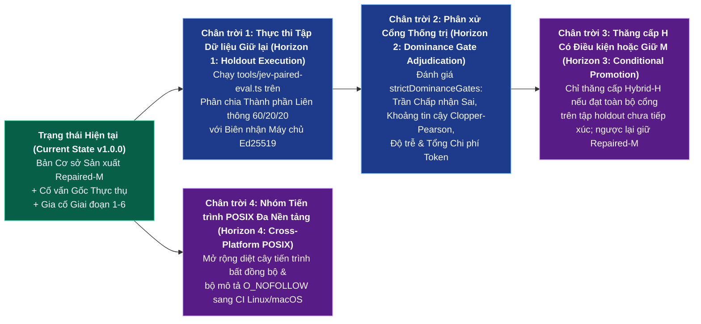
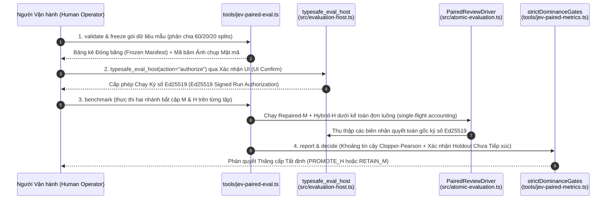

# Tiến hóa Dự án & Lộ trình Kỹ thuật (Project Evolution & Technical Roadmap) — `omp_extension`

> **Sổ cái Tiến hóa Chính tắc, Ma trận Cột mốc & Lộ trình Chiến lược (Canonical Evolution Ledger, Milestone Matrix & Strategic Roadmap)** cho `omp-typesafe-extension` (`v1.0.0`).  
> Theo dõi toàn bộ quá trình phát triển từ định tuyến `jev-latest` ban đầu qua Kiểm toán Cơ sở P0–P6 (P0–P6 Baseline Audit), Đại tu Đồng thuận Lưỡng viện (Bicameral Consensus Overhaul), Khung Đánh giá Bắt cặp `M`/`H` (Paired `M`/`H` Evaluation Framework), Gia cố Đội đỏ Giai đoạn 1–6 ngày `2026-10-26` (Red-Team Hardening Phases 1–6), và các cổng thăng cấp sắp tới (upcoming promotion gates).

---

## 1. Dòng thời gian Tiến hóa Kiến trúc Đầu-Cuối (End-to-End Architectural Evolution Timeline)

```mermaid
timeline
    title Tiến hóa Kiến trúc omp_extension (Architectural Evolution — 2026-10-05 đến 2026-10-26+)
    section Giai đoạn I — Khởi nguyên Tầng Nhanh & Bộ tiêu chí (Phase I — Fast-Tier & Rubric Genesis)
        2026-10-05 : ADR-01 Định tuyến Mô hình Tầng Nhanh (Fast-Tier Model Routing jev-latest)
                   : Tách rời src/debate-evaluator.ts & src/plan-evaluator.ts (Decoupled evaluators)
        2026-10-08 : Gia cố Khiên Toàn vẹn & Tách Đường dẫn Không gian làm việc (Integrity Shield Hardening)
        2026-10-12 : ADR-02 Tiêm Ngữ cảnh Tầng 1 & Bộ tiêu chí Đa nhãn Tầng 2 (Contextual Injection & Multi-Label Rubrics)
                   : Đường ống Cổng 1 (Gate 1 AST/Test) + Cổng 2 (Gate 2 Semantic JEV)
    section Giai đoạn II — Chốt chặn, Đồng thuận Lưỡng viện & Hiệu chuẩn (Phase II — Ratchets, Bicameral Consensus & Calibration)
        2026-10-13 : ADR-03 Chốt chặn Cùng Bằng chứng Cổng 0, Chặn Trốn tránh Block & Bộ Giải quyết Ký tự đại diện (Gate 0 Ratchet & Wildcard Resolver)
                   : ADR-04 Đồng thuận Lưỡng viện Advisor-JEV & Trải nghiệm Khắc phục XML (Bicameral Consensus & XML Remediation UX)
        2026-10-14 : ADR-05 Kiểm toán Pháp y 5 Phiên (5-Session Forensic Audit — Phát hiện 7 Khiếm khuyết Hệ thống)
        2026-10-15 : ADR-06 Hiệu chuẩn Xác suất Noul P(yes) Thực, Xóa Tường Ngưỡng Cứng & Độ Trung thực Trạng thái 32KB (True Noul Calibration)
    section Giai đoạn III — Hợp đồng Giai đoạn, Cố vấn Gốc & Bản bóng H (Phase III — Staged Contracts, Native Advisor & Shadow H)
        2026-10-19 : ADR-07 Bản Cơ sở Repaired-M + Cố vấn Gốc Chỉ Đọc Thực thụ + Bản bóng Hybrid-H (Repaired-M + Genuine Native Advisor + Hybrid-H Shadow)
                   : Xác thực theo Giai đoạn (Staged Verification — bind -> collect -> review -> prepare_advisor -> done)
        2026-10-21 : Máy chủ Đánh giá Bắt cặp (Paired Evaluation Host — Biên nhận Ed25519, tools/jev-paired-eval.ts, phân chia 60/20/20)
                   : Kiểm toán Toàn diện Bảo mật & Tính Đúng đắn Cơ sở P0-P6 (P0-P6 Comprehensive Baseline Audit)
    section Giai đoạn IV — Gia cố Đội đỏ & Đồng bộ Toàn cục Một Chạm (Phase IV — Red-Team Hardening & One-Click Global Sync)
        2026-10-26 : Bản cam kết 0580327 Gia cố Đội đỏ Giai đoạn 1-5 (Red-Team Hardening Phases 1-5 — TOCTOU, EGC, Stream Drain, Secret Env, Telemetry)
                   : Giai đoạn 6 Chuỗi Công cụ Một Chạm (Phase 6 One-Click Toolchain — oneclick-omp.ps1, verify-omp-global.cjs, Đồng bộ Toàn cục)

---

## 2. Ma trận Cột mốc Lịch sử — Từ Kiểm toán P0–P6 đến Gia cố 2026-10-26 (Historical Milestone Matrix)

### 2.1 Tóm tắt Các Đợt Cột mốc (Milestone Wave Summary)

| Đợt Cột mốc (Milestone Wave) | Giai đoạn (Period) | Mục tiêu Kỹ thuật Cốt lõi (Core Engineering Objective) | Các Mô-đun Chính Được Bàn giao / Tái Kiến trúc (Key Modules Delivered / Re-Architected) | Chuẩn Đo kiểm Xác minh (Verification Benchmark) |
|---|---|---|---|---|
| **M1: Dự báo Tầng Nhanh & Bộ tiêu chí Đa nhãn (Fast-Tier Predict & Multi-Label Rubrics)** | `2026-10-05` – `2026-10-12` | Định tuyến tranh biện tiền triển khai (pre-implementation debate) và kiểm tra hoàn thành nhiệm vụ sang `jev-latest` với bộ tiêu chí nhận biết nhiệm vụ (task-aware rubrics). | `src/typesafe-api-client.cjs`, `src/debate-evaluator.ts`, `src/plan-evaluator.ts`, `src/cook-expert-judge.ts`, `src/verification-gate.ts` | Các bộ kiểm thử đơn vị ban đầu + kiểm thử khói (smoke tests) `jev-latest` trực tiếp. |
| **M2: Chốt chặn, Bộ Giải quyết Ký tự đại diện & Hiệu chuẩn Thực (Ratchets, Wildcard Resolver & True Calibration)** | `2026-10-13` – `2026-10-15` | Đóng lỗ hổng trốn tránh `todo(op="block")`, chặn thử lại mù quáng trên bản diff không đổi, hỗ trợ `"projects": ["*"]`, và hiệu chuẩn xác suất `noul` $P(\text{yes})$. | `src/typesafe-enabled-resolver.cjs`, `src/bicameral-consensus.ts`, `src/remediation-generator.ts`, `src/xml-enclosure.ts`, `src/payload-safety.ts` | Phát lại pháp y (forensic replay) 5 bản ghi phiên đa nhiệm (`ADR-20261014`). |
| **M3: Hợp đồng Giai đoạn & Cố vấn Gốc Thực thụ (Staged Contracts & Genuine Native Advisor)** | `2026-10-16` – `2026-10-20` | Loại bỏ hoàn toàn HTTP/IO khỏi tiền kiểm `todo` gốc; ràng buộc `incarnationId` mật mã; làm trung gian cho các tác nhân con `advisor` chỉ đọc thực sự. | `src/contract-runtime.ts`, `src/host-history.ts`, `src/task-verification-runtime.ts`, `src/task-evidence-runtime.ts`, `src/advisor-runtime.ts`, `src/advisor-readonly.ts` | Bộ kiểm thử khói kiểm soát biên vòng lặp `tools/todo-remediation-smoke.ts`. |
| **M4: Bản bóng Nguyên tử `H` & Máy chủ Đánh giá Bắt cặp (Atomic `H` Shadow & Paired Evaluation Host)** | `2026-10-19` – `2026-10-22` | Xây dựng thẩm phán vị từ nguyên tử theo thứ tự phụ thuộc (`H`) và bộ đo kiểm bắt cặp ký số Ed25519 đối sánh với `Repaired-M`. | `src/atomic-judge.ts`, `src/atomic-evaluation.ts`, `src/evaluation-host.ts`, `tools/jev-paired-eval.ts`, `tools/jev-paired-*.ts` (15 mô-đun) | Khung đo kiểm bắt cặp (`validate`, `freeze`, `benchmark`, `report`, `decide`). |
| **M5: Kiểm toán Bảo mật & Tính Đúng đắn P0–P6 (P0–P6 Security & Correctness Audit)** | `2026-10-21` – `2026-10-25` | Loại bỏ các đường vòng qua mặt thẩm quyền (authority bypasses), gia cố mẫu biên tập ẩn, cưỡng chế quyền biến đổi theo phạm vi, và xây dựng đồng bộ bản cơ sở có giao dịch. | `src/source-mutation-authority.ts`, `src/advisor-mutation-delegation.ts`, `src/typesafe-redact.cjs`, `tools/sync-baseline.cjs` | Ma trận kiểm thử mở rộng trên `82` tệp kiểm thử (`900+` khẳng định kiểm thử). |
| **M6: Gia cố Đội đỏ 2026-10-26 Giai đoạn 1–6 (2026-10-26 Red-Team Hardening Phases 1–6)** | `2026-10-26` | Giải quyết triệt để 5 phát hiện đội đỏ chuyên sâu (`0580327`) + bàn giao trình xác minh toàn cục 6 tầng `<3 giây` và quy trình thăng cấp một chạm. | `src/typesafe-evidence-file.cjs`, `src/evidence-workspace.ts`, `src/evidence-collector.ts`, `src/egc.ts`, `src/advisor-native-budget.ts`, `src/typesafe-child-env.cjs`, `tools/verify-omp-global.cjs`, `tools/oneclick-omp.ps1` | `918+` bài kiểm thử đạt + `ALL CHECKS PASSED` trên xác minh toàn cục 6 tầng + `jev-latest` trực tiếp. |

### 2.2 Phân rã Chi tiết Kiểm toán Cơ sở P0–P6 (P0–P6 Baseline Audit Breakdown)

Trước đợt Gia cố Đội đỏ ngày `2026-10-26` (Red-Team Hardening wave), cơ sở mã nguồn đã trải qua một cuộc kiểm toán cơ sở bảy tầng có hệ thống (`P0`–`P6`):

| Tầng Ưu tiên (Priority Tier) | Phạm vi Kiểm toán (Audit Scope) | Các Bàn giao Chính & Bất biến Được Thiết lập (Key Deliverables & Invariants Established) | Các Mô-đun Chính (Primary Modules) |
|---|---|---|---|
| **P0: Lịch sử Máy chủ & Thẩm quyền Lời gọi (Host History & Invocation Authority)** | Ngăn chặn các lời gọi công cụ giả mạo (forged tool calls) hoặc trạng thái nhánh bị ngắt kết nối khởi tạo hợp đồng hay phê duyệt. | Xác thực phả hệ `readHostBranch` ($<100,000$ mục, xác minh liên kết cha) + kết nối chứng nhân `AsyncLocalStorage` (`omp.typesafe.tool-execution.v1`). | `src/host-history.ts`, `src/host-tool-invocation.ts` |
| **P1: Hợp đồng Nhiệm vụ & Độ Trung thực Chuyển tiếp Gốc (Task Contract & Native Transition Fidelity)** | Đảm bảo tương thích chính xác tuyệt đối với các bước chuyển trạng thái `todo` gốc và quy tắc con trỏ của Oh-My-Pi v18.12.3. | `validateNativeTodoTransition`, `normalizeNativeTodoPointer`, `incarnationId` tất định, và thu thập truy xuất nguồn gốc đầu vào `/ck:cook`. | `src/task-contract-transition.ts`, `src/task-contract-native.ts`, `src/task-contract-cook-input.ts` |
| **P2: Bằng chứng Không gian làm việc & Toàn vẹn Biên nhận (Workspace Evidence & Receipt Integrity)** | Đảm bảo các gói `JudgeEvidencePacket` phản ánh đúng bản diff không gian làm việc thực tế và các lượt chạy kiểm thử không bị giả mạo. | So sánh ảnh chụp trước/sau/ổn định (pre/post/stability snapshot) xung quanh `collectVerificationReceipt`, giới hạn tạo tác bàn giao `4,940 B`, và đổ đầy nước gói 32 KiB. | `src/verification-receipt.ts`, `src/evidence-artifacts.ts`, `src/judge-evidence-packet.ts` |
| **P3: Cô lập Cố vấn Gốc Thực thụ (Genuine Native Advisor Isolation)** | Loại bỏ hoàn toàn cơ chế tự phê duyệt heuristic nội bộ và cô lập các phiên con của Advisor. | Prompt tác nhân con do máy chủ ghim chặt, tước bỏ lịch sử qua `projectAdvisorPayload`, trung gian tệp chỉ đọc khớp chính xác SHA, và xác minh biên nhận nhánh đã quyết toán. | `src/advisor-runtime.ts`, `src/advisor-guards.ts`, `src/advisor-readonly.ts`, `src/advisor-host-settlement.ts` |
| **P4: Cam kết theo Giai đoạn & Quản trị Nợ (Staged Commit & Debt Governance)** | Tách rời quá trình xác thực chậm khỏi tiền kiểm `todo` gốc và ngăn chặn hành vi trốn nợ qua `block`/`drop`. | Tiền kiểm không I/O `createNativeStageRegistry`, quyền biến đổi có thời hạn 60 giây trong `createTodoLifecycleAuthority`, và công cụ `typesafe_resolve_historical_debt`. | `src/task-verification-native.ts`, `src/todo-lifecycle-authority.ts`, `src/task-verification-historical.ts` |
| **P5: Đo kiểm Bắt cặp `M`/`H` & Sự Nghiêm ngặt Thống kê (Paired `M`/`H` Benchmark & Statistical Rigor)** | Xây dựng hạ tầng thực nghiệm có khả năng bác bỏ khoa học (falsifiable experimental infrastructure) trước khi thăng cấp Nguyên tử `H`. | `evaluation-host.ts` ký số Ed25519, bộ xác thực phân chia thành phần liên thông 60/20/20, cận khoảng tin cậy Clopper-Pearson, và sổ cái tập giữ lại chưa từng tiếp xúc. | `src/evaluation-host.ts`, `tools/jev-paired-validation.ts`, `tools/jev-paired-statistics.ts`, `tools/jev-paired-exposure.ts` |
| **P6: Thăng cấp Bản cơ sở 2 Gốc Có Giao dịch (Transactional 2-Root Baseline Promotion)** | Đảm bảo triển khai nguyên tử, có khả năng hoàn tác (rollback-capable) trên cả `target` và `global_omp_agents` (Schema v2, độc lập hoàn toàn khỏi `.claude`). | `tools/sync-baseline.cjs` kèm sao lưu ảnh trước, `.sync-journal.json`, `.sync-manifest.json`, và các lượt chạy kiểm thử trong `createVerificationHome` cô lập. | `tools/sync-baseline.cjs`, `tools/promote-omp-global.ps1` |

---

## 3. Phân tích Chuyên sâu Đợt Gia cố Đội đỏ 2026-10-26 — Giai đoạn 1–6 (Deep Breakdown of the 2026-10-26 Red-Team Hardening)

Đợt kỹ thuật ngày `2026-10-26` (`Commit 0580327` + Đồng bộ Toàn cục Một Chạm) đã khóa chặt năm lỗ hổng tinh vi về bảo mật, đồng thời (concurrency) và viễn trắc (telemetry) được phát hiện trong quá trình rà soát đối kháng đội đỏ, tiếp nối bởi việc hợp nhất chuỗi công cụ vận hành:

```mermaid
flowchart TB
    subgraph P1["Giai đoạn 1: Gia cố Hệ thống Tệp & Ảnh chụp (Phase 1: Filesystem & Snapshot Hardening)"]
        P1A["src/typesafe-evidence-file.cjs<br/>Xác minh chuỗi tổ tiên đường dẫn thực đơn nhất (Single-realpath ancestor chain)<br/>Chặn đánh tráo TOCTOU qua symlink/junction/hardlink"]
        P1B["src/evidence-workspace.ts<br/>Lưu đệm WorkspaceSnapshot đã niêm phong &<br/>lưu giữ ảnh trước tất định (deterministic preimage retention)"]
    end

    subgraph P2["Giai đoạn 2: Khóa Triển khai & An toàn Cây Tiến trình (Phase 2: Deployment Lock & Process Tree Safety)"]
        P2A["tools/sync-baseline.cjs<br/>Xác minh định danh kế hoạch sau khi lấy khóa<br/>('deployment plan changed after lock')"]
        P2B["src/evidence-collector.ts<br/>Lệnh taskkill /t /f bất đồng bộ không chặn trên Windows<br/>kèm bộ hẹn giờ dự phòng SIGKILL 5 giây"]
    end

    subgraph P3["Giai đoạn 3: Thắt chặt Cam kết Gắn cổng Bằng chứng EGC (Phase 3: EGC Strictness)"]
        P3A["src/egc.ts<br/>Từ chối 'unsandboxed': true trên todo/todo_write<br/>trong chế độ cưỡng chế (enforce mode)"]
        P3B["src/egc.ts<br/>Bắt buộc lệnh xác thực trong uncontracted: 'allow'<br/>trừ khi jev.mode === 'enforce' có yêu cầu"]
        P3C["src/egc.ts<br/>Từ chối có cấu trúc EgcEvidenceRefusal (FILE_MISSING / FILE_TOO_LARGE)<br/>& bác bỏ hoàn thành mơ hồ (targets.length > 1)"]
    end

    subgraph P4["Giai đoạn 4: Xả Luồng Advisor & Chặn Rò rỉ Env Con (Phase 4: Advisor Stream Drain & Child Env Leak Guard)"]
        P4A["src/advisor-native-budget.ts<br/>Xả luồng phản hồi tường minh khi hết giờ/lỗi<br/>để ngăn chặn treo socket (hung sockets)"]
        P4B["src/advisor-protocol.ts<br/>Cưỡng chế bất biến từ chối applicable === false<br/>trên biên nhận AdvisorAssessment"]
        P4C["src/typesafe-child-env.cjs<br/>Chặn giá trị bí mật bị rò rỉ vào BẤT KỲ<br/>khóa biến môi trường được phép nào"]
    end

    subgraph P5["Giai đoạn 5: Bảo toàn Viễn trắc (Phase 5: Telemetry Preservation)"]
        P5A["src/typesafe-redact.cjs<br/>TELEMETRY_COUNT_KEYS bảo toàn số nguyên không âm<br/>đếm token (input_tokens, output_tokens, v.v.)"]
    end

    subgraph P6["Giai đoạn 6: Chuỗi Công cụ Toàn cục Một Chạm (Phase 6: One-Click Global Toolchain)"]
        P6A["tools/verify-omp-global.cjs (.bat)<br/>Trình Xác minh Bảng kê, Bảo mật & API Trực tiếp 6 Tầng (<3 giây)"]
        P6B["tools/oneclick-omp.ps1 (.bat)<br/>Kiểm tra Trạng thái Thông minh -> Đồng bộ Có Điều kiện -> Xác minh Sau Đồng bộ"]
    end

    P1 --> P2 --> P3 --> P4 --> P5 --> P6
```

### 3.1 Đặc tả Kỹ thuật Từng Giai đoạn (Phase-by-Phase Technical Specification)

| Giai đoạn (Phase) | Các Tệp Mục tiêu (Target Files) | Lỗ hổng / Khoảng trống Được Giải quyết (Vulnerability / Gap Addressed) | Cơ chế Gia cố Chính xác Được Triển khai (Exact Hardening Mechanism Implemented) |
|---|---|---|---|
| **Giai đoạn 1 (Phase 1)** | `src/typesafe-evidence-file.cjs`, `src/evidence-workspace.ts` | Các lệnh gọi `realpathSync` lặp đi lặp lại trên từng phân đoạn thư mục tạo ra cửa sổ tranh chấp (race window) và I/O dư thừa trong quá trình duyệt không gian làm việc lớn. | Hợp nhất việc duyệt thư mục tổ tiên bằng xác minh chuỗi đường dẫn thực đơn nhất (single-realpath chain verification), từ chối symlink/junction qua `lstatSync` tại mọi bước nhảy, kiểm tra bộ mô tả `O_NOFOLLOW`, cưỡng chế `nlink === 1`, và lưu đệm ảnh chụp trong `evidence-workspace.ts`. |
| **Giai đoạn 2 (Phase 2)** | `tools/sync-baseline.cjs`, `src/evidence-collector.ts` | (1) Các tệp mã nguồn có thể bị thay đổi giữa lúc lập kế hoạch trước khóa và lúc chiếm được khóa trong `sync-baseline.cjs`. (2) Lệnh `taskkill` đồng bộ đối với các tiến trình kiểm thử bị hết giờ trên Windows làm nghẽn vòng lặp sự kiện Node/Bun. | (1) Tính toán lại mã băm kế hoạch triển khai sau khi lấy được `.sync-lock` và hủy bỏ ngay với lỗi `"deployment plan changed after lock"` nếu lệch. (2) Thay thế lệnh diệt đồng bộ bằng `spawn("taskkill", ["/pid", pid, "/t", "/f"])` bất đồng bộ + bộ hẹn giờ dự phòng `SIGKILL` 5 giây. |
| **Giai đoạn 3 (Phase 3)** | `src/egc.ts`, `src/verification-gate.ts` | Tác nhân có thể truyền `"unsandboxed": true` vào lệnh gọi `todo`, hoàn thành nhiều mục `todo` trong một lệnh gọi `done` mơ hồ duy nhất (`targets.length > 1`), hoặc bỏ qua lệnh xác thực dưới chế độ `uncontracted: "allow"`. | Bổ sung sàng lọc tường minh `"unsandboxed": true` trong chế độ cưỡng chế, bắt buộc `targets.length === 1` khi `done`, yêu cầu lệnh xác thực dưới `uncontracted: "allow"` (trừ khi đã được bao phủ bởi yêu cầu `jev.mode === "enforce"`), và giới thiệu kiểu lỗi `EgcEvidenceRefusal` (`FILE_MISSING`, `FILE_TOO_LARGE`). |
| **Giai đoạn 4 (Phase 4)** | `src/advisor-native-budget.ts`, `src/advisor-protocol.ts`, `src/typesafe-child-env.cjs` | (1) Các luồng Advisor bị hủy/hết giờ có thể để lại bộ đệm chưa đọc bị mở. (2) Một bản `AdvisorAssessment` có `applicable: false` có thể bị hiểu nhầm. (3) Một giá trị bí mật sao chép vào biến môi trường trong danh sách trắng (ví dụ `CUSTOM_PATH=ts_live_...`) có thể lọt vào tiến trình con. | (1) Bổ sung lệnh hủy/xả bộ đọc luồng (stream reader cancel/drain) tường minh trong khối `finally`/catch. (2) Cưỡng chế từ chối khi `applicable === false` trong `src/advisor-protocol.ts`. (3) Quét toàn bộ giá trị biến môi trường trong danh sách trắng ở `src/typesafe-child-env.cjs` đối chiếu với các giá trị bí mật và mẫu token. |
| **Giai đoạn 5 (Phase 5)** | `src/typesafe-redact.cjs` | Cơ chế biên tập ẩn theo tên khóa khớp với các khóa `*_tokens` (`input_tokens`, `output_tokens`, `total_tokens`), xóa nhầm các số nguyên đếm mức sử dụng thành `"[REDACTED]"` và làm hỏng kế toán chi phí/token trong các bài đo kiểm bắt cặp `ADR-20261019`. | Bổ sung `TELEMETRY_COUNT_KEYS` (tập `Set` gồm 9 khóa bộ đếm token chính tắc) tại `src/typesafe-redact.cjs:26-36`; khi `Number.isSafeInteger(value) && value >= 0`, số nguyên được giữ nguyên vẹn trong khi các giá trị chuỗi/bí mật dưới các khóa đó vẫn bị biên tập ẩn. |
| **Giai đoạn 6 (Phase 6)** | `tools/oneclick-omp.bat`, `tools/oneclick-omp.ps1`, `tools/verify-omp-global.bat`, `tools/verify-omp-global.cjs` | Người vận hành cần một công cụ nhanh, tất định để kiểm tra sự đồng nhất trên cả 3 thư mục gốc toàn cục và xác minh sức khỏe `jev-latest` trực tiếp mà không phải chạy toàn bộ quy trình thăng cấp kèm kiểm thử dài 30 giây mỗi lần. | Xây dựng `verify-omp-global.cjs` (trình xác minh 6 tầng `<3 giây` kiểm tra trình trung chuyển proxy, sự đồng nhất manifest SHA-256 trên 3 gốc, bộ giải quyết, bộ biên tập ẩn/child-env, và API `jev-latest` trực tiếp) cùng `oneclick-omp.ps1` (chỉ đồng bộ có điều kiện khi phát hiện sai lệch). |

---

## 4. Ma trận Sẵn sàng Triển khai Hiện tại (Current Deployment Readiness Matrix)

Tất cả các phân hệ trong `D:/100.Software/Github/omp_extension` (`v1.0.0`) đều đã được triển khai và xác minh trên cả ba thư mục gốc thời gian chạy được quản lý:

| Phân hệ / Tầng (Subsystem / Layer) | Các Mô-đun Chính (Primary Modules) | Trạng thái Sản xuất (Production Status) | Độ Bao phủ Kiểm thử (`tests/`) | Thư mục Gốc Đồng bộ Toàn cục (Global Sync Root) |
|---|---|---|---|---|
| **Proxy Tiện ích Mở rộng Toàn cục (Global Extension Proxy)** | `~/.omp/agent/extensions/typesafe-planner.ts` | **Sản xuất / Bất biến (Production Immutable)** | Được xác minh bởi Tầng 1 của `verify-omp-global.cjs` | `~/.omp/agent/extensions` |
| **Tiện ích Mở rộng Chính & 16 Công cụ (Main Extension & 16 Tools)** | `typesafe-planner.ts` (`2,317 LOC`) | **Sản xuất / Cưỡng chế (Production Enforce)** | `tests/typesafe-planner*.test.ts` | `target` (`C:/Users/thant/Projects/omp_extension`) |
| **7 Mô-đun Thời gian chạy Dùng chung CJS (7 CJS Shared Runtime Modules)** | `src/typesafe-*.cjs` | **Sản xuất / Độc lập (Production Isolated)** | `tests/typesafe-*.test.ts` | `target` (Độc lập hoàn toàn khỏi `.claude`) |
| **Hợp đồng Nhiệm vụ & Sổ cái Lịch sử (Task Contract & History Ledger)** | `src/contract-runtime.ts`, `src/task-contract*.ts`, `src/host-history.ts` | **Sản xuất / Cưỡng chế (Production Enforce)** | `tests/contract-runtime.test.ts`, `tests/task-contract*.test.ts` | `target` |
| **Ảnh chụp Không gian làm việc & Bằng chứng (Workspace Snapshot & Evidence)** | `src/task-evidence-runtime.ts`, `src/evidence-*.ts`, `src/judge-evidence-packet.ts` | **Sản xuất / Cưỡng chế (Production Enforce)** | `tests/evidence-*.test.ts`, `tests/judge-evidence-packet.test.ts` | `target` |
| **Xác thực Giai đoạn & Thẩm phán `M` (Staged Verification & `M` Judge)** | `src/task-verification-*.ts`, `src/bicameral-consensus.ts`, `src/cook-expert-judge.ts` | **Bản Cơ sở Sản xuất (`Repaired-M` Baseline)** | `tests/task-verification*.test.ts`, `tests/bicameral-consensus.test.ts` | `target` |
| **Cố vấn Gốc Độc lập (Independent Native Advisor)** | `src/advisor-*.ts` (19 mô-đun) + `agents/{advisor,ck-advisor}.md` | **Sản xuất / Cưỡng chế (Production Enforce)** | `tests/advisor-*.test.ts` | `target` + `global_omp_agents` (`~/.omp/agent/agents`) |
| **Cam kết Gắn cổng Bằng chứng (`EGC` - Evidence-Gated Commit)** | `src/egc*.ts`, `src/ast-analyzer.ts`, `src/verification-gate.ts` | **Sản xuất / Cưỡng chế (Production Enforce)** | `tests/egc*.test.ts`, `tests/ast-analyzer.test.ts` | `target` |
| **Thẩm phán Nguyên tử `H` & Đánh giá Bắt cặp (Atomic `H` Judge & Paired Eval)** | `src/atomic-*.ts`, `src/evaluation-host*.ts`, `tools/jev-paired-*.ts` | **Ứng viên Đối chứng Bóng (Shadow Challenger - Có Gắn cổng)** | `tests/atomic-*.test.ts`, `tests/jev-paired-*.test.ts` | `target` |

---

## 5. Các Chân trời Tiếp theo & Lộ trình Chiến lược Q4 2026 – Q1 2027 (Next Horizons & Strategic Roadmap)



### 5.1 Chân trời 1 & 2: Các Cổng Thăng cấp Tập Giữ lại giữa `Hybrid-H` và `Repaired-M` (`ADR-20261019`)
Trước khi `Bounded Hybrid-H` (`src/atomic-judge.ts`) có thể được thăng cấp từ ứng viên chạy bóng (shadow candidate) lên cổng sản xuất có thẩm quyền trong `src/task-verification-runtime.ts`, nó bắt buộc phải vượt qua năm cổng tất định được cưỡng chế bởi `strictDominanceGates` (`tools/jev-paired-metrics.ts`):

1. **Cô lập Nguồn gốc Tập Giữ lại Chưa Tiếp xúc (`claimUnseenHoldout` trong `tools/jev-paired-exposure.ts` - Unseen Holdout Provenance Isolation)**: Phần phân chia giữ lại `20%` cuối cùng (được phân hoạch theo nguồn gốc nhiệm vụ thành phần liên thông (connected-component task provenance) để các bước phiên liên quan không bao giờ nằm vắt ngang qua các tập huấn luyện/xác thực/giữ lại) phải có số lần tiếp xúc trước đó bằng 0 trong sổ cái tiếp xúc (exposure ledger).
2. **Không Suy thoái Tỷ lệ Phê duyệt Sai (Zero False-Approval Regression)**: `H` phải thể hiện tỷ lệ phê duyệt sai bắt cặp (phê duyệt các nhiệm vụ được nhãn chuẩn vàng của con người gán là `REJECT`) không cao hơn `Repaired-M` trong phạm vi cận khoảng tin cậy nhị thức chính xác Clopper-Pearson (`tools/jev-paired-statistics.ts`).
3. **Độ Chính xác Bắt cặp Tích cực hoặc Không Kém hơn (Positive or Non-Inferior Paired Accuracy)**: Mức cải thiện bắt cặp trên các nhãn chuẩn vàng của nhiệm vụ hoàn thành (`tools/jev-paired-validation.ts`) phải đạt hoặc vượt `Repaired-M` trên cả nhóm ca thông thường lẫn nhóm ca đối kháng/khó (adversarial/hard-slice cases).
4. **Chi phí & Độ trễ Toàn phần Được Xác minh bằng Biên nhận (`tools/jev-paired-accounting.ts` - All-In Receipt-Verified Cost & Latency)**: Tổng chi phí mỗi tập (episode cost) và độ trễ thời gian thực—bao gồm cả biên nhận token `jev-latest` (`input_tokens` được bảo toàn nhờ `TELEMETRY_COUNT_KEYS` ở Giai đoạn 5) và mức sử dụng tác nhân con `Advisor` gốc (`captureAdvisorNativeObservation`)—phải nằm trong trần ngân sách của giao thức.
5. **Tính Toàn vẹn Khảo sát Loại bỏ Thành phần (`ablationIdentity` trong `tools/jev-paired-ablations.ts` - Ablation Completeness)**: Các phép thử loại bỏ thành phần (ablations) về gom lô (batching) và chính sách vị từ phải xác minh rằng việc gom lô đa vị từ không làm suy giảm độ hiệu chuẩn so với việc điều phối từng vị từ đơn lẻ.

### 5.2 Chân trời 3: Tương đồng Nhóm Tiến trình POSIX & Bộ Mô tả Tệp Đa Nền tảng (Cross-Platform POSIX Parity)
- Mở rộng hàm `killProcessTree` trong `src/evidence-collector.ts` bằng cơ chế gửi tín hiệu tới nhóm tiến trình qua PID âm (`process.kill(-pid, "SIGTERM")` $\rightarrow$ dự phòng `SIGKILL`) khi chạy trên máy chủ Linux/macOS song song với triển khai `taskkill /pid <pid> /t /f` hiện có trên Windows.
- Bổ sung các lượt chạy ma trận CI Linux/macOS tự động để xác minh kiểm tra bộ mô tả `O_NOFOLLOW` trong `src/typesafe-evidence-file.cjs` và chuẩn hóa đường dẫn trong `tools/sync-baseline.cjs`.

### 5.3 Chân trời 4: Liên hợp Đa Kho Mã & Bảng Điều khiển Viễn trắc (Multi-Repo Federation & Telemetry Dashboarding)
- Cung cấp báo cáo tổng hợp CLI ngoại tuyến trên các mục nhánh `omp.typesafe.task-verification-facts.v1` qua nhiều kho mã được kích hoạt bằng `"projects": ["*"]` trong `~/.omp/agent/typesafe.json`.
- Hiển thị mức tiết kiệm của chốt chặn cùng bằng chứng Cổng 0 (Gate 0 same-evidence ratchet savings), số lần chặn trốn tránh kiểm thử AST tại Cổng 1 (Gate 1 AST test-evasion interceptions), và phân phối độ trễ Đồng thuận Lưỡng viện tại Cổng 2 mà không xuất bất kỳ mã nguồn hay đường dẫn người dùng nào ra ngoài.

---

## 6. Quy trình Quản trị Thăng cấp & Đánh giá Bắt cặp `M` so với `H` (Paired Evaluation & Promotion Governance Workflow)

Giao thức thăng cấp đầu-cuối nhằm đánh giá ứng viên `Bounded Hybrid-H` (`src/atomic-judge.ts`) đối sánh với bản cơ sở sản xuất `Repaired-M` (`src/task-verification-macro.ts`) được thực thi thông qua `tools/jev-paired-eval.ts` và công cụ `typesafe_eval_host`:



### 6.1 Danh mục Kiểm tra Phát hành & Đồng bộ Vận hành (Operational Release & Sync Checklist)

Mọi cột mốc kỹ thuật trong `D:/100.Software/Github/omp_extension` BẮT BUỘC phải hoàn tất cổng thăng cấp bốn bước sau đây trước khi đóng nhiệm vụ:

| Bước (Step) | Lệnh Thực thi (Command) | Yêu cầu Cổng Kiểm soát (Gate Requirement) |
|---|---|---|
| **1. Bộ Kiểm thử Đơn vị & Tích hợp Khép kín (Hermetic Unit & Integration Suite)** | `bun test` | Toàn bộ `82` tệp kiểm thử (`918+` bài kiểm thử) vượt qua với `0` lỗi. |
| **2. Thăng cấp 2 Thư mục Gốc Có Giao dịch (Transactional 2-Root Promotion)** | `tools/sync-baseline.bat` hoặc `tools/oneclick-omp.bat` | Mã băm kế hoạch trước và sau khi khóa khớp nhau; `.sync-manifest.json` (Schema v2) được ghi vào `target` và `global_omp_agents`. |
| **3. Xác minh Ngoại tuyến 5 Tầng Toàn cục (Global 5-Layer Offline Verification)** | `npm run verify:global` | Hoàn tất trong `<3 giây`; xác minh proxy Bất biến Vàng, đồng nhất manifest SHA-256, quy tắc ký tự đại diện của bộ giải quyết, và bảo mật redactor/child-env. |
| **4. Kiểm tra Sức khỏe System One Trực tiếp (Live System One Health Check)** | `npm run verify:live` | Xác nhận kết nối khứ hồi `jev-latest` trực tiếp (`noul` $\in [0, 1]$) và bảo toàn bộ đếm viễn trắc. |
