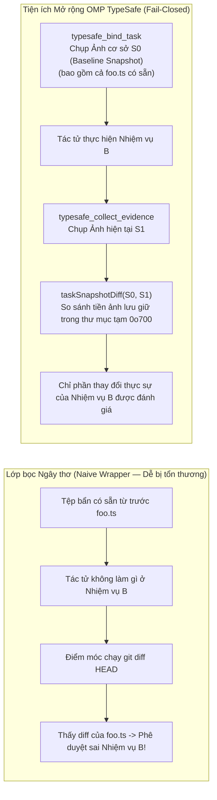
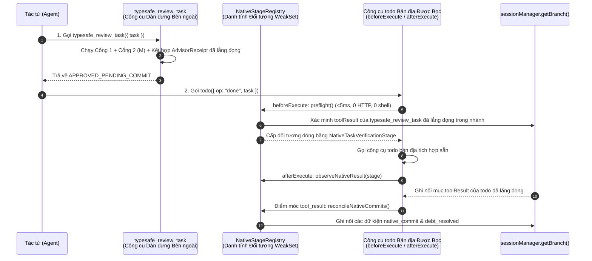
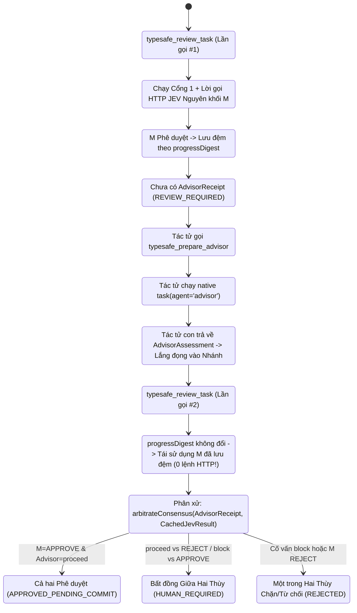
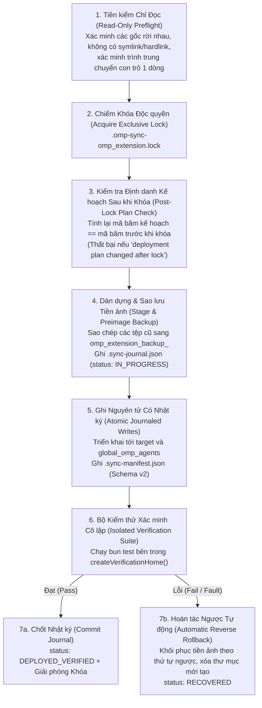
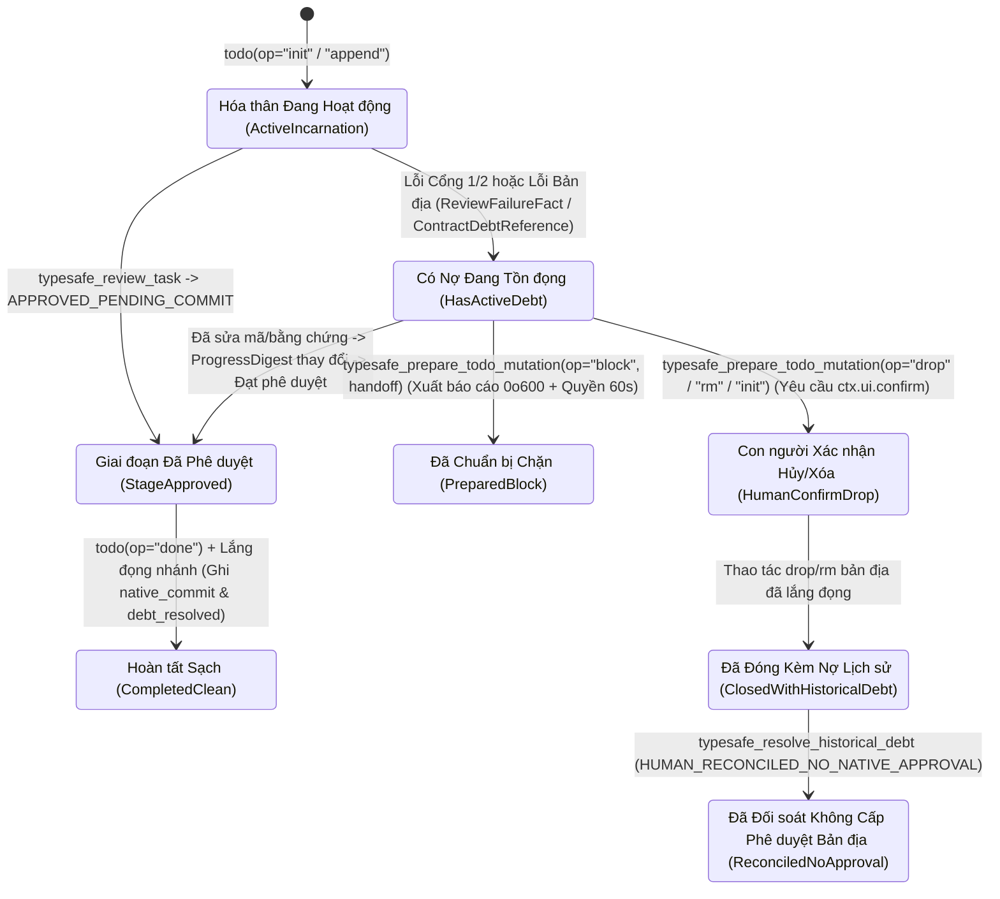

# Giải thích Giải pháp Kỹ thuật & Lý giải Kiến trúc (Technical Solution Explanation & Architectural Rationale)

## 1. Bài toán Kỹ thuật Cốt lõi: Tại sao các Rào chắn Tác tử Ngây thơ Thất bại (Why Naive Agent Guardrails Fail)

Các tác tử lập trình tự hành (Autonomous Coding Agents) vận hành trên các kho mã nguồn sản phẩm thực tế thường bộc lộ 7 chế độ lỗi lặp đi lặp lại (Recurring Failure Modes) khi chỉ được quản trị bằng các chỉ dẫn lời nhắc đơn giản hoặc các lớp bọc điểm móc công cụ ngây thơ (Naive Tool-Hook Wrappers):

1. **Ảo giác Hoàn thành & Tự Chứng nhận (Completion Hallucination & Self-Certification)**: Tác tử gọi `todo(op="done")` khi chưa hề thay đổi dòng mã nào, chưa từng chạy kiểm thử, hoặc các tệp báo cáo bàn giao chỉ là các bản mẫu chưa được chỉnh sửa.
2. **Lách Kiểm thử & Đầu độc Môi trường (Test Evasion & Environment Poisoning)**: Khi một bài kiểm thử thất bại, một tác tử không bị ràng buộc có thể xóa các khẳng định `expect(...)`, thêm `.skip`, chú thích vô hiệu hóa các bài kiểm thử đang lỗi, hoặc sửa đổi dữ liệu mẫu (Fixtures) ngay trong lúc chạy để ép mã thoát bằng `0`.
3. **Khóa chết Điểm móc Đồng bộ (Synchronous Hook Deadlocks)**: Việc chạy `bun test` hoặc các yêu cầu HTTP tới mô hình thẩm định mất nhiều giây ngay bên trong điểm móc công cụ `todo` bản địa sẽ làm nghẽn vòng lặp sự kiện của máy chủ (Host Event Loop), gây tranh chấp với thao tác hủy lượt chạy (Turn Cancellation) và làm hỏng trạng thái todo nếu kết quả công cụ không kịp lắng đọng.
4. **Điểm mù Đơn Thẩm phán & Lãng phí HTTP Dư thừa (Single-Judge Blind Spots & Redundant HTTP Churn)**: Một bộ phân loại nhanh đứng một mình không thể đọc các tệp ngữ cảnh xung quanh chưa bị chạm tới, trong khi một tác tử con LLM đa dụng đứng một mình lại dễ bị thuyết phục bởi tính xu nịnh hội thoại (Conversational Sycophancy). Tệ hơn nữa, các vòng lặp thử lại ngây thơ cứ gửi đi gửi lại cùng một tải trọng y hệt tới API từ xa vô thời hạn.
5. **Giả mạo Đối số Đường truyền & Rò rỉ Phạm vi Liên Nhiệm vụ (Wire-Argument Forgery & Cross-Task Scope Bleed)**: Một tác tử có thể truyền các chuỗi `originalUserEntryId` hoặc `task` bịa đặt vào lời gọi công cụ, hoặc lợi dụng quyền ghi được cấp cho Nhiệm vụ A để ghi đè lên các tệp được bảo vệ thuộc Nhiệm vụ B.
6. **Cắt cụt Ngữ cảnh Ngầm & Biên tập Quá mức (Silent Context Clipping & Over-Redaction)**: Phép cắt chuỗi ngây thơ `substring(0, 32768)` làm đứt đoạn JSON/diff ngay giữa chừng token (phá hủy phần nhật ký lỗi ở cuối), trong khi biểu thức chính quy che giấu bí mật ngây thơ lại xóa sạch cả các bộ đếm số nguyên lành tính (`input_tokens`, `output_tokens`) hoặc làm rò rỉ bí mật ẩn bên trong biến môi trường tiến trình con `PATH`/`TEMP`.
7. **Triển khai Toàn cục Phân liệt Não bộ (Split-Brain Global Deployments)**: Việc sao chép trực tiếp các tệp vào `~/.omp` hoặc `~/.claude` mà không có cơ chế khóa giao dịch (Transactional Locking) sẽ khiến môi trường chạy tác tử toàn cục rơi vào trạng thái sao chép dở dang bị lỗi bất cứ khi nào một bài kiểm thử thất bại giữa quá trình đồng bộ.

---

## 2. Ma trận Đối chiếu Tổng quan: Lớp bọc LLM Ngây thơ so với Tiện ích Mở rộng OMP TypeSafe (Executive Comparison Matrix)

| Chiều Đánh giá (Dimension) | Lớp bọc / Điểm móc LLM Ngây thơ (Naive LLM Wrapper / Hook) | Tiện ích Mở rộng OMP TypeSafe (`omp-typesafe-extension`) | Các Mô-đun Thực thi Chính (Primary Enforcing Modules) |
|---|---|---|---|
| **1. Bằng chứng Hoàn thành (Completion Proof)** | Tin tưởng chuỗi tóm tắt của mô hình hoặc chỉ kiểm tra `git status` trên cây làm việc | Yêu cầu đường cơ sở `WorkspaceSnapshot` niêm phong bằng `WeakMap` + độ lệch tiền ảnh `taskSnapshotDiff` + biên lai `VerificationReceipt` + tạo phẩm giới hạn `4,940B` | `src/evidence-workspace.ts`, `src/verification-receipt.ts`, `src/evidence-artifacts.ts` |
| **2. Chống Lách Kiểm thử (Anti-Test-Evasion)** | Chỉ kiểm tra `exitCode === 0` | Bộ quét lách kiểm thử AST/diff (`analyzeDiffForTestEvasion`) + kiểm tra đồng nhất ảnh chụp trước/sau/ổn định + `taskkill /t /f` bất đồng bộ với bộ hẹn giờ dự phòng 5 giây | `src/ast-analyzer.ts`, `src/evidence-collector.ts`, `src/verification-gate.ts` |
| **3. Tiền kiểm `todo` Bản địa (Native `todo` Preflight)** | Chạy kiểm thử shell và gọi HTTP ngay trong điểm móc `todo` | **Tiền kiểm Không HTTP, Không Shell (`<5ms`)**: tiêu thụ giai đoạn `APPROVED_PENDING_COMMIT` theo danh tính đối tượng và chỉ chốt sau khi nhánh đã lắng đọng | `src/task-verification-runtime.ts`, `src/task-verification-native.ts`, `typesafe-planner.ts` |
| **4. Kiến trúc Thẩm định (Judge Architecture)** | Lời nhắc LLM đơn lẻ hoặc bộ tiêu chí chưa hiệu chuẩn | **Đồng thuận Lưỡng viện (Bicameral Consensus)**: TypeSafe System One (bộ tiêu chí `M` trên `jev-latest`) + Cố vấn Chỉ Đọc Độc lập (`advisor`/`ck:advisor`) kèm bộ đệm đơn luồng theo `progressDigest` | `src/bicameral-consensus.ts`, `src/task-verification-macro.ts`, `src/advisor-runtime.ts` |
| **5. Thẩm quyền Lịch sử & Phạm vi (History & Scope Authority)** | Tin tưởng các tham số công cụ do mô hình truyền vào | Kết nối số ngẫu nhiên `AsyncLocalStorage` (`omp.typesafe.tool-execution.v1`) với `sessionManager.getBranch()` và lấy phần giao `paths` $\times$ `operations` giữa các hợp đồng | `src/host-history.ts`, `src/host-tool-invocation.ts`, `src/source-mutation-authority.ts` |
| **6. Vệ sinh Đường ra & Môi trường (Egress & Env Hygiene)** | Cắt mù `.slice(0, 32768)` và regex khóa ngây thơ | Gói `JudgeEvidencePacket` 32 KiB + `createEvidenceStateValidator` + ngoại lệ số nguyên `TELEMETRY_COUNT_KEYS` + bộ chặn chuỗi con bí mật trong môi trường con | `src/judge-evidence-packet.ts`, `src/typesafe-redact.cjs`, `src/typesafe-child-env.cjs` |
| **7. Triển khai Toàn cục (Global Deployment)** | Sửa trực tiếp hoặc dùng lệnh `cp` không bảo vệ vào `~/.omp` | Trình trung chuyển ủy nhiệm bất biến 1 dòng + kiểm tra mã băm kế hoạch sau khi khóa + đồng bộ có nhật ký trên 3 gốc + `bun test` cô lập + hoàn tác ngược | `tools/sync-baseline.cjs`, `tools/verify-omp-global.cjs`, `tools/oneclick-omp.ps1` |

---

## 3. Lý giải Kiến trúc Chuyên sâu qua 7 Chiều (Deep-Dive Architectural Rationale Across the 7 Dimensions)

### 3.1 Chiều 1: Ngăn chặn Ảo giác & Tự Chứng nhận (Hallucination & Self-Certification Prevention)
**Tại sao lệnh `git diff` trên cây làm việc là không đủ:**
Nếu một không gian làm việc đã có sẵn các chỉnh sửa chưa commit trước khi tác tử bắt đầu Nhiệm vụ B, lệnh `git diff HEAD` ngây thơ sẽ gán nhầm những chỉnh sửa tồn đọng đó cho Nhiệm vụ B. Ngược lại, nếu tác tử đã commit các thay đổi trong quá trình làm nhiệm vụ, lệnh `git diff` so với cây làm việc sẽ trả về kết quả rỗng.

**Cách `omp_extension` giải quyết triệt để:**
1. **Đường cơ sở Tiền ảnh Ràng buộc vào Hợp đồng (Contract-Bound Preimage Baseline — `src/evidence-workspace.ts`)**: Khi `typesafe_bind_task` chạy, `evidenceRuntime.captureBaseline` chụp lại một ảnh chụp `WorkspaceSnapshot` đã niêm phong (ghi lại mã băm SHA-256, các thuộc tính BigInt `dev/ino/mtimeNs/nlink` của từng tệp và lưu giữ các byte tiền ảnh trong một `WeakMap` riêng tư của mô-đun).
2. **Độ lệch Điểm cuối Gắn với Nhiệm vụ (Task-Relative Endpoint Diff — `taskSnapshotDiff`)**: Khi `typesafe_collect_evidence` chạy, `taskSnapshotDiff(before, after, files)` hiện thực hóa chính xác các tiền ảnh từ `before` và `after` vào một thư mục tạm quyền `0o700` rồi thực thi `git diff --no-index --binary --find-renames --no-ext-diff`. Các byte bẩn có từ trước nhiệm vụ bị loại trừ hoàn toàn.
3. **Tạo phẩm Bàn giao Có Giới hạn (`DELIVERABLE_ARTIFACT_MAX_BYTES = 4,940` — Bounded Deliverable Artifacts)**: Đối với các nhiệm vụ nghiên cứu, đánh giá hoặc lập kế hoạch vốn không làm thay đổi mã nguồn sản phẩm, `collectTaskArtifacts` xác minh rằng các tạo phẩm bàn giao cụ thể thực sự tồn tại, không phải là các khuôn mẫu CLI chưa chỉnh sửa (`isPlanCliStub`), và nằm gọn trong ngân sách `4,940` byte UTF-8.

---

### 3.2 Chiều 2: Chống Lách Kiểm thử & Xác minh Cô lập (Anti-Test-Evasion & Hermetic Verification)
**Tại sao mã thoát `0` của `bun test` có thể bị qua mặt:**
Một tác tử chịu áp lực phải vượt qua cổng kiểm tra có thể xóa dòng `expect(...)` đang lỗi, đổi `it(...)` thành `it.skip(...)`, hoặc viết một bài kiểm thử tự sửa đổi tệp mã nguồn ngay trong lúc chạy.

**Cách `omp_extension` giải quyết triệt để:**
- **Phân tích Tĩnh Hành vi Lách Kiểm thử trên Bản Diff (Static Diff Evasion Analysis — `src/ast-analyzer.ts`)**: `analyzeDiffForTestEvasion(diff)` quét mọi tệp kiểm thử bị sửa đổi (`tests/`, `__tests__/`, `*.test.*`, `*.spec.*`) và gắn cờ cảnh báo:
  - Xóa ròng (Net Deletion) các lệnh gọi `expect(` / `assert` mà không có các lệnh thêm mới bù đắp.
  - Xóa ròng các khối `describe` / `it` / `test`.
  - Chú thích vô hiệu hóa các khẳng định kiểm thử (`// expect(...)`) hoặc thêm mới `.skip`, `.todo`, `xit`, `xdescribe`.
  - Các biểu thức hằng đúng (Literal Tautologies) chẳng hạn như `expect(x).toBe(x)`.
- **Kẹp Ba Ảnh chụp (Three-Snapshot Sandwich — `src/verification-receipt.ts`)**: `collectVerificationReceipt` chụp một ảnh `before`, chạy lệnh được phê duyệt bên trong `createVerificationHome()` (thư mục `HOME`/`USERPROFILE` cô lập quyền `0o700` với các điểm móc Git bị vô hiệu hóa), rồi chụp cả hai ảnh `after` và `stable`. Nếu bất kỳ tệp mã nguồn hoặc tài sản kiểm thử nào bị biến đổi trong quá trình chạy kiểm thử (`SOURCE_CHANGED_DURING_VERIFICATION`, `TEST_ASSETS_CHANGED_DURING_VERIFICATION`, `POST_TEST_TREE_UNSTABLE`), biên lai sẽ bị hủy hiệu lực ngay lập tức.
- **Dọn dẹp Cây Tiến trình Windows Không Chặn (Non-Blocking Windows Process Tree Cleanup — `src/evidence-collector.ts`)**: Trên hệ điều hành Windows, các tiến trình kiểm thử bị quá thời gian thường để lại các tiến trình cháu mồ côi giữ khóa tệp (File Locks). `executeTestCommand` phát lệnh bất đồng bộ `taskkill /t /f /pid <pid>` kèm theo bộ hẹn giờ dự phòng `5,000ms` để việc dọn dẹp tiến trình không bao giờ làm nghẽn vòng lặp sự kiện của tiện ích mở rộng.

| Hướng Lách Kiểm thử (Evasion Vector) | Kiểm tra Mã thoát Ngây thơ (Naive Exit-Code Check) | Phòng vệ của OMP TypeSafe (OMP TypeSafe Defense) | Mã / Lý do Từ chối (Rejection Code / Reason) |
|---|---|---|---|
| Xóa dòng `expect(x).toBe(y)` đang lỗi | Vượt qua (`exitCode === 0`) | `analyzeDiffForTestEvasion` đếm số khẳng định thêm vào so với xóa đi | `Test evasion detected: net deletion of assertions` |
| Thêm `it.skip(...)` hoặc `xit(...)` | Vượt qua (`exitCode === 0`) | `analyzeDiffForTestEvasion` phát hiện các bổ từ skip/todo | `Test evasion detected: skipped test introduced` |
| Viết `expect(a).toBe(a)` | Vượt qua (`exitCode === 0`) | Biểu thức chính quy trong `analyzeDiffForTestEvasion` bắt cặp vế trái/phải giống hệt nhau | `Test evasion detected: tautological assertion` |
| Kịch bản kiểm thử tự vá mã nguồn trên đĩa | Vượt qua (`exitCode === 0`) | `collectVerificationReceipt` đối chiếu ảnh chụp `before` với `after`/`stable` | `SOURCE_CHANGED_DURING_VERIFICATION` / `TEST_ASSETS_CHANGED_DURING_VERIFICATION` |
| Tham số EGC `unsandboxed: true` hoặc `--passWithNoTests` | Chạy không hộp cát / vượt qua | `src/egc.ts` chặn `unsandboxed: true` và các biểu thức chính quy lách kiểm thử mức `HARD` | `EGC: unsandboxed tool execution is forbidden` / phạt cứng `+100` |

---

### 3.3 Chiều 3: Tiền kiểm Bản địa Không HTTP & Lắng đọng Nhánh Hai Pha (Zero-HTTP Native Preflight & Two-Phase Branch Settlement)
**Tại sao việc chạy các tác vụ nặng bên trong `todo(op="done")` làm hỏng máy chủ tác tử:**
Trong Oh-My-Pi, công cụ `todo` là một bước chuyển trạng thái đồng bộ tốc độ cao. Việc thực hiện I/O mạng hoặc khởi tạo các tác tử con ngay bên trong bước tiền kiểm `todo` có nguy cơ chạm trần thời hạn công cụ `22,000ms` hoặc khiến trạng thái xác thực bị lệch pha nếu máy chủ hủy bỏ lượt chạy.

Bằng cách tách rời `typesafe_review_task` khỏi `todo(op="done")`:
1. Toàn bộ các công việc tốn kém (chạy kiểm thử, gửi yêu cầu HTTP `jev-latest` và chạy các lượt tác tử con Cố vấn chỉ đọc) đều diễn ra trong các lời gọi công cụ `typesafe_*` chuyên biệt, có khả năng tiếp tục lại (Resumable).
2. `NativeStageRegistry` (`src/task-verification-native.ts`) sử dụng một `WeakSet` chứa các giai đoạn theo danh tính đối tượng đã đóng băng (Frozen Object-Identity Stages) để không một giai đoạn nào có thể bị làm giả từ văn bản JSON.
3. Ngay cả sau khi `beforeExecute` thành công, khoản nợ nhiệm vụ vẫn **chưa** được giải phóng cho đến khi `reconcileNativeCommits` xác nhận rằng mục `toolResult` của công cụ `todo` bên ngoài đã thực sự được ghi bền vững vào `sessionManager.getBranch()`.

---

### 3.4 Chiều 4: Kết hợp Lưỡng viện `M` + Cố vấn Chỉ Đọc (Bicameral `M` + Read-Only Advisor Composition)
**Tại sao chỉ dùng `jev-latest` một mình hoặc chỉ dùng tác tử con LLM một mình đều không đủ:**
- **TypeSafe System One (Bộ tiêu chí Nguyên khối `M` — Monolithic Rubric)** cung cấp các phán quyết xác suất đã hiệu chuẩn (`noul` $\in [0, 1]$) tốc độ cao và phân loại độ trôi kiến trúc theo danh mục trên một gói bằng chứng `32 KiB` nghiêm ngặt, nhưng nó không thể chủ động mở xem các tệp ngang hàng chưa bị chỉnh sửa để kiểm chứng các hợp đồng tại điểm gọi hàm liên mô-đun (Cross-Module Callsite Contracts).
- **Cố vấn Bản địa Chỉ Đọc (`advisor` / `ck:advisor` — Read-Only Native Advisor)** có thể tương tác kiểm tra các tệp trong không gian làm việc được cấp phép thông qua các lệnh `read`/`grep`/`glob` khớp mã băm SHA chính xác, nhưng vì bản chất là một mô hình sinh văn bản (Generative Model) nên nó không bao giờ được nắm quyền đơn phương bỏ qua các xác suất đã hiệu chuẩn của System One.

**Cách Kết hợp Lưỡng viện hoạt động mà không phát sinh các lời gọi HTTP dư thừa:**

### 3.4.1 Kế hoạch Khôi phục Có Cấu trúc & Chốt chặn Chống Thử lại (`src/task-recovery.ts`)
Khi `typesafe_review_task` trả về `REJECTED` hoặc `EVIDENCE_REQUIRED`, nó ghi lại một dữ kiện `ReviewFailureFact` được đánh khóa theo `progressDigest = stateProgressDigest(record)` vào `omp.typesafe.task-verification-facts.v1` và tổng hợp một đồ thị có hướng không chu trình (DAG) `RecoveryPlan` gồm 5 bước theo thứ tự phụ thuộc:
1. **`diagnose` (`owner: "parent"`)**: Kiểm tra chính xác các tiêu chí bị lỗi cùng các phát hiện từ JEV/Cố vấn.
2. **`execute` (`owner: "scoped_executor"`)**: Sửa chữa duy nhất các vi phạm đã được chẩn đoán bên trong `allowedMutationScope` mà không làm suy yếu các bài kiểm thử.
3. **`verify` (`owner: "parent"`)**: Chạy lại các lệnh xác minh được phê duyệt và thu thập bằng chứng mới gắn với nhiệm vụ (`typesafe_collect_evidence`).
4. **`review` (`owner: "independent_reviewer"`)**: Thu nhận các bản đánh giá mới từ Cố vấn độc lập và JEV sau khi `progressDigest` đã thay đổi.
5. **`reevaluate` (`owner: "parent"`)**: Gọi lại `typesafe_review_task` trên mã băm `progressDigest` đã cập nhật.

Nếu tác tử gọi lại `typesafe_review_task` **mà không** thay đổi bất kỳ mã nguồn, tạo phẩm hay biên lai xác minh liên quan nào (`progressDigest` giữ nguyên), chốt chặn chống thử lại (Anti-Retry Ratchet) sẽ lập tức trả về kết quả lỗi đã lưu đệm với **không lời gọi mạng nào (Zero Network Calls)**.

---

### 3.5 Chiều 5: Phép nối Lịch sử Nhánh bằng Mật mã & Giao thoa Phạm vi (Cryptographic Branch History Joins & Scope Intersection)
**Tại sao không thể tin tưởng các mã định danh (ID) do mô hình tự truyền vào:**
Nếu một công cụ chấp nhận `{ originalUserEntryId: "msg_123", task: "Fix typo" }` theo đúng bề mặt chữ nghĩa, một mô hình bị tiêm lệnh (Prompt-Injected) hoặc đang ảo giác có thể trỏ ngược về một tin nhắn người dùng tầm thường trước đó nhằm hợp thức hóa việc tự ý cắt bỏ các yêu cầu phức tạp.

**Cách `omp_extension` thực thi Thẩm quyền Lịch sử Bản địa (Native History Authority):**
1. **Phép nối Chứng nhân Thực thi (Execution Witness Join — `src/host-tool-invocation.ts`, `src/host-history.ts`)**: Mọi lần thực thi công cụ đều được bọc trong một ngữ cảnh `AsyncLocalStorage` nhằm ghi mục `omp.typesafe.tool-execution.v1` kèm theo một số ngẫu nhiên mật mã (`nonce`) và `inputDigest` vào nhánh. Hàm `validateProjectToolInvocationJoin` xác minh rằng mục tùy chỉnh, lời gọi `toolCall` của trợ lý, và (khi được yêu cầu) kết quả `toolResult` đều tồn tại trong `ctx.sessionManager.getBranch()` theo đúng trật tự nhân quả (Causal Order).
2. **Yêu cầu Gốc của Người dùng Không thể Tái Ràng buộc (Non-Rebindable Original User Request — `src/task-contract-runtime-provenance.ts`)**: Một khi một hóa thân nhiệm vụ đã được ràng buộc với lời nhắc `role:user` xác thực đứng liền trước nó (đã lọc bỏ các câu mẫu như `"Continue"` hoặc `<system-reminder>`), các bản sửa đổi tiếp theo không thể tự ý trỏ lại `originalUserRequest` sang một mục khác nếu không có sự xác nhận tương tác trực tiếp của con người trên máy chủ (`omp.typesafe.contract.confirmation.v1`).
3. **Giao thoa Phạm vi Liên Hợp đồng (Cross-Contract Scope Intersection — `src/source-mutation-authority.ts`)**: Nếu có hai nhiệm vụ đang hoạt động đồng thời, `currentSourceMutationGrant` lấy phần giao (Intersection) của các `operations` và `paths` được phép thay vì lấy phần hợp (Union), đảm bảo quyền ghi của Hợp đồng A không thể bị lạm dụng trên các tệp tham chiếu chỉ đọc của Hợp đồng B.

---

### 3.6 Chiều 6: Điền nước Đường ra, `TELEMETRY_COUNT_KEYS` & Làm sạch Môi trường Tiến trình Con (Egress Water-Filling, `TELEMETRY_COUNT_KEYS` & Child Env Scrubbing)
**Tại sao các phương pháp cắt ngắn và biên tập che giấu ngây thơ thất bại trong thực tế:**
1. **Cắt cụt Bằng chứng Ngầm (Silent Evidence Truncation)**: Nếu một tải trọng vượt quá `32 KiB` và trình khách âm thầm cắt bớt chuỗi, mô hình thẩm định có thể đánh giá một bản diff không đầy đủ rồi phê duyệt nhầm mã lỗi — hoặc từ chối mã hợp lệ chỉ vì một tiêu chí đã bị cắt mất.
   - **Giải pháp**: `prepareRequest` trong `src/typesafe-api-client.cjs` chạy `preparePayload` với tham số `maxBytes: Infinity` để các gói bằng chứng **không bao giờ bị cắt cụt ngầm**. Thay vào đó, `buildJudgeEvidencePacket` thực thi nghiêm ngặt ngân sách `32,768` byte ngay từ đầu (`MANDATORY_PACKET_PROOF_EXCEEDS_BUDGET`), yêu cầu tác tử phải tuyển chọn khoảng dòng tường minh thông qua `typesafe_retrieve_evidence` và `typesafe_collect_evidence(selections)`. Đối với các lời gọi `typesafe_judge` tổng quát, `preparePayload` sử dụng **thuật toán điền nước tìm kiếm nhị phân (Binary-Search Water-Filling Algorithm)** để tìm mức trần byte an toàn UTF-8 lớn nhất $L$ chỉ áp dụng trên các nút lá chuỗi dài nhất.
2. **Biên tập Quá mức Số liệu Viễn trắc Token (Over-Redacting Token Telemetry — `src/typesafe-redact.cjs`)**: Bất kỳ khóa JSON nào chứa từ `token` (ví dụ: `secret_token`, `access_token`) đều kích hoạt cơ chế che giấu toàn bộ nhánh ngang hàng (`[REDACTED:token]`). Tuy nhiên, các đối tượng hạch toán LLM lại chứa các khóa như `input_tokens` và `output_tokens`.
   - **Giải pháp**: Tập hợp `TELEMETRY_COUNT_KEYS` (`input_tokens`, `output_tokens`, `total_tokens`, `prompt_tokens`, `completion_tokens`, `cache_creation_input_tokens`, `cache_read_input_tokens`) miễn trừ chính xác 7 khóa đó **chỉ khi giá trị của chúng là một số nguyên an toàn không âm** (`Number.isSafeInteger(v) && v >= 0`). Các giá trị kiểu chuỗi, số thực dấu phẩy động, số âm hoặc đối tượng nằm dưới các khóa đó vẫn bị che giấu bình thường.
3. **Rò rỉ Giá trị Bí mật qua các Biến Môi trường Tiến trình Con Được Phép (`src/typesafe-child-env.cjs`)**: Việc chỉ xóa biến `TYPESAFE_API_KEY` theo tên là không đủ nếu người dùng hoặc kịch bản vô tình nhúng giá trị bí mật đó vào bên trong `PATH`, `TEMP` hoặc một biến nằm trong danh sách trắng khác.
   - **Giải pháp**: Hàm `collectSecrets` trích xuất toàn bộ các giá trị bí mật từ môi trường nguồn (`NAMED_SECRETS` + các biến khớp mẫu `/(?:_API_KEY|_SECRET|_TOKEN|_PASSWORD)$/i` có độ dài $\ge 12$) và kiểm tra giá trị của mọi biến nằm trong danh sách trắng; nếu phát hiện bất kỳ chuỗi con bí mật nào hiện diện, `buildChildEnvironment` sẽ lập tức ném lỗi `ChildEnvironmentError("UNSAFE_ALLOWED_VALUE")`.

---

### 3.7 Chiều 7: Đồng bộ Giao dịch Gắn Khóa & Bất biến Vàng (Lock-Bound Transactional Sync & The Golden Invariant)
**Tại sao việc chỉnh sửa trực tiếp các tệp toàn cục bị nghiêm cấm:**
OMP nạp các tiện ích mở rộng từ thư mục `~/.omp/agent/extensions/`. Nếu một tác tử hoặc lập trình viên chỉnh sửa trực tiếp các tệp trong `~/.omp` hoặc `C:/Users/thant/Projects/omp_extension`, bộ kiểm thử tại không gian làm việc phát triển sẽ không còn phản ánh đúng thời gian chạy đang hoạt động, và chỉ một lỗi cú pháp nhỏ cũng sẽ làm tê liệt mọi phiên OMP trên toàn hệ thống.

**Tại sao cơ chế này đảm bảo quảng bá không thời gian chết (Zero-Downtime Promotion):**
- **Trình trung chuyển Bất biến (Immutable Trampoline)**: `~/.omp/agent/extensions/typesafe-planner.ts` là một tệp tái xuất mô-đun ES 1 dòng cố định (`export { default } from "C:/Users/thant/Projects/omp_extension/typesafe-planner.ts";`) được `sync-baseline.cjs` xác minh ở chế độ chỉ đọc trong mỗi lần chạy.
- **Bảo vệ Chống TOCTOU Sau khi Khóa (Post-Lock TOCTOU Protection)**: Việc tính toán lại mã băm của kế hoạch triển khai *sau khi* đã chiếm được khóa `.omp-sync-<target>.lock` đảm bảo rằng không có bất kỳ tệp nào trong không gian làm việc bị thay đổi giữa bước kiểm tra tiền trạm và bước chiếm khóa.
- **Xác minh Tức thì (`verify-omp-global.cjs`)**: Người vận hành có thể chạy `npm run verify:global` (`<3s`) hoặc `tools/oneclick-omp.bat` bất cứ lúc nào để xác nhận độ đồng nhất SHA-256 đạt 100% trên toàn bộ các mục được quản lý thuộc `target` và `global_omp_agents`.

---

## 4. Quản trị Vòng đời: Nợ Hóa thân, Đối soát Lịch sử & Cô lập EGC (Lifecycle Governance: Incarnation Debt, Historical Reconciliation & EGC Isolation)

### 4.1 Tại sao Không thể Âm thầm Hủy bỏ hoặc Khởi tạo lại các Nhiệm vụ (Why Tasks Cannot Be Silently Dropped or Re-Initialized)
Trong một trình quản lý danh sách todo ngây thơ, một tác tử thất bại ở cổng xác thực 3 lần liên tiếp có thể dễ dàng gọi `todo(op="drop", task="...")` hoặc `todo(op="init", list=[...])` để xóa sổ hoàn toàn nhiệm vụ đang lỗi đó.

**Cách `omp_extension` ngăn chặn hành vi xóa bỏ nghĩa vụ (Obligation Erasure):**
1. **Khoản nợ Gắn liền với Hóa thân (Incarnation-Bound Debt — `src/task-contract-history.ts`, `src/task-verification-debt.ts`)**:
   - Mọi nhiệm vụ được tạo ra qua `init` hoặc `append` đều nhận một mã định danh mật mã `incarnationId = canonicalDigest({ creation, target })`.
   - Bất kỳ lỗi bản địa hoặc sự từ chối ngữ nghĩa nào (`ReviewFailureFact`) đều gắn một khoản nợ bền vững (`semantic_rejection`, `contract_debt`, `unclassified_native_failure`) vào đúng `incarnationId` đó.
2. **Đột biến Vòng đời Được Bảo vệ (`typesafe_prepare_todo_mutation` trong `src/todo-lifecycle-authority.ts`)**:
   - Lời gọi công cụ `todo` bản địa với `op: "block" | "drop" | "rm" | "init"` mà không có quyền `LifecycleGrant` thời hạn 60 giây đã chuẩn bị trước sẽ bị chặn ngay lập tức.
   - Đối với thao tác `block`, bên gọi bắt buộc phải cung cấp đầy đủ thông tin bàn giao khôi phục `RecoveryHandoff` (`owner`, `nextAction`, `unblockCondition`, `resumeCommand`), được ghi ra tệp `plans/reports/typesafe-recovery/<uuid>.md` (quyền `0o600`, đồng bộ đĩa `fsync` + đọc kiểm tra lại mã băm SHA-256) và được ghi nhật ký dưới dạng `omp.typesafe.lifecycle-recovery.v1`.
   - Việc hủy bỏ (`drop`), xóa (`rm`) hoặc thay thế bất kỳ hóa thân nào đang mang khoản nợ chưa giải quyết đều bắt buộc phải có sự xác nhận tương tác trực tiếp của con người trên máy chủ (`ctx.ui.confirm`).
3. **Đối soát Nợ Lịch sử (`typesafe_resolve_historical_debt` trong `src/task-verification-historical.ts`)**:
   - Nếu một hóa thân đã bị đóng hoặc bị bỏ rơi trong lịch sử trước đó khi vẫn còn nợ chưa giải quyết, `typesafe_resolve_historical_debt` sẽ xây dựng một danh mục `HistoricalDebtCatalogue` và hiển thị hộp thoại `ctx.ui.confirm` để ghi nhận quyết định `decision: "human_accept_historical_obligation_no_native_approval"`.
   - Điều cốt tử là: việc đối soát nợ lịch sử **không bao giờ** cấp quyền hoàn thành bản địa cho bất kỳ nhiệm vụ nào đang mở ở hiện tại.

---

### 4.2 Tại sao EGC Độc lập Sử dụng Cây Làm việc Tách rời và Bộ Kiểm thử Ẩn (`src/egc.ts`)
Khi chạy các vòng lặp lập trình tự hành nhiều bước theo cấu hình `.omp/egc.json`, việc đánh giá các bài kiểm thử ngay trên cây làm việc trực tiếp (Live Working Tree) sẽ tạo điều kiện cho các tác dụng phụ từ những tạo phẩm bản dựng chưa được theo dõi hoặc các tệp kiểm thử bị chỉnh sửa che giấu mất lỗi hồi quy (Regressions).

**Cách `src/egc.ts` thực thi đánh giá phòng sạch (Clean-Room Evaluation):**
1. **Khóa Hợp đồng bằng Mật mã (`/egc lock` — Cryptographic Contract Lock)**: Tệp `.omp/egc.json` được băm (`contractSha`) và đối chiếu với `~/.omp/egc/<basename>-<sha8>/contract.lock`. Nếu không có sự phê duyệt khóa của con người, mọi nỗ lực gọi `todo done` đều bị từ chối.
2. **Hộp cát Cây Làm việc Git Tách rời (Detached Git Worktree Sandbox)**: Trừ phi cấu hình `isolation === "inplace"`, EGC luôn tạo một cây làm việc tách rời hoàn toàn mới tại nhánh cơ sở `base` (`git worktree add --detach <tmp> <base>`), chỉ sao chép các tệp đã thay đổi không thuộc diện bảo vệ (kiểm tra `!lstatSync(path).isSymbolicLink()`), rồi chạy `spec.verify` tiếp nối bởi `spec.holdout`.
3. **Thực thi Bộ Kiểm thử Ẩn Mù (Blind Holdout Execution)**: Nếu một lệnh kiểm thử ẩn `spec.holdout` thất bại, EGC chỉ báo cáo `holdout check failed` **mà không** làm lộ chuỗi lệnh holdout hay nội dung stdout/stderr cho tác tử, ngăn chặn triệt để việc tác tử học vẹt (Overfitting) hoặc gán cứng kết quả trả về cho bộ kiểm thử ẩn.
4. **Kiểm tra Hồi quy khi Dừng Phiên & Vòng lặp Tiếp tục (Session-Stop Regression & Continuation Loop)**: Tại sự kiện `session_stop`, EGC xác minh lại toàn bộ các nhiệm vụ đã `"completed"` trên cây mã nguồn hiện tại; nếu một nhiệm vụ làm sau vô tình làm hỏng bài kiểm thử của một nhiệm vụ làm trước đó, nhiệm vụ trước đó sẽ bị mở lại (`lifecycle = "open"`, `assessment = "rejected"`) và tác tử bị buộc phải tiếp tục làm việc (`{ continue: true }`, tối đa tới `maxContinuations = 3`).
