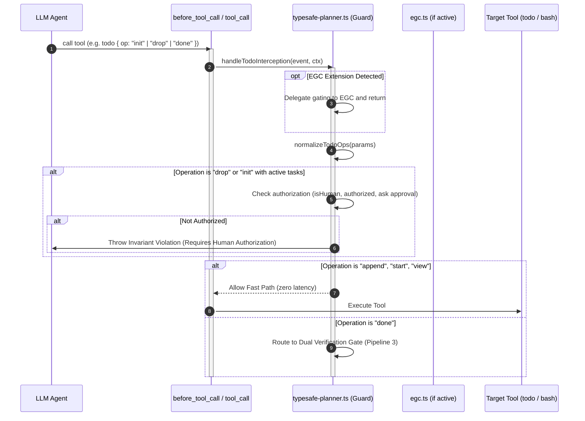
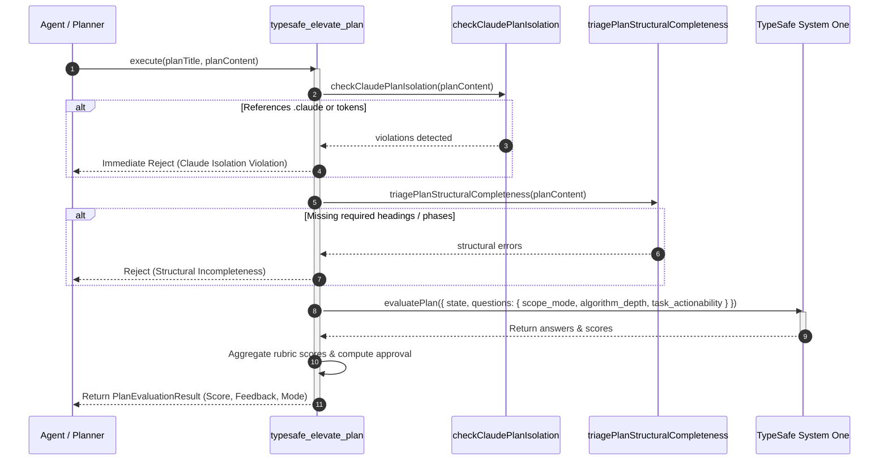
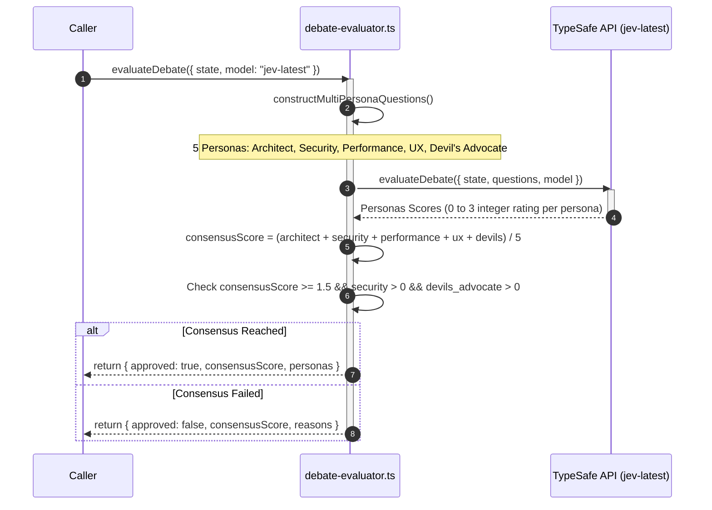
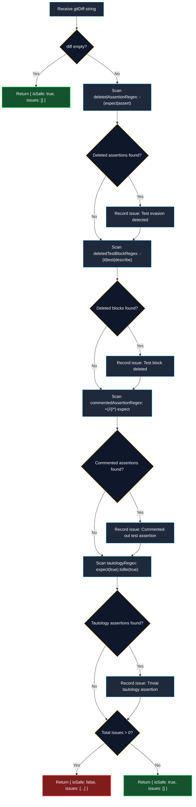
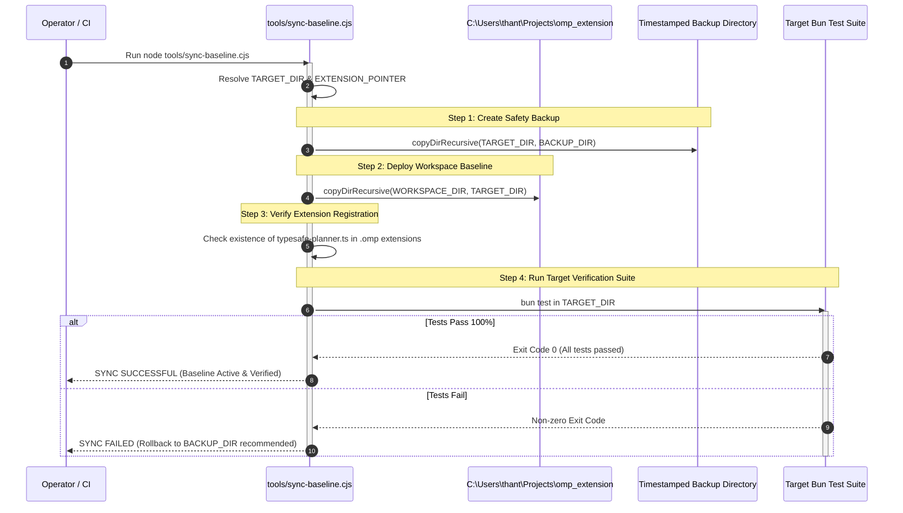

# TypeSafe Extension for oh-my-pi (omp): Source Code Logic Flow & Execution Pipelines

## 1. Overview of Execution Pipelines

This document provides end-to-end execution flows, trace algorithms, and sequence diagrams for the primary operational pipelines of the **omp-typesafe-extension**:

1. **Session Pre-Flight Health Probe & Transport Scoping Pipeline**
2. **Tool Call Interception & Privilege Guard Pipeline**
3. **Dual Verification Gate (`todo done`) Pipeline**
4. **Plan Quality Elevation & Rubric Scoring Pipeline**
5. **Multi-Persona Debate & Consensus Evaluation Pipeline**
6. **AST Diffing & Anti-Test-Evasion Verification Pipeline**
7. **Baseline Backup, Sync & Deployment Pipeline**

---

## 2. Sequence Diagram 1: Session Pre-Flight Health Probe (`session_start`)

```mermaid
sequenceDiagram
    autonumber
    participant OMP as OMP Harness
    participant TP as typesafe-planner.ts
    participant Probe as Transport Scope (fetch)
    participant Cloud as TypeSafe API
    participant UI as OMP Message Bus

    OMP->>TP: emit("session_start", ctx)
    activate TP
    TP->>TP: Check project allowlist & dev workspace
    
    rect rgb(20, 30, 45)
        note over TP,Probe: Isolated Transport Try-Catch Block
        TP->>Probe: execute fetch("https://api.typesafe.ai/v1/systemone", { timeout: 3500 })
        activate Probe
        Probe->>Cloud: HTTP GET /v1/systemone
        alt Network Failure / Timeout
            Cloud--xProbe: ECONNREFUSED / Timeout
            Probe-->>TP: catch(err) -> emit "API unreachable" warning
            TP->>UI: sendMessage({ customType: "warning", content: "..." })
        else Successful Connection
            Cloud-->>Probe: HTTP Response (200, 401, 403, or 404)
            deactivate Probe
        end
    end

    alt HTTP 200 OK
        TP->>UI: sendMessage("TypeSafe: ONLINE (jev-latest)").catch(...)
    else HTTP 401 / 403 Forbidden
        TP->>UI: sendMessage("TypeSafe error: Invalid or expired API key").catch(...)
    else HTTP 404 Not Found
        TP->>UI: sendMessage("TypeSafe error: System One endpoint not found").catch(...)
    end
    deactivate TP
```



### Detailed Logic Steps:
1. `session_start` event receives context `ctx`.
2. Resolves current project directory via `getProjectDir(ctx)`.
3. Verifies if TypeSafe is enabled for this project via `loadResolverModule()`.
4. Encloses network probe inside an isolated `try...catch` block:
   - Does **not** allow downstream IPC errors (`sendMessage`) to leak into the network catch handler.
   - Sets a 3,500ms timeout abort signal.
5. If `fetch()` throws, records network reachability failure and terminates probe early.
6. Evaluates HTTP response status outside the network `try/catch`.
7. All subsequent `pi.sendMessage` calls are appended with `.catch(() => {})` to protect lifecycle stability.

---

## 3. Sequence Diagram 2: Tool Call Interception & Privilege Guard



---

## 4. Sequence Diagram 3: Dual Verification Gate Execution (`todo done`)

```mermaid
sequenceDiagram
    autonumber
    participant Agent as Agent Loop
    participant Guard as typesafe-planner.ts
    participant Collector as evidence-collector.ts
    participant Micro as cook-expert-judge (Gate 1)
    participant Macro as cook-expert-judge (Gate 2)
    participant SystemOne as TypeSafe System One

    Agent->>Guard: todo { op: "done", task: "taskId" }
    activate Guard
    
    rect rgb(35, 20, 20)
        note over Guard: Stall Ratchet Pre-Check (Before Gates)
        Guard->>Guard: currentFailures = (failures || 0) + 1
        Guard->>Guard: consecutiveFailuresByTask.set(taskId, currentFailures)
        alt currentFailures >= 3
            Guard-->>Agent: HALT LOOP (Stall ratchet triggered after 3 failures)
        end
    end

    Guard->>Collector: collectTaskEvidence({ taskId, planPath, testCommand })
    activate Collector
    Collector->>Collector: Concurrent git status + git diff HEAD
    Collector->>Collector: Execute testCommand (if configured)
    Collector->>Collector: Extract plan criteria
    Collector-->>Guard: return TaskEvidenceResult
    deactivate Collector

    rect rgb(30, 40, 20)
        note over Guard,Micro: GATE 1: Deterministic Micro-Check (cook-expert-judge)
        Guard->>Micro: runTaskMicroCheck(evidence)
        activate Micro
        Micro->>Micro: Check .claude untouched & testExitCode == 0
        Micro->>Micro: analyzeDiffForTestEvasion(gitDiff) (diff regex check)
        Micro-->>Guard: return MicroCheckResult
        deactivate Micro
    end

    alt Gate 1 Failed
        Guard-->>Agent: Rejection Error (plain text message; counter remains incremented)
    else Gate 1 Passed
        rect rgb(20, 30, 50)
            note over Guard,Macro: GATE 2: Semantic Macro-Check (cook-expert-judge)
            Guard->>Macro: runPhaseMacroCheck(context, client)
            activate Macro
            Macro->>SystemOne: evaluateGate({ state, questions: meets_criteria, plan_drift })
            activate SystemOne
            SystemOne-->>Macro: return { meets_criteria, plan_drift }
            deactivate SystemOne
            Macro-->>Guard: return MacroCheckResult
            deactivate Macro
        end

        alt P(meets_criteria) < 0.80 OR plan_drift != "no_drift"
            Guard-->>Agent: Rejection Error (plain text with drift feedback; counter remains incremented)
        else Approved (Score >= 0.80 AND no_drift)
            Guard->>Guard: consecutiveFailuresByTask.delete(taskId)
            Guard-->>Agent: Task Completion Approved & Verified
        end
    end
    deactivate Guard
```

---

## 5. Sequence Diagram 4: Plan Quality Elevation (`typesafe_elevate_plan`)



---

## 6. Sequence Diagram 5: Multi-Persona Debate & Consensus



---

## 7. Sequence Diagram 6: AST Diffing & Anti-Test-Evasion (`analyzeDiffForTestEvasion`)



> **Implementation Note & False-Positive Limitation**:
> `ast-analyzer.ts` uses line-oriented regular expressions over the unified git diff text rather than parsing a full ECMAScript AST.
> As a consequence, legitimate test refactoring that modifies existing assertion lines produces a deletion hunk (e.g. `- expect(a).toBe(1)` / `+ expect(a).toBe(2)`) which trips `deletedAssertionRegex` and causes false-positive Gate 1 rejections.

---

## 8. Sequence Diagram 7: Baseline Backup, Sync & Deployment Pipeline


