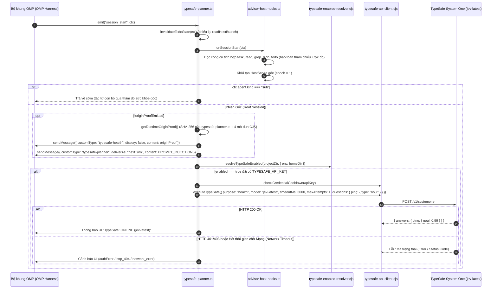
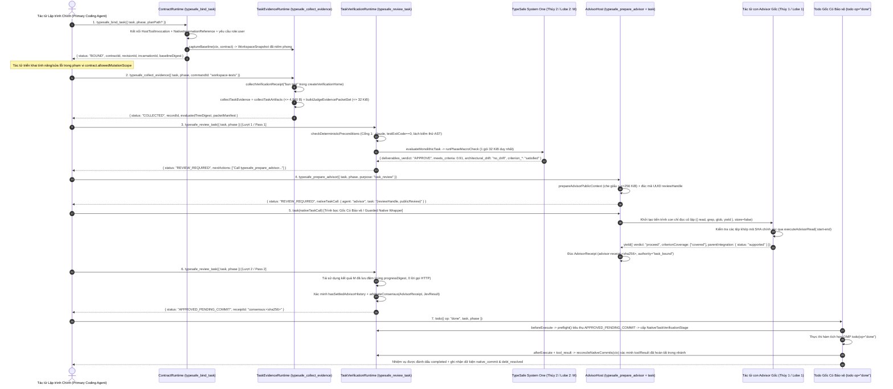
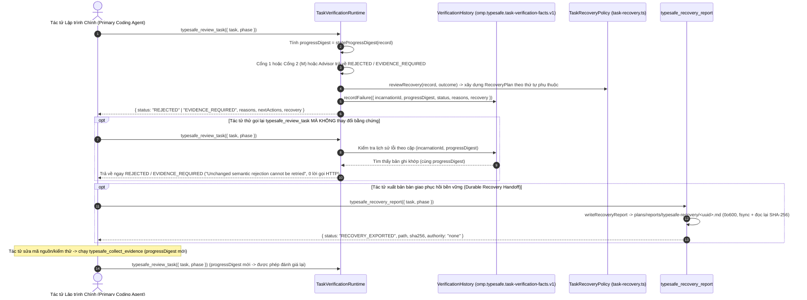
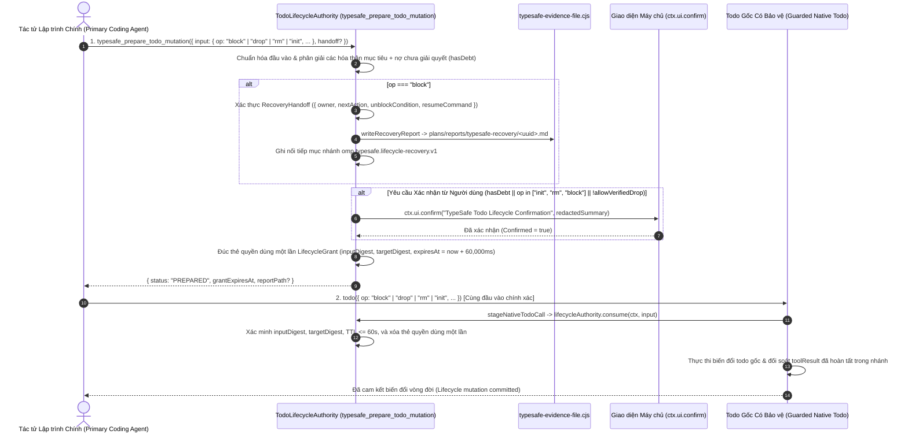

# Phần mở rộng TypeSafe cho oh-my-pi (omp): Luồng Logic Mã nguồn & Đường ống Thực thi (Source Code Logic Flow & Execution Pipelines)

Tài liệu này đặc tả 6 đường ống thực thi đầu-cuối (End-to-End Execution Pipelines) chính của `omp_extension` (`omp-typesafe-extension` v1.0.0) bằng các sơ đồ tuần tự Mermaid (Mermaid Sequence Diagrams) chi tiết và bảng truy vết từng bước ở cấp độ mã nguồn (Step-by-Step Code-Level Trace Tables):

1. **Khởi động Phiên, Bằng chứng Nguồn gốc `runtime-origin` & Thăm dò Sức khỏe Tiền trạm (`session_start` — Session Startup, `runtime-origin` Proof & Pre-Flight Health Probe)**
2. **Xác thực Nhiệm vụ theo Giai đoạn & Đồng thuận Lưỡng viện (`typesafe_bind_task` $\rightarrow$ `typesafe_collect_evidence` $\rightarrow$ `typesafe_review_task` $\rightarrow$ `typesafe_prepare_advisor` $\rightarrow$ `task` gốc $\rightarrow$ `typesafe_review_task` $\rightarrow$ `todo done` gốc — Staged Task Verification & Bicameral Consensus)**
3. **Phục hồi Sau Từ chối, Chốt chặn Chống Thử lại Cùng Bằng chứng & Vòng lặp Khắc phục Advisor (Rejection Recovery, Same-Evidence Retry Ratchet & Advisor Remediation Loop)**
4. **Chuẩn bị Biến đổi Vòng đời (`typesafe_prepare_todo_mutation` cho `block` / `drop` / `rm` / `init` — Lifecycle Mutation Preparation)**
5. **Đường ống Thực thi & Từ chối Hoàn thành Mục tiêu Thực chất — EGC (`src/egc.ts` — Earned Goal Completion Enforcement & Refusal Pipeline)**
6. **Đồng bộ Đường cơ sở Giao dịch (`sync-baseline.cjs`) & Xác minh Toàn cục Một chạm (`verify-omp-global.cjs` — Transactional Baseline Sync & One-Click Verification)**

---

## 1. Đường ống 1: Khởi động Phiên, Bằng chứng `runtime-origin` & Thăm dò Sức khỏe Tiền trạm (Pipeline 1: Session Startup, `runtime-origin` Proof & Pre-Flight Health Probe)

Khi OMP khởi động hoặc chuyển đổi phiên làm việc, `typesafe-planner.ts` và `src/advisor-host-hooks.ts` khởi tạo trạng thái phiên, bọc các công cụ gốc (`task`, `read`, `grep`, `glob`, `todo`), phát ra bằng chứng mật mã SHA-256 `runtime-origin`, và gửi gói thăm dò tới `https://api.typesafe.ai/v1/systemone` (`jev-latest`).



### Bảng Truy vết Từng bước — Đường ống 1 (Step-by-Step Trace Table)

| Bước (Step) | Mô-đun & Hàm (Module & Function) | Trạng thái Đầu vào (Input State) | Xác minh / Biến đổi (Verification / Transformation) | Đầu ra / Tác dụng phụ (Output / Side Effect) |
| ---: | :--- | :--- | :--- | :--- |
| 1 | `typesafe-planner.ts:invalidateTodoState` | `ctx` (`sessionManager`) | Tăng `generation` và `revision`, xóa `stagedCalls` và `taskBaselines` chưa cam kết, đồng thời phát lại `projectHostHistory(readHostBranch(ctx))`. | Bản chiếu nghĩa vụ trong bộ nhớ mới được gắn với lịch sử nhánh trực tiếp. |
| 2 | `src/advisor-host.ts:registerAdvisorHost` | Sổ đăng ký công cụ tích hợp (Builtin Tool Registry) | Bọc `task`, `read`, `grep`, `glob`, và `todo` trong khi vẫn bảo toàn chính xác định danh đối tượng `original.parameters`. | Các trình bọc thực thi gốc có bảo vệ bắt đầu hoạt động cho phiên. |
| 3 | `typesafe-planner.ts:getRuntimeOriginProof` | Các tệp trên đĩa trong `targetDir` | Băm SHA-256 tệp `typesafe-planner.ts` và `typesafe-{enabled-resolver,redact,api-client,policy-client}.cjs`. | Mục ẩn `typesafe-health` ghi nhận chính xác mã băm SHA-256 của các mô-đun đã nạp. |
| 4 | `src/typesafe-enabled-resolver.cjs:resolveTypeSafeEnabled` | `projectDir`, `TYPESAFE_API_KEY`, `~/.omp/agent/typesafe.json` | Kiểm tra sự hiện diện của khóa API, công tắc ngắt toàn cục (Global Kill-Switch), danh sách loại trừ hai chiều `excludeProjects`, và danh sách cho phép `projects` (`"*"` hoặc `gitRoot`). | `{ enabled: boolean, reason: string }`. |
| 5 | `typesafe-planner.ts` (Thăm dò tại `session_start`) | `purpose: "health"`, `timeoutMs: 3000` | Gửi câu hỏi `ping` (`noul`) 1 lần thử tới `jev-latest` bên trong khối `try/catch` truyền tải cô lập. | Phát thông báo trạng thái `ONLINE` hoặc cảnh báo không gây sập tiến trình. |

---

## 2. Đường ống 2: Xác thực Nhiệm vụ theo Giai đoạn & Đồng thuận Lưỡng viện — Luồng Thành công `done` (Pipeline 2: Staged Task Verification & Bicameral Consensus)

Toàn bộ công việc xác thực nặng nề diễn ra bên ngoài bước tiền trạm `todo` gốc qua 6 giai đoạn tường minh trước khi `todo(op="done")` gốc thực thi bước tiền trạm ngắn và cam kết vào nhánh.



### Bảng Truy vết Từng bước — Đường ống 2 (Step-by-Step Trace Table)

| Giai đoạn (Stage) | Công cụ / Điểm móc (Tool / Hook) | Các Hàm Chính Được Gọi (Key Functions Invoked) | Bất biến Được Thực thi (Invariants Enforced) | Trạng thái Kết quả (Resulting State) |
| ---: | :--- | :--- | :--- | :--- |
| 1 | `typesafe_bind_task` | `contracts.bind`, `evidenceRuntime.captureBaseline` | Hóa thân `creationKnown` duy nhất; lời nhắc `role:user` thực sự liền trước; hộp thoại `ui.confirm` nếu có `planPath` hoặc phạm vi `implementation`; ảnh chụp cơ sở đã niêm phong. | Ghi nối tiếp `omp.typesafe.contract.v1`; lưu đệm đường cơ sở. |
| 2 | `typesafe_collect_evidence` | `collectVerificationReceipt`, `collectTaskEvidence`, `collectTaskArtifacts`, `buildJudgeEvidencePacketSet` | Ảnh chụp `before`/`after`/`stable` bao quanh `bun test`; `changedFiles` nằm trong `allowedMutationScope`; tạo phẩm `<= 4,940 B`; gói dữ liệu `<= 32,768 B`. | Lưu đệm `TaskEvidenceRecord` (`status: "COLLECTED"`). |
| 3 | `typesafe_review_task` (Lượt 1) | `checkDeterministicPreconditions`, `evaluateMonolithicTask`, `runPhaseMacroCheck` | Chốt chặn cùng bằng chứng thông suốt; vượt qua Cổng 1; gói đơn bao phủ 100% tiêu chí; `createEvidenceStateValidator` xác minh mã băm thân HTTP; `M` phê duyệt. | Lưu đệm `TaskReviewState`; trả về `REVIEW_REQUIRED`. |
| 4 | `typesafe_prepare_advisor` | `prepareHostReview`, `prepareAdvisorPublicContext` | Che giấu gói qua `redactEvidenceState`; xác minh mọi `evidenceRefs` còn nguyên vẹn sau khi che giấu; giới hạn lời nhắc ở `262,144 B`; lưu thẻ `provisional`. | Trả về bộ mô tả lời gọi `task` gốc có thể thực thi. |
| 5 | `task` gốc (Advisor) | `executeHostTask`, `installAdvisorHostHooks`, `executeAdvisorRead`, `makeAdvisorReceipt` | Một mục Advisor duy nhất mỗi lần gọi; chặn tác tử con lồng nhau; công cụ con giới hạn trong `{read,grep,glob,yield}`; xác minh SHA-256 đĩa ở mỗi lần đọc; lược đồ đầu ra nghiêm ngặt. | Hoàn tất `AdvisorReceipt` (`authority: "task_bound"`) trong lịch sử nhánh. |
| 6 | `typesafe_review_task` (Lượt 2) | `performReview` (trúng bộ đệm / Cache Hit), `hasSettledAdvisorHistory`, `arbitrateConsensus` | Tái sử dụng kết quả `M` đã lưu đệm mà không gọi HTTP; xác nhận `toolResult` đã hoàn tất cho `task` Advisor; xác minh `M == "APPROVE"` và `Advisor == "proceed"` cùng mọi tiêu chí đạt `"covered"`. | `TaskReviewOutcome` = `APPROVED_PENDING_COMMIT` (`consensus:<sha256>`). |
| 7 | `todo(op="done")` gốc | `executeAdvisorNativeTodo`, `stageNativeTodoCall`, `reconcileNativeCommits` | Tiền trạm ngắn (`<= 22,000 ms`, 0 lời gọi HTTP/kiểm thử/tác tử con); xác minh `toolResult` đã hoàn tất của `typesafe_review_task`; chỉ cam kết sau khi `toolResult` của `todo` xuất hiện trong `readHostBranch(ctx)`. | Nhiệm vụ đạt `completed`; lưu `native_commit` và `debt_resolved` vào `omp.typesafe.task-verification-facts.v1`. |

---

## 3. Đường ống 3: Phục hồi Sau Từ chối, Chốt chặn Chống Thử lại Cùng Bằng chứng & Vòng lặp Khắc phục (Pipeline 3: Rejection Recovery, Same-Evidence Retry Ratchet & Remediation Loop)

Khi Cổng 1, Cổng 2 (`M`), hoặc Cố vấn độc lập (Independent Advisor) từ chối hoặc yêu cầu bổ sung bằng chứng, `TaskVerificationRuntime` ghi lại một dữ kiện thất bại bền vững được lập chỉ mục theo `progressDigest`, tổng hợp một `TaskRecoveryPlan` theo thứ tự phụ thuộc, và chặn mọi lần thử lại cùng bằng chứng (Same-Evidence Retries) cho đến khi bằng chứng mã nguồn, kiểm thử, hoặc hợp đồng bên dưới thực sự thay đổi.



### Bảng Truy vết Từng bước — Đường ống 3 (Step-by-Step Trace Table)

| Bước (Step) | Thành phần (Component) | Điều kiện / Kích hoạt (Condition / Trigger) | Hành vi Chốt chặn & Phục hồi (Ratchet & Recovery Behavior) |
| ---: | :--- | :--- | :--- |
| 1 | `src/task-verification-state.ts:stateProgressDigest` | Mọi lời gọi `typesafe_review_task` | Tính toán mã băm SHA-256 chuẩn tắc trên `contract.revisionId`, `evaluatedTreeDigest`, `verificationReceiptDigest`, các khoảng dòng tiêu chí đã chọn, và mã băm tạo phẩm bàn giao. |
| 2 | `src/task-verification-history.ts:recordFailure` | Kết quả là `REJECTED`, `EVIDENCE_REQUIRED`, hoặc `UNAVAILABLE` | Ghi nối tiếp một dữ kiện `review_failure` vào `omp.typesafe.task-verification-facts.v1` và gắn nợ `SemanticRejectionDebt` vào `incarnationId`. |
| 3 | `src/task-verification-runtime.ts:performReview` | Thử lại với `progressDigest` không đổi | • `REJECTED` $\rightarrow$ Chặn ngay lập tức (`"Unchanged semantic rejection cannot be retried"`).<br>• `EVIDENCE_REQUIRED` $\rightarrow$ Chặn ngay lập tức cho đến khi thu thập đủ bằng chứng còn thiếu.<br>• `UNAVAILABLE` $\rightarrow$ Chặn cho đến khi một quan sát `availability` sau lỗi được tiêu thụ (`history.consumeAvailability`). |
| 4 | `src/cook-expert-judge.ts:runPhaseMacroCheck` | `attemptCount >= 3` lần bị từ chối ngữ nghĩa | Leo thang kết quả xử lý lên `HUMAN_REQUIRED` để các vòng lặp tự trị không thể quay vòng vô tận. |

---

## 4. Đường ống 4: Chuẩn bị Biến đổi Vòng đời (`typesafe_prepare_todo_mutation` — Pipeline 4: Lifecycle Mutation Preparation)

Các phép biến đổi khác `done` (`block`, `drop`, `rm`, thay thế `init`) không được phép chạy tùy tiện ngay trong bước tiền trạm `todo` gốc; chúng bắt buộc phải được chuẩn bị trước thông qua `typesafe_prepare_todo_mutation` (`src/todo-lifecycle-authority.ts`).



---

## 5. Đường ống 5: Thực thi EGC, Sàng lọc Không Hộp cát & Luồng Từ chối (`src/egc.ts` — Pipeline 5: EGC Enforcement, Unsandboxed Screening & Refusal Flow)

Khi `.omp/egc.json` đang hoạt động và đã được khóa qua `/egc lock`, `src/egc.ts` thực thi xác minh trên cây làm việc tách rời (Detached-Worktree Verification), sàng lọc các lời gọi có `"unsandboxed": true`, và chặn việc hoàn thành sớm hoặc thoát phiên khi chưa đạt yêu cầu.

```mermaid
sequenceDiagram
    autonumber
    actor Agent as Tác tử Lập trình Chính (Primary Coding Agent)
    participant EGC as src/egc.ts (tool_call / tool_result / session_stop)
    participant Ledger as EgcNativeLedger (src/egc-native.ts)
    participant WT as Cây làm việc Git Tách rời (typesafe-child-env.cjs)
    participant JEV as src/egc-judge.ts (askJev)

    Agent->>EGC: tool_call (write / edit / bash / todo)
    alt Công cụ ghi hoặc todo có "unsandboxed": true (và mode !== "shadow")
        EGC-->>Agent: CHẶN / BLOCK ("EGC: unsandboxed execution is forbidden")
    else Gọi công cụ ghi tệp (File writer tool)
        EGC->>Ledger: ledger.revoke() (đặt lại các nhiệm vụ "ready" chưa hoàn thành về "unassessed")
    else todo(op="done", task)
        EGC->>EGC: Xác minh contract.lock khớp với mã băm SHA-256 của .omp/egc.json
        EGC->>Ledger: Phân giải nghĩa vụ mục tiêu (từ chối nếu targets.length > 1: mục tiêu nhập nhằng)
        EGC->>EGC: Kiểm tra chính sách uncontracted (yêu cầu lệnh verify trừ khi jev.mode==="enforce")
        EGC->>EGC: Đọc các tệp đã thay đổi/chưa theo dõi (ném EgcEvidenceRefusal nếu >131,072 B hoặc bị thiếu)
        EGC->>EGC: Kiểm tra tệp oracle được bảo vệ & các biểu thức chính quy chống lách luật HARD/SOFT
        EGC->>WT: git worktree add --detach -> sao chép tệp thay đổi -> chạy setup + verify + holdout
        alt Kiểm tra tất định đạt && jev.mode !== "off"
            EGC->>JEV: askJev (stub <= 0.5, tamper <= 0.3, impl_r1..N >= 0.5)
            JEV-->>EGC: Xác suất JEV (JEV probabilities)
        end
        alt Toàn bộ kiểm tra đều đạt
            EGC->>Ledger: Đánh dấu assessment="ready", ghi nhận passFp, dàn dựng lời gọi
            EGC-->>Agent: Cho phép todo(op="done") gốc -> cam kết khi có toolResult hoàn tất
        else Cổng kiểm tra thất bại (Gate fails)
            EGC->>Ledger: Cập nhật best/fp; tăng stalls nếu fp không đổi hoặc score >= best (khóa ở maxStalls=2)
            EGC-->>Agent: CHẶN / BLOCK kèm chi tiết lỗi & số lần đình trệ (stall count)
        end
    end
```

---

## 6. Đường ống 6: Đồng bộ Đường cơ sở Giao dịch & Xác minh Toàn cục Một chạm (Pipeline 6: Transactional Baseline Sync & One-Click Global Verification)

Bốn công cụ `tools/oneclick-omp.ps1`, `tools/verify-omp-global.cjs`, `tools/promote-omp-global.ps1`, và `tools/sync-baseline.cjs` tạo thành một đường ống thăng cấp và xác minh vòng kín (Closed-Loop Promotion and Verification Pipeline) trên cả 2 gốc được quản lý (`target` và `global_omp_agents`) theo Bản kê Schema v2 (Manifest Schema v2 độc lập hoàn toàn khỏi `.claude`).

```mermaid
sequenceDiagram
    autonumber
    actor Op as Người vận hành / Lập trình viên (Operator / Developer)
    participant One as oneclick-omp.ps1
    participant Ver as verify-omp-global.cjs
    participant Prom as promote-omp-global.ps1
    participant Sync as sync-baseline.cjs
    participant Home as createVerificationHome() (0o700)

    Op->>One: tools\oneclick-omp.bat [-Mode Auto] [-Live]
    One->>Ver: Bước 1: node tools/verify-omp-global.cjs --json
    Ver->>Ver: Kiểm tra [1] Loader Proxy [2] Đối xứng SHA-256 2 Gốc (Schema v2) [3] --dry-run [4] Resolver/Redactor [5] Sao lưu [6] Thăm dò Trực tiếp
    alt overallOk === true (0 thay đổi đang chờ)
        Ver-->>One: { overallOk: true }
        One-->>Op: "[OK] Workspace and OMP Global Runtime are already 100% synchronized." (Thoát 0)
    else Phát hiện độ lệch (Drift) hoặc có cờ -Mode ForceSync
        One->>Prom: Bước 2: promote-omp-global.ps1
        Prom->>Prom: Làm sạch env qua typesafe-child-env.cjs --policy-json & xác minh Loader Proxy 1 dòng
        Prom->>Sync: node tools/sync-baseline.cjs --dry-run (kiểm tra tiền trạm)
        Prom->>Sync: node tools/sync-baseline.cjs (triển khai giao dịch nguyên tử)
        activate Sync
        Sync->>Sync: Xây dựng kế hoạch trước khóa -> chiếm khóa .omp-sync-<hash>.lock (cờ wx)
        Sync->>Sync: Giai đoạn 2: Xây dựng lại kế hoạch sau khóa & khẳng định đồng nhất == kế hoạch trước khóa
        Sync->>Sync: Ghi tiền ảnh + .sync-journal.json (IN_PROGRESS) vào omp_extension_backup_<ISO>
        Sync->>Sync: Ghi nguyên tử (.tmp + fsync + rename) vào target và global_omp_agents + ghi .sync-manifest.json (Schema v2)
        Sync->>Home: Khởi chạy "bun test" bên trong thư mục HOME 0o700 cô lập
        alt bun test đạt (exitCode === 0)
            Home-->>Sync: ĐẠT (PASS)
            Sync->>Sync: Cập nhật trạng thái nhật ký = DEPLOYED_VERIFIED & nhả khóa
            Sync-->>Prom: Thoát 0 (Exit 0)
        else Bất kỳ lỗi ghi nào hoặc bun test thất bại
            Home--xSync: THẤT BẠI (FAIL)
            Sync->>Sync: Hoàn nguyên theo thứ tự ngược từ tiền ảnh sao lưu + khôi phục bảng kê -> status = RECOVERED
            Sync-->>Prom: Thoát 1 (Exit 1)
        end
        deactivate Sync
        One->>Ver: Bước 3: Chạy hậu kiểm node tools/verify-omp-global.cjs
        Ver-->>Op: Kết quả kiểm tra trên đĩa và HTTP nếu có; không chứng minh mã đã nạp hoặc native judge
    end
```

### Bảng Truy vết Từng bước — Đường ống 6 (Step-by-Step Trace Table)

| Pha (Phase) | Kịch bản & Hàm (Script & Function) | Kiểm tra Bảo mật / Toàn vẹn (Security / Integrity Check) | Xử lý Khi Thất bại (Failure Disposition) |
| ---: | :--- | :--- | :--- |
| 1 | `verify-omp-global.cjs:verifyPointer` | Khẳng định `~/.omp/agent/extensions/typesafe-planner.ts` là tệp thông thường, không có NUL/BOM, khớp chính xác dòng xuất 1 dòng sang `target`. | `pointer.ok = false` (kích hoạt lời nhắc mở Notepad có hướng dẫn trong `promote-omp-global.ps1`). |
| 2 | `verify-omp-global.cjs:verifyManifestParity` | So sánh mã băm SHA-256 của từng mục trong `target/.sync-manifest.json` với tệp nguồn không gian làm việc và tệp đích đã triển khai trên `target` và `global_omp_agents` (Schema v2). | `manifest.ok = false` kèm danh sách lệch `mismatches[]` chi tiết. |
| 3 | `sync-baseline.cjs:acquireLock` + Kiểm tra Sau Khóa | Chiếm khóa độc quyền `.omp-sync-<hash>.lock` và tính toán lại kế hoạch triển khai *sau khi* khóa, đối chiếu mã băm với kế hoạch trước khi khóa (Gia cố Giai đoạn 2). | Hủy bỏ ngay trước khi chạm vào các thư mục đích với lỗi `deployment plan changed after lock`. |
| 4 | `sync-baseline.cjs` Áp dụng Nguyên tử & Xác minh Cô lập | Lưu tiền ảnh vào `omp_extension_backup_<ISO>`, ghi nguyên tử các tệp, và chạy `bun test` bên trong `createVerificationHome()`. | Khôi phục toàn bộ tiền ảnh theo thứ tự nhật ký đảo ngược (`RECOVERED`, thoát `1`) hoặc giữ lại khóa nếu quá trình hoàn nguyên gặp lỗi (`RECOVERY_INCOMPLETE`, thoát `2`). |
