# Phần mở rộng TypeSafe cho oh-my-pi (omp): Mô hình hóa Mã nguồn & Kiến trúc (Source Code Modeling & Architecture)

Tài liệu này định nghĩa các mô hình kiến trúc đa tầng (Multi-Level Architectural Models) của `omp_extension` (`omp-typesafe-extension` v1.0.0) từ bối cảnh hệ thống từ trên xuống (C4 Cấp độ 1–4 / C4 Levels 1–4) đến đồ thị phụ thuộc mô-đun theo chiều ngang/chiều dọc (Horizontal/Vertical Dependency Graphs) và 6 máy trạng thái hình thức (Formal State Machines).

---

## 1. Mô hình Kiến trúc C4 (C4 Architectural Model)

### 1.1 Cấp độ 1: Sơ đồ Bối cảnh Hệ thống (Level 1: System Context Diagram)

Tại ranh giới bối cảnh hệ thống (System Context Boundary), `omp_extension` đóng vai trò trung gian điều phối giữa người vận hành/lập trình viên (Human Developer), bộ khung tác tử lập trình **oh-my-pi (OMP)**, mô hình ngôn ngữ lớn lập trình chính (Primary Coding LLM), tác tử con **Cố vấn Độc lập Chỉ Đọc (Independent Read-Only Native Advisor Subagent)**, môi trường Hệ điều hành/Git/Kiểm thử cục bộ, 3 gốc triển khai được quản lý (3 Managed Deployment Roots), và dịch vụ đám mây từ xa **TypeSafe System One API** (`jev-latest`).

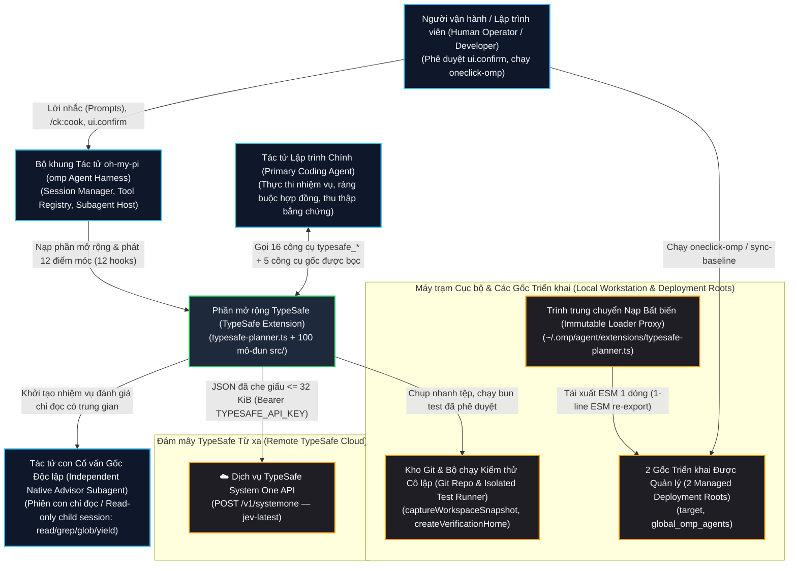

---

### 1.2 Cấp độ 2: Sơ đồ Thùng chứa (Level 2: Container Diagram)

Bên trong tiến trình thời gian chạy (Runtime Process) và chuỗi công cụ vận hành (Operational Toolchain), `omp_extension` được tổ chức thành **4 thùng chứa thực thi (Execution Containers)**:
1. **Máy chủ Phần mở rộng Nội tiến trình OMP (OMP In-Process Extension Host — `typesafe-planner.ts`)**: Chặn bắt các điểm móc vòng đời (Lifecycle Hooks), bọc các công cụ gốc (`task`, `read`, `grep`, `glob`, `todo`), và cung cấp 16 công cụ `typesafe_*`.
2. **9 Miền Hệ thống con TypeScript/CJS Lõi (9 Core Subsystem Domains — `src/**`)**: Triển khai hợp đồng, ảnh chụp nhanh, gói bằng chứng 32 KiB, Đồng thuận Lưỡng viện (`M` + Advisor), thẩm phán chạy ngầm `H` (Shadow `H` Judge), và EGC.
3. **Thời gian chạy CJS Không phụ thuộc Dùng chung (Shared Zero-Dependency CJS Runtime — `src/typesafe-*.cjs`)**: Được đồng triển khai vào `target` và `~/.claude/` để phân giải bật/tắt (Opt-In Resolution), che giấu bí mật (Redaction), lưới chính sách (Policy Lattices), cô lập môi trường tiến trình con (Child Env Isolation), và đọc/ghi tệp chống TOCTOU.
4. **Giao diện CLI Vận hành & Đánh giá Bắt cặp (Operational & Paired Evaluation CLI — `tools/**`)**: Đồng bộ giao dịch ngoài băng tần (`sync-baseline.cjs`), bộ xác minh toàn cục 6 lớp (`verify-omp-global.cjs`), trình bọc một chạm (`oneclick-omp.ps1`), và đánh giá bắt cặp `M`/`H` (`jev-paired-eval.ts`).

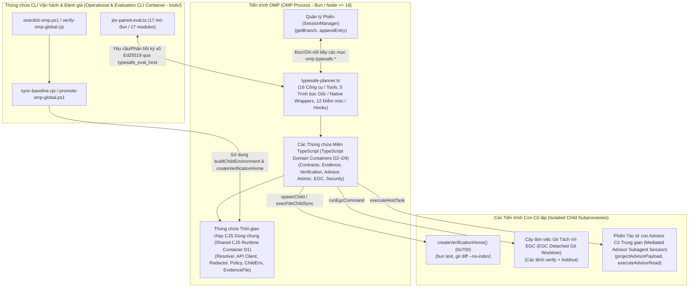

---

### 1.3 Cấp độ 3: Sơ đồ Thành phần — 9 Miền Hệ thống con trong `src/` (Level 3: Component Diagram)

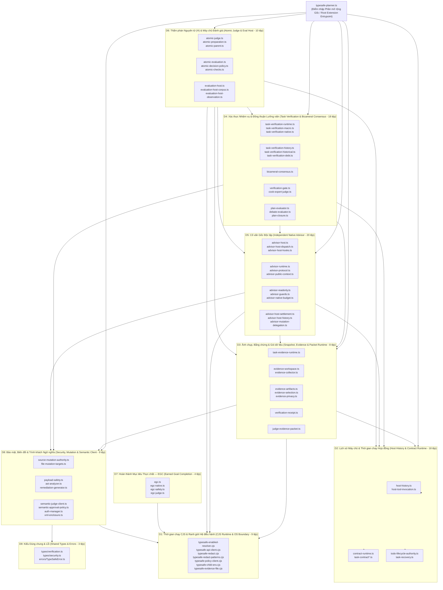

---

### 1.4 Cấp độ 4: Các Thực thể Dữ liệu Cốt lõi & Lược đồ Nhật ký Nhánh Phiên (Level 4: Core Data Entities & Session Branch Journal Schema)

Sơ đồ lớp (Class Diagram) dưới đây mô hình hóa 6 cấu trúc dữ liệu thời gian chạy chính (`TaskContract`, `WorkspaceSnapshot`, `JudgeEvidencePacket`, `AdvisorReceipt`, `TaskReviewOutcome`, `SyncManifest`) và 7 lược đồ mục nhánh phiên tùy chỉnh (`omp.typesafe.*`) được lưu trữ bền vững trong `ctx.sessionManager.getBranch()`.

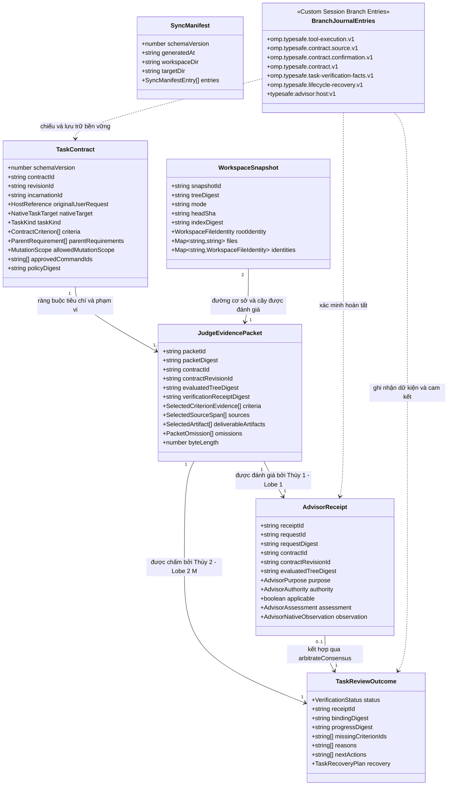

---

## 2. Đồ thị Phụ thuộc theo Chiều dọc & Chiều ngang (Vertical & Horizontal Dependency Graphs)

### 2.1 Phân cấp Lời gọi theo Chiều dọc — Thẩm quyền Điều khiển & Dữ liệu Từ trên xuống (Vertical Call Hierarchy)

Phân cấp chiều dọc thực thi nghiêm ngặt thẩm quyền gọi từ trên xuống (Strict Downward Call Authority): các tầng trên điều phối luồng công việc, các tầng giữa tính toán trạng thái miền và bằng chứng, còn tầng dưới cùng thực thi các nguyên hàm hệ điều hành/mạng được cô lập tác dụng phụ (Side-Effect-Isolated OS/Network Primitives).

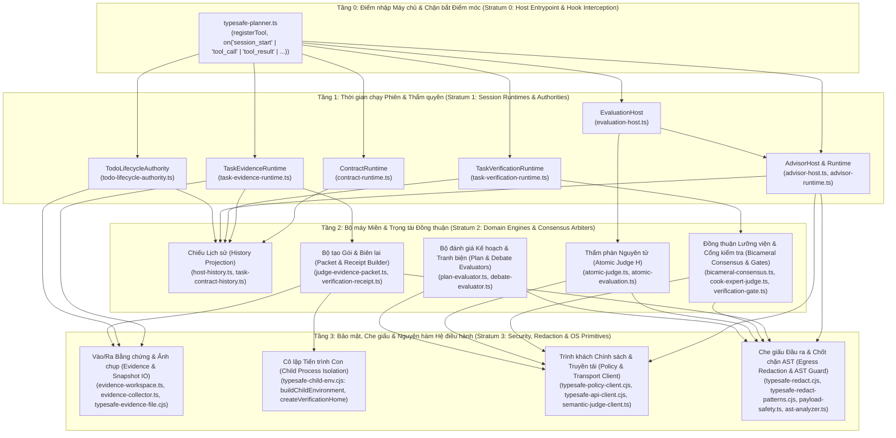

### 2.2 Đồ thị Tương tác Ngang hàng — Cộng tác Luồng công việc Liên miền (Horizontal Peer Interaction Graph)

Xuyên suốt vòng đời của một nhiệm vụ theo giai đoạn, 5 thời gian chạy ngang hàng (Peer Runtimes) cộng tác theo chiều ngang thông qua các mã băm SHA-256 bất biến và các mục nhánh đã hoàn tất (Settled Branch Entries) thay vì chia sẻ trạng thái khả biến:

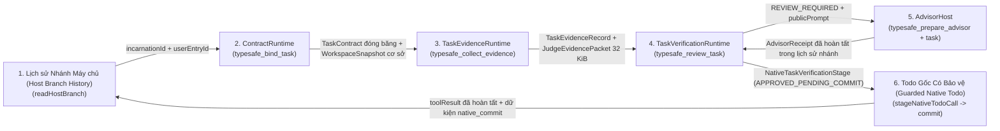

---

## 3. Các Mô hình Máy Trạng thái Hình thức (Formal State Machine Models — 6 Máy Trạng thái Cốt lõi)

### 3.1 Máy Trạng thái 1: Vòng đời Hóa thân Nhiệm vụ & Hợp đồng (Task Incarnation & Contract Lifecycle — `src/task-contract-history.ts`, `src/contract-runtime.ts`)

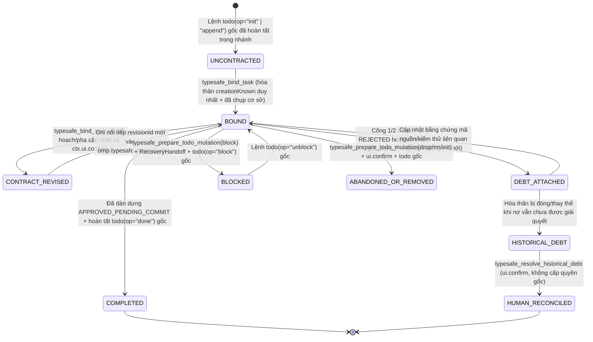

---

### 3.2 Máy Trạng thái 2: Đánh giá theo Giai đoạn & Đồng thuận Lưỡng viện (Staged Review & Bicameral Consensus — `src/task-verification-runtime.ts`, `src/bicameral-consensus.ts`)

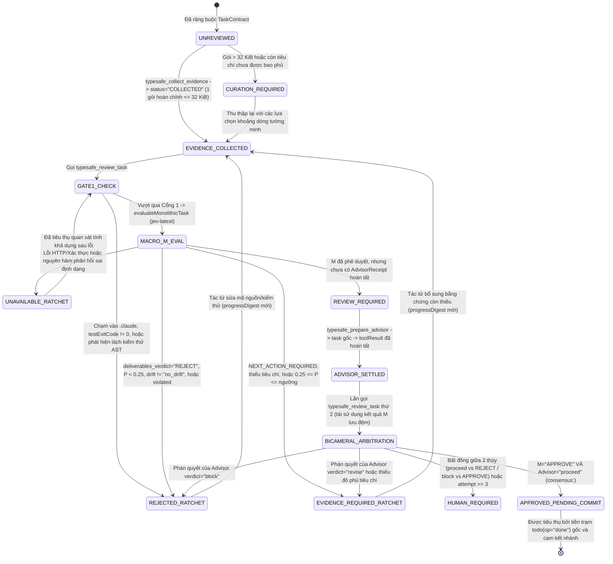

---

### 3.3 Máy Trạng thái 3: Điều phối & Trung gian Tác tử con Advisor Gốc (Native Advisor Subagent Dispatch & Mediation — `src/advisor-runtime.ts`, `src/advisor-host-*.ts`)

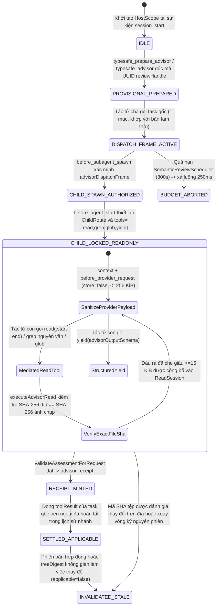

---

### 3.4 Máy Trạng thái 4: Nghĩa vụ EGC & Vòng đời Cổng Cây làm việc (EGC Obligation & Worktree Gate Lifecycle — `src/egc.ts`, `src/egc-native.ts`)

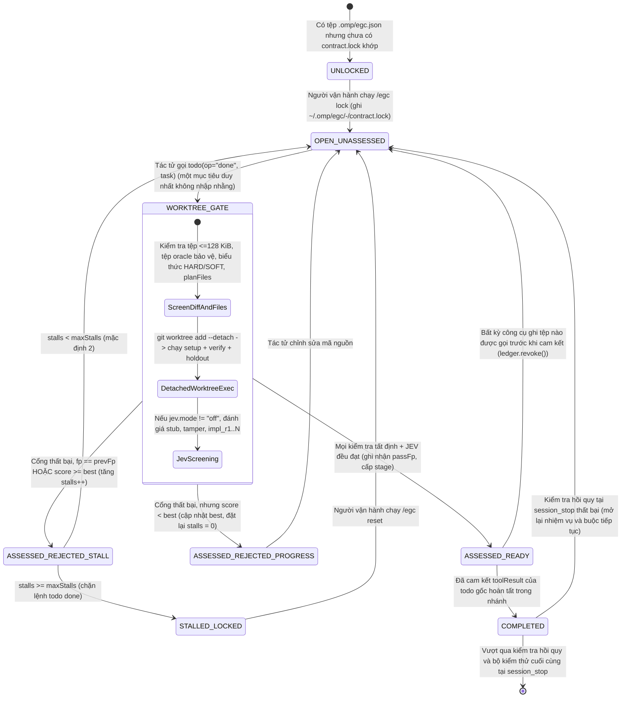

---

### 3.5 Máy Trạng thái 5: Thời gian hồi Thông tin xác thực, Thử lại & Quản lý Xác thực (Credential Cooldown, Retry & Auth Manager — `src/typesafe-api-client.cjs`, `src/auth-manager.ts`)

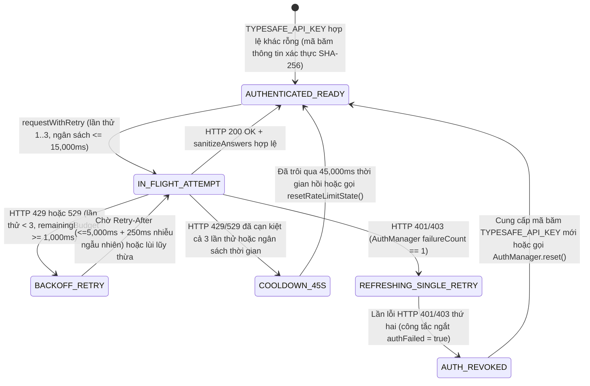

---

### 3.6 Máy Trạng thái 6: Đồng bộ Đường cơ sở Giao dịch (Transactional Baseline Sync — `tools/sync-baseline.cjs`)

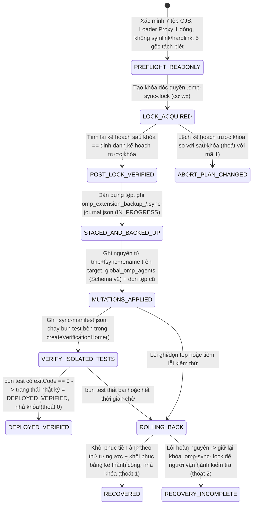
