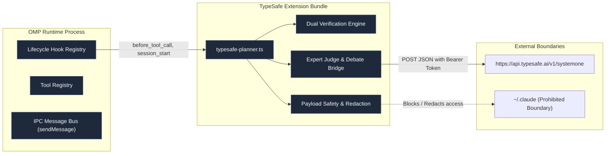
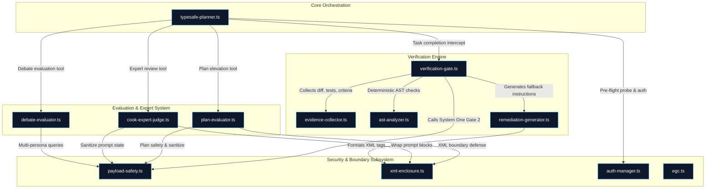
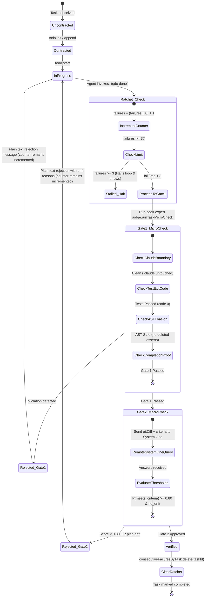
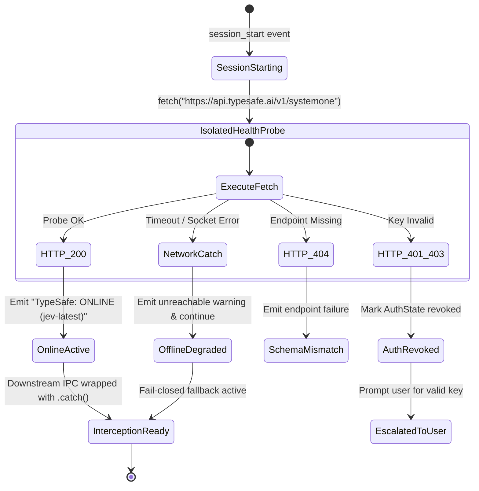
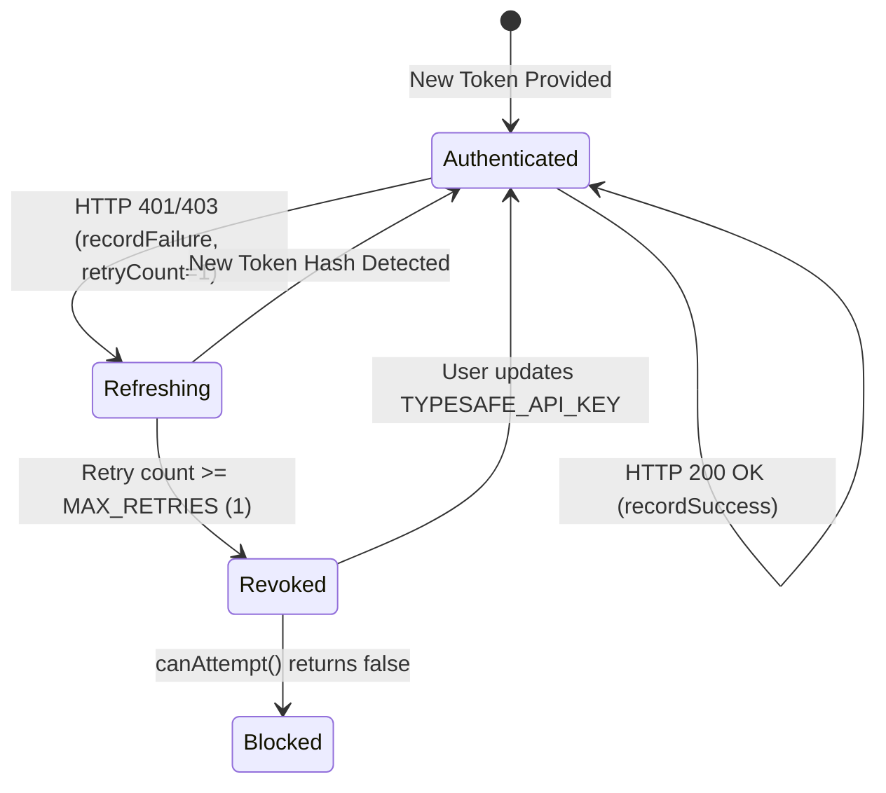
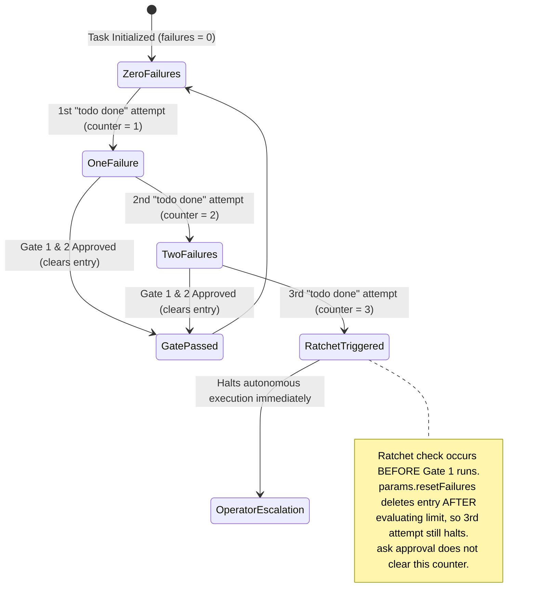
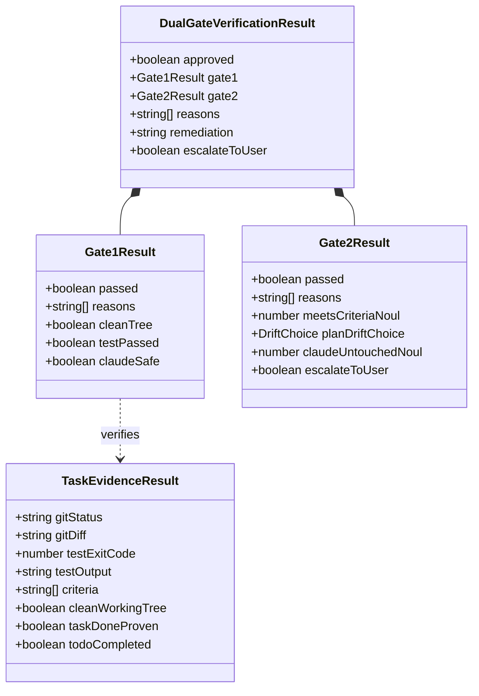

# TypeSafe Extension for oh-my-pi (omp): Source Code Modeling & Architecture

## 1. C4 Architectural Model

### Level 1: System Context Diagram

```mermaid
graph TD
    User["👤 Human Operator / Developer"] -->|Executes tasks & commands| OMP["🖥️ oh-my-pi (omp) Agent Harness"]
    OMP -->|Drives autonomous coding loop| LLM["🤖 LLM Subagent (e.g. Gemini 3.8 Flash)"]
    OMP -->|Loads extension lifecycle| Extension["🛡️ TypeSafe Extension (typesafe-planner.ts)"]
    
    subgraph Local Workstation Environment
        Extension -->|Gathers OS ground truth| Git["📦 Git Repository & Test Runner (Bun)"]
        Extension -->|Enforces code & AST boundaries| FS["📂 Local Filesystem (Workspace & Plans)"]
    end

    subgraph Remote TypeSafe Cloud
        Extension -->|Dual Verification Gate (Gate 2)| SystemOne["☁️ TypeSafe System One API (jev-latest)"]
    end

    classDef core fill:#1e293b,stroke:#38bdf8,stroke-width:2px,color:#f8fafc;
    classDef ext fill:#0f172a,stroke:#22c55e,stroke-width:2px,color:#f8fafc;
    classDef extSys fill:#1e1e24,stroke:#f59e0b,stroke-width:2px,color:#f8fafc;
    class OMP,LLM core;
    class Extension ext;
    class SystemOne,Git,FS extSys;
```

---

### Level 2: Container Diagram



---

### Level 3: Component Diagram (`src/` Architecture)



---

## 2. Component Dependency Graph

```
typesafe-planner.ts
 ├── src/plan-evaluator.ts
 │    ├── src/payload-safety.ts
 │    └── src/xml-enclosure.ts
 ├── src/verification-gate.ts
 │    ├── src/evidence-collector.ts
 │    ├── src/payload-safety.ts
 │    ├── src/ast-analyzer.ts
 │    │    └── src/types/security.ts
 │    ├── src/remediation-generator.ts
 │    │    └── src/types/security.ts
 │    └── src/auth-manager.ts
 │         └── src/types/security.ts
 ├── src/cook-expert-judge.ts
 │    ├── src/payload-safety.ts
 │    ├── src/xml-enclosure.ts
 │    └── src/verification-gate.ts
 ├── src/debate-evaluator.ts
 │    └── src/payload-safety.ts
 └── src/evidence-collector.ts
```

---

## 3. State Machine Models

### 3.1. Task Lifecycle & Dual Verification Gate State Machine



---

### 3.2. Session Lifecycle & Pre-Flight Health Probe



---

### 3.3. Authentication Key Dynamic Recovery State Machine



---

### 3.4. Stall Ratchet State Machine



---

## 4. Domain & Data Contract Models

### 4.1. Gate Verification Entities


