# Phần mở rộng TypeSafe cho oh-my-pi (omp): Đặc tả Kỹ thuật Mã nguồn (Source Code Specification)

Tài liệu này cung cấp đặc tả kỹ thuật chi tiết theo từng mô-đun (Module-by-Module Technical Specification) cho `omp_extension` (`omp-typesafe-extension` v1.0.0), bao quát `typesafe-planner.ts` (toàn bộ 16 công cụ đã đăng ký, 5 trình bọc công cụ gốc có bảo vệ — Guarded Native Wrappers, và 12 điểm móc vòng đời — Lifecycle Hooks), toàn bộ 100 mô-đun trong `src/` thuộc 9 miền chức năng, và toàn bộ 26 công cụ vận hành/đánh giá trong `tools/`.

---

## 1. Điểm nhập Phần mở rộng Gốc (`typesafe-planner.ts` — `2,317 LOC`)

### 1.1 Nguồn gốc Thời gian chạy, Khởi tạo & Bọc Công cụ (Runtime Origin, Initialization & Tool Wrapping)
- **Xuất Chính (Primary Export)**: `export default function typesafePlannerExtension(pi: ExtensionAPI): void`
- **Giao diện Được Xuất (Exported Interfaces)**: `PendingRemediation`, `CanonicalTodoTask`, `CanonicalTodoPhase`, `StagedTodoCall`, `ExtensionAPI`
- **Bằng chứng Nguồn gốc Thời gian chạy (`getRuntimeOriginProof`)**:
  - Băm SHA-256 tệp `typesafe-planner.ts` và 4 mô-đun CJS cốt lõi (`src/typesafe-enabled-resolver.cjs`, `src/typesafe-redact.cjs`, `src/typesafe-api-client.cjs`, `src/typesafe-policy-client.cjs`).
  - Phát ra một thông điệp tùy chỉnh ẩn `typesafe-health` tại sự kiện `session_start` đầu tiên của tiến trình để công tác điều tra số phiên (Session Forensics) và `tools/verify-omp-global.cjs` có thể xác minh chính xác nguồn gốc mã nguồn đang được nạp.
- **Trình bọc Thực thi Công cụ Phổ quát (Universal Tool Execution Wrapper — `registerTool`, dòng `1199–1203`)**:
  1. Nhân bản và đóng băng sâu (Deep-Freeze) các tham số đầu vào `params` thông qua `freezeContractValue(structuredClone(params))`.
  2. Thực thi bên trong `invocations.run(ctx, definition.name, callId, owned, ...)` (`src/host-tool-invocation.ts`), ghi nhận một mục nhánh `omp.typesafe.tool-execution.v1` mang mã dùng một lần (Nonce-Bearing Branch Entry).
  3. Đưa mọi tải trọng trả về công khai đi qua `publicResult(value)` (`redactEvidenceState(value, { apiKey, homeDirs: [homeDir] })`).

---

### 1.2 Đặc tả 16 Công cụ `typesafe_*` Đã Đăng ký & 5 Trình bọc Công cụ Gốc Có Bảo vệ

| # | Tên Công cụ (Tool Name) | Cấp phê duyệt (Approval) | Vị trí Mã nguồn (Location) | Lược đồ Tham số (`zod` Parameter Schema) | Hợp đồng Thực thi & Kết quả Trả về Chi tiết (Detailed Execution & Return Contract) |
| ---: | :--- | :---: | :--- | :--- | :--- |
| 1 | `typesafe_bind_task` | `"exec"` | `typesafe-planner.ts:1323-1336` | `{ task, phase?, planPath?, phaseHeading?, originalUserEntryId? }` | Gọi `contracts.bind(ctx, callId, params)` để đóng băng hóa thân `todo` Core đang hoạt động và yêu cầu `role:user` thực sự liền trước. Chụp đường cơ sở trước thay đổi (Pre-Change Baseline) qua `evidenceRuntime.captureBaseline(ctx, outcome.contract)`. Trả về `BOUND` (`contractId`, `revisionId`, `incarnationId`, `baselineDigest`) hoặc `EVIDENCE_REQUIRED` / `HUMAN_REQUIRED`. |
| 2 | `typesafe_collect_evidence` | `"exec"` | `typesafe-planner.ts:1337-1352` | `{ task, phase?, commandId?, artifactPaths?, selections? }` | Gọi `evidenceRuntime.collect(ctx, callId, params)`. Chạy lệnh `commandId` đã phê duyệt tùy chọn (`workspace-tests` $\rightarrow$ `bun test`), chụp nhanh nguồn/khác biệt không gian làm việc, khám phá tạo phẩm bàn giao (`<= 4,940 B`), và xây dựng `JudgeEvidencePacketSetResult` (`<= 32,768 B`). Trả về `COLLECTED`, `CURATION_REQUIRED`, `EVIDENCE_REQUIRED`, hoặc `UNAVAILABLE`. |
| 3 | `typesafe_retrieve_evidence` | `"read"` | `typesafe-planner.ts:1353-1369` | `{ task, phase?, path, fullFileDigest, spans? }` | Gọi `evidenceRuntime.retrieve(ctx, params)`. Trích xuất chính xác các khoảng dòng đánh số từ 1 đã lưu đệm khớp với `fullFileDigest`. Thực thi trần đầu ra UTF-8 đã che giấu cứng ở mức `16,384` byte; trả về `EVIDENCE_REQUIRED` nếu vượt ngưỡng mà không cắt xén ngầm (No Silent Clipping). |
| 4 | `typesafe_review_task` | `"exec"` | `typesafe-planner.ts:1370-1378` | `{ task, phase? }` | Gọi `verificationRuntime.review(ctx, callId, params)`. Kiểm tra chốt chặn chống thử lại cùng bằng chứng (`progressDigest`), chạy Cổng 1 (`checkDeterministicPreconditions`) và Cổng 2 (`evaluateMonolithicTask` $\rightarrow$ `runPhaseMacroCheck`). Trả về `REVIEW_REQUIRED` khi `M` phê duyệt nhưng chưa có `AdvisorReceipt` hoàn tất. Ở lần gọi thứ hai sau khi Advisor hoàn tất, tái sử dụng kết quả `M` đã lưu đệm và phân xử đồng thuận (`APPROVED_PENDING_COMMIT`, `REJECTED`, `EVIDENCE_REQUIRED`, `HUMAN_REQUIRED`, `UNAVAILABLE`). |
| 5 | `typesafe_prepare_advisor` | `"read"` | `src/advisor-host.ts:87-95` | `{ decision?, question?, role?, options?, constraints?, context?, task?, phase?, purpose? }` | Chuẩn bị một lượt đánh giá Advisor do máy chủ sở hữu (`purpose` $\in$ `["task_review", "parent_review", "consultation"]`) từ hợp đồng đã ràng buộc và gói bằng chứng công khai (`prepareHostReview`), đúc mã UUID `reviewHandle` và trả về một bộ mô tả lời gọi `task` gốc có thể thực thi (Executable Native Task Call Descriptor). |
| 6 | `typesafe_advisor` | `"read"` | `src/advisor-host.ts:96-103` | `{ decision?, question?, role?, options?, constraints?, context?, task?, phase? }` | Chuẩn bị một lượt tham vấn Cố vấn gốc chỉ đọc độc lập (`purpose: "consultation"`) hoặc trả về biên lai bất biến `AdvisorReceipt` đã hoàn tất sau khi tác tử cha thực thi lệnh `task` gốc được trả về. |
| 7 | `typesafe_prepare_todo_mutation` | `"exec"` | `typesafe-planner.ts:1379-1388` | `{ input, handoff? }` | Gọi `lifecycleAuthority.prepare(ctx, params)` cho các phép biến đổi khác `done` (`block`, `drop`, `rm`, `init`). Yêu cầu `RecoveryHandoff` (`owner`, `nextAction`, `unblockCondition`, `resumeCommand`) đối với `block`, bật hộp thoại `ctx.ui.confirm` khi có nợ/thu hẹp phạm vi, ghi báo cáo phục hồi, và cấp quyền `LifecycleGrant` dùng một lần có hạn 60 giây. |
| 8 | `typesafe_resolve_historical_debt` | `"exec"` | `typesafe-planner.ts:1389-1397` | `{ incarnationId, reason }` | Gọi `verificationRuntime.resolveHistoricalDebt(ctx, callId, params)` cho các hóa thân đã hoàn thành/bị hủy bỏ/bị xóa. Yêu cầu `ctx.ui.confirm` và ghi nhận `HUMAN_RECONCILED_NO_NATIVE_APPROVAL` (không bao giờ cấp quyền hoàn thành gốc). |
| 9 | `typesafe_recovery_report` | `"exec"` | `typesafe-planner.ts:1398-1410` | `{ task, phase? }` | Xuất trạng thái phục hồi đã ràng buộc qua `writeRecoveryReport(projectDir, ...)` ra tệp `plans/reports/typesafe-recovery/<uuid>.md` (`0o600`), trả về `{ status: "RECOVERY_EXPORTED", path, sha256, recovery, authority: "none" }`. |
| 10 | `typesafe_eval_host` | `"exec"` | `typesafe-planner.ts:1411-1427` | `{ action: "identity" \| "authorize" \| "prepare" \| "collect", run?, protocolPath?, requestId? }` | Cầu nối hữu hạn nội phiên tới `evaluationHost` (`src/evaluation-host.ts`) phục vụ đo kiểm chạy ngầm bắt cặp `M`/`H`. Yêu cầu `ctx.ui.confirm` tại bước `authorize` và ký số các biên lai bằng cặp khóa Ed25519 theo từng phiên. |
| 11 | `typesafe_judge` | mặc định (`default`) | `typesafe-planner.ts:2096-2123` | `{ state, questions, model? }` | Điều phối các câu hỏi có cấu trúc `noul`, `choice`, và `score` tới TypeSafe System One dưới mục đích `"judge"`, thực thi lưới định tuyến chỉ thắt chặt (Tighten-Only Routing Lattice: `baseline: "review"`, `lattice: ["auto", "review", "block"]`). |
| 12 | `typesafe_rerank` | mặc định (`default`) | `typesafe-planner.ts:2125-2173` | `{ query, candidates: string[] }` | Đánh giá các câu hỏi `score` `candidate_0..N` (thang điểm `0..2`) dưới mục đích `"rerank"` và trả về danh sách ứng viên được sắp xếp giảm dần theo điểm chuẩn hóa (Normalized Score). |
| 13 | `typesafe_evaluate_multi` | mặc định (`default`) | `typesafe-planner.ts:2175-2210` | `{ state, dimensions: string[] }` | Từ chối các định danh chiều trùng lặp hoặc số lượng `> 128`, xây dựng một câu hỏi `noul` cho mỗi chiều dưới mục đích `"multi"`, và trả về xác suất theo từng chiều. |
| 14 | `typesafe_elevate_plan` | mặc định (`default`) | `typesafe-planner.ts:2212-2242` | `{ planTitle, planContent, userPrompt?, attempt? }` | Chạy `evaluatePlanDraft` (`purpose: "plan"`). Nếu được duyệt, nối tiếp sang `runMultiPersonaDebate` (`purpose: "debate"`). Yêu cầu cả hai cùng đạt; luôn đặt `advisoryOnly: true`. |
| 15 | `typesafe_verify_completion` | `"read"` | `typesafe-planner.ts:2244-2260` | `{ taskId, phase? }` | Kiểm tra chỉ mang tính tham vấn (Advisory-Only Inspection) đối với bằng chứng nhiệm vụ đã thu thập qua `verifyTaskCompletion` (`purpose: "native_done"`). Không thực thi lệnh và không cấp thẩm quyền gốc (`advisoryOnly: true`). |
| 16 | `typesafe_expert_review` | mặc định (`default`) | `typesafe-planner.ts:2263-2306` | `{ role: "scope_arbiter" \| "drift_guard" \| "risk_security_triage", context, criteria? }` | Điều phối tới `evaluateScopeArbiter`, `evaluateDriftGuard`, hoặc `evaluateRiskSecurityTriage` (`src/cook-expert-judge.ts`) dưới mục đích `"expert"` (`advisoryOnly: true`). |
| 17* | **5 Trình bọc Công cụ Gốc Có Bảo vệ** (`task`, `read`, `grep`, `glob`, `todo`) | `"exec"` / `"read"` | `src/advisor-host.ts:50-73` | Tham chiếu chính xác lược đồ tích hợp `original.parameters` | Được cài đặt tại `session_start`. `task` định tuyến qua `executeHostTask`; `todo` định tuyến qua `executeAdvisorNativeTodo` (`stageNativeTodoCall` $\rightarrow$ `observeNativeResult`); `read`/`grep`/`glob` bên trong phiên con Advisor định tuyến qua `executeReadOnlyTool`. |

---

### 1.3 Các Điểm móc Vòng đời (Lifecycle Hooks) Được Đăng ký trong `typesafe-planner.ts` & `src/advisor-host-hooks.ts`

```mermaid
flowchart LR
    subgraph SessionHooks["Điểm móc Phiên & Lượt (Session & Turn Hooks)"]
        H1["input"]
        H2["session_start"]
        H3["session_switch / branch / tree"]
        H4["turn_end / agent_end"]
        H5["session_shutdown"]
    end

    subgraph ToolAndAgentHooks["Điểm móc Công cụ, Tác tử con & Nhà cung cấp (Tool, Subagent & Provider Hooks)"]
        H6["before_subagent_spawn"]
        H7["before_agent_start"]
        H8["context"]
        H9["before_provider_request"]
        H10["tool_call"]
        H11["tool_result"]
        H12["message_end"]
    end

    H1 -->|"captureCookInput"| H2
    H2 -->|"Bọc công cụ gốc + bằng chứng nguồn gốc + thăm dò sức khỏe"| H7
    H6 -->|"Xác minh advisorDispatchFrame / ủy quyền quyền biến đổi"| H7
    H7 -->|"Khóa tác tử con Advisor hoặc gắn phạm vi biến đổi"| H8
    H8 -->|"publicAdvisorMessages"| H9
    H9 -->|"projectAdvisorPayload (store=false)"| H10
    H10 -->|"Chốt chặn todo / write / edit / ask / bash"| H11
    H11 -->|"reconcileNativeCommits trong nhánh"| H12
    H12 --> H4 --> H3 --> H5
```

---

## 2. Miền 1: Thời gian chạy CJS & Mô-đun Ranh giới Hệ điều hành (`src/typesafe-*.cjs`)

### 2.1 `src/typesafe-enabled-resolver.cjs` (`558 LOC`)
- **Xuất Chính (Exports)**:
  - `resolveTypeSafeEnabled(projectDir, { env = process.env, homeDir = os.homedir() } = {}) -> { enabled: boolean, reason: 'no-key' | 'global-config-unreadable' | 'global-kill-switch' | 'global-excluded' | 'global-exclude-invalid' | 'global-allowlist' | 'default-off' }`
  - `findGitRoot(dir)`, `readGlobalConfig(configPath)`, `typeSafeConfigWarnings(config)`, `isValidExcludeEntry(entry, platform)`, `isValidExcludeList(list, platform)`, `globalKillSwitchTriggered(globalConfig)`
- **Quy tắc Ưu tiên & Bảo mật (Precedence & Security Rules)**:
  1. Thiếu hoặc rỗng `TYPESAFE_API_KEY` $\rightarrow$ trả về `{ enabled: false, reason: "no-key" }` mà không chạm vào đĩa.
  2. Chỉ đọc tệp `<homeDir>/.omp/agent/typesafe.json` (không bao giờ đọc cấu hình cục bộ trong thư mục dự án).
  3. JSON không đọc được hoặc không phải đối tượng $\rightarrow$ `"global-config-unreadable"`.
  4. `typesafe === false` hoặc `typesafe.enabled !== true` $\rightarrow$ `"global-kill-switch"`.
  5. `typesafe.excludeProjects`: xác thực từng mục (`isValidExcludeEntry`), tính toán các ứng viên đường dẫn từ vựng (Lexical) + `realpath` cho `projectDir`, `gitRoot`, `gitdir`/`commondir` của cây làm việc (Worktree), và gốc kho lưu trữ chủ sở hữu, đồng thời chặn ngay nếu bất kỳ ứng viên nào trùng, nằm trong, hoặc là tổ tiên của một mục loại trừ (`"global-excluded"`).
  6. `typesafe.projects`: kích hoạt (`"global-allowlist"`) nếu `gitRoot` khớp với một mục hoặc có ký tự đại diện `"*"`.

### 2.2 `src/typesafe-api-client.cjs` (`734 LOC`)
- **Xuất Chính (Exports)**: `validateInput`, `validateQuestionCount`, `prepareRequest`, `redactEvidenceState`, `runPreparedValidation`, `sanitizeAnswers`, `getChoiceOptions`, `judgeTypeSafe`, `requestWithRetry`, `checkCredentialCooldown`, `cancelBodyBounded`, `resetRateLimitState`, `parseRetryAfter`, `RETRY_POLICY`.
- **Đặc tả Kỹ thuật (Specifications)**:
  - Gọi `preparePayload(..., { maxBytes: Infinity })` trong `prepareRequest` để bằng chứng không bao giờ bị cắt xén ngầm (Never Silently Truncated), sau đó thực thi giới hạn `bodyBytes <= 32768` (`MAX_BODY_BYTES`) và kiểm tra `question_identity_changed`.
  - `projectPublicMessages` lọc `state.messages` chỉ giữ các vai trò `assistant`/`tool`/`toolResult`, lược bỏ các khối suy nghĩ (Thinking Blocks), thông điệp người dùng, nhắc nhở hệ thống, và đối số công cụ thô (chỉ giữ lại `{ i }`).
  - `RETRY_POLICY`: Chỉ thử lại các mã HTTP `429` và `529` (`maxAttempts: 3`, `totalBudgetMs: 15000`, `backoffBaseMs: 500`, `backoffCapMs: 4000`, `maxRetryAfterMs: 5000`, `retryAfterJitterMs: 250`, `minUsefulAttemptMs: 1000`, `cooldownMs: 45000`).

### 2.3 `src/typesafe-redact.cjs` (`375 LOC`) & `src/typesafe-redact-patterns.cjs` (`676 LOC`)
- **Xuất Chính (Exports)**: `redactString`, `redactPayload`, `capBytes`, `preparePayload`, `detectSecret`, `sensitiveKeyKind`, `sensitiveCamelKeyKind`.
- **Quy tắc Che giấu (Redaction Rules)**:
  - **Khóa Khứ hồi (Round-Trip Keys)**: Từ chối bí mật nằm trong `Object.keys(payload.questions)` hoặc các khóa tùy chọn `choice` với lỗi `payload_rejected_secret_in_key`.
  - **Giai đoạn 5 — `TELEMETRY_COUNT_KEYS`**: Miễn trừ `input_tokens`, `output_tokens`, `total_tokens`, `prompt_tokens`, `completion_tokens`, `cache_creation_input_tokens`, và `cache_read_input_tokens` khỏi cơ chế che giấu khóa anh em `*token*` khi giá trị là một số nguyên an toàn không âm (`Number.isSafeInteger(v) && v >= 0`).
  - **Mẫu Chuỗi (String Patterns)**: Làm sạch giá trị `apiKey` nguyên văn, khóa PEM, JWT, `sk-*`, `gh[pousr]_*`, `github_pat_*`, `glpat-*`, `xox[abprs]-*`, `AIza*`, `AKIA*`/`ASIA*`, `npm_*`, `Basic`/`Bearer`, thông tin người dùng URL, phép gán khóa-giá trị (KV Assignments), đường dẫn thư mục người dùng, và các chuỗi entropy cao (`> 3.0` bit/ký tự với hệ hex / `> 4.3` bit/ký tự với chuỗi hỗn hợp).

### 2.4 `src/typesafe-policy-client.cjs` (`277 LOC`)
- **Xuất Chính (Exports)**: `checkPolicy`, `judgeWithPolicy`, `resolveTrustedToolPolicy`, `resolveToolPolicies`, `validateRoutingQuestions`, `validateRoutingAnswers`, `createSemanticReviewScheduler`.
- **Đặc tả Kỹ thuật (Specifications)**:
  - Đóng băng các bản chụp `TrustedToolPolicy` qua 14 mục đích (`judge`, `rerank`, `multi`, `plan`, `debate`, `advisory`, `expert`, `advisor`, `native_done`, `native_drop`, `decision`, `health`, `egc`, `evaluation`) vào một `WeakSet` riêng tư của mô-đun.
  - Thực thi `REVIEW_LIMITS` (`maxPackets: 128`, `maxDispatches: 384`, `deadlineMs: 300000`, `maxActive: 1`, `maxQueued: 1`).

### 2.5 `src/typesafe-child-env.cjs` (`114 LOC`) & `src/typesafe-evidence-file.cjs` (`194 LOC`)
- **`typesafe-child-env.cjs`**:
  - Xuất `buildChildEnvironment`, `spawnChild`, `spawnChildSync`, `execFileChildSync`, `execChildSync`, `createVerificationHome`, `ChildEnvironmentError`.
  - Hỗ trợ chế độ CLI `--policy-json <purpose>` phục vụ các kịch bản PowerShell.
  - Bộ Chặn Giá trị Bí mật Giai đoạn 4 (Phase 4 Secret Value Blocker): Quét toàn bộ biến môi trường nguồn tìm `NAMED_SECRETS` và mẫu `/(?:_API_KEY|_SECRET|_TOKEN|_PASSWORD)$/i` (`>= 12` ký tự) và ném lỗi `UNSAFE_ALLOWED_VALUE` nếu bất kỳ chuỗi con bí mật nào rò rỉ vào biến hệ điều hành được phép.
- **`typesafe-evidence-file.cjs`**:
  - Xuất `readWorkspaceFile`, `listWorkspaceFiles`, `writeRecoveryReport`, `WorkspaceFileError`.
  - Gia cố Một Đường dẫn Thực & Chống TOCTOU Giai đoạn 1 (Phase 1 Single-Realpath & TOCTOU Hardening): Xác minh BigInt `lstatSync`/`fstatSync` (`dev`, `ino`, `nlink === 1n`, `size`, `mtimeNs`, `ctimeNs`, `birthtimeNs`) qua mọi phân đoạn thư mục tổ tiên (`inspectDirectoryChain`) và bộ mô tả tệp (`O_RDONLY | O_NOFOLLOW | O_NONBLOCK`), từ chối liên kết tượng trưng (`symlink`), điểm nối Windows (`junction`), liên kết cứng (`hardlink`), và các phân đoạn đường dẫn `.claude`.

---

## 3. Miền 2: Lịch sử Máy chủ, Lời gọi Công cụ & Thời gian chạy Hợp đồng (`18 Tệp`)

| Mô-đun (Module) | LOC | Biểu tượng Được Xuất (Exported Symbols) | Đặc tả & Bất biến (Specification & Invariants) |
| :--- | ---: | :--- | :--- |
| `src/host-history.ts` | 218 | `readHostBranch`, `findProjectToolCall`, `validateProjectToolInvocationJoin`, `contractHostHistoryDigest`, `validateUserReference`, `nativeCreationReferences`, `validateSourceSpan`, `projectHostHistory`, `userRequestText`, `publicHostText`, `originalTodoInput` | Đọc `ctx.sessionManager.getBranch()` (`<= 100,000` mục), xác thực chuỗi `parentId`, lọc bỏ lời nhắc người dùng mẫu (`Continue`, `Retry`), và kết nối bằng chứng `HostToolInvocation` với các dòng `toolCall` + `toolResult` đã hoàn tất. |
| `src/host-tool-invocation.ts` | 68 | `createHostToolInvocationRuntime`, `validateHostToolInvocation`, `HOST_TOOL_INVOCATION_ENTRY` | Bọc hàm gọi lại `execute` của công cụ trong `AsyncLocalStorage` và ghi nối tiếp `omp.typesafe.tool-execution.v1` (`nonce`, `sessionId`, `callId`, `toolName`, `inputDigest`). |
| `src/contract-runtime.ts` | 233 | `createContractRuntime`, `ContractRuntime` | Triển khai `typesafe_bind_task`: kết hợp lịch sử nhánh, quan sát `/ck:cook`, và phê duyệt `ctx.ui.confirm` để đúc kết hoặc sửa đổi các bản ghi `TaskContract`. |
| `src/task-contract.ts` | 138 | `createTaskContract`, `reviseTaskContract`, `taskIncarnationId`, `contractRevisionDigest`, `validHostReference` | Đúc các `TaskContract` đóng băng sâu (`contractId = canonicalDigest({ incarnationId, originalUserRequest })`, `revisionId = contractRevisionDigest(body)`). |
| `src/task-contract-source.ts` | 117 | `contractDigest`, `canonicalDigest`, `nativeTaskSourceUri`, `parseContractCriteria`, `freezeContractValue` | Băm SHA-256 sắp xếp khóa đệ quy, bộ phân tích tiêu chí pha Markdown (từ chối các nhãn giữ chỗ `TODO`/`TBD`/`...`), và đóng băng đệ quy `Object.freeze`. |
| `src/task-contract-history.ts` | 203 | `projectContractHistory`, `createContractHistoryRecord`, `CONTRACT_HISTORY_CUSTOM_TYPE` | Chiếu `ContractHistoryProjection` (`nativePhases`, `nativeStateReliable`, `incarnations`, `contracts`, `contractRevisions`, `debt`) từ các mục nhánh (`omp.typesafe.contract.v1`). |
| `src/task-contract-native.ts` | 119 | `captureNativeCall`, `applyNativeResult` | Khớp các `toolCall` `todo` của trợ lý với `toolResult` đã hoàn tất và đúc `incarnationId = canonicalDigest({ creation, target })` với `creationKnown: true` khi gọi `init`/`append`. |
| `src/task-contract-input.ts` | 66 | `normalizeNativeTodoInput`, `nativeTodoInputDigest`, `readNativeTodoOperation` | Chuẩn hóa đối số `todo` trên đường truyền (`init`, `append`, `view`, `done`, `drop`, `rm`, `start`, `block`, `unblock`), lược bỏ trường truyền tải `i` và từ chối `ops`. |
| `src/task-contract-transition.ts` | 162 | `parseNativeTodoPhases`, `normalizeNativeTodoPointer`, `validateNativeTodoTransition` | Mô phỏng chính xác các phép chuyển đổi trạng thái `todo` của OMP v18.12.3 và cơ chế tự động dịch chuyển con trỏ `normalizeInProgressTask`. |
| `src/task-contract-integrity.ts` | 70 | `assertContractIntegrity` | Bộ xác thực ranh giới kiểm tra các mã băm, dải `SourceSpan`, và tính duy nhất của tiêu chí. |
| `src/task-contract-review.ts` | 79 | `validateReviewBinding`, `ReviewBinding` | Xác thực mã băm `ReviewBinding` qua các chế độ `task_review`, `parent_review`, `consultation`, và `shadow`. |
| `src/task-contract-cook-input.ts` | 101 | `captureCookInput`, `readCookInputObservations` | Thu giữ lời nhắc `/ck:cook --auto <path>` tại điểm móc `input` trước khi mở rộng kỹ năng và chụp nhanh các tệp kế hoạch/pha được tham chiếu. |
| `src/task-contract-runtime-journal.ts` | 219 | `readContractRuntimeJournal` | Đọc và xác thực các mục nhánh `omp.typesafe.contract.source.v1` và `omp.typesafe.contract.confirmation.v1`. |
| `src/task-contract-runtime-provenance.ts` | 67 | `activeContractBindingCall`, `originalHostTaskRequest`, `currentNativeContractTarget` | Phân giải lời gọi `typesafe_bind_task` đang hoạt động duy nhất, lời nhắc người dùng thực sự liền trước, và mục tiêu `todo` gốc hiện tại. |
| `src/task-contract-runtime-sources.ts` | 133 | `resolveParentSource`, `explicitCookPath`, `snapshotCookDocuments`, `parentSourceCriteriaIdentity`, `trustedNativeTaskKind`, `approvedContractScope`, `workspaceSourcePath` | Phân giải tệp kế hoạch/pha trong không gian làm việc, phân loại `taskKind` (`implementation`, `review`, `research`, `operations`), và tính toán `allowedMutationScope`. |
| `src/task-contract-runtime-types.ts` | 136 | `CONTRACT_SOURCE_CUSTOM_TYPE`, `CONTRACT_CONFIRMATION_CUSTOM_TYPE`, `CONTRACT_BIND_TOOL_NAME` | Định nghĩa kiểu và hằng số lược đồ cho việc ràng buộc hợp đồng và bản ghi xác nhận. |
| `src/todo-lifecycle-authority.ts` | 142 | `createTodoLifecycleAuthority`, `LIFECYCLE_RECOVERY_ENTRY` | Triển khai `typesafe_prepare_todo_mutation`: xác thực `RecoveryHandoff`, bật hộp thoại `ctx.ui.confirm`, ghi báo cáo phục hồi, và đúc thẻ quyền `LifecycleGrant` dùng một lần có hạn 60 giây. |
| `src/task-recovery.ts` | 133 | `createTaskRecoveryPolicy`, `recoveryProgressDigest`, `recordRecoveryAttempt`, `createRejectionDebt` | Xây dựng các đối tượng `RecoveryPlan` theo thứ tự phụ thuộc và tính toán mã băm tiến độ phục hồi ở cấp độ tiêu chí. |

---

## 4. Miền 3: Ảnh chụp Không gian làm việc, Bằng chứng & Thời gian chạy Gói dữ liệu (`8 Tệp`)

| Mô-đun (Module) | LOC | Biểu tượng Được Xuất (Exported Symbols) | Đặc tả & Trần Ngân sách Byte (Specification & Byte Ceilings) |
| :--- | ---: | :--- | :--- |
| `src/task-evidence-runtime.ts` | 248 | `createTaskEvidenceRuntime`, `TaskEvidenceRuntime` | Thời gian chạy theo phạm vi phiên đứng sau `typesafe_collect_evidence` và `typesafe_retrieve_evidence` (trần `16,384 B`), thu giữ đường cơ sở, và xác thực độ mới. |
| `src/evidence-workspace.ts` | 207 | `captureWorkspaceSnapshot`, `taskSnapshotDiff`, `snapshotBytes`, `isHostSnapshot`, `releaseWorkspaceSnapshot`, `SNAPSHOT_LIMITS` | `SNAPSHOT_LIMITS`: `4,000` tệp, `1 MiB`/tệp, `8 MiB`/ảnh chụp, tổng lưu giữ `32 MiB` (`FinalizationRegistry`), bản vá khác biệt `1 MiB`. Giai đoạn 1 lưu đệm các lần đọc tệp không đổi theo định danh `stat`. `taskSnapshotDiff` so sánh tiền ảnh cơ sở và tiền ảnh đánh giá qua `git diff --no-index`. |
| `src/evidence-collector.ts` | 305 | `collectTaskEvidence`, `executeTestCommand`, `extractCriteriaFromPlan`, `assertPathIsClaudeSafe`, `touchesClaudeBoundary`, `DELIVERABLE_ARTIFACT_MAX_BYTES` (`4940`), `isHostTaskEvidence` | Thực thi cô lập `.claude` và kiểm tra `allowedMutationScope` / `AuthorizedMutationReceipt`. Giai đoạn 2 sử dụng lệnh hủy tiến trình bất đồng bộ không chặn `taskkill /t /f` trên Windows với bộ hẹn giờ dự phòng 5 giây. |
| `src/evidence-artifacts.ts` | 80 | `collectTaskArtifacts`, `taskArtifactAssociation`, `referencedWorkspacePaths` | Khám phá và xếp hạng các tạo phẩm bàn giao nhiệm vụ từ đường dẫn không gian làm việc và tệp thay đổi, đóng gói tham lam trong giới hạn `4,940` byte. |
| `src/evidence-selection.ts` | 73 | `retrieveEvidenceSource`, `selectCriterionEvidence` | Trích xuất các khoảng dòng đánh số từ 1 tăng chặt, không chồng lấn và ghi nhận tường minh các phần lược bỏ `out_of_packet_scope`. |
| `src/evidence-privacy.ts` | 10 | `isPrivateEvidencePath` | Chặn các đường dẫn riêng tư/thông tin xác thực (`.env*`, `.claude/**`, `*.pem`, `*.key`, `*secret*`, `*credential*`) trước khi trộn bằng chứng. |
| `src/verification-receipt.ts` | 144 | `collectVerificationReceipt`, `validateVerificationReceipt`, `issueAuthorizedMutationReceipt`, `validateAuthorizedMutation` | Chạy các lệnh đã phê duyệt (`workspace-tests` $\rightarrow$ `bun test`, `timeoutMs <= 300,000 ms`) trong `createVerificationHome()` giữa các ảnh chụp `before`, `after`, và `stable`. |
| `src/judge-evidence-packet.ts` | 228 | `buildJudgeEvidencePacket`, `buildJudgeEvidencePacketSet`, `finalizeEvidencePacket`, `createEvidenceStateValidator` | Lắp ráp các `JudgeEvidencePacket` giới hạn `32,768` byte và `EvidencePacketSetManifest`, xác minh độ bao phủ 100% tiêu chí/tạo phẩm cùng tính đồng nhất mã băm thân gói truyền tải. |

---

## 5. Miền 4: Xác thực Nhiệm vụ, Đồng thuận Lưỡng viện & Bộ Đánh giá (`18 Tệp`)

| Mô-đun (Module) | LOC | Biểu tượng Được Xuất (Exported Symbols) | Đặc tả & Quy tắc Xác thực (Specification & Verification Rules) |
| :--- | ---: | :--- | :--- |
| `src/task-verification-runtime.ts` | 194 | `createTaskVerificationRuntime`, `TaskVerificationRuntime` | Điều phối `typesafe_review_task`, chốt chặn thử lại cùng bằng chứng (`REJECTED`/`EVIDENCE_REQUIRED`/`UNAVAILABLE`), kết hợp `M` lưu đệm + Advisor, và tiền trạm/cam kết `done` gốc. |
| `src/task-verification-types.ts` | 99 | `TaskReviewState`, `TaskReviewOutcome`, `NativeTaskVerificationStage`, `TaskRecoveryPlan` | Các giao diện cốt lõi cho xác thực nhiệm vụ theo giai đoạn, kết quả đánh giá, và giai đoạn cam kết gốc. |
| `src/task-verification-state.ts` | 71 | `taskReviewSnapshot`, `taskRecoveryProgress`, `stateProgressDigest`, `reviewRecovery` | Tính toán `stateProgressDigest` trên các nguồn tiêu chí đã chọn, tạo phẩm, biên lai tích hợp, và kết quả lệnh xác minh. |
| `src/task-verification-native.ts` | 105 | `createNativeStageRegistry` | Sổ đăng ký dàn dựng theo định danh đối tượng quản lý `APPROVED_PENDING_COMMIT` $\rightarrow$ `observe` $\rightarrow$ `commit` nhánh đã hoàn tất. |
| `src/task-verification-advisor.ts` | 177 | `createTaskAdvisorServices` | Kết nối `TaskVerificationRuntime` với `AdvisorHostServices` để chuẩn bị và xác thực các yêu cầu `task_review`, `parent_review`, và `consultation`. |
| `src/task-verification-macro.ts` | 50 | `evaluateMonolithicTask` | Thực thi độ bao phủ toàn bộ tiêu chí trong một gói duy nhất (`ONE_COMPLETE_ORIGINAL_TASK_PACKET_REQUIRED`) và điều phối `runPhaseMacroCheck`. |
| `src/task-verification-history.ts` | 202 | `createVerificationHistory`, `VERIFICATION_HISTORY_ENTRY` | Lưu trữ bền vững và truy vấn các mục nhánh `omp.typesafe.task-verification-facts.v1` cho lỗi đánh giá, quan sát tính khả dụng, kế hoạch phục hồi, và cam kết gốc. |
| `src/task-verification-historical.ts` | 74 | `createHistoricalDebtResolver` | Triển khai `typesafe_resolve_historical_debt` với `ctx.ui.confirm` cho các hóa thân đã hoàn thành/bị hủy bỏ/bị xóa (`HUMAN_RECONCILED_NO_NATIVE_APPROVAL`). |
| `src/task-verification-debt.ts` & `-debt-types.ts` | 106 | `historicalDebtCatalogue`, `HistoricalDebtRecord`, `HistoricalDebtCatalogue`, `HistoricalDebtResolutionFact` | Tổng hợp các khoản nợ chưa giải quyết gồm `semantic_rejection`, `contract_debt`, và `unclassified_native_failure` cho các hóa thân đã đóng. |
| `src/task-verification-invocation.ts` & `-plan.ts` | 48 | `verificationInvocationSource`, `planPhaseReviewDigest`, `usablePlanPhaseReview` | Phân giải bằng chứng thực thi `HostToolInvocation` và xác thực mã băm cho các lượt đánh giá pha kế hoạch ở chế độ tham vấn. |
| `src/bicameral-consensus.ts` | 978 | `evaluateAdvisorIntent`, `arbitrateConsensus`, `evaluateBicameralDoneConsensus`, `runBicameralDoneCheck`, `runBicameralDropCheck`, `runBicameralDecisionCheck`, `formatCkAdvisorReport` | Phân xử Thùy 1 (Lobe 1: `AdvisorReceipt` với `authority === "task_bound"`) + Thùy 2 (Lobe 2: `JevResult`). Leo thang bất đồng giữa hai thùy (`proceed` so với `REJECT` hoặc `block` so với `APPROVE`) hoặc tiêu chí/tích hợp cha chưa được bao phủ lên `HUMAN_REQUIRED`. |
| `src/verification-gate.ts` | 241 | `checkDeterministicPreconditions`, `constructGateQuestions`, `verifyTaskCompletion`, `resolveAutoApprovalThreshold`, `generateFallbackRemediation` | Các kiểm tra tất định Cổng 1 (cô lập `.claude`, `testExitCode`, `analyzeDiffForTestEvasion`, các phần lược bỏ bắt buộc) và bộ đánh giá Cổng 2 mang tính tham vấn `typesafe_verify_completion`. |
| `src/cook-expert-judge.ts` | 645 | `runTaskMicroCheck`, `runPhaseMacroCheck`, `runTodoDropCheck`, `evaluateScopeArbiter`, `evaluateDriftGuard`, `evaluateRiskSecurityTriage`, `generateVerificationScorecard` | Đánh giá `deliverables_verdict`, `meets_criteria` (mặc định `> 0.50`; `0.25..ngưỡng` $\rightarrow$ `EVIDENCE_REQUIRED`; `< 0.25` $\rightarrow$ `REJECTED`), `architectural_drift === "no_drift"`, `scope_mode !== "REDUCTION"`, và từng tiêu chí `criterion_0..N` (`satisfied` \| `violated` \| `evidence_missing`). Leo thang lên `HUMAN_REQUIRED` khi `attemptCount >= 3`. |
| `src/plan-evaluator.ts` | 367 | `evaluatePlanDraft`, `checkClaudePlanIsolation`, `preEvaluationTriage` | Phân loại kế hoạch (`<= 32 KiB`, thứ tự bước, phụ thuộc xuôi DAG, tệp mục tiêu, lệnh kiểm thử) + 4 biểu điểm JEV (`scope_mode === "HOLD"`, `algorithm_depth >= 2`, `task_actionability`, `claude_isolation_adherence`). |
| `src/debate-evaluator.ts` | 248 | `runMultiPersonaDebate`, `constructMultiPersonaQuestions`, `resolveDebateModel` | Tranh biện 5 nhân cách (`architect`, `security`, `performance`, `ux`, `devils_advocate` trên thang `0..3`; yêu cầu `mean >= 1.5` và `architect, security, devils_advocate >= 1`). |
| `src/plan-closure.ts` | 89 | `assertScopedPlanClosure`, `parsePlanCliCheck`, `phaseFileForCheck`, `PlanClosurePrerequisiteError` | Chặn `plan-cli check` hoặc việc đóng kế hoạch Markdown `[x]` khi các nhiệm vụ trong hợp đồng vẫn chưa hoàn thành hoặc còn nợ chưa giải quyết. |

---

## 6. Miền 5: Hệ thống con Cố vấn Gốc Độc lập (`20 Tệp`)

| Mô-đun (Module) | LOC | Biểu tượng Được Xuất (Exported Symbols) | Đặc tả & Bất biến Bảo mật (Specification & Security Invariants) |
| :--- | ---: | :--- | :--- |
| `src/advisor-protocol.ts` | 194 | `createAdvisorRequest`, `validateAdvisorReceipt`, `validateAssessmentForRequest`, `foldAdvisorHistory`, `advisorOutputSchema` | Định nghĩa `AdvisorRequest`, `AdvisorAssessment`, `AdvisorReceipt`, lược đồ JSON nghiêm ngặt, và bất biến tính áp dụng Giai đoạn 4 (`applicable === false` khi cũ/bị thay thế). |
| `src/advisor-runtime.ts` | 234 | `createAdvisorRuntime`, `AdvisorRuntime` | Máy trạng thái cho việc chuẩn bị Advisor, ràng buộc phiên con, chiếu tải trọng nhà cung cấp, trung gian công cụ chỉ đọc, và đúc kết `AdvisorReceipt`. |
| `src/advisor-host.ts` & `-types.ts` | 213 | `registerAdvisorHost`, `supportsAdvisorHost`, `AdvisorHostAPI`, `AdvisorHostServices` | Bọc các công cụ tích hợp sẵn `task`, `read`, `grep`, `glob`, và `todo` đồng thời đăng ký `typesafe_prepare_advisor` và `typesafe_advisor`. |
| `src/advisor-host-dispatch.ts` | 149 | `prepareHostReview`, `prepareHostShadowReview`, `executeHostTask` | Đúc các mã UUID `reviewHandle` tạm thời và thực thi các lệnh điều phối `task` gốc đơn mục bên trong `advisorDispatchFrame` và `reviewBudget`. |
| `src/advisor-host-hooks.ts` & `-state.ts` | 270 | `installAdvisorHostHooks`, `getHostScope`, `routeChild`, `rotateHostScope`, `advisorDispatchFrame`, `ADVISOR_HOST_ENTRY` | Cài đặt các điểm móc cô lập tiến trình con (`before_subagent_spawn`, `before_agent_start`, `context`, `before_provider_request`, `tool_call`, `tool_result`) và lưu trữ các mục `typesafe:advisor:host:v1`. |
| `src/advisor-host-settlement.ts` & `-history.ts` | 121 | `collectAdvisorHostSettlement`, `ownsAdvisorHostSettlement`, `isCurrentAdvisorHostSettlement`, `hasSettledAdvisorHistory` | Xác minh rằng một `AdvisorReceipt` được hậu thuẫn bởi một dòng `toolResult` `task` gốc duy nhất, không lỗi và đã hoàn tất trong `sessionManager.getBranch()`. |
| `src/advisor-native-budget.ts` & `-observation.ts` | 131 | `createAdvisorNativeBudget`, `captureAdvisorNativeObservation`, `decodeAdvisorNativeObservation` | Kiểm soát các lời gọi nhà cung cấp của tác tử con qua `SemanticReviewScheduler`, xả các Promise gốc bị hủy tối đa `250 ms` khi quá hạn/lỗi (Giai đoạn 4), và thu giữ số liệu token/chi phí/độ trễ của SDK. |
| `src/advisor-native-prompt.ts`, `-schema.ts`, `-todo.ts` | 68 | `nativeAdvisorPrompt`, `advisorNativeTaskCapabilities`, `advisorNativeParameters`, `executeAdvisorNativeTodo` | Định dạng lời nhắc tác tử con đã ghim phiên bản v18.12.3, xây dựng tham số `task` gốc nghiêm ngặt (`isolated: false`, `schemaMode: "strict"`), và bọc thực thi `todo` gốc. |
| `src/advisor-public-context.ts` | 82 | `prepareAdvisorPublicContext`, `prepareAdvisorConsultationContext` | Che giấu các gói nhiệm vụ/tham vấn qua `redactEvidenceState`, xác minh sự tồn toàn của tham chiếu, và thực thi `maxContextBytes = 262,144` byte (256 KiB). |
| `src/advisor-readonly.ts` & `-read-session.ts` | 167 | `authorizeAdvisorRead`, `executeAdvisorRead`, `defaultAdvisorReadLimits`, `createAdvisorReadSession` | Trung gian hóa `read` (kèm `:start-end`), `grep` nguyên văn, và `glob` đối chiếu với các tệp được cấp quyền có mã băm SHA chính xác (`maxFileBytes: 4 MiB`, `maxOutputBytes: 16 KiB`). |
| `src/advisor-guards.ts`, `-mutation-delegation.ts`, `-shadow.ts` | 257 | `projectAdvisorPayload`, `guardAdvisorTool`, `publicAdvisorMessages`, `createNativeMutationDelegation`, `validateShadowAdvisorReview` | Làm sạch tải trọng nhà cung cấp (`store: false`, lược bỏ mô tả công cụ), ủy quyền phạm vi biến đổi tệp qua các tác tử con không phải Advisor, và xác thực các lượt đánh giá chạy ngầm. |

---

## 7. Miền 6–9: Thẩm phán Nguyên tử (`H`), EGC, Bảo mật & Kiểu Dùng chung (`26 Tệp`)

| Miền & Mô-đun (Domain & Modules) | LOC | Biểu tượng Được Xuất (Exported Symbols) | Đặc tả & Bất biến (Specification & Invariants) |
| :--- | ---: | :--- | :--- |
| **D6: Thẩm phán Nguyên tử (`H` — Atomic Judge)** (`atomic-judge.ts`, `atomic-evaluation.ts`, `atomic-decision-policy.ts`, `atomic-preparation.ts`, `atomic-parent.ts`, `atomic-checks.ts`) | 565 | `createAtomicJudge`, `createPairedReviewDriver`, `resolveAtomicDecisionPolicy`, `decideAtomicNoul`, `prepareAtomicInput`, `createAtomicParentPredicates`, `runAtomicDeterministicChecks` | Sắp xếp tô-pô (Topological Sort) các vị từ con (`q_<hash>`) và vị từ cha (`parent_<hash>`), gom lô `<= 128` câu hỏi/gói qua `SemanticReviewScheduler`, đánh giá quan hệ `supports` \| `contradicts` \| `insufficient`, và chạy đo kiểm chạy ngầm bắt cặp `M`/`H` (`mode: "shadow"`, `allowMutation: false`, `allowAuthorityReuse: false`). |
| **D6: Máy chủ Đánh giá (Evaluation Host)** (`evaluation-host.ts`, `-types.ts`, `-corpus.ts`, `-observation.ts`) | 271 | `createEvaluationHost`, `loadOwnedEvaluationRun`, `loadOwnedEvaluationCase`, `observedNativeProof`, `failedNativeObservation` | Triển khai `typesafe_eval_host` (`identity`, `authorize`, `prepare`, `collect`), đúc cặp khóa Ed25519 theo phiên, bật hộp thoại `ctx.ui.confirm` khi `authorize`, và ký số biên lai `NativeHostEnvelope`. |
| **D7: EGC** (`egc.ts`, `egc-native.ts`, `egc-safety.ts`, `egc-judge.ts`) | 778 | `egcExtension`, `EgcEvidenceRefusal`, `projectEgcNativeHistory`, `EgcNativeLedger`, `boundedEgcJson`, `prepareEgcData`, `runEgcCommand`, `createEgcJudge`, `askJev` | Gia cố Giai đoạn 3: chặn `"unsandboxed": true` trên `todo`/`todo_write` và công cụ ghi ở chế độ thực thi; yêu cầu lệnh xác minh trong `uncontracted: "allow"` trừ khi `jev.mode === "enforce"`; ném lỗi `EgcEvidenceRefusal` (`FILE_TOO_LARGE` / `FILE_MISSING`) với tệp `> 131,072 B`; từ chối mục tiêu `done` nhập nhằng (`targets.length > 1`); chạy `verify` + `holdout` trong cây làm việc git tách rời. |
| **D8: Bảo mật & Trình khách Ngữ nghĩa (Security & Semantic Client)** (`payload-safety.ts`, `ast-analyzer.ts`, `remediation-generator.ts`, `auth-manager.ts`, `xml-enclosure.ts`, `source-mutation-authority.ts`, `file-mutation-targets.ts`, `semantic-judge-client.ts`, `semantic-approval-policy.ts`, `semantic-failure.ts`) | 849 | `preparePayloadSafe`, `analyzeDiffForTestEvasion`, `generateRemediationBlock`, `AuthManager`, `encloseUntrusted`, `currentSourceMutationGrant`, `fileMutationTargets`, `createSemanticJudgeClient`, `createSemanticApprovalPolicy`, `semanticFailureDisposition` | Lấy giao `operations` và `paths` giữa các hợp đồng đang hoạt động (`sourceMutationAllowed`); phát hiện hành vi xóa/bỏ qua khẳng định kiểm thử (`analyzeDiffForTestEvasion`); theo dõi lỗi xác thực bằng mã băm SHA-256 16 ký tự hex (`AuthManager`); ràng buộc các chính sách `SemanticPurpose` bất biến. |
| **D9: Kiểu Dùng chung & Lỗi (Shared Types & Errors)** (`types/verification.ts`, `types/security.ts`, `errors/TypeSafeError.ts`) | 566 | `VerificationOutcome`, `TaskContract`, `WorkspaceSnapshot`, `JudgeEvidencePacket`, `AdvisorReceipt`, `ASTAnalysisResult`, `TypeSafeError` | Các giao diện TypeScript chuẩn tắc và các lớp lỗi có cấu trúc dùng chung cho toàn bộ các miền. |

---

## 8. Công cụ Vận hành & Đánh giá Bắt cặp (`tools/**` — 26 Tệp)

| Mô-đun Công cụ (Tool Module) | LOC | Lệnh CLI / Cách gọi (CLI Command / Invocation) | Đặc tả Kỹ thuật (Technical Specification) |
| :--- | ---: | :--- | :--- |
| `tools/oneclick-omp.ps1` & `tools/oneclick-omp.bat` | — | `bun run oneclick` / `tools\oneclick-omp.bat [-Mode Auto\|VerifyOnly\|ForceSync] [-Live] [-Json]` | Điều phối kiểm đĩa và triển khai; nhánh `Auto` giữ mã lỗi hậu kiểm. Không chứng minh mã đã nạp hoặc native judge. |
| `tools/verify-omp-global.cjs` & `tools/verify-omp-global.bat` | — | `bun run verify:global` / `bun run verify:live` | Ngoại tuyến mặc định; help thoát trước I/O, tham số lạ bị từ chối; HTTP chỉ khi yêu cầu. `verificationScope` tách kiểm đĩa, HTTP, native judge, mã đã nạp và quyền ngữ nghĩa. |
| `tools/sync-baseline.cjs`, `tools/promote-omp-global.ps1`, `tools/sync-baseline.bat` | 762 | `npm run sync` / `node tools/sync-baseline.cjs [--dry-run] [--bootstrap]` | Chiếm khóa `.omp-sync-<hash>.lock`, xác minh lại định danh kế hoạch triển khai sau khi khóa (Giai đoạn 2), sao lưu tiền ảnh vào `.sync-journal.json`, ghi nguyên tử vào 3 gốc được quản lý, chạy `bun test` bên trong `createVerificationHome()`, và thực hiện hoàn nguyên theo thứ tự ngược nếu thất bại. |
| `tools/todo-remediation-smoke.ts` | 79 | `bun tools/todo-remediation-smoke.ts [omp-path]` | Khởi chạy `omp` kết nối tới máy chủ SSE vòng lặp cục bộ bên trong `createVerificationHome()` để xác minh lệnh `todo:done` chưa được duyệt bị chặn (`SDK_NATIVE_SMOKE_PROOF`). |
| `tools/jev-paired-eval.ts` (+ 16 mô-đun `jev-paired-*.ts`) | 1,412 | `bun tools/jev-paired-eval.ts validate\|freeze\|benchmark\|report\|decide` | Bộ máy đo kiểm bắt cặp `M`/`H` đăng ký trước thực thi độ bao phủ 36 kịch bản, phân tách tập hợp hợp-tìm 60/20/20, khóa phơi nhiễm tập giữ lại (`claimUnseenHoldout`), xác minh biên lai máy chủ Ed25519 (`EVALUATION_HOST_PROTOCOL`), khoảng tin cậy Clopper-Pearson, và cổng quyết định áp dụng `strict-corpus-dominance-v1`. |

---

## 9. Phân rã Thư viện Đánh giá Bắt cặp `M`/`H` (`tools/jev-paired-*.ts` — 17 Mô-đun)

| Mô-đun (Module) | LOC | Hàm & Kiểu Được Xuất (Exported Functions & Types) | Đặc tả & Vai trò Cổng Thống trị (Specification & Dominance Gate Role) |
| :--- | ---: | :--- | :--- |
| `tools/jev-paired-eval.ts` | 88 | Điểm nhập CLI (`validate`, `freeze`, `benchmark`, `report`, `decide`) | Phân tích cờ CLI, thực thi các lệnh đánh giá bắt cặp, ghi `<run>/status.json`, và trả về mã thoát tất định (`0` hoàn tất, `2` lỗi, `3` `needs_native_dispatch`, `4` chưa thể kết luận / `inconclusive`). |
| `tools/jev-paired-eval-lib.ts` | 15 | Tái xuất thùng (Barrel Re-export) | Tái xuất toàn bộ 15 mô-đun thư viện anh em `jev-paired-*`. |
| `tools/jev-paired-types.ts` | 102 | `DISPOSITIONS`, `METRIC_IDS`, `Protocol`, `CorpusCase`, `HumanLabel`, `Attempt`, `Episode`, `FrozenBundle`, `Manifest`, `Decision` | Định nghĩa lược đồ đo kiểm bắt cặp chuẩn tắc và 9 chỉ số thống trị (9 Dominance Metrics: `unsafe_approvals`, `h_only_wrong`, `integration_misses`, `correctness_lower`, `errors`, `unnecessary_deferrals`, `priced_cost`, `p95_latency`, `reviewer_actions`). |
| `tools/jev-paired-inputs.ts` | 101 | `projectProtocol`, `projectCase`, `projectLabel`, `projectPrice`, `projectAttempt`, `projectEpisode`, `projectNativeArmRequest`, `projectNativeHostEnvelope` | Các bộ chiếu DTO danh sách trắng nghiêm ngặt (`maxDepth: 32`) lược bỏ thuộc tính không khai báo và từ chối bí danh mô hình thả nổi (`latest`, `default`, `auto`) trong `resolvedModel`. |
| `tools/jev-paired-files.ts` | 113 | `loadBundle`, `writeAtomicJson`, `loadManifest` | Đọc các tệp kho ngữ liệu qua `readWorkspaceFile` (`<= 8 MiB`), xác minh mã băm ảnh chụp/hợp đồng cùng phạm vi chạy ngầm chỉ đọc, và ghi JSON nguyên tử (`.tmp` + `wx` + `fsync` + `rename`). |
| `tools/jev-paired-validation.ts` | 120 | `validateBundle`, `connectedGroups`, `labelGold`, `schedulePairs` | Xác minh độ bao phủ 36 kịch bản, tính toán các thành phần liên thông hợp-tìm (Union-Find Connected Components) cho phân tách `[60, 20, 20]` phát triển/hiệu chuẩn/giữ lại, phân xử nhãn chuẩn mù đôi (Double-Blind Gold Labels), và lập lịch các cặp nhánh tất định. |
| `tools/jev-paired-runner.ts` | 219 | `freezeBundle`, `readJournal`, `reportRun`, `benchmarkRun`, `recoverAdmittedEpisode` | Tạo khóa quyền sở hữu đơn lượt chạy `.frozen-<digest>.json`, chạy đo kiểm dữ liệu mẫu tất định, và khôi phục các tập (Episodes) bị gián đoạn do sự cố từ `admitted.json`. |
| `tools/jev-paired-host-protocol.ts` | 72 | `EVALUATION_HOST_PROTOCOL`, `publicKeyDigest`, `validateHostBinding`, `verifyNativeHostEnvelope` | Xác thực các ràng buộc khóa máy chủ Ed25519 và xác minh các phản hồi `NativeHostEnvelope` đã ký số (`jev-paired-native-host-v1`). |
| `tools/jev-paired-host-client.ts` | 70 | `advanceNativeBenchmark` | Bộ điều khiển bước hữu hạn xác minh các tệp `.response.json` đã ký, ghi nối tiếp vào `receipts.jsonl`, và phát ra tệp `.request.json` tiếp theo + `native-host/pending.json`. |
| `tools/jev-paired-host-journal.ts` | 25 | `readNativeReceiptJournal` | Xác minh lại từng cặp yêu cầu/phản hồi đã ký theo đúng thứ tự lập lịch với không khoảng trống (Zero Gaps) và không tái sử dụng biên lai chéo nhánh. |
| `tools/jev-paired-workspace.ts` | 160 | `createWorkspaceBenchmarkAuthority`, `checkBoundBenchmarkPolicy`, `actualBenchmarkPolicyIdentity` | Bọc `createPairedReviewDriver` với cơ chế thực thi đơn luồng (Single-Flight Enforcement) tới `https://api.typesafe.ai/v1/systemone` và trích xuất biên lai theo từng lần thử. |
| `tools/jev-paired-accounting.ts` | 72 | `priceAttempt`, `validateReceipts`, `episodeCash`, `billingTotal` | Tính toán chi phí token/yêu cầu và đối chiếu chéo biên lai lần thử truyền tải với tổng số của tập (Episode Totals). |
| `tools/jev-paired-exposure.ts` | 33 | `claimUnseenHoldout` | Sổ cái được bảo vệ bằng khóa (`holdout-exposures.json`) ngăn chặn việc tái sử dụng các nhóm nguồn gốc tập giữ lại (Holdout Provenance Groups) đã bị phơi nhiễm qua các lượt chạy. |
| `tools/jev-paired-statistics.ts` | 70 | `binomialTail`, `clopperPearson`, `pairedImprovement`, `zeroEventUpper`, `quantileInterval`, `riskSummary` | Tính đuôi nhị thức chính xác trong không gian logarit (Log-Space Exact Binomial Tails), khoảng tin cậy Clopper-Pearson, cận sai khác bắt cặp, và khoảng phân vị thống kê thứ tự. |
| `tools/jev-paired-metrics.ts` & `-metric-types.ts` | 183 | `computeMetrics`, `strictDominanceGates`, `decide`, `EvaluationMetrics`, `GateAssessment` | Đánh giá các cổng quyết định `strict-corpus-dominance-v1`; mặc định giữ `"retain_repaired_M"` trừ khi cả `failedGates` và `unknownGates` đều rỗng (`"adopt_H"`). |
| `tools/jev-paired-ablations.ts` | 25 | `ablationIdentity` | Xác minh tính đầy đủ của đoàn hệ cắt bỏ (Ablation Cohort Completeness) và sự đồng nhất mã băm trạng thái từng câu hỏi cho các phép thử cắt bỏ gom lô. |

---

## 10. Bảng Tham chiếu Biến Môi trường & Ngưỡng Số học (Environment Variables & Numerical Threshold Reference)

| Biến / Hằng số (Variable / Constant) | Giá trị Mặc định (Default Value) | Mô-đun Định nghĩa (Defining Module) | Bất biến Vận hành (Operational Invariant) |
| :--- | :--- | :--- | :--- |
| `TYPESAFE_API_KEY` | `""` (vô hiệu hóa / disabled) | `src/typesafe-enabled-resolver.cjs` | Thông tin xác thực Bearer cho `https://api.typesafe.ai/v1/systemone` và là mục tiêu chính để che giấu đầu ra cũng như làm sạch môi trường tiến trình con. |
| `TYPESAFE_AUTO_APPROVAL_THRESHOLD` | `0.50` (`> 0.50`) | `src/semantic-approval-policy.ts` | Ngưỡng `noul` mặc định sử dụng phép so sánh lớn hơn nghiêm ngặt `>`; các giá trị tùy chỉnh được cấu hình trong đoạn `[0, 1]` (hoặc `1..100` chia cho `100`) sử dụng `>=`. |
| `TYPESAFE_BASELINE` / `TYPESAFE_LATTICE` | `"review"` / `"auto,review,block"` | `typesafe-planner.ts` & `src/typesafe-policy-client.cjs` | Mức cơ sở và các cấp độ có thứ tự của lưới định tuyến chỉ thắt chặt (Tighten-Only Routing Lattice) dùng cho `typesafe_judge`. |
| `TYPESAFE_PREDICT_MODEL` / `TYPESAFE_DEBATE_MODEL` | `"jev-latest"` | `src/debate-evaluator.ts` | Định danh mô hình được sử dụng cho `runMultiPersonaDebate`. |
| `DELIVERABLE_ARTIFACT_MAX_BYTES` | `4,940` B (`18,000` B trong kiểm tra vĩ mô độc lập) | `src/evidence-collector.ts` / `src/cook-expert-judge.ts` | Ngân sách byte UTF-8 tối đa cho các tạo phẩm bàn giao nhiệm vụ được đóng gói trong `JudgeEvidencePacket`. |
| `MAX_BODY_BYTES` | `32,768` B (`32 KiB`) | `src/typesafe-api-client.cjs` & `src/judge-evidence-packet.ts` | Trần cứng (Hard Ceiling) cho kích thước byte của `JudgeEvidencePacket` đã tuần tự hóa và phần thân yêu cầu HTTP gửi đi. |
| `TODO_STAGE_TTL_MS` / `preflightBudgetMs` | `60,000 ms` / `22,000 ms` | `typesafe-planner.ts` & `src/todo-lifecycle-authority.ts` | Cửa sổ hết hạn cho các lời gọi `todo` đã dàn dựng / `LifecycleGrant` và thời hạn hủy bỏ (Abort Deadline) cho `stageNativeTodoCall`. |
