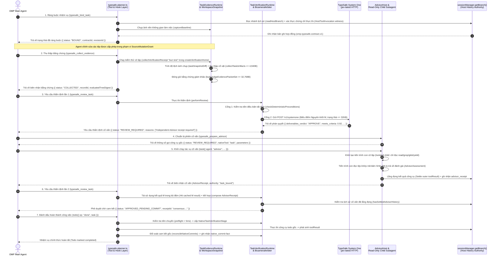

# Kiến trúc Tích hợp TypeSafe System One (`jev-latest`) & Hệ thống Phòng thủ 8 Tầng (8-Layer System Architecture)

> **Tài liệu Tham chiếu Kỹ thuật Chuẩn hóa (Standardized Technical Reference)**
> Đặc tả kiến trúc toàn diện cho `omp-typesafe-extension` (`v1.0.0`, môi trường thực thi đích `oh-my-pi` v18.12.3, Bun $\ge 1.0$, Node.js $\ge 18$). Bao phủ ngăn xếp phòng thủ chiều sâu 8 tầng (`8-layer defense-in-depth stack` gồm `typesafe-planner.ts` + 100 mô-đun trong `src/` + 26 công cụ trong `tools/`), Xác thực theo Giai đoạn (`Staged Verification`), Đồng thuận Lưỡng viện (`Bicameral Consensus`: Biểu điểm Nguyên khối `M` + Cố vấn Độc lập Chỉ Đọc `Advisor`), Đánh giá Đối chứng Ẩn `H/Atomic` (`Shadow H/Atomic Evaluation`), Tầng Vận chuyển & Lọc Bí mật CJS Dùng chung (`Shared CJS Transport & Redaction`), Chốt chặn Hoàn thành Dựa trên Bằng chứng (`EGC Standalone Guard`), và Đồng bộ Giao dịch (`Transactional Sync`).
---

## 1. Tổng quan Kiến trúc 8 Tầng (8-Layer Architecture Overview)

`omp_extension` không phải là một trình bọc (wrapper) gọi LLM đơn thuần, mà là một **Hệ điều hành Kiểm chứng & Quản trị Vòng đời Tác vụ (Fail-Closed Verification & Lifecycle Governance Runtime)** nằm giữa OMP Host Process và Agent. Thay vì chạy kiểm thử hoặc gọi HTTP bên trong callback ngắn của native `todo`, hệ thống tách bạch rõ ràng giữa **Giai đoạn Thu thập & Thẩm định Song viện (Staged Evidence & Bicameral Review)** và **Giai đoạn Cam kết Nguyên tử Không Trễ (Zero-HTTP Native Preflight & Branch Settlement)**.

### 1.1 Sơ đồ Kiến trúc Top-Down (Top-Down System Topology)

```mermaid
flowchart TB
    subgraph Host["Tầng 1: Tiến trình Chủ OMP & Biên giới Đánh chặn (Layer 1: OMP Host Process & Interception Boundary)"]
        Hooks["12+ Điểm neo Vòng đời (Lifecycle Hooks)<br/>(input, session_start, tool_call, tool_result, ...)"]
        Tools16["16 Công cụ typesafe_* Đăng ký (Registered Tools)<br/>(bind, collect, retrieve, review, advisor, ...)"]
        Wrappers5["5 Trình bọc Công cụ Gốc (Same-Native Tool Wrappers)<br/>(task, read, grep, glob, todo)"]
    end

    subgraph Authority["Tầng 2: Thẩm quyền Lịch sử Gốc & Ràng buộc Hợp đồng (Layer 2: Native History Authority & Contract Binding)"]
        Branch["Đọc Nhánh Phiên (readHostBranch)<br/>sessionManager.getBranch()"]
        Witness["Chứng thực Thực thi Công cụ (HostToolInvocationRuntime)<br/>(AsyncLocalStorage + omp.typesafe.tool-execution.v1)"]
        ContractRT["Thời gian chạy Hợp đồng (ContractRuntime / typesafe_bind_task)<br/>incarnationId + TaskContract + SourceMutationGrant"]
    end

    subgraph Evidence["Tầng 3: Động cơ Bằng chứng & Ảnh chụp Tương đối (Layer 3: Task-Relative Evidence & Snapshot Engine)"]
        Snap["Ảnh chụp Không gian làm việc & Bộ đệm Tiền ảnh (WorkspaceSnapshot & Preimage Cache)<br/>(captureWorkspaceSnapshot, taskSnapshotDiff)"]
        Receipts["Biên nhận Kiểm thử & Thu thập Cổ vật (VerificationReceipt & Artifact Collector)<br/>(DELIVERABLE_ARTIFACT_MAX_BYTES = 4,940B)"]
        Packet["Bộ đóng gói Bằng chứng Giám khảo (JudgeEvidencePacket Builder)<br/>(Giới hạn cứng 32,768B + EvidencePacketSetManifest)"]
        EvFile["Đọc/Ghi Tệp Chống TOCTOU (TOCTOU-Hardened File I/O)<br/>(typesafe-evidence-file.cjs + Cô lập .claude)"]
    end

    subgraph Consensus["Tầng 4: Cổng Kép & Động cơ Đồng thuận Lưỡng viện (Layer 4: Dual-Gate & Bicameral Consensus Engine)"]
        Gate1["Cổng 1: Kiểm tra Vi mô Tất định (Gate 1: Deterministic Micro-Check)<br/>(<150ms, 0 tokens, Chống Gian lận Kiểm thử AST)"]
        LobeM["Viện 2: Biểu điểm Nguyên khối M (Lobe 2: Monolithic M Rubric)<br/>(evaluateMonolithicTask -> runPhaseMacroCheck)"]
        LobeAdv["Viện 1: Cố vấn Độc lập Chỉ Đọc (Lobe 1: Independent Read-Only Advisor)<br/>(AdvisorRuntime + Đọc/Tìm kiếm Khớp SHA-256)"]
        Arbiter["Trọng tài Lưỡng viện (Bicameral Arbiter / arbitrateConsensus)<br/>-> APPROVED_PENDING_COMMIT"]
    end

    subgraph Shadow["Tầng 5: Máy chủ Đánh giá Ẩn H/Atomic (Layer 5: Shadow H/Atomic Evaluation Host)"]
        Atomic["Giám khảo Nguyên tử (Atomic Judge / createAtomicJudge)<br/>Đồ thị Phụ thuộc DAG + Vị từ Quan hệ/Noul"]
        EvalHost["Máy chủ Đánh giá Nội phiên (In-Session EvaluationHost / typesafe_eval_host)<br/>Phong bì Ký số Ed25519 + Sổ cái Holdout"]
    end

    subgraph Transport["Tầng 6: Vận chuyển, Chính sách & Lọc Bí mật CJS Dùng chung (Layer 6: Shared CJS Transport, Policy & Redaction)"]
        Resolver["Bộ phân giải Kích hoạt (typesafe-enabled-resolver.cjs)<br/>(Chỉ đọc ~/.omp/agent/typesafe.json toàn cục)"]
        Redact["Bộ lọc Bí mật (typesafe-redact.cjs + patterns.cjs)<br/>(TELEMETRY_COUNT_KEYS + Cắt tỉa Mực nước 32KB)"]
        Policy["Khách hàng Chính sách (typesafe-policy-client.cjs)<br/>(Lưới Chỉ Thắt chặt + Bộ lập lịch Thẩm định)"]
        ApiClient["Khách hàng API (typesafe-api-client.cjs)<br/>(https://api.typesafe.ai/v1/systemone • jev-latest)"]
    end

    subgraph EGC["Tầng 7: Chốt chặn Hoàn thành Dựa trên Bằng chứng (Layer 7: Earned Goal Completion Standalone Guard)"]
        EgcGate["src/egc.ts + egc-native.ts<br/>(.omp/egc.json + Cây làm việc Tách rời + Bộ kiểm thử Holdout)"]
    end

    subgraph Deploy["Tầng 8: Triển khai Giao dịch & Bằng chứng Nguồn gốc (Layer 8: Transactional Deployment & Runtime-Origin Proof)"]
        Pointer["Trình trung chuyển Ủy nhiệm 1 Dòng Bất biến (Immutable Proxy Trampoline)<br/>(~/.omp/agent/extensions/typesafe-planner.ts)"]
        Sync["Đồng bộ Giao dịch (tools/sync-baseline.cjs)<br/>(3 Gốc Tách biệt + Hoàn nguyên theo Nhật ký)"]
        Verify["Kiểm chứng Toàn cục & Một chạm (verify-omp-global.cjs & oneclick-omp.ps1)<br/>(Đối chiếu 6 Tầng & Thăm dò JEV Trực tiếp)"]
    end

    Host --> Authority
    Authority --> Evidence
    Evidence --> Consensus
    Consensus --> Shadow
    Consensus --> Transport
    Shadow --> Transport
    EGC --> Transport
    Deploy -.->|"Triển khai & Kiểm chứng (Promotes & Verifies)"| Host
```



---

### 1.2 Ma trận Ngang – Dọc 8 Tầng (Horizontal-to-Vertical Layer Matrix)

| Layer | Tên tầng (Layer Name) | Các Module cốt lõi (Primary Modules) | Trách nhiệm dọc (Vertical Responsibility) | Bất biến Bảo mật & Toàn vẹn (Fail-Closed Invariants) |
|---|---|---|---|---|
| **L1** | **Host Hook & Tool Interception** | `typesafe-planner.ts`, `src/advisor-host.ts`, `src/advisor-host-hooks.ts` | Đăng ký 16 công cụ `typesafe_*`, bọc 5 công cụ native (`task`, `read`, `grep`, `glob`, `todo`), lắng nghe 12+ lifecycle hooks. | Mọi tham số đầu vào được `structuredClone` + `freezeContractValue`; mọi đầu ra công khai đi qua `redactEvidenceState`. |
| **L2** | **Native History Authority & Contract Binding** | `src/host-history.ts`, `src/host-tool-invocation.ts`, `src/contract-runtime.ts`, `src/task-contract*.ts`, `src/source-mutation-authority.ts` | Tái tạo trạng thái `todo` từ `sessionManager.getBranch()`, định danh `incarnationId`, đóng băng `TaskContract`, cấp quyền sửa file theo giao hội (`intersection`) các phạm vi hợp đồng. | Không bao giờ tin tham số do model tự khai báo nếu không khớp lịch sử nhánh thực tế và chứng thực `AsyncLocalStorage` (`omp.typesafe.tool-execution.v1`). |
| **L3** | **Task-Relative Evidence & Snapshot Engine** | `src/task-evidence-runtime.ts`, `src/evidence-workspace.ts`, `src/evidence-collector.ts`, `src/evidence-artifacts.ts`, `src/judge-evidence-packet.ts`, `src/typesafe-evidence-file.cjs` | Chụp ảnh workspace trước/sau task, chạy lệnh test trong `createVerificationHome()`, đóng gói artifacts ($\le 4,940\text{ B}$) và tạo `JudgeEvidencePacket` ($\le 32,768\text{ B}$). | Kiểm tra chuỗi thư mục `realpathSync.native` + BigInt `dev/ino/nlink===1n` chống TOCTOU, symlink, junction, hardlink; chặn tuyệt đối `.claude`. |
| **L4** | **Dual-Gate & Bicameral Consensus (`M` + Advisor)** | `src/verification-gate.ts`, `src/cook-expert-judge.ts`, `src/bicameral-consensus.ts`, `src/task-verification-runtime.ts`, `src/advisor-*.ts` | Chạy Gate 1 (local $<150\text{ms}$) + Gate 2 (`M` rubric trên `jev-latest`) kết hợp với biên nhận `AdvisorReceipt` độc lập chỉ-đọc để cấp stage `APPROVED_PENDING_COMMIT`. | Chặn retry khi `progressDigest` không đổi; nếu `M` và Advisor bất đồng (`proceed` vs `REJECT` hoặc `block` vs `APPROVE`) $\rightarrow$ `HUMAN_REQUIRED`. |
| **L5** | **Shadow `H/Atomic` Evaluation Host** | `src/atomic-judge.ts`, `src/atomic-evaluation.ts`, `src/atomic-decision-policy.ts`, `src/evaluation-host.ts`, `tools/jev-paired-eval.ts` | Đánh giá song song giữa `M` (Monolithic) và `H` (Atomic Predicates) trên tập dữ liệu đóng băng có chữ ký Ed25519 mà không cấp quyền hoàn thành task thật. | `mutationAllowed: false`, `authorityReusable: false`; giữ nguyên `M` làm mặc định cho tới khi `H` vượt qua tất cả cổng `strictDominanceGates`. |
| **L6** | **Shared CJS Transport, Policy & Redaction** | `src/typesafe-enabled-resolver.cjs`, `src/typesafe-api-client.cjs`, `src/typesafe-redact.cjs`, `src/typesafe-redact-patterns.cjs`, `src/typesafe-policy-client.cjs`, `src/typesafe-child-env.cjs` | Kiểm tra opt-in toàn cục, lọc lộ lọt thông tin nhạy cảm, bảo toàn bộ đếm token (`TELEMETRY_COUNT_KEYS`), áp dụng mạng tinh thể chỉ-thắt-chặt (`Tighten-Only Lattice`) và gửi HTTP. | Từ chối khóa câu hỏi chứa bí mật (`payload_rejected_secret_in_key`); chặn rò rỉ giá trị bí mật vào biến môi trường tiến trình con (`UNSAFE_ALLOWED_VALUE`). |
| **L7** | **EGC Standalone Guard** | `src/egc.ts`, `src/egc-native.ts`, `src/egc-safety.ts`, `src/egc-judge.ts` | Thực thi giao thức Earned Goal Completion độc lập dựa trên `.omp/egc.json`, chạy kiểm thử cô lập trên git worktree tách rời và bộ test holdout ẩn. | Chặn `"unsandboxed": true` ở chế độ `enforce`, từ chối mục tiêu `done` mơ hồ (`targets.length > 1`), ném `EgcEvidenceRefusal` (`FILE_TOO_LARGE` / `FILE_MISSING`). |
| **L8** | **Transactional Sync & Runtime-Origin Proof** | `tools/sync-baseline.cjs`, `tools/promote-omp-global.ps1`, `tools/verify-omp-global.cjs`, `tools/oneclick-omp.ps1` | Triển khai giao dịch từ workspace sang 2 gốc đích (`target`, `global_omp_agents`) theo Bản kê Schema v2, xác minh kế hoạch sau khi khóa (post-lock plan check) và tự động rollback nếu lỗi. | Tệp `~/.omp/agent/extensions/typesafe-planner.ts` là trampoline 1 dòng bất biến; tự phát bằng chứng `getRuntimeOriginProof()` SHA-256 lúc khởi động phiên. |

---

## 2. Giải phẫu Chi tiết 8 Tầng Kiến trúc (Deep Dive by Layer)

### 2.1 Tầng 1: Host Hook & Tool Interception (`typesafe-planner.ts`, `src/advisor-host.ts`)
- **Đóng băng tham số & Chứng thực thực thi**: Mọi công cụ đăng ký qua `registerTool` (`typesafe-planner.ts:1199-1203`) đều sao chép sâu và đóng băng tham số (`freezeContractValue(structuredClone(params))`), sau đó chạy trong ngữ cảnh `invocations.run(ctx, definition.name, callId, owned, ...)`.
- **Bọc công cụ Native cùng Tham chiếu Schema (`supportsAdvisorHost`)**: Khi phiên làm việc khởi động, `registerAdvisorHost` (`src/advisor-host.ts:50-73`) bọc 5 công cụ builtin (`task`, `read`, `grep`, `glob`, `todo`) nhưng **giữ nguyên thực thể `original.parameters`** (`nativeSchemas`) để bộ xác thực của OMP Host không bao giờ bị lệch kiểu.
- **Tấm khiên Toàn vẹn Tệp tin & Hạ tầng (`write` / `edit` / `bash`)**:
  - Chặn tuyệt đối các bí danh URI `file:`.
  - Chặn ghi đè vào proxy toàn cục `~/.omp/agent/extensions/typesafe-planner.ts`, các tệp trạng thái `todo.json`/`.todo*`, hoặc thư mục đích đang chạy `C:/Users/thant/Projects/omp_extension`.
  - Chặn sửa đổi các tệp nguồn được bảo vệ (`typesafe-planner.ts`, `src/**`, `tools/**`, `models.yml`) trừ khi có `SourceMutationGrant` hợp lệ từ hợp đồng đang hoạt động (hoặc được ủy quyền hợp lệ qua `advisor-mutation-delegation.ts`).

### 2.2 Tầng 2: Native History Authority & Contract Binding (`src/host-history.ts`, `src/contract-runtime.ts`)
- **Truy xuất nhánh phiên thực tế (`readHostBranch`)**: Chỉ đọc từ `ctx.sessionManager.getBranch()` và `getSessionId()`. Từ chối nhánh có chuỗi `parentId` đứt gãy, trùng lặp ID, hoặc vượt quá `100,000` mục.
- **Định danh Hóa thân Tác vụ (`incarnationId`)**: `projectContractHistory` (`src/task-contract-history.ts`) ghép cặp lệnh gọi `todo` của assistant với `toolResult` đã lắng đọng (settled) để tính:
  $$\text{incarnationId} = \text{canonicalDigest}(\{\text{creation}, \text{target}\})$$
  Nếu phát hiện mục `user_todo_edit` hoặc `toolResult` không khớp, cờ `nativeStateReliable` lập tức chuyển thành `false` (fail-closed).
- **Ràng buộc Hợp đồng (`typesafe_bind_task`)**: Đóng băng yêu cầu gốc của người dùng (`originalUserRequest`), tiêu chí chấp nhận từ `plan.md` / `phase-XX-*.md` (tự động từ chối các tiêu chí chứa placeholder như `TODO`, `TBD`, `...`), phân loại `taskKind` (`implementation`, `review`, `research`, `operations`) và yêu cầu xác nhận từ người dùng (`ctx.ui.confirm`) khi cần thiết.

### 2.3 Tầng 3: Task-Relative Evidence & Snapshot Engine (`src/evidence-*.ts`, `src/judge-evidence-packet.ts`)
- **Ảnh chụp Workspace Niêm phong (`WorkspaceSnapshot`)**:
  - Giới hạn cứng (`SNAPSHOT_LIMITS`): tối đa `4,000` tệp, `1 MiB`/tệp, `8 MiB`/snapshot, `32 MiB` tổng bộ nhớ lưu giữ qua `FinalizationRegistry`.
  - Tính toán diff tương đối của riêng tác vụ (`taskSnapshotDiff`) bằng cách trích xuất preimage từ `WeakMap<WorkspaceSnapshot, RetainedSnapshot>` ra thư mục tạm `0o700` và chạy `git diff --no-index --binary --find-renames --no-ext-diff`, loại bỏ hoàn toàn nhiễu từ các thay đổi bẩn có sẵn trước khi nhận task.
- **Chứng chỉ Kiểm thử Cô lập (`collectVerificationReceipt`)**:
  - Chạy lệnh kiểm thử được phê duyệt (`workspace-tests` $\rightarrow$ `bun test`) bên trong `createVerificationHome()`.
  - Trên Windows, bộ thu thập bằng chứng (`src/evidence-collector.ts`) sử dụng cơ chế hủy tiến trình con bất đồng bộ không chặn (`taskkill /t /f`) kèm bộ đếm thời gian dự phòng `5s` (fallback timer) để dọn sạch cây tiến trình bị treo.
  - Tự động từ chối nếu mã nguồn hoặc tệp test bị thay đổi trong lúc chạy test (`SOURCE_CHANGED_DURING_VERIFICATION`, `TEST_ASSETS_CHANGED_DURING_VERIFICATION`, `POST_TEST_TREE_UNSTABLE`).
- **Ngân sách Artifacts & Gói Bằng chứng**:
  - Artifacts đầu ra được xếp hạng theo mức độ liên quan và đóng gói tham lam dưới ngưỡng `DELIVERABLE_ARTIFACT_MAX_BYTES = 4,940` bytes (`src/evidence-collector.ts`, `src/evidence-artifacts.ts`).
  - Gói bằng chứng hoàn chỉnh `JudgeEvidencePacket` được kiểm tra kích thước UTF-8 $\le 32,768$ bytes (`32 KiB`) và niêm phong bằng `createEvidenceStateValidator()` để đảm bảo phần thân HTTP gửi đi khớp tuyệt đối (`isDeepStrictEqual`) với trạng thái đã kiểm duyệt.

### 2.4 Tầng 4: Dual-Gate & Bicameral Consensus (`M` + Independent Read-Only Advisor)
- **Gate 1 — Kiểm tra Tiền điều kiện Tất định (`checkDeterministicPreconditions`, $<150\text{ms}$, $0$ token)**:
  1. Cô lập ranh giới `.claude` (`!touchesClaudeBoundary`).
  2. Mã thoát kiểm thử bằng `0` (`testExitCode === 0`).
  3. Phân tích AST chống gian lận kiểm thử (`analyzeDiffForTestEvasion` trong `src/ast-analyzer.ts`): phát hiện xóa câu lệnh `expect`/`assert`, thêm `.skip`/`.todo`/`xit`, comment-out test, hoặc tạo biểu thức hằng đúng (`expect(x).toBe(x)`).
  4. Không có tiêu chí bắt buộc nào bị bỏ sót (`omissions` có `required: true` $\rightarrow$ `EVIDENCE_REQUIRED`).
- **Gate 2 — Thẩm định Ngữ nghĩa Song viện (Bicameral Consensus)**:
  - **Viện 2 (Lobe 2 — Monolithic `M` Rubric)**: Đánh giá toàn bộ gói bằng chứng đơn (`evaluateMonolithicTask` $\rightarrow$ `runPhaseMacroCheck`) qua `jev-latest` với các câu hỏi `deliverables_verdict`, `meets_criteria` (`noul`), `architectural_drift` (`no_drift`), `scope_mode` (`!= REDUCTION`), và từng tiêu chí `criterion_0..N` (`satisfied`).
  - **Viện 1 (Lobe 1 — Independent Read-Only Advisor)**: Nếu `M` chấp thuận nhưng chưa có biên nhận Advisor, `typesafe_review_task` trả về `REVIEW_REQUIRED`. Agent gọi `typesafe_prepare_advisor`, thực thi subagent `task` chỉ-đọc (`advisor` hoặc `ck:advisor`), sau đó gọi lại `typesafe_review_task`.
  - **Cô lập Tuyệt đối Subagent Advisor (`src/advisor-guards.ts`, `src/advisor-readonly.ts`)**:
    - Chỉ được phép dùng `{ read, grep, glob, yield }`; chặn spawn subagent lồng nhau (`advisor_nested_subagent_spawn_denied`).
    - Chỉ đọc được các tệp trong `request.scope.files` có mã băm SHA-256 trên đĩa khớp với ảnh chụp (`advisor_evaluated_file_changed`); `read` bắt buộc có selector `:start-end`; `grep` chỉ cho phép khớp chuỗi literal.
    - Bất biến `parentIntegration`: Nếu `request.parentRequirementIds.length === 0`, `parentIntegration.status` bắt buộc là `"not_applicable"` với mảng rỗng; nếu có yêu cầu tích hợp cha, `status` không được là `"not_applicable"` (`src/advisor-protocol.ts:125-138`).
  - **Trọng tài Đồng thuận (`arbitrateConsensus`)**: Kết hợp kết quả của `M` (đã lưu cache theo `progressDigest`, không gọi lại HTTP) và `AdvisorReceipt` đã lắng đọng trong lịch sử nhánh (`hasSettledAdvisorHistory`). Chỉ khi cả hai cùng đồng thuận (`jev.verdict === "APPROVE"` và `advisor.verdict === "proceed"`), trạng thái mới chuyển sang `APPROVED_PENDING_COMMIT`.

### 2.5 Tầng 5: Shadow `H/Atomic` Evaluation Host (`src/atomic-*.ts`, `src/evaluation-host.ts`)
- Triển khai nhánh đánh giá nguyên tử `H` (`createAtomicJudge`), phân rã các tiêu chí thành đồ thị phụ thuộc không chu trình (DAG) gồm các vị từ cơ sở (`q_<hash>`) và vị từ tích hợp cha (`parent_<hash>`), chạy qua `SemanticReviewScheduler` (`maxPackets: 128`, `maxDispatches: 384`, `deadlineMs: 300,000`).
- Công cụ `typesafe_eval_host` (`identity`, `authorize`, `prepare`, `collect`) kết nối phiên OMP thực tế với CLI `tools/jev-paired-eval.ts` bằng chữ ký số **Ed25519** (`EVALUATION_HOST_PROTOCOL = "jev-paired-native-host-v1"`), đảm bảo mọi thử nghiệm `M` đối đầu `H` đều ở chế độ chỉ-đọc (`mutationAllowed: false, authorityReusable: false`).

### 2.6 Tầng 6: Shared CJS Transport, Policy & Redaction (`src/typesafe-*.cjs`)
- **7 Module CJS Không Phụ thuộc Ngoài**: Chia sẻ nguyên bản giữa OMP Extension và Claude MCP Server.
- **Bảo toàn Số liệu Token (`TELEMETRY_COUNT_KEYS`)**: Trong `src/typesafe-redact.cjs`, các khóa chứa từ `token` thường bị xóa trắng thành `[REDACTED:token]`. Tuy nhiên, 7 khóa đếm token hợp lệ (`input_tokens`, `output_tokens`, `total_tokens`, `prompt_tokens`, `completion_tokens`, `cache_creation_input_tokens`, `cache_read_input_tokens`) được giữ nguyên nếu và chỉ nếu giá trị là số nguyên an toàn không âm (`Number.isSafeInteger(v) && v >= 0`).
- **Môi trường Tiến trình con Khép kín (`src/typesafe-child-env.cjs`)**: Quét toàn bộ biến môi trường nguồn tìm các khóa nhạy cảm (`NAMED_SECRETS` và hậu tố `_API_KEY|_SECRET|_TOKEN|_PASSWORD` có độ dài $\ge 12$) và chặn đứng nếu giá trị bí mật xuất hiện dưới dạng chuỗi con bên trong bất kỳ biến môi trường được phép nào như `PATH` hay `TEMP` (`UNSAFE_ALLOWED_VALUE`).

### 2.7 Tầng 7: EGC Standalone Guard (`src/egc.ts`, `src/egc-native.ts`)
- Bảo vệ độc lập dựa trên hợp đồng `.omp/egc.json` đã khóa (`/egc lock`).
- Trong chế độ `enforce`:
  - Chặn mọi lệnh gọi `todo` / `todo_write` hoặc công cụ ghi file có cờ `"unsandboxed": true`.
  - Khi `uncontracted: "allow"`, bắt buộc phải có lệnh kiểm증 (`verify`) trừ khi `jev.mode === "enforce"` đi kèm `requirements` rõ ràng.
  - Từ chối hoàn thành khi mục tiêu `done` khớp với nhiều hơn 1 tác vụ (`targets.length > 1`).
  - Ném lỗi tường minh `EgcEvidenceRefusal` (`FILE_TOO_LARGE` hoặc `FILE_MISSING`) khi tệp không theo dõi (untracked) vượt quá `131,072` bytes hoặc biến mất trong lúc thu thập.

### 2.8 Tầng 8: Transactional Sync & Runtime-Origin Proof (`tools/sync-baseline.cjs`)
- **2 Gốc Triển khai Tách biệt theo Bản kê Schema v2 (`target`, `global_omp_agents`)**:
  1. `target`: `C:/Users/thant/Projects/omp_extension` (+ `.sync-manifest.json` Schema v2, 514 tệp).
  2. `global_omp_agents`: `~/.omp/agent/agents/{advisor.md,ck-advisor.md}` (2 tệp).
  *(Độc lập hoàn toàn khỏi `.claude`; không quản lý hay ghi vào `~/.claude`)*.
- **Kiểm tra Kế hoạch Sau khi Khóa (Post-Lock Plan Identity Check)**: Sau khi tạo tệp khóa `.omp-sync-<target>.lock`, `sync-baseline.cjs` lập lại kế hoạch triển khai và so sánh mã băm; nếu bất kỳ tệp nào thay đổi trong khoảng thời gian chờ khóa (`deployment plan changed after lock`), giao dịch hủy ngay lập tức trước khi ghi đĩa.

---

## 3. Sơ đồ Luồng Kiểm chứng & Tuần tự (Staged Verification Flowchart & Sequence)

### 3.1 Sơ đồ Luồng Quyết định Khi Đánh dấu Hoàn thành (`typesafe_review_task` $\rightarrow$ `todo done`)

```mermaid
flowchart TD
    Start(["Agent chuẩn bị hoàn thành Task"]) --> Bind["1. typesafe_bind_task<br/>Đóng băng TaskContract + Chụp Baseline Snapshot"]
    Bind --> Work["2. Thực hiện thay đổi trong phạm vi SourceMutationGrant"]
    Work --> Collect["3. typesafe_collect_evidence<br/>Chạy commandId (bun test) + Đóng gói JudgeEvidencePacket <= 32KB"]
    Collect --> Review1["4. typesafe_review_task (Lần 1)"]

    Review1 --> Ratchet{"Cùng progressDigest<br/>đã bị REJECTED /<br/>EVIDENCE_REQUIRED?"}
    Ratchet -->|Có| BlockRetry["Chặn Retry ngay lập tức<br/>(Không gọi lại JEV HTTP)"]
    Ratchet -->|Không| Gate1{"Gate 1: Local Micro-Check<br/>(testExitCode===0, !touchesClaude,<br/>!testEvasion, đủ omissions)"}

    Gate1 -->|Trượt| OutReject["REJECTED / EVIDENCE_REQUIRED<br/>+ Sinh XML Remediation"]
    Gate1 -->|Đạt| Gate2M["Gate 2 (Lobe 2): Monolithic M Rubric<br/>trên jev-latest (1 packet toàn vẹn)"]

    Gate2M --> MPass{"M phê duyệt?<br/>(APPROVE, meets_criteria đạt ngưỡng,<br/>no_drift, !REDUCTION)"}
    MPass -->|Không| OutM["REJECTED / EVIDENCE_REQUIRED /<br/>HUMAN_REQUIRED (nếu >= 3 lần)"]
    MPass -->|Có| HasAdv{"Đã có AdvisorReceipt<br/>hợp lệ & settled?"}

    HasAdv -->|Chưa có| ReqAdv["Trả về REVIEW_REQUIRED"]
    ReqAdv --> PrepAdv["5. typesafe_prepare_advisor<br/>-> Trả về tham số native task"]
    PrepAdv --> RunAdv["6. Thực thi native task (advisor / ck:advisor)<br/>Subagent chỉ-đọc kiểm tra exact-SHA files"]
    RunAdv --> Review2["7. typesafe_review_task (Lần 2)<br/>Tái sử dụng kết quả M từ cache + Ghép AdvisorReceipt"]

    HasAdv -->|Đã có| Compose["arbitrateConsensus(AdvisorReceipt, JevResult)"]
    Review2 --> Compose

    Compose --> Disagreement{"Hai viện bất đồng?<br/>(proceed vs REJECT hoặc<br/>block vs APPROVE)"}
    Disagreement -->|Có| Escalate["HUMAN_REQUIRED<br/>(Báo cáo nguyên trạng cả 2 viện)"]
    Disagreement -->|Không| BothApprove{"Cả M và Advisor<br/>cùng chấp thuận?"}
    BothApprove -->|Không| OutReject
    BothApprove -->|Có| Stage["APPROVED_PENDING_COMMIT<br/>Cấp NativeTaskVerificationStage"]

    Stage --> NativeDone["8. Agent gọi native todo(op='done')"]
    NativeDone --> Preflight["Preflight (<5ms, 0 HTTP, 0 lệnh shell)<br/>Kiểm tra object-identity stage & settled review call"]
    Preflight --> Settled["reconcileNativeCommits (trên tool_result)<br/>Xác nhận toolResult nằm trong sessionManager.getBranch()"]
    Settled --> FinalDone(["Task Chính thức Hoàn thành & Xóa Nợ Incarnation"])
```



### 3.2 Sơ đồ Tuần tự Tương tác Liên Tầng (End-to-End Sequence Diagram)



---

## 4. Ma trận Đăng ký Công cụ & Can thiệp (Complete Tool & Hook Interception Matrix)

### 4.1 Toàn bộ 16 Công cụ `typesafe_*` và 5 Trình bọc Native

| # | Tên Công cụ (Tool) | Phân quyền | Module xử lý | Mục đích & Cơ chế Bảo vệ |
|---|---|---|---|---|
| 1 | `typesafe_bind_task` | `"exec"` | `src/contract-runtime.ts` | Đóng băng hóa thân `todo` (`incarnationId`) và yêu cầu gốc của người dùng; chụp ảnh nền workspace (`captureBaseline`). |
| 2 | `typesafe_collect_evidence` | `"exec"` | `src/task-evidence-runtime.ts` | Chạy lệnh kiểm thử được duyệt, thu thập diff tương đối, artifacts ($\le 4,940\text{ B}$) và tạo gói bằng chứng $\le 32\text{ KiB}$. |
| 3 | `typesafe_retrieve_evidence` | `"read"` | `src/evidence-selection.ts` | Trích xuất các dải dòng (1-based line spans) từ bộ nhớ đệm theo `fullFileDigest` (giới hạn đầu ra `16,384` bytes UTF-8). |
| 4 | `typesafe_review_task` | `"exec"` | `src/task-verification-runtime.ts` | Chạy Gate 1 + Gate 2 (`M`) và kết hợp với `AdvisorReceipt` để cấp trạng thái `APPROVED_PENDING_COMMIT`. |
| 5 | `typesafe_prepare_advisor` | `"read"` | `src/advisor-host-dispatch.ts` | Chuẩn bị hồ sơ thẩm định chỉ-đọc (`task_review`, `parent_review`, `consultation`), trả về lệnh gọi native `task`. |
| 6 | `typesafe_advisor` | `"read"` | `src/advisor-host.ts` | Chuẩn bị hoặc lấy biên nhận tham vấn độc lập (`purpose: "consultation"`), không tạo quyền hoàn thành `todo`. |
| 7 | `typesafe_prepare_todo_mutation` | `"exec"` | `src/todo-lifecycle-authority.ts` | Chuẩn bị thao tác `block`, `drop`, `rm`, `init` ngoài preflight; xuất báo cáo bàn giao và cấp grant `60s` (cần `ui.confirm` nếu giảm phạm vi/còn nợ). |
| 8 | `typesafe_resolve_historical_debt` | `"exec"` | `src/task-verification-historical.ts` | Yêu cầu con người xác nhận (`ui.confirm`) để đối soát nợ lịch sử trên các incarnation đã đóng (`HUMAN_RECONCILED_NO_NATIVE_APPROVAL`). |
| 9 | `typesafe_recovery_report` | `"exec"` | `typesafe-planner.ts` | Xuất báo cáo khôi phục `# TypeSafe recovery handoff` ra `plans/reports/typesafe-recovery/<uuid>.md` (chế độ `0o600`, fsync + đọc lại kiểm tra SHA-256). |
| 10 | `typesafe_eval_host` | `"exec"` | `src/evaluation-host.ts` | Cầu nối hữu hạn (`identity`, `authorize`, `prepare`, `collect`) phục vụ đánh giá cặp `M`/`H` có chữ ký Ed25519. |
| 11 | `typesafe_judge` | default | `typesafe-planner.ts` | Gửi trạng thái và câu hỏi (`noul`, `choice`, `score`) tới System One dưới mục đích `"judge"` (tuân thủ mạng tinh thể `baseline`/`lattice`). |
| 12 | `typesafe_rerank` | default | `typesafe-planner.ts` | Chấm điểm (`score` `0..2`) và sắp xếp lại danh sách ứng viên theo mức độ phù hợp với truy vấn dưới mục đích `"rerank"`. |
| 13 | `typesafe_evaluate_multi` | default | `typesafe-planner.ts` | Đánh giá cùng một trạng thái trên nhiều chiều (`noul` cho từng chiều, tối đa `128` câu hỏi) dưới mục đích `"multi"`. |
| 14 | `typesafe_elevate_plan` | default | `src/plan-evaluator.ts` + `src/debate-evaluator.ts` | Thẩm định bản thảo kế hoạch (`purpose: "plan"`, $\le 32\text{ KiB}$) và tự động nối tiếp tranh biện 5 nhân cách (`purpose: "debate"`). |
| 15 | `typesafe_verify_completion` | `"read"` | `src/verification-gate.ts` | Kiểm tra tham vấn (`advisoryOnly: true`) bằng chứng hiện có qua Gate 1 & Gate 2 mà không chạy lệnh hay cấp quyền staging. |
| 16 | `typesafe_expert_review` | default | `src/cook-expert-judge.ts` | Đánh giá chuyên gia theo 3 vai trò: `scope_arbiter`, `drift_guard`, `risk_security_triage` (`advisoryOnly: true`). |
| W1–W5 | `task`, `read`, `grep`, `glob`, `todo` | `"exec"` / `"read"` | `src/advisor-host.ts` | Bọc các công cụ builtin: điều phối subagent Advisor, kiểm soát đọc/tìm kiếm theo SHA-256 trong Advisor, và chạy `beforeExecute`/`afterExecute` cho `todo`. |

### 4.2 Ma trận 12+ Sự kiện Vòng đời (Lifecycle Hooks Matrix)

| Sự kiện (Hook Event) | Nơi đăng ký | Hành vi Kiểm soát & Đồng bộ Trạng thái |
|---|---|---|
| `input` | `typesafe-planner.ts:1428` | Gọi `contracts.captureCookInput(ctx, event)` để ghi nhận nguyên bản lệnh `/ck:cook --auto <path>` và chụp ảnh `plan.md`/`phase-*.md` trước khi skill bung rộng. |
| `session_start` | `typesafe-planner.ts:1437` & `advisor-host-hooks.ts:21` | Làm mới trạng thái `todo`, cài đặt 5 trình bọc công cụ native, phát thông điệp ẩn `typesafe-health` chứa `getRuntimeOriginProof()`, nạp `PROMPT_INJECTION`, và chạy Ping Probe `3000ms` tới `jev-latest`. |
| `tool_call` | `typesafe-planner.ts:1944` & `advisor-host-hooks.ts:73` | Đối soát các cam kết đang chờ (`reconcileNativeCommits`), chặn `write`/`edit` trái phép, chấm điểm rủi ro cho `ask`, kiểm tra lệnh `plan-cli` trong `bash`, và giới hạn công cụ của subagent Advisor. |
| `tool_result` | `typesafe-planner.ts:1955` & `advisor-host-hooks.ts:86` | Đánh dấu `nativeResultObserved = true` cho `StagedTodoCall` tương ứng và gọi `reconcileNativeCommits(ctx)` để hoàn tất cam kết khi `toolResult` đã ghi vào nhánh phiên. |
| `before_agent_start` | `typesafe-planner.ts:1969` & `advisor-host-hooks.ts:39` | Đối soát cam kết `todo`, gắn quyền sửa đổi được ủy quyền cho subagent thường, hoặc khóa chặt subagent Advisor vào `{ read, grep, glob, yield }`. |
| `message_end` | `typesafe-planner.ts:1969` | Chạy `reconcileNativeCommits(ctx)` để đảm bảo mọi kết quả công cụ vừa kết thúc đều được đồng bộ với sổ cái hợp đồng. |
| `turn_end`, `agent_end` | `typesafe-planner.ts:1985` | Tăng `generation`/`revision` và xóa các `stagedCalls` chưa được quan sát, nhưng **giữ nguyên** kết quả thẩm định `TaskVerificationRuntime` qua ranh giới lượt. |
| `session_switch`, `session_branch`, `session_tree` | `typesafe-planner.ts:1971` & `advisor-host-hooks.ts:103` | Gọi `invalidateTodoState(ctx)` và `rotateHostScope()`: hủy toàn bộ stage/grant đang mở, xoay `epoch` để ngăn các subagent cũ ghi nhận kết quả lệch nhánh. |
| `session_shutdown` | `typesafe-planner.ts:1976` & `advisor-host-hooks.ts:114` | Đối soát lần cuối, hủy toàn bộ thẩm quyền vòng đời, xóa bộ nhớ đệm bằng chứng và hủy các ngân sách Advisor đang chạy. |
| `before_subagent_spawn`, `context`, `before_provider_request` | `src/advisor-host-hooks.ts:25,56,64` | Chặn Advisor spawn subagent con, thay thế toàn bộ lịch sử hội thoại của Advisor bằng `publicAdvisorMessages(request)` và lọc payload gửi tới nhà cung cấp mô hình (`projectAdvisorPayload`). |

---

## 5. Chẩn đoán Tiền trạm (`session_start`) & Bằng chứng Nguồn gốc Runtime

Mỗi khi phiên làm việc chính (`ctx.agent.kind !== "sub"`) khởi động:
1. **Runtime-Origin Proof (`getRuntimeOriginProof`)**:
   - Tính mã băm SHA-256 của tệp entrypoint đang thực thi (`typesafe-planner.ts`) và 4 module CJS cốt lõi (`typesafe-enabled-resolver.cjs`, `typesafe-redact.cjs`, `typesafe-api-client.cjs`, `typesafe-policy-client.cjs`).
   - Phát thông điệp ẩn `customType: "typesafe-health"` vào phiên làm việc để chứng minh mã nguồn đang chạy đến từ bản triển khai hợp lệ tại `C:/Users/thant/Projects/omp_extension`.
2. **Kiểm tra Quyền Dự án (`resolveTypeSafeEnabled`)**:
   - Đọc duy nhất `~/.omp/agent/typesafe.json` (tuyệt đối không đọc cấu hình cục bộ trong thư mục dự án để tránh repo lạ tự kích hoạt).
   - Kiểm tra `TYPESAFE_API_KEY`, công tắc ngắt toàn cục (`global-kill-switch`), danh sách loại trừ hai chiều (`excludeProjects` kiểm tra cả cây cha, cây con và `.git` worktree/submodule), và danh sách cho phép (`projects`).
3. **Ping Probe Siêu nhẹ (`3000ms` deadline, 1 lần thử)**:
   - Kiểm tra `checkCredentialCooldown(apiKey)` trước khi gửi gói tin `< 200 bytes` (`state: "ping"`, câu hỏi `ping` kiểu `noul`, `model: "jev-latest"`, `purpose: "health"`).
   - Hiển thị thông báo trạng thái trực tiếp trên giao diện OMP (`ONLINE` hoặc mã cảnh báo `authError`, `http_404`, `timeout`).

---

## 6. Sổ tay Vận hành & Xử lý Sự cố (Operational Runbook & Troubleshooting)

### 6.1 Quy trình Triển khai & Kiểm tra Một chạm (One-Click Promotion & Verification)

> **Quy tắc Bất biến Vàng (Golden Invariant):**
> Tuyệt đối không bao giờ chỉnh sửa trực tiếp vào `C:/Users/thant/.omp/agent/extensions/typesafe-planner.ts` (trampoline 1 dòng) hoặc `C:/Users/thant/Projects/omp_extension`. Mọi thay đổi phải thực hiện tại workspace `D:/100.Software/Github/omp_extension` và đồng bộ qua công cụ chuẩn.

```bash
# 1. Kiểm tra nhanh 6 lớp (<3s): Trampoline, Manifest Parity, Dry-Run Sync,
#    Runtime-Origin SHA-256, Resolver/Redactor (TELEMETRY_COUNT_KEYS), Backup Journal
npm run verify:global

# 2. Kiểm tra 6 lớp kèm thăm dò trực tiếp (live probe) tới jev-latest (noul + choice + score)
npm run verify:live

# 3. Xem trước kế hoạch đồng bộ (Read-only Dry-Run)
npm run sync:dry-run

# 4. Đồng bộ giao dịch đầy đủ (Tạo backup, ghi nguyên tử 3 gốc, chạy bun test cô lập, tự rollback nếu lỗi)
npm run sync

# 5. Quy trình Một chạm Thông minh (Kiểm tra trạng thái -> Tự đồng bộ nếu lệch -> Xác minh lại)
tools\oneclick-omp.bat
```

### 6.2 Bảng Chẩn đoán & Khắc phục Sự cố Thường gặp

| Triệu chứng / Mã lỗi (Symptom / Error Code) | Nguyên nhân Gốc rễ (Root Cause) | Cách Khắc phục Chính xác (Resolution) |
|---|---|---|
| `REVIEW_REQUIRED` sau khi gọi `typesafe_review_task` | Gate 1 và Gate 2 (`M` rubric) đã đạt, nhưng tác vụ chưa có biên nhận `AdvisorReceipt` độc lập đã lắng đọng trong nhánh. | Gọi `typesafe_prepare_advisor`, thực thi công cụ native `task` với tham số được trả về, sau đó gọi lại `typesafe_review_task` (hệ thống sẽ ghép kết quả `M` từ cache mà không gọi lại HTTP). |
| `Unchanged semantic rejection cannot be retried` | Agent gọi lại `typesafe_review_task` khi `progressDigest` (mã nguồn, kết quả test, gói bằng chứng) chưa hề thay đổi sau lần bị `REJECTED` hoặc `EVIDENCE_REQUIRED`. | Thực hiện sửa lỗi thực tế trên mã nguồn/kiểm thử, gọi lại `typesafe_collect_evidence` để tạo `progressDigest` mới rồi mới gọi `typesafe_review_task`. |
| `CURATION_REQUIRED` hoặc `MANDATORY_PACKET_PROOF_EXCEEDS_BUDGET` | Tổng kích thước gói bằng chứng vượt quá `32,768` bytes hoặc artifacts vượt quá `4,940` bytes. | Sử dụng `typesafe_retrieve_evidence` để xem các đoạn dòng cần thiết và truyền `selections` (dải dòng 1-based không chồng lấn) vào `typesafe_collect_evidence` sao cho 1 gói bao phủ đủ mọi tiêu chí gốc. |
| `HUMAN_REQUIRED` (Cross-lobe disagreement) | Viện `M` (`jev-latest`) và Viện `Advisor` đưa ra phán quyết trái ngược nhau (`proceed` vs `REJECT` hoặc `block` vs `APPROVE`), hoặc đã thất bại ngữ nghĩa $\ge 3$ lần. | Xem xét báo cáo của cả hai viện (không viện nào bị ghi đè), xin ý kiến người dùng hoặc điều chỉnh cài đặt để giải quyết điểm mâu thuẫn. |
| `extension pointer must match exact one-line export` khi chạy `sync-baseline` | Tệp `~/.omp/agent/extensions/typesafe-planner.ts` bị sửa đổi hoặc chứa BOM/nhiều dòng. | Chạy `tools\sync-baseline.bat` (`promote-omp-global.ps1`): script sẽ tự động chép dòng chuẩn `export { default } from "C:/Users/thant/Projects/omp_extension/typesafe-planner.ts";` vào clipboard và mở Notepad để lưu lại. |
| `UNSAFE_ALLOWED_VALUE` từ `typesafe-child-env.cjs` | Một biến môi trường được phép (như `PATH` hoặc `TEMP`) vô tình chứa chuỗi con trùng với một khóa bí mật (`*_API_KEY`, `*_TOKEN`, `*_SECRET`). | Làm sạch biến môi trường hệ thống (`PATH`/`TEMP`) để loại bỏ chuỗi bí mật trước khi chạy lệnh kiểm thử hoặc đồng bộ. |
