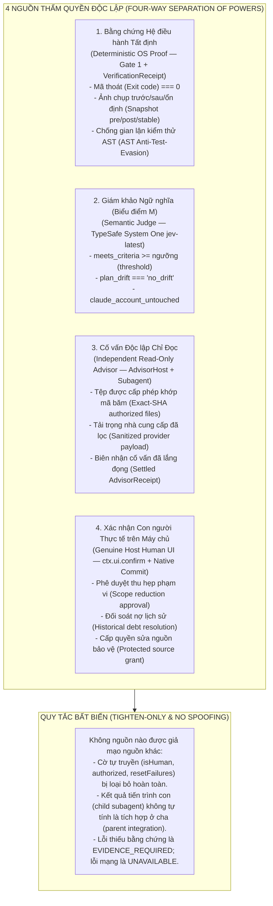
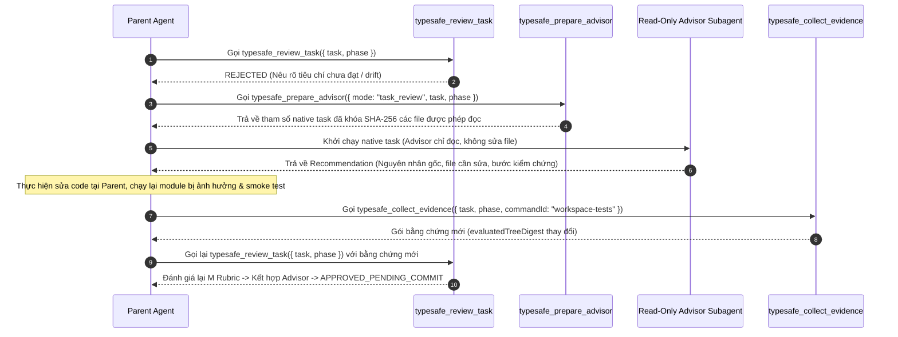

# Sổ tay Vận hành Khẩn cấp & Biên giới Bảo mật TypeSafe (TypeSafe Operations, Security Boundaries & Emergency Runbook — `typesafe-operations.md`)

Tài liệu đặc tả vận hành bảo mật (`security operations`), cơ chế phục hồi nhiệm vụ bị từ chối (`rejected task recovery`), quy tắc đóng gói bằng chứng nghiên cứu/triển khai (`research & implementation evidence packaging`), bảo toàn thông số đo lường từ xa (`telemetry count preservation`), và quy trình kiểm soát Hoàn thành Dựa trên Bằng chứng (`Evidence-Gated Completion — EGC`).

---

## 1. Ma trận Biên giới Bảo mật & Quyền hạn (Security & Authority Matrix)



| Thao tác / Sự kiện | Nguồn kiểm tra bắt buộc | Cờ giả mạo bị từ chối | Trạng thái khi thiếu điều kiện |
|---|---|---|---|
| Hoàn thành task (`todo done`) | `BOUND` Contract + `VerificationReceipt` + `M` Pass + `AdvisorReceipt` + Settled Native Result | `authorized`, `isHuman`, `resetFailures`, `testCommand`, `approval` | `EVIDENCE_REQUIRED` / `REVIEW_REQUIRED` / `REJECTED` |
| Tạm khóa task (`todo block`) | `typesafe_prepare_todo_mutation` + Báo cáo phục hồi bền vững + Host UI Confirm | Gọi trực tiếp `todo block` khi đang có nợ từ chối | Bị chặn tại preflight |
| Hủy / Xóa task (`todo drop`, `rm`, `init`) | `typesafe_prepare_todo_mutation` + Host UI Confirm (nếu giảm phạm vi hoặc còn nợ) | Tự truyền `reason` hoặc `allowJudgeModification` trong `todo` | Bị chặn tại preflight |
| Sửa file bảo vệ (`typesafe-planner.ts`, `models.yml`, `.cjs`) | Grant phạm vi chính xác từ Host hoặc `TYPESAFE_ALLOW_MODIFICATION=1` từ shell cha | Sửa qua `write`/`edit`/`bash` không có quyền | Hủy lệnh (`evt.cancel`) + Escalation |

---

## 2. Cấu hình Model Chuẩn (`jev-latest` $\rightarrow$ `jev-1.14.0`)

### 2.1 Chuẩn hóa Model Mặc định
Toàn bộ các kênh đánh giá (Gate 2 Verification, Plan Draft Elevation, Tri-Role Expert Review, Multi-Persona Debate, và EGC Judge) đều chuẩn hóa về model canonical:
- **Tên model gửi đi**: `jev-latest`
- **Model phân giải thực tế trên đám mây**: `jev-1.14.0` (được ghi nhận trong `metadata.resolvedModel`).
- Mọi tên model cũ không còn tồn tại (như `jev-fast`) đều được tự động ánh xạ về `jev-latest`.

### 2.2 Ghi đè qua Biến Môi trường
- `TYPESAFE_DEFAULT_MODEL`: Ghi đè model mặc định cho toàn bộ extension (phải nằm trong danh sách `allowedModels` của policy client).
- `TYPESAFE_PREDICT_MODEL`: Ghi đè model riêng cho vòng phân tích tranh biện 5 góc nhìn (`ck:predict`).

---

## 3. Quy trình Phục hồi Khi Task Bị Từ chối (`Rejected Todo & Advisor Recovery`)

### 3.1 Quy tắc Chống Thử Lại Mù Quáng (Same-Evidence Retry Ratchet)
- Các trường `resetFailures`, `authorized`, `isHuman` truyền trong tham số `todo` **không có bất kỳ hiệu lực nào**.
- Khi một lần gọi `typesafe_review_task` bị từ chối ngữ nghĩa (`REJECTED`), mã băm bằng chứng (`evaluatedTreeDigest` + `packetDigest`) được ghi vào lịch sử xác thực (`omp.typesafe.task-verification-facts.v1`).
- Nếu Agent gọi lại `typesafe_review_task` mà không thay đổi mã nguồn hoặc bằng chứng, hệ thống **trả về ngay kết quả từ chối đã lưu** mà không phát sinh thêm request HTTP nào tới TypeSafe System One.

### 3.2 Quy trình Khắc phục Dẫn dắt bởi Advisor (Advisor-Led Remediation Loop)



### 3.3 Ràng buộc Bảo toàn Luồng của Advisor (`src/advisor-native-budget.ts` & `src/advisor-protocol.ts`)
- **Giải phóng luồng khi Timeout/Lỗi**: Khi một lượt chạy Advisor bị hủy hoặc quá hạn (`timeout`), `createAdvisorNativeBudget` tự động gắn `.catch(() => {})` vào promise thực thi nền để tránh lỗi `UnhandledPromiseRejection` làm sập tiến trình Host.
- **Tính hợp lệ của `applicable === false`**: Trong `validateAdvisorAssessment`, nếu một mục thẩm định có `applicable: false` thì bắt buộc `satisfied === false` và danh sách `evidenceRefs` phải rỗng (`length === 0`).

---

## 4. Đóng gói Bằng chứng Nghiên cứu & Bảo toàn Telemetry (`Egress & Redaction`)

### 4.1 Ngân sách Bằng chứng Bài nộp (`4,940 Bytes` Artifact Cap & `32 KiB` Packet Cap)
- Các báo cáo nghiên cứu hoặc tệp kết quả gắn với task (qua dòng `Task: ...`, `Original task (verbatim): ...`, hoặc khóa JSON `task`) được thu thập nguyên vẹn trong giới hạn **4,940 byte UTF-8** (`DELIVERABLE_ARTIFACT_MAX_BYTES = 4940`).
- Nếu bằng chứng bắt buộc vượt quá giới hạn mà không thể đóng gói nguyên vẹn, hệ thống từ chối sớm với mã `insufficient_deliverable_evidence` (`EVIDENCE_REQUIRED`) thay vì âm thầm cắt cụt đuôi tài liệu.
- Toàn bộ gói `JudgeEvidencePacket` gửi tới TypeSafe System One được giới hạn cứng ở **32,768 byte (32 KiB)** (`MAX_BODY_BYTES = 32768`).

### 4.2 Bảo toàn Bộ đếm Token Telemetry (`TELEMETRY_COUNT_KEYS`)
Trong `src/typesafe-redact.cjs`, quy tắc lọc khóa nhạy cảm (`sensitiveKeyKind` cho các khóa chứa hậu tố `_token` / `_tokens`) miễn trừ danh sách các khóa đếm lượng token chuẩn khi giá trị của chúng là **số nguyên không âm an toàn** (`Number.isSafeInteger(v) && v >= 0`):
- `input_tokens`
- `output_tokens`
- `total_tokens`
- `prompt_tokens`
- `completion_tokens`
- `cache_creation_input_tokens`
- `cache_read_input_tokens`

Nhờ đó:
- Các số thống kê sử dụng thực tế (ví dụ `{"input_tokens": 128, "output_tokens": 64}`) được giữ nguyên kiểu `number` trong báo cáo và telemetry.
- Bất kỳ giá trị chuỗi (`"sk-ant-..."`), số âm, số thực, hoặc khóa nhạy cảm khác (như `secret_token`, `access_token`, `refresh_token`, `apiKey`) vẫn bị thay thế triệt để bằng `[REDACTED:...]` hoặc `[REDACTED:kv]`.

---

## 5. Quy tắc Kiểm soát EGC (`src/egc.ts` — Evidence-Gated Completion)

### 5.1 Chế độ `uncontracted: "allow"` và Tính Khả Kiểm (Falsifiability)
Khi cấu hình `.omp/egc.json` đặt `"uncontracted": "allow"`:
- Một task không có hợp đồng trước chỉ được phép hoàn thành nếu có ít nhất một cơ chế kiểm chứng độc lập:
  1. Có lệnh kiểm chứng xác định (`verify` hoặc `holdout`), **HOẶC**
  2. Bật `"jev": { "mode": "enforce" }` **kèm theo** danh sách yêu cầu không rỗng (`spec.requirements.length > 0`, ví dụ thông qua `defaults.requirements`).
- Nếu cả hai đều vắng mặt, EGC từ chối hoàn thành với thông báo:
  `No verification command: completion is unfalsifiable.`

### 5.2 Chặn Cờ `"unsandboxed": true` trên Công cụ `todo` / `todo_write`
- Ở chế độ cưỡng chế (`mode !== "shadow"`), EGC quét đầu vào của `todo` và `todo_write` để chặn mọi tham số chứa `/"unsandboxed"\s*:\s*true/` với lỗi:
  `EGC: protected configuration or unsandboxed operation denied.`
- Đồng thời vẫn cho phép các tên task hợp lệ có nhắc tới tên tệp (ví dụ `"Cập nhật tài liệu cho egc.ts"`).

### 5.3 Xử lý Lỗi Đọc File Bằng chứng (`EgcEvidenceRefusal`) & Chặn Đích `done` Mơ hồ
- Nếu quá trình đọc file trong `src/egc.ts` gặp lỗi `FILE_TOO_LARGE` hoặc `FILE_MISSING` (ngoài trường hợp file được xóa hợp lệ trong Git), EGC bọc lỗi thành `EgcEvidenceRefusal`, ghi nhận `assessment = "rejected"`, và trả về thông báo chuẩn:
  `EGC REFUSED: EVIDENCE_REQUIRED: ...`
- Nếu lệnh `todo(op="done")` không chỉ rõ `task` và khớp với nhiều hơn 1 nghĩa vụ đang mở (`targets.length > 1`), EGC lập tức từ chối với lỗi:
  `EGC: ambiguous completion target; specify exact phase and task content.`

---

## 6. Kiểm tra Nhanh Trạng thái Vận hành (One-Click Healthcheck)

Bất cứ lúc nào cần xác nhận toàn bộ các hàng rào bảo mật trên đang hoạt động tại OMP Global:
```bash
# Chạy công cụ kiểm chứng 6 tầng (bao gồm tự kiểm tra TELEMETRY_COUNT_KEYS và Live JEV Probe)
node tools/verify-omp-global.cjs --live
```
Hoặc nhấp đúp `tools\verify-omp-global.bat` trực tiếp từ Windows Explorer.
