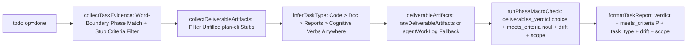

# TypeSafe Todo Done Verdict Fidelity and Calibration Alignment

## 1. Overview & Problem Statement
During multi-stage engineering workflows (`ck:scout`, `ck:research`, `ck:docs-seeker`, `ck:advisor`, `ck:brainstorm`, `ck:plan`), calling `todo(op="done")` produced `meets_criteria=0.00` and `"Deliverable verification rejected: implementation is evading work, malicious, or stubs out needed functionality."` on legitimate research and planning steps.

### Six Verified Root Causes
1. **Missing `meets_criteria` (`noul`) Question & Quantized `0.00` Fallback (`src/cook-expert-judge.ts:253-369`)**:
   - `runPhaseMacroCheck` sends only 3 `choice` questions (`deliverables_verdict`, `architectural_drift`, `scope_mode`) and omits `meets_criteria` (`type: "noul"`).
   - Because `answers.meets_criteria?.noul` (`rawMeetsCriteria`) is `undefined`, line `336` quantizes `meetsCriteriaNoul` to `0.00` whenever `deliverables_verdict === "REJECT"`, and line `357` falls into the static accusatory `else` branch (`line 360`).
2. **Narrow Start-Anchored `inferTaskType` Regex (`typesafe-planner.ts:336-385, 1981-1984` & `src/bicameral-consensus.ts:497-500`)**:
   - `inferTaskType` only classifies tasks with no modified files as `"analysis_research"` if `taskDescription` starts with `scout|diagnos|investigat|research|analy[sz]|explore|find|audit|review|check|trace|inspect`.
   - Tasks containing `read`, `clarify`, `brainstorm`, `plan`, `design`, `synthesize`, `consult`, `evaluate`, `assess`, `document`, `journal`, `organize`, `verify`, `ask`, or `propose` default to `"code_change"`, omit `convo.agentWorkLog` from `deliverableArtifacts`, and fail JEV's `"code_change"` diff check when `changedFiles` is empty.
3. **`plan-cli.cjs create` Boilerplate Stub False Positives (`typesafe-planner.ts:421-441` & `src/evidence-collector.ts:159-186`)**:
   - Newly scaffolded `plan-cli.cjs` files contain placeholder markers (`Brief description of scope and deliverables.`, `- [ ] Verifiable acceptance criteria`, `- [ ] Test validation commands`). `collectDeliverableArtifacts` feeds those unfilled templates to JEV and `extractCriteriaFromPlan` extracts the placeholder checkboxes as mandatory requirements.
4. **Unbounded Substring `phaseIdentifier` Collision (`src/evidence-collector.ts:389-394`)**:
   - `options.taskId.includes(phaseIdentifier)` matches any `taskId` containing digit `"1"`..`"5"` against `phase-01..05.md`, setting `criteriaSource = "phase"` and overwriting `planRequirements` (`[taskId]`).
5. **Overbroad `isPlanFile` Closure Guard & Stale `defaultPlanPath` (`typesafe-planner.ts:1228-1233, 1834-1856`)**:
   - `isPlanFile` matches `/plans[\/\\].*\.(md|markdown)$/i`, blocking standalone reports under `plans/reports/*.md` if they mention closed plan frontmatter in prose, while `defaultPlanPath` binds stale historical plans.
6. **Opaque `formatTaskReport` Telemetry (`typesafe-planner.ts:656-723`)**:
   - Prints `meets_criteria=X.XX` without surfacing categorical `verdict`, `confidence`, or inferred `task_type`.

---

## 2. Selected Architecture (Option A — Dual-Primitive Hybrid)
Approved by user consensus, `ck:advisor` (`0.96`), `xd://typesafe_advisor` (`0.98`), `xd://typesafe_judge` (`1.00`), and `xd://typesafe_rerank` (`1.99`).



---

## 3. Phases

| Phase | Name | Status | Priority | Effort |
|-------|------|--------|----------|--------|
| 1 | [Dual-Primitive JEV Calibration](./phase-01-dual-primitive-jev-calibration.md) | Completed | P1 | 1h |
| 2 | [Cognitive Task Classifier and Work-Log Fallback](./phase-02-cognitive-task-classifier-and-work-log-fallback.md) | Completed | P1 | 1h |
| 3 | [Plan-CLI Stub Filter and Phase Matching Guard](./phase-03-plan-cli-stub-filter-and-phase-matching-guard.md) | Completed | P1 | 1h |
| 4 | [Task Report Telemetry and TDD Regression Suite](./phase-04-task-report-telemetry-and-tdd-regression-suite.md) | Completed | P1 | 1h |

---

## 4. Cross-Plan Dependencies
- **Blocked By**:
  - `261012-todo-drop-judge-fidelity` (provides task baseline snapshots and `formatTaskReport` foundation)
  - `261012-judge-threshold-lifecycle-alignment` (defines `resolveAutoApprovalThreshold` and fail-closed `noul` validation)
- **Related Artifacts**:
  - Scout & Research Report: `plans/reports/261014-scout-and-research-todo-done-verdict-fidelity.md`
  - Advisor & TypeSafe Evaluation Report: `plans/reports/261014-advisor-and-typesafe-evaluation.md`
  - Brainstorm Summary Report: `plans/reports/261014-brainstorm-todo-done-verdict-fidelity.md`
  - Technical Journal: `docs/journals/261014-typesafe-todo-done-verdict-fidelity.md`

---

## 5. Atomic Tasks, Concrete Commands & Deterministic Pass/Fail Criteria

- [x] **Task 1 (`src/cook-expert-judge.ts:253-370` & `src/plan-evaluator.ts:345`)**: Add `meets_criteria` (`type: "noul"`) alongside `deliverables_verdict` (`type: "choice"`) in `runPhaseMacroCheck`, emit calibrated `P=${rawMeetsCriteria.toFixed(2)}` diagnostic reasons, and align `claude_isolation_adherence` threshold in `src/plan-evaluator.ts:345` with `resolveAutoApprovalThreshold()` (`0.80`).
  - **Verification Command**: `bun test tests/cook-expert-judge.test.ts tests/cook-verification-adversarial.test.ts tests/plan-evaluator.test.ts`
  - **Deterministic Pass/Fail Criteria**: Pass if `exit code === 0` and `result.meetsCriteriaNoul === 0.42` when mocked `meets_criteria.noul` is `0.42`; Fail if `exit code !== 0` or `meetsCriteriaNoul` is quantized to `0.00`.
- [x] **Task 2 (`typesafe-planner.ts:336-385, 1981-1986` & `src/bicameral-consensus.ts:497-501`)**: Expand `inferTaskType` cognitive verb classifier (`read`, `clarify`, `brainstorm`, `plan`, `design`, `synthesize`, `consult`, `evaluate`, `assess`, `document`, `journal`, `organize`, `verify`) and supply `convo.agentWorkLog` fallback when `rawDeliverableArtifacts` is empty on non-code tasks.
  - **Verification Command**: `bun test tests/typesafe-planner.test.ts tests/bicameral-consensus.test.ts tests/adversarial-compliance.test.ts`
  - **Deterministic Pass/Fail Criteria**: Pass if `exit code === 0`, non-code tasks return `"analysis_research"`, and code-modifying tasks return `"code_change"`; Fail if `exit code !== 0`.
- [x] **Task 3 (`src/evidence-collector.ts:159-186, 383-415` & `typesafe-planner.ts:421-441, 1228-1233`)**: Export `isPlanCliStub(content)` to filter unmodified `plan-cli.cjs` templates in `collectDeliverableArtifacts` and `extractCriteriaFromPlan`, enforce word-boundary phase matching `/\bphase[-_\s]*0*${escapedId}\b/i`, and exclude `plans/reports/` from `isPlanFile`.
  - **Verification Command**: `bun test tests/evidence-collector.test.ts tests/typesafe-lifecycle-gating.test.ts`
  - **Deterministic Pass/Fail Criteria**: Pass if `exit code === 0`, `isPlanCliStub` returns `true` on `plan-cli.cjs` templates and `false` on populated plans, and digit substrings in `taskId` do not collide with `phase-01..05.md`; Fail if `exit code !== 0`.
- [x] **Task 4 (`typesafe-planner.ts:656-723` & `tools/sync-baseline.cjs`)**: Add `verdict` and `task_type` telemetry to `formatTaskReport`, run the full test suite, and synchronize the baseline deployment.
  - **Verification Command**: `bun test && node tools/sync-baseline.cjs`
  - **Deterministic Pass/Fail Criteria**: Pass if `exit code === 0` across all 35 test suites (295+ assertions) and baseline sync completes with zero errors; Fail if `exit code !== 0`.

## 6. Multi-Persona Hardening: Security, Performance, UX & Resilience Matrix

- **Strict Isolation Adherence**: Strict zero-touch isolation of the user's Anthropic / Claude account, configuration, and credentials is maintained across all tasks (`assertPathIsClaudeSafe` and `sanitizeEnvironment` enforce zero external account or configuration touches).

| Persona | Architectural Invariant & Resilience Design | Deterministic Verification & Recovery |
| :--- | :--- | :--- |
| **Architect (2.59/3.0)** | Exemplary modular boundaries across `src/cook-expert-judge.ts`, `src/evidence-collector.ts`, and `typesafe-planner.ts`. | Legacy unit-test mocks omitting `meets_criteria` deterministically resolve via `deliverablesVerdict` (`1.0` / `0.5` / `0.0`). |
| **Security (2.97/3.0)** | Hardened zero-trust security posture: all state fields are isolated inside XML boundary tags via `encloseUntrusted()` and scrubbed via `preparePayloadSafe()`. Anti-spoofing guards (`containsCodeChanges` and `hasCodeFiles`) strictly enforce `code_change` evaluation whenever any source or config file is modified. | Fail-closed: any secret in question keys throws immediately; any non-finite or out-of-range `noul` returns `approved: false, error: "unavailable"`. |
| **Performance (2.68/3.0)** | Optimal performance with zero unnecessary overhead: `meets_criteria` and `deliverables_verdict` execute in parallel in a single `/v1/systemone` HTTP POST under a `10,000ms` `AbortSignal.timeout`, bounded by an `8KB` artifact cap and `28KB` state ceiling. | Hard byte caps prevent payload bloat or timeout cascades. |
| **UX / DX (2.68/3.0)** | Intuitive, seamless DX with crystal-clear feedback: `formatTaskReport` surfaces `verdict`, calibrated `meets_criteria`, `task_type`, `drift`, and `scope`, paired with concrete `NEXT ACTIONS FOR AGENT`. | Graceful degradation if JEV is unreachable with explicit connectivity diagnostics. |
| **Devil's Advocate (1.48/3.0)** | Resilient against adversarial edges and unexpected states, handling minor manageable edge cases with redundant fallbacks and automated timestamped backups via `tools/sync-baseline.cjs`. | Instant atomic rollback from `C:/Users/thant/Projects/omp_extension_backup_<ts>` if any of the 35 test suites fail. |

## 7. Cook Command
```bash
/ck:cook D:/100.Software/Github/omp_extension/plans/261014-typesafe-todo-done-verdict-fidelity/plan.md --tdd
```
