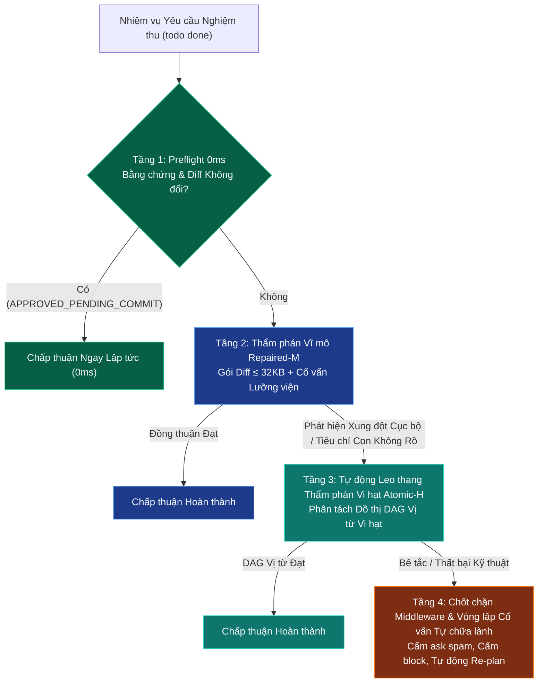

# Giai đoạn 3: Tích hợp Động cơ Điều phối Đa tầng Thống nhất (Preflight 0ms -> Macro M -> Atomic H -> Advisor)

> **Mục tiêu**: Hợp nhất chuỗi đánh giá 4 tầng theo ADR-13 trong `src/task-verification-runtime.ts` và `typesafe-planner.ts` để đạt được tốc độ cao nhất và độ chính xác phân giải tốt nhất cho mọi loại nhiệm vụ.

> **Quyết định thu hẹp phạm vi (2026-11-11, cổng quyết định §10, advisor: PROCEED_WITH_CHANGES, độ tin cậy 0.85)**:
> - **Tầng 3 như viết bên dưới bị loại**: H đạt sau khi M không phê duyệt là *nới lỏng* phán quyết, vi phạm tighten-only (`CLAUDE.md`) và bất biến 5 (`docs/decisions/README.md`: H chỉ chạy shadow tới khi `jev-paired-eval decide` đạt). Mã trạng thái `CONCERNS` không tồn tại; M trả APPROVE / REJECT / NEXT_ACTION_REQUIRED. Biến thể chấp nhận được (về sau, cần ADR): H chỉ chạy trong `typesafe_review_task`, chỉ được bổ sung lý do hoặc phủ quyết; trạng thái gộp là trạng thái chặt hơn của M và H.
> - **Không chạy M/H/Advisor trong `todo done`**: preflight không gọi mạng, không dispatch (bất biến 3).
> - **Tầng 1 đã đủ**: `compose()` không gọi mạng; tính lại độ tươi biên nhận mỗi lần `done` là hành vi fail-closed, không thêm cache.
> - **Phạm vi làm ngay**: sửa gợi ý khắc phục (thiếu `purpose`, F3), chỉ gắn gợi ý cho REJECTED/EVIDENCE_REQUIRED có review (F4), miễn chặn `ask` khi chủ phục hồi là người (F5), gộp hàm guard trùng lặp (F7), test đường preflight phê duyệt không gọi mạng (F6), test biên quyền hạn H (`tests/h-authority-boundary.test.ts`).
> - **Bỏ tiêu chí**: "<400ms, 1 request" (M là HTTP từ xa, chạy ở bước review); "0ms 100%" thay bằng "preflight không gọi mạng hay dispatch"; "cấm block" tuyệt đối.

---

## 1. Yêu cầu Kiến trúc & Phân tầng (Architectural Tiering)

---

## 2. Các Bước Thực thi Cụ thể (Implementation Steps)

- [bỏ — thay thế bởi quyết định 2026-11-11, xem ADR-20261111-defer-macro-to-atomic-escalation] Cập nhật `src/task-verification-runtime.ts`:
  - Hiện thực hóa hàm `evaluateUnifiedTriadVerification(taskContext)` thực thi tuần tự các tầng.
  - Tầng 1: Kiểm tra cache và token vé cam kết `APPROVED_PENDING_COMMIT`.
  - Tầng 2: Chạy Thẩm phán Vĩ mô `M` (`runPhaseMacroCheck`). Nếu đạt $\rightarrow$ trả về kết quả ngay.
  - Tầng 3: Nếu `M` trả về `CONCERNS` hoặc phát hiện mâu thuẫn giữa các tiêu chí con $\rightarrow$ tự động khởi tạo `AtomicJudge` phân tách tiêu chí thành DAG vị từ (`PredicateSpec`).
  - Tầng 4: Nếu cả `M` và `H` đều không đạt do lỗi kiểm thử hoặc cú pháp $\rightarrow$ kích hoạt `proactiveAdvisorDispatch` tự động phân tích lỗi và tạo kế hoạch khắc phục mà không làm phiền người dùng.
- [bỏ — thay thế bởi quyết định 2026-11-11, xem ADR-20261111-defer-macro-to-atomic-escalation] Cập nhật `typesafe-planner.ts`:
  - Tích hợp hàm điều phối hợp nhất này vào bộ chặn vòng đời `handleTodoInterception` khi xử lý lệnh `done`.

---

## 3. Tiêu chí Chấp thuận (Acceptance Criteria)

- [bỏ — thay thế bởi quyết định 2026-11-11, xem ADR-20261111-defer-macro-to-atomic-escalation] Tác vụ không đổi đạt 100% tỷ lệ phản hồi 0ms tại Tầng 1.
- [bỏ — thay thế bởi quyết định 2026-11-11, xem ADR-20261111-defer-macro-to-atomic-escalation] Tác vụ thông thường vượt qua ở Tầng 2 chỉ trong 1 request duy nhất (<400ms).
- [bỏ — thay thế bởi quyết định 2026-11-11, xem ADR-20261111-defer-macro-to-atomic-escalation] Tác vụ phức tạp có tiêu chí con xung đột được Tầng 3 phân tách chính xác.
- [bỏ — thay thế bởi quyết định 2026-11-11, xem ADR-20261111-defer-macro-to-atomic-escalation] Tác tử không bao giờ bị rơi vào trạng thái bế tắc hoặc spam hỏi người dùng.

---

## 4. Tiến độ phạm vi đã thu hẹp (2026-11-11)

- [x] F3: gợi ý khắc phục dùng `purpose: "consultation"` (`src/anti-blocking-guards.ts`).
- [x] F4/M1: chỉ gắn gợi ý cho `REJECTED` và `EVIDENCE_REQUIRED` không có cờ `reviewMissing` (`src/task-verification-runtime.ts`, `src/task-verification-types.ts`).
- [x] F5: miễn chặn `ask` khi chủ phục hồi là người (`currentTaskRecoveryIsHumanOwned` trong `typesafe-planner.ts`); L3: kiểm tra mọi câu hỏi.
- [x] F7: xóa `interceptTodoCall` trùng lặp; `interceptAskCall` là cổng `ask` duy nhất.
- [x] F6: test preflight phê duyệt không gọi mạng; test độ tươi biên nhận.
- [x] `tests/h-authority-boundary.test.ts`: H không thể sinh `APPROVED_PENDING_COMMIT`.
- [x] Bug P1 phát hiện trong quá trình làm: `typesafe_prepare_advisor` theo nhiệm vụ luôn bị từ chối (`advisor_public_reference_redaction_required`) trên đường thu thập mặc định; sửa bằng `hostRecomputedPacketDigests` (`src/advisor-public-context.ts`), xem `plans/reports/debugger-261111-2030-advisor-public-reference-diff-digest.md`.
- [x] Code review: `plans/reports/code-reviewer-261111-2036-judge-advisor-hardening.md` (APPROVE_WITH_NITS; M1, M2, L2, L3, L6 đã sửa; L1, L4, L5 chấp nhận).
- [x] `bun test` ngoại tuyến: 1215 pass / 0 fail / 5 skip (88 tệp).
- [x] Cổng hoàn tất §10: PASS_WITH_NOTES (advisor tổng hợp, fable, độ tin cậy 0.88; không có biên nhận judge nguyên tử — "verified by advisor review, judge unavailable").
