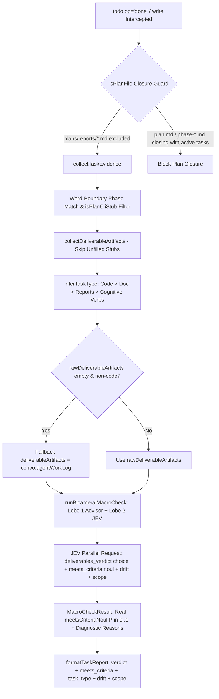

# Brainstorm Summary Report: TypeSafe `todo done` Verdict Fidelity & Calibration Architecture

## 1. Problem Statement & Root Causes
When executing `todo(op="done")` during multi-stage workflows (`ck:scout`, `ck:research`, `ck:brainstorm`, `ck:plan`), `typesafe-task-report` frequently displayed `meets_criteria=0.00` and `"Deliverable verification rejected: implementation is evading work, malicious, or stubs out needed functionality."`, while `ask` and `todo` hooks operated silently without exposing categorical verdicts or task types.

Through codebase scouting (`ck:scout`), official documentation verification (`ck:docs-seeker` on `docs.typesafe.ai`), research (`ck:research`), and Bicameral Advisor / System One consultation (`ck:advisor` + `xd://typesafe_*`), we established **six exact root causes**:

| # | Location | Root Cause | Impact |
| :- | :--- | :--- | :--- |
| **1** | `src/cook-expert-judge.ts:253-369` | `runPhaseMacroCheck` sends only 3 `choice` questions (`deliverables_verdict`, `architectural_drift`, `scope_mode`) and omits `meets_criteria` (`type: "noul"`). `rawMeetsCriteria` is `undefined`, forcing `meetsCriteriaNoul = 0.0` on `REJECT` and falling into the static accusatory `else` message (`line 360`). | Every `REJECT` displays `meets_criteria=0.00` and accuses the agent of malicious/evasive behavior. |
| **2** | `typesafe-planner.ts:336-385, 1981-1984` & `src/bicameral-consensus.ts:497-500` | `inferTaskType` regex is anchored to string start (`^\s*`) and omits common cognitive/workflow verbs (`read`, `clarify`, `brainstorm`, `plan`, `design`, `synthesize`, `consult`, `evaluate`, `assess`, `document`, `journal`, `organize`, `verify`, `ask`, `propose`). Non-code tasks with zero changed files default to `"code_change"` and omit `convo.agentWorkLog` from `deliverableArtifacts`. | JEV evaluates empty `unified_diff` under the `"code_change"` rubric and returns `REJECT`. |
| **3** | `typesafe-planner.ts:421-441` & `src/evidence-collector.ts:159-186` | `plan-cli.cjs create` scaffolds `plan.md` (`TBD.`) and `phase-XX-*.md` stubs (`Brief description of scope and deliverables.`, `- [ ] Verifiable acceptance criteria`). Calling `todo(op="done")` before populating the stubs sends `TBD.` to JEV and extracts placeholder checkboxes as mandatory requirements. | JEV sees `TBD.` in `deliverable_artifacts` and rejects for stubbed functionality (`scope=EXPANSION`). |
| **4** | `src/evidence-collector.ts:389-394` | `options.taskId.includes(phaseIdentifier)` matches any `taskId` containing digit `"1"`..`"5"` against `phase-01..05.md`, setting `criteriaSource = "phase"` and overwriting `planRequirements` (`[taskId]`). | Unrelated tasks inherit phase criteria from `phase-01..05.md`. |
| **5** | `typesafe-planner.ts:1228-1233, 1834-1856` | `isPlanFile` matches `/plans[\/\\].*\.(md|markdown)$/i` and `isClosingPlan` unanchored regex matches any prose mentioning the closed status keyword inside `plans/reports/*.md`, while `defaultPlanPath` binds stale historical plans (`plans/261012-todo-drop-judge-fidelity/plan.md`). | Writing reports under `plans/reports/` triggers false Plan Closure errors; tasks inherit stale plan context. |
| **6** | `typesafe-planner.ts:656-723` | `formatTaskReport` prints `meets_criteria=X.XX` without showing `verdict` (`APPROVE`/`REJECT`/`NEXT_ACTION_REQUIRED`), `confidence`, or inferred `task_type`. | Users cannot distinguish categorical JEV verdicts from `noul` probabilities or task classification. |

---

## 2. Evaluated Approaches & Trade-Off Analysis

### Option A: Dual-Primitive Hybrid + Context-Aware Task Classifier + Plan-CLI Stub Filter (Selected)
- **Design**:
  1. Add `meets_criteria` (`type: "noul"`) to `runPhaseMacroCheck` alongside `deliverables_verdict` (`type: "choice"`), `architectural_drift` (`type: "choice"`), and `scope_mode` (`type: "choice"`).
  2. Preserve full backward compatibility with all 16 existing mock tests in `tests/` (11 mocking `meets_criteria` only, 3 mocking `deliverables_verdict` only, 2 mocking both) via `const meetsCriteriaNoul = rawMeetsCriteria ?? (deliverablesVerdict === "APPROVE" ? (answers.deliverables_verdict?.confidence ?? 1.0) : deliverablesVerdict === "NEXT_ACTION_REQUIRED" ? (answers.deliverables_verdict?.confidence ?? 0.5) : 0.0)`.
  3. Emit task-type-aware diagnostic rejection reasons that include `P=${rawMeetsCriteria.toFixed(2)}` and retain the substring `"rejected"` (required by `tests/cook-expert-judge.test.ts:590` and `tests/cook-verification-adversarial.test.ts:243`).
  4. Broaden `inferTaskType` (and `evaluateAdvisorIntent` Lobe 1) to recognize cognitive/planning verbs anywhere in `taskDescription` when no code files are modified, while preserving the anti-spoofing override (`containsCodeChanges` in `src/cook-expert-judge.ts:194-201`) whenever code/config files are modified. Always fall back to `convo.agentWorkLog` in `deliverableArtifacts` when `rawDeliverableArtifacts` is empty and no code files changed.
  5. Add `isPlanCliStub(content)` in `typesafe-planner.ts` and `src/evidence-collector.ts` to filter unmodified `plan-cli.cjs` boilerplate stubs (`Brief description of scope and deliverables.`, `- [ ] Verifiable acceptance criteria`, `TBD.`) from `collectDeliverableArtifacts` and `extractCriteriaFromPlan`.
  6. Replace `options.taskId.includes(phaseIdentifier)` with word-boundary matching (`/\bphase[-_\s]*0*${escapedId}\b/i`), exclude `plans/reports/` from `isPlanFile` closure guard, and enrich `formatTaskReport` with `verdict` and `task_type`.
- **Pros**: Solves all 6 root causes; aligns with official TypeSafe multi-question batching docs; zero regressions across 295+ existing tests; maintains YAGNI/KISS/DRY.
- **Cons**: Adds 1 `noul` question to the existing 3-question `runPhaseMacroCheck` payload (~25 extra tokens, evaluated in parallel by System One).

### Option B: Pure Categorical Verdict Only (Rejected)
- **Design**: Remove `meetsCriteriaNoul` from `MacroCheckResult` and `formatTaskReport`, displaying only `deliverables_verdict`.
- **Pros**: Slightly fewer fields in `TaskReport`.
- **Cons**: Breaks 13 existing unit tests in `tests/cook-expert-judge.test.ts`, `tests/cook-verification-adversarial.test.ts`, and `tests/todo-remediation-feedback.test.ts`; sacrifices continuous calibrated probability telemetry; leaves `inferTaskType` and `plan-cli.cjs` stub bugs unaddressed.

### Option C: Bypass Gate 2 JEV for Non-Code Tasks (Rejected)
- **Design**: Skip `runPhaseMacroCheck` when `changedFiles` contains no code files.
- **Pros**: Avoids JEV network call on research tasks.
- **Cons**: Violates the core dual-gate architecture (`typesafe-planner.ts:1979`), breaks `tests/e2e-workflow.test.ts:59` and `tests/judge-input-fidelity.test.ts:275`, and allows agents to mark tasks done with empty work logs without semantic verification.

---

## 3. Consensus & Architecture Diagram

Both the user (`ask` confirmation), `ck:advisor` (`0.96`), `xd://typesafe_advisor` (`0.98`), `xd://typesafe_judge` (`confidence: 1.00`), and `xd://typesafe_rerank` (`1.99`) selected **Option A**.

---

## 4. Implementation Considerations & Risks
- **Anti-Spoofing Invariant**: `containsCodeChanges` in `src/cook-expert-judge.ts:194-201` must remain untouched so an agent cannot rename a code-modification task `"Brainstorm auth"` to evade code-diff scrutiny.
- **Backward Compatibility with Unit Test Mocks**: Existing test mocks in `tests/cook-expert-judge.test.ts` return either `meets_criteria` alone or `deliverables_verdict` alone. The dual-primitive parser in `runPhaseMacroCheck` must support both seamlessly.
- **Golden Invariant**: All edits must occur in `D:/100.Software/Github/omp_extension` and deploy via `node tools/sync-baseline.cjs`; never edit `C:/Users/thant/.omp/agent/extensions/typesafe-planner.ts` directly.

---

## 5. Success Metrics & Validation Criteria
1. `runPhaseMacroCheck` sends `meets_criteria` (`type: "noul"`) alongside `deliverables_verdict` (`type: "choice"`) and surfaces the real calibrated $P \in [0, 1]$ instead of hardcoded `0.00`.
2. Cognitive/workflow tasks (`Read...`, `Clarify...`, `Brainstorm...`, `Plan...`, `Synthesize...`, `Document...`, `Organize...`) with no modified code files classify as `"analysis_research"` and supply `agentWorkLog` when file artifacts are absent.
3. Newly scaffolded `plan-cli.cjs create` stubs (`TBD.`, `Brief description of scope and deliverables.`) are detected by `isPlanCliStub` and excluded from deliverable artifacts and active phase criteria until populated.
4. `src/evidence-collector.ts` matches phase IDs using word boundaries (`/\bphase[-_\s]*0*${id}\b/i`) and `isPlanFile` in `typesafe-planner.ts` excludes `plans/reports/*.md`.
5. `bun test` passes 100% across all test suites.

## 6. Next Steps
- Proceed to `/ck:plan` (`plans/261014-typesafe-todo-done-verdict-fidelity/plan.md` + 4 TDD phases), validate via `xd://typesafe_elevate_plan`, record technical journal (`ck:journal`), and update project organization index (`ck:project-organization`).
